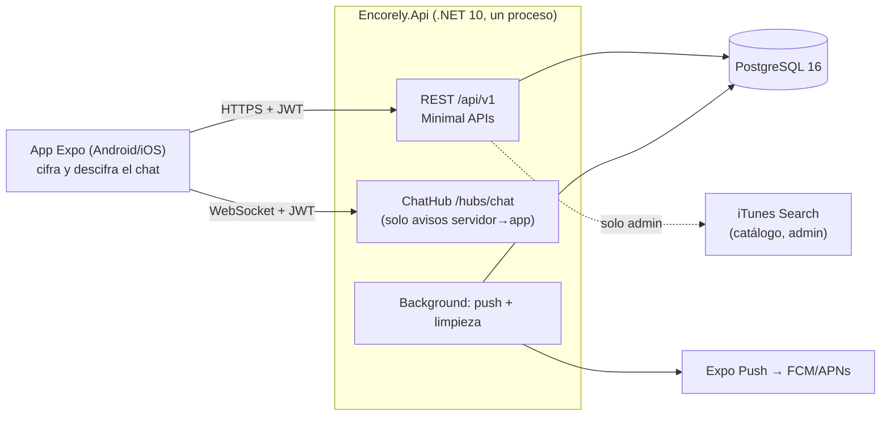
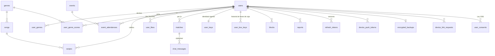

# Arquitectura · Encorely API

Documento vivo de la reconstrucción `rebuild/v1` (octubre 2026). Las decisiones de alcance vienen de
`reportes/06-decisiones-y-alcance-v1.md` y del reporte completo; aquí se explica **cómo** quedó construido y **por qué**.

## 1. Vista general



Un **monolito modular**: un proyecto `Encorely.Api` con una carpeta por feature y un proyecto de tests. Se descartaron
Kafka, Redis y el Worker del legado (D3): Postgres resuelve el volumen de una app de este tamaño, y cada pieza extra era
superficie de fallo para un equipo de 3 sin beneficio medible.

| Feature | Responsabilidad |
|---|---|
| `Auth` | Registro, login, refresh con rotación, logout |
| `Users` | Perfil, borrado de cuenta, consentimientos, exportación de datos |
| `Legal` | Versión vigente de términos, páginas públicas, borrado web |
| `Music` | Géneros, feed de canciones, swipes, ADN musical, importación de Spotify |
| `Events` | Eventos curados, asistencia, radar por evento |
| `Matching` | Likes entre personas, match recíproco, unmatch |
| `Chat` | Directorio de llaves públicas, mensajes cifrados, ack |
| `Moderation` | Bloqueos, reportes con franking |
| `Devices` | Tokens push |
| `Sync` | Respaldo cifrado, vinculación de dispositivos |
| `Sessions` | Sesiones abiertas (familias de refresh tokens) |
| `Admin` | Eventos, canciones, reportes, suspensión de cuentas |

Cada feature tiene `*Endpoints.cs` (rutas y metadatos OpenAPI), `*Contracts.cs` (DTOs del contrato), `*Service.cs`
(reglas) y sus entidades. La infraestructura transversal vive en `Infrastructure/`.

## 2. Pipeline de una request

```
[ForwardedHeaders: solo si FORWARDED_TRUSTED_NETWORKS] → ExceptionHandler → StatusCodePages → SecurityHeaders → log de acceso (sin query) → CORS
→ Authentication (JWT) → ActiveUserCheck → Authorization (fallback: autenticado) → RateLimiter
→ Validación (DataAnnotations, .NET 10) → handler → servicio → EF Core / Dapper
```

- **Identidad solo desde el JWT.** `ClaimsPrincipal.UserId()` lee el claim `sub`; ningún contrato acepta un `userId` para
  decidir quién eres. Era la raíz del IDOR sistémico del legado (GEN-01).
- **Cuenta viva en cada request.** `ActiveUserCheck` comprueba que el usuario del token exista y no esté suspendido: borrar
  la cuenta o suspenderla corta el acceso al instante, sin esperar a que venza el token (15 min).
- **Autorización por recurso.** Un recurso ajeno responde **404**, no 403, para no confirmar que existe.
- **Errores.** Todo error es `application/problem+json` con `title` en español, `code` estable para ramificar en el
  cliente, `traceId` y, en validación, `errors` por campo (camelCase). JSON mal formado, enums desconocidos y campos
  faltantes dan 400; ninguna entrada inválida llega a 500.
- **Configuración.** Opciones tipadas validadas al arrancar; sin secretos por defecto (GEN-04).

## 3. Modelo de datos



Reglas que la BD garantiza (no solo el código):

- `users.email` único y siempre normalizado (trim + minúsculas) → sin cuentas duplicadas por mayúsculas.
- `swipes (user_id, song_id)` es PK → repetir una canción no suma.
- `matches`: `CHECK (user_a_id < user_b_id)` y un índice único **parcial** sobre el par cuando `status = 'Active'`: un solo
  match activo por par, con historial de matches cerrados.
- `chat_messages (match_id, seq)` único; `id` lo genera el cliente (idempotencia).
- `banned_emails` (hash SHA-256 del correo): suspender una cuenta veta su correo para registrarse aunque la borre; reactivar
  lo levanta. `message_franking_records`: copia del compromiso de franking, con vida propia (el ack y la retención borran
  el mensaje, no el compromiso; vence a los 180 días) para que un reporte pueda verificarse después.
- Operaciones sin fila natural que bloquear se serializan por usuario con advisory locks de transacción
  (`Infrastructure/Database/AdvisoryLock.cs`): `keys`, `profile`, `dna-import` y `account-state` (compartido en likes,
  exclusivo al suspender, para que un ban concurrente no deje un match activo).
- `user_artists` guarda el top importado de Spotify (se reemplaza en cada importación), con `key` = nombre normalizado
  para cruzar perfiles. `profile_reactions` (PK de, para, tipo de objetivo, key) guarda una reacción por objetivo y par;
  bloquear borra las del par y suspender las de la cuenta. Un perfil ajeno lo ve cualquier usuario autenticado si la persona
  aceptó la versión de consentimiento con esa finalidad (`ProfileService.PublicProfileConsentSince`) y tiene
  `show_profile_to_others` encendido; con bloqueo en cualquier sentido, no (`ProfileService.CanViewAsync`).
- El bloqueo por intentos no vive en la BD: `LoginThrottle` cuenta en memoria por par (correo, IP). Login, borrado web y
  `DELETE /me` con contraseña pasan por la misma puerta de `AuthService`.
- El access token lleva `sid` (familia del refresh): los push tokens se ligan a esa sesión y se borran al cerrarla. Cada
  request autenticada comprueba en la misma consulta del estado de la cuenta que esa sesión siga abierta, así que cerrarla
  (`SessionRevoker`: logout, `/me/sessions`, reuso de refresh, ban) corta el access token y el hub en el acto.
- Borrar un usuario borra en cascada swipes, likes, matches, mensajes, llaves, sesiones y respaldos. Los reportes quedan
  con la referencia en `NULL`: son evidencia de moderación.
- Enums guardados como texto (legibles y sin CHECKs numéricos que den 500).
- Esquema versionado con migraciones de EF Core desde el día 0 (GEN-09); los tests aplican todas las migraciones sobre
  un Postgres real.

## 4. Dominio

### 4.1 ADN musical

Vector de pesos por género (`Features/Music/Dna.cs`, fórmula única para todo el sistema):

```
peso(g) = max(0, likes(g)·1 − dislikes(g)·0,5 + importado_spotify(g) + 2·[g declarado en el perfil])
afinidad(a, b) = round(100 · coseno(peso_a, peso_b))
```

- Cada swipe actualiza el contador del género con un upsert atómico en la misma transacción del swipe (sin lost update).
- Con 15 géneros y pesos que dependen de los swipes, el coseno sí discrimina; en el legado, 3 rasgos no negativos daban
  ≥ 0,95 en casi todos los pares (GEN-05).
- Los géneros declarados dan señal desde el onboarding; la importación de Spotify (top artistas leídos en el dispositivo
  con PKCE) reemplaza su aporte anterior en vez de sumarlo. El token de Spotify nunca llega al servidor.

### 4.2 Radar por evento

Única consulta con Dapper (D4): una CTE calcula el vector de cada asistente y el coseno contra el mío en SQL, con las
constantes de `Dna` como parámetros. Requisitos: ir al evento, haber calificado al menos `RADAR_MIN_SWIPES` canciones
(el umbral lo sirve `/me/dna`; el front no lo duplica). Muestra a quien alcance `RADAR_MIN_AFFINITY` (≥) y a quien
no tenga datos para calcularla (`affinity: null`: sin señal propia o sin ningún género con peso positivo). Excluye
bloqueos en ambas direcciones y cuentas suspendidas, igual que `attendeeCount`. Devuelve hasta 200 asistentes; si había
más, añade `X-Radar-Truncated: true`.

### 4.3 Match recíproco

```mermaid
sequenceDiagram
    participant A as App de Ana
    participant API
    participant DB as Postgres
    participant B as App de Beto
    A->>API: POST /likes {targetUserId: Beto}
    API->>DB: ¿comparten un evento? ¿hay bloqueo?
    API->>DB: BEGIN; pg_advisory_xact_lock(hash(par))
    API->>DB: INSERT like Ana→Beto (idempotente)
    API->>DB: ¿existe like Beto→Ana?
    alt no existe
        API-->>A: {matched: false}
    else existe
        API->>DB: INSERT match (a<b, Active); COMMIT
        API-->>A: {matched: true, matchId}
        API-)B: MatchCreated (hub) + push sin contenido
    end
```

- Solo se puede dar like a alguien con quien se comparte un evento: el contacto nace del contexto, no de un catálogo.
- El advisory lock por par serializa likes cruzados, unmatch y bloqueo: dos likes simultáneos crean exactamente un match
  (hay test con 20 rondas concurrentes), y un bloqueo concurrente no puede resucitar un match.
- Unmatch y bloqueo cierran el match y borran los likes del par; volver a hacer match exige dos likes nuevos.
- Suspender una cuenta cierra sus matches y borra todos sus likes (dados y recibidos). Reactivarla no restaura matches:
  rehacer cualquiera exige otra vez dos likes nuevos.

## 5. Chat cifrado de extremo a extremo

### 5.1 Diseño

El cliente cifra; **el servidor solo guarda y entrega ciphertext**. Librerías en la app: `@noble/curves` (X25519, Ed25519)
y `@noble/ciphers` (XChaCha20-Poly1305), JS puro y auditadas, sin dev build.

| Pieza | Especificación |
|---|---|
| Identidad | Ed25519 por usuario; la privada solo en SecureStore (`WHEN_UNLOCKED_THIS_DEVICE_ONLY`) |
| Llave de caja | X25519, con `boxKeyId` estrictamente creciente y firmada por la identidad: firma de `"ENCORELY-BOXKEY-v1" ‖ u32be(boxKeyId) ‖ boxKey`. La firma la verifica el cliente |
| Secreto por par | `HKDF-SHA256(X25519(mi_privada, pública_del_otro), salt = matchId, info = "ENCORELY-CHAT-v1")` |
| Cifrado | XChaCha20-Poly1305, nonce aleatorio de 24 B por mensaje |
| AAD | `"ENCORELY-MSG-v1" ‖ version ‖ id ‖ matchId ‖ senderId ‖ senderBoxKeyId ‖ recipientBoxKeyId`: el servidor no puede mover un mensaje a otro chat ni cambiar su remitente sin que falle el descifrado |
| Código de seguridad | 60 dígitos derivados de SHA-256 de ambas llaves de identidad ordenadas por userId, para comparar en persona |

### 5.2 Qué ve y qué hace el servidor

- Guarda por mensaje: `id`, `match_id`, `sender_id`, `seq`, versión, ids de llaves, `nonce`, `ciphertext`, `franking_tag`
  opcional y fecha. **Nunca texto plano ni llaves privadas.** Un test canario cifra un texto conocido, lo envía y recorre
  todas las tablas y todas las líneas de log buscándolo (en claro, base64 y hex).
- Solo los dos miembros de un match activo escriben; leer el historial se permite también con el match cerrado. Un
  tercero recibe 404 en todo.
- `seq` por match se asigna con `UPDATE … RETURNING` en la misma transacción del insert: orden total sin huecos aunque
  lleguen 20 envíos a la vez. Reenviar el mismo `id` con el mismo contenido es idempotente (200).
- Si la llave de caja del destinatario cambió, el envío responde 409 `stale_recipient_key` y el cliente re-cifra.
- `ChatHub` es autenticado y **no tiene métodos invocables**: solo avisa `MessageAvailable`, `PeerKeyChanged`,
  `MatchClosed` y `MatchCreated`. La fuente de verdad siempre es el REST. El token del hub viaja en `?access_token=`
  únicamente en `/hubs/*`, y el log de acceso propio nunca registra query strings (el log de hosting de ASP.NET está en
  Warning por la misma razón).
- Push: sin contenido ("Tienes mensajes nuevos"), sin nombre del remitente; solo tipo y `matchId`. Se envía desde una
  cola en segundo plano para no frenar la request.

### 5.3 Modelo de amenazas

| Amenaza | ¿Protege? | Por qué |
|---|---|---|
| Servidor curioso (operador, admin de BD) | **Sí, el contenido** | Solo hay ciphertext. Sí ve quién habla con quién, cuándo y el tamaño aproximado |
| Dump de la BD | **Sí** | Sin las llaves privadas el ciphertext no sirve |
| Dump de la BD y después robo de una llave privada | **No** (v1) | Sin forward secrecy, esa llave descifra lo capturado. Ver 5.5 |
| Servidor malicioso que sustituye una llave pública | **Parcial** | Se detecta comparando el código de seguridad y con el aviso `PeerKeyChanged`; el primer contacto sin verificar queda expuesto (TOFU) |
| MITM de red | **Sí** | TLS + E2EE |
| Robo de contraseña | **Parcial** | El atacante puede publicar una llave nueva: el contacto recibe `PeerKeyChanged`. Las sesiones se pueden cerrar desde `/me/sessions` |
| Teléfono robado y bloqueado | **Sí** | Keychain/Keystore solo con el equipo desbloqueado |
| Teléfono desbloqueado o con malware | **No** | Ningún E2EE protege un dispositivo comprometido |
| Acoso o spam | **Parcial** | Chat solo con match mutuo, bloquear y reportar con franking; las capturas de pantalla no se pueden impedir |
| Notificaciones push | **Sí** | No llevan contenido |

### 5.4 Límites declarados (se dicen en la app y aquí)

- **Sin forward secrecy en la v1.** Quien robe la llave privada puede descifrar lo que haya capturado.
- **Un dispositivo por defecto.** Si se reinstala la app sin respaldo ni vinculación, se genera una identidad nueva y los
  mensajes anteriores ya no se pueden leer.
- **Verificación manual** del código de seguridad.
- El producto dice "cifrado de extremo a extremo" y **nunca** "como Signal".

### 5.5 Lo que ya soporta el servidor más allá de la v1

| Capacidad | Soporte en el servidor |
|---|---|
| Aviso de cambio de llave | Evento `PeerKeyChanged` a todos los matches activos en cada publicación de llaves |
| Forward secrecy gruesa | Rotación de llave de caja (`PUT /keys/me` con `boxKeyId` mayor) e historial público por id (`/peer-keys/box/{id}`). Diseño recomendado en el cliente: cadena hacia adelante `chain_{n+1} = HKDF(chain_n)`, `box_priv_n = HKDF(chain_n, "ENCORELY-BOXKEY-v1")`, rotación cada 7 días y borrado de `chain_n` → lo pasado no se recupera aunque roben el teléfono después |
| Franking (reportes verificables) | `frankingTag = HMAC-SHA256(fk, "ENCORELY-FRANK-v1" ‖ id ‖ p)`, con `fk` dentro del ciphertext. Al reportar, quien reporta revela `p` y `fk`; el servidor verifica el HMAC en tiempo constante y que `p` declare el mismo id, match, remitente (el reportado) y destinatario (quien reporta) |
| Borrado tras la entrega | `POST /matches/{id}/messages/ack {upToSeq}` borra del servidor lo recibido hasta ese seq (para cuando el historial viva cifrado en el teléfono) |
| Respaldo cifrado | `/me/backup`: blob opaco cifrado con una llave derivada de una passphrase (argon2id recomendado) |
| Multi-dispositivo | `/keys/link-requests`: buzón de un solo uso (10 min) donde el dispositivo viejo deja el material de llaves cifrado hacia la llave efímera del nuevo, que se compara por QR. Los dispositivos vinculados comparten identidad; con la cadena de 5.5 rotan sin coordinarse |

## 6. Seguridad (base: OWASP ASVS 4.0 nivel 1)

| Control | Implementación |
|---|---|
| Contraseñas | BCrypt (factor 12), 12 a 72 bytes; se rechaza en vez de truncar |
| Enumeración | Verificación contra un hash ficticio si el email no existe (mismo tiempo y mismo 401) |
| Fuerza bruta | Rate limit por IP en registro/login/borrado web y bloqueo temporal del par (correo, IP) tras 5 fallos. El 429 se decide antes del hash y también para correos inexistentes: no delata cuentas ni confirma contraseñas |
| Sesiones | Access JWT de 15 min (HS256, issuer/audience validados); refresh opaco de 256 bits guardado como SHA-256, rotación en cada uso y revocación de la familia completa si se reutiliza uno viejo |
| Suspensión | Rol admin confirmado en la BD en cada request de `/admin`; suspender cierra matches, revoca sesiones y corta el JWT vigente |
| Cabeceras | `nosniff`, `X-Frame-Options: DENY`, `Referrer-Policy: no-referrer`, CSP `default-src 'none'` en la API; las páginas HTML llevan CSP con hashes, sin `unsafe-inline`; HSTS fuera de Development |
| Superficie | Swagger solo en Development; `/health/live` y `/health/ready` sin detalles; sin cadenas de conexión ni stack traces en las respuestas |
| Logs | Sin query strings, cuerpos, tokens ni contenido de mensajes |
| Datos personales (Ley 1581) | Consentimiento versionado con fecha, exportación (`/me/export`), borrado en la app y en la web (`/cuenta/eliminar`), mayoría de edad 18+ |

Riesgos residuales aceptados:

- El bloqueo por intentos es por (correo, IP), no por cuenta: así nadie deja a otra persona sin login ni borrado web
  conociendo solo su correo. A cambio, un ataque distribuido desde muchas IP contra una cuenta no se bloquea; lo frenan
  el rate limit por IP, bcrypt (factor 12) y el mínimo de 12 caracteres. El contador vive en memoria (una instancia):
  un reinicio lo pone en cero.

- El registro responde 409 si el email ya existe (no hay verificación por correo en la v1, así que no hay forma de
  ocultarlo sin romper la experiencia). Está limitado por el rate limit.
- Una cuenta suspendida recibe 403 `account_banned` solo cuando la contraseña es correcta (con una incorrecta, el 401 de
  siempre). Eso confirma la contraseña de una cuenta que ya no se puede usar; a cambio, la persona sabe por qué no entra.
- Una cuenta suspendida puede borrarse (derecho de supresión, Ley 1581), pero el hash de su email queda vetado para
  registrarse de nuevo.

## 7. Pruebas

- xUnit v3 + `WebApplicationFactory` + **Postgres real con Testcontainers**: los bugs de SQL y de concurrencia aparecen en
  los tests, no en producción (en el legado los repositorios estaban mockeados).
- Un contenedor y una API en memoria para toda la suite; cada test crea sus propios usuarios, así corren en paralelo.
- Cada endpoint con recursos tiene su prueba de "A no accede a lo de B".
- `OpenApiContractTests` amarra el contrato versionado al código.
- CI en GitHub Actions: build con warnings como errores, suite completa e imagen Docker.

## 8. Operación

- Health: `/health/live` (proceso vivo, sin dependencias, sirve de liveness) y `/health/ready` (incluye la BD).
- Tareas en segundo plano: envío de push (cola acotada) y limpieza horaria de buzones de vinculación vencidos y refresh
  tokens caducados.
- Despliegue preparado (`Dockerfile`, `render.yaml`) pero no publicado (D15). Con varias instancias habría que mover las
  migraciones a un paso previo y usar un backplane de SignalR; con una sola no hace falta.
