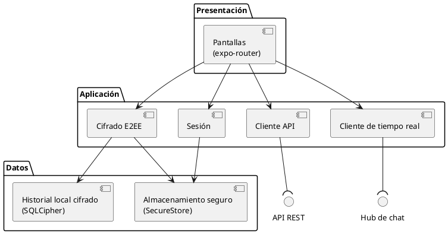
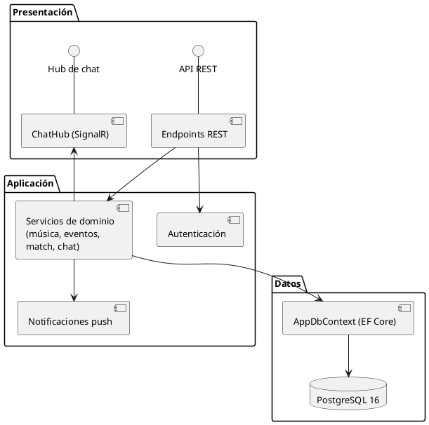
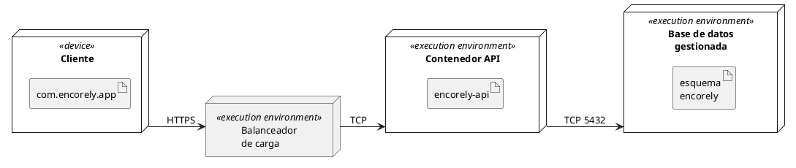
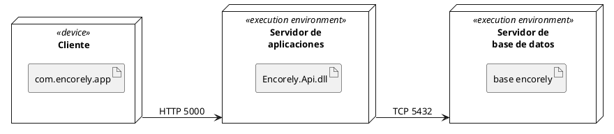
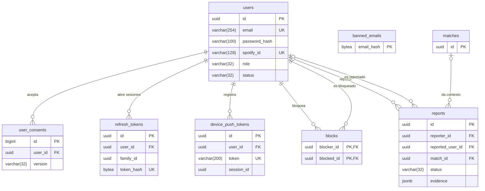
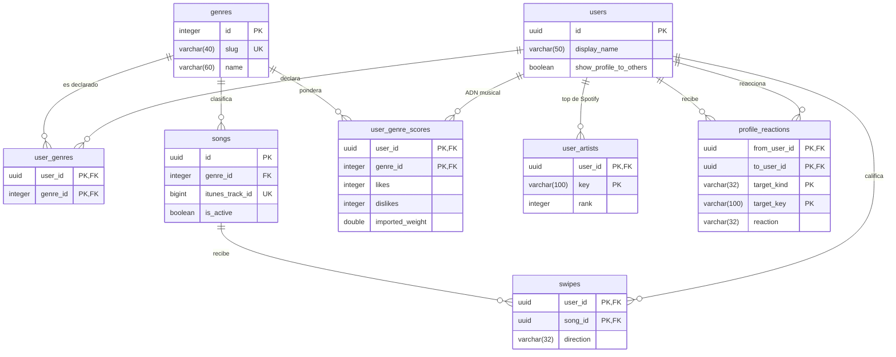
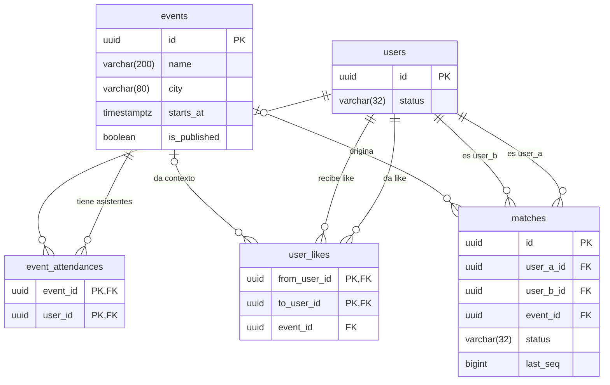
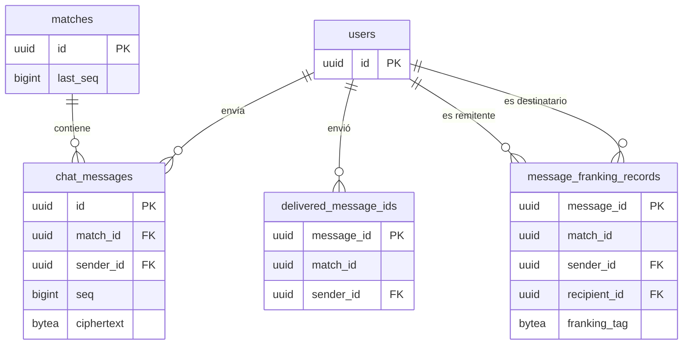
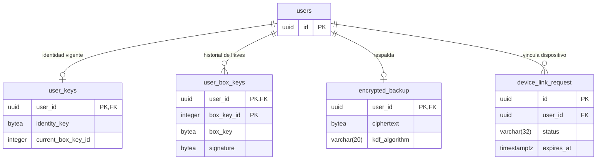

<section class="portada">
<div class="portada-cuerpo">
<p class="portada-marca">ENCORELY</p>
<p class="portada-tipo">Documentación técnica · Avance</p>
<p class="portada-titulo">Manual técnico del sistema</p>
<p class="portada-sub">App móvil, API y base de datos: arquitectura, instalación, despliegue, seguridad y operación.</p>
<div class="portada-datos">
<div><span>Preparado por</span><p>Camilo Rincón · Emmanuel Dávila · Samuel Sierra · Juan Diego Calle</p></div>
<div><span>Preparado para</span><p>Tecnológico de Antioquia · Despliegue de Sistemas</p></div>
<div><span>Lugar y fecha</span><p>Itagüí, Antioquia · 22 de octubre de 2026</p></div>
</div>
</div>
<aside class="portada-talon">
<p class="talon-etq">Documento</p><p class="talon-val">ENC-MT-001</p>
<p class="talon-etq">Versión</p><p class="talon-val">1.4</p>
<p class="talon-etq">Contrato API</p><p class="talon-val">v1.0.0-draft.17</p>
<p class="talon-etq">Clasificación</p><p class="talon-val">Uso interno</p>
</aside>
</section>

[[TOC]]

## 1. Control documental e historial de cambios

### 1.1 Control documental

| Campo | Valor |
|---|---|
| Código del documento | ENC-MT-001 |
| Sistema | Encorely: app móvil `encorely-front` (Expo, Android e iOS) y API `encorly_back` (.NET 10 + PostgreSQL 16) |
| Tipo de documento | Manual técnico unificado · avance de entrega |
| Versión vigente | 1.4 |
| Fecha de emisión | 2026-10-22 |
| Elaborado por | Camilo Rincón, Emmanuel Dávila, Samuel Sierra, Juan Diego Calle |
| Aprobado por | Aprobado por: \_\_\_\_\_\_\_\_\_\_\_\_\_\_\_\_\_\_\_\_ (docente) · Fecha: \_\_\_\_\_\_\_\_\_\_\_\_ |
| Responsable de mantenerlo | Camilo Rincón (Product Owner) coordina las versiones; cada capítulo tiene su responsable en 1.4 |
| Periodicidad de actualización | Con cada cambio de esquema de la base de datos, de contrato (draft) o de despliegue, y revisión completa por release |

### 1.2 Historial de cambios

| Versión | Fecha | Autores | Cambios | Aprobación |
|---|---|---|---|---|
| 0.1 | 2026-10-20 | Equipo Encorely | Manuales técnicos por repositorio: `encorly_back/docs/MANUAL-TECNICO.md` y `encorely-front/docs/MANUAL-TECNICO.md` | No aplica (borrador) |
| 1.0 | 2026-10-20 | Camilo Rincón, Emmanuel Dávila, Samuel Sierra, Juan Diego Calle | Manual unificado según la estructura de la cátedra: análisis del problema, arquitectura por capas, matriz de componentes, fichas de las 25 tablas, plan de despliegue y rollback, diagrama de despliegue UML, operatividad e incidentes | Pendiente de firma del docente |
| 1.1 | 2026-10-22 | Camilo Rincón, Emmanuel Dávila, Samuel Sierra, Juan Diego Calle | Portada con identidad de Encorely y datos de entrega (Tecnológico de Antioquia, Despliegue de Sistemas) | Pendiente |
| 1.2 | 2026-10-22 | Camilo Rincón, Emmanuel Dávila, Samuel Sierra, Juan Diego Calle | Estructura alineada a las diapositivas de la cátedra; el análisis del software pasa a documento propio; capítulo 1 sin portada, ficha fusionada en el control documental y sin "Documentos relacionados" | Pendiente |
| 1.3 | 2026-10-22 | Camilo Rincón, Emmanuel Dávila, Samuel Sierra, Juan Diego Calle | Paridad estricta con las diapositivas: se quitan secciones no pedidas, se agregan segmentación, auditoría, alta disponibilidad, capacitación, dueños por aspecto operativo y diagramas de despliegue en UML con PlantUML | Pendiente |
| 1.4 | 2026-10-22 | Camilo Rincón, Emmanuel Dávila, Samuel Sierra, Juan Diego Calle | Depuración por bloque: se retira el texto que no explican las diapositivas (detalles de implementación, justificaciones, notas y columnas no pedidas); 7.2 queda solo con el título; diagramas de componentes y de despliegue rehechos en UML con el orden de los ejemplos de las diapositivas | Pendiente |

### 1.3 Propósito y público del documento

Este manual explica cómo está construido, configurado, desplegado y mantenido Encorely. Está dirigido a desarrollo (back y front), administración de base de datos e infraestructura y operación (DevOps).

### 1.4 Responsables y periodicidad de actualización

| Capítulo | Responsable | Disparador de actualización | Plazo |
|---|---|---|---|
| 1. Control documental | Camilo Rincón (Product Owner) | Cada versión nueva del documento | Al emitir la versión |
| 2. Objetivo, alcance y descripción general | Camilo Rincón (Product Owner) | Cambio de alcance o de una decisión de producto | En el mismo PR del cambio |
| 3. Requisitos de hardware, software y red | Samuel Sierra (DevOps e infraestructura) | Cambio de versión de una herramienta, de un puerto o de un nodo | En el mismo PR del cambio |
| 4. Arquitectura y diagramas de componentes | Camilo Rincón (arquitecto de software) | Módulo, capa o componente nuevo | En el mismo PR del cambio |
| 5. Instalación, configuración y despliegue | Samuel Sierra; 5.2 y 5.5.5, Emmanuel Dávila (app) | Cambio de `Dockerfile`, `render.yaml`, `eas.json` o de variables de entorno | Antes de aplicar el cambio en un ambiente |
| 6. Base de datos y modelo de información | Samuel Sierra (administrador de base de datos) | Nueva migración de EF Core: fichas, diccionario, ERD y lista de migraciones | En el mismo PR de la migración |
| 7. Integraciones, APIs y servicios externos | Camilo Rincón (desarrollo back) | Nueva entrada en `contracts/CHANGELOG.md` o integración nueva | En el mismo PR del cambio de contrato |
| 8. Seguridad, perfiles y permisos | Camilo Rincón (seguridad) | Control, perfil o secreto nuevo | En el mismo PR del cambio |
| 9. Operación, monitoreo, respaldo y recuperación | Samuel Sierra; 9.3, Juan Diego Calle (monitoreo) | Cambio de umbral, alerta, herramienta o política de respaldo | Antes de aplicar el cambio en producción |
| 10. Solución de incidentes, mantenimiento y anexos | Camilo Rincón (escalamiento de incidentes); 10.3.2, Emmanuel Dávila | Incidente cerrado (runbooks y lecciones de 10.1 y 10.2) o procedimiento nuevo | Hasta 5 días hábiles después del cierre |

En cada release (versión de la app o de la API) el equipo completo revisa el documento y agrega la fila del historial de cambios antes de etiquetar el release.

Cada cambio sube la versión del documento: cambio menor (corrección o sección nueva) suma 0.1; cambio de estructura o de release suma 1.0.

### 1.5 Convenciones de nombres
### 1.6 Convenciones de redacción y de comandos
### 1.7 Manejo de información sensible
### 1.8 Herramientas de elaboración del manual
## 2. Objetivo, alcance y descripción general del sistema

### 2.1 Objetivo del sistema

Encorely conecta a personas mayores de edad que van al mismo concierto y tienen gustos musicales parecidos, para que se conozcan antes del evento y vayan juntas. El objetivo técnico es que esa cadena funcione de punta a punta, con identidad verificada en el servidor, afinidad calculada con datos reales y una conversación privada que el propio servidor no puede leer.

### 2.2 Alcance de la versión 1

Dentro del alcance: los requisitos funcionales RF-01 a RF-17 (definidos en el documento *Análisis del software*), es decir, cuenta y onboarding, catálogo de canciones y ADN musical, eventos y radar, match recíproco, perfil social, chat cifrado de extremo a extremo con respaldo y traspaso, bloqueo y reporte, notificaciones push y panel de administración.

Fuera del alcance:

- Salas grupales por evento.
- Login con Google y Apple.
- APIs externas distintas de iTunes Search, FCM/APNs (vía Expo Push) y el conector de Spotify.
- Publicación en tiendas y hosting de producción.
- QA en iOS.

### 2.3 Descripción general
## 3. Requisitos de hardware, software y red

### 3.1 Ambientes del sistema

| Ambiente | Dónde corre | Estado |
|---|---|---|
| Desarrollo local (`Development`) | PC del equipo: Postgres en Docker, API con `dotnet run`, app en emulador o teléfono | En uso y verificado |
| Pruebas automatizadas (`Testing`) | Testcontainers en el PC o en el runner de GitHub Actions | En uso y verificado |
| Integración continua | GitHub Actions (`ubuntu-24.04` y `ubuntu-latest`) | En uso |
| Staging | Propuesto: Render + perfil EAS `preview` (`https://api-staging.encorely.example`, marcador) | Preparado, no creado |
| Producción (`Production`) | Propuesto: Render (servicio web + Postgres administrado) + tiendas | Preparado, no desplegado |

### 3.2 Requisitos de hardware

#### 3.2.1 Estación de desarrollo
#### 3.2.2 Dispositivos móviles
#### 3.2.3 Servidores de producción
### 3.3 Requisitos de software
#### 3.3.1 Software para el back
#### 3.3.2 Software para la app
### 3.4 Requisitos de red
## 4. Arquitectura y diagramas de componentes

### 4.1 Descripción de la arquitectura del sistema

El back es un monolito modular: un solo proceso ASP.NET Core 10 con una carpeta por feature (`Features/<Feature>`) y la infraestructura transversal en `Infrastructure/`. La app es un cliente nativo que guarda en el teléfono solo tokens, llaves y el historial cifrado del chat. El contrato `contracts/openapi.v1.json` une los dos lados: la API lo genera desde el código y la app genera sus tipos desde él.

#### 4.1.1 Capa de presentación

Componentes en Encorely: app móvil (`encorely-front/src/app`, `src/features`, `src/ui`); panel de administración HTML en `/admin`; páginas `/legal/terminos`, `/legal/privacidad` y `/cuenta/eliminar` servidas por la API.

Tecnología: Expo SDK 57, React Native 0.86, React 19.2, TypeScript 6; HTML.

#### 4.1.2 Capa de aplicación

Componentes en Encorely: API REST `/api/v1` (Minimal APIs), servicios de dominio por feature, `ChatHub`, tareas en segundo plano (`PushDispatcher`, `PushReceiptChecker`, `MaintenanceService`).

Tecnología: ASP.NET Core 10, C#, SignalR.

#### 4.1.3 Capa de datos

Componentes en Encorely: PostgreSQL 16 con 25 tablas; en el teléfono, SQLCipher para el historial y SecureStore para tokens y llaves.

Tecnología: EF Core 10 + Npgsql, Dapper (radar), `expo-sqlite`, `expo-secure-store`.

#### 4.1.4 Infraestructura
#### 4.1.5 Integraciones
#### 4.1.6 Seguridad
#### 4.1.7 Operación
### 4.2 Diagrama de arquitectura lógica
### 4.3 Diagrama de componentes

#### 4.3.1 Componentes de la app



#### 4.3.2 Componentes de la API



## 5. Instalación, configuración y despliegue

### 5.1 Instalación local de la API y la base de datos

**Prerrequisitos**

- Software de 3.3.1 instalado: mise, Docker con `docker compose` v2.
- Repositorio `encorly_back` clonado y en la rama `dev`.
- Puertos 5000 y 5432 libres (o usar los puertos alternos del final de esta sección).
- Si mise no está activado en la shell (`eval "$(mise activate zsh)"`), anteponer `mise exec --` a cada `dotnet`.

**Pasos**

1. Instalar el SDK definido por el repositorio:

   ```bash
   mise trust     # solo la primera vez en un clon nuevo
   mise install
   ```

2. Crear la configuración local y completar los cuatro valores marcados (los demás ya sirven para local):

   ```bash
   cp .env.example .env
   # DB_PASSWORD         la que se quiera; docker compose crea la BD con ella
   # JWT_SIGNING_KEY     openssl rand -base64 48
   # BANNED_EMAIL_KEY    openssl rand -base64 48   (distinta de la anterior)
   # DEMO_USER_PASSWORD  opcional: contraseña de las 16 cuentas demo
   ```

3. Levantar PostgreSQL y esperar a que esté sano:

   ```bash
   docker compose up -d --wait
   ```

4. Arrancar la API. En `Development` aplica las 11 migraciones y siembra el catálogo al arrancar:

   ```bash
   mise exec -- dotnet run --project src/Encorely.Api
   ```

5. Comprobar el servicio y, si se definió `DEMO_USER_PASSWORD`, iniciar sesión con una cuenta demo:

   ```bash
   curl http://localhost:5000/health/live
   curl http://localhost:5000/health/ready
   curl -s http://localhost:5000/openapi/v1.json | jq -r .info.title
   curl -s -X POST http://localhost:5000/api/v1/auth/login \
     -H 'content-type: application/json' \
     -d '{"email":"valentina.rojas@encorely.demo","password":"<DEMO_USER_PASSWORD>"}' | jq '.user'
   ```

**Criterio de validación**

- El log de arranque muestra `Applying migration '20261014050309_Initial'` hasta `'20261015155802_IndicesPurga'` y las líneas `Seed: 15 géneros`, `Seed: 120 canciones`, `Seed: 24 eventos` (más `Seed: 16 usuarios demo` y `Seed: match demo del revisor` si hay `DEMO_USER_PASSWORD`). En una base que ya tenía datos estas líneas no aparecen.
- `/health/live` y `/health/ready` responden `Healthy`.
- `/openapi/v1.json` devuelve el título `Encorely API`.
- El login responde `accessToken`, `refreshToken`, `expiresIn: 900` y `user`.

**Variantes**

- Puertos alternos: `--urls http://127.0.0.1:5100` al arrancar la API y `DB_PORT=5433` para Postgres.
- Todo en contenedores, sin SDK: `docker compose --profile full up -d --build`.

### 5.2 Instalación local de la app

**Prerrequisitos**

- Software de 3.3.2: Node 24, pnpm 12.11.2, JDK 17 activo, Android SDK 36 con `ANDROID_HOME` apuntando a él y un AVD (referencia: `encorely_api35`).
- `encorely-front` clonado en la rama `Dev`, con `encorly_back` en la carpeta hermana.
- API local corriendo y validada según 5.1.

**Pasos**

1. Instalar dependencias exactamente como dice el lockfile:

   ```bash
   pnpm install --frozen-lockfile
   ```

2. Verificar el código sin emulador:

   ```bash
   pnpm typecheck && pnpm lint && pnpm test
   ```

3. Configurar la URL de la API:

   ```bash
   cp .env.example .env
   # EXPO_PUBLIC_API_URL=http://10.0.2.2:5000        (emulador Android)
   # EXPO_PUBLIC_API_URL=http://<IP-del-PC>:5000     (teléfono en la misma red)
   ```

4. Compilar e instalar el development build y arrancar Metro en otra terminal:

   ```bash
   export ANDROID_HOME="$HOME/Android/Sdk"
   ~/Android/Sdk/emulator/emulator -avd encorely_api35 &
   pnpm android
   pnpm start
   ```

**Criterio de validación**

- `pnpm install --frozen-lockfile` termina sin cambiar `pnpm-lock.yaml`.
- `typecheck`, `lint` y `test` pasan.
- La app abre en la pantalla de bienvenida; no aparece "Falta configurar el servidor".
- Con una cuenta demo se entra y la pestaña Conciertos lista los eventos del seed.

### 5.3 Configuración
#### 5.3.1 Variables de entorno de la API
#### 5.3.2 Variables de entorno de la app
#### 5.3.3 Configuración estática de la app
### 5.4 Integración continua
### 5.5 Plan de despliegue a producción
#### 5.5.1 Estado actual del despliegue
#### 5.5.2 Cronograma, responsables y ventana
#### 5.5.3 Actividades de la fase de despliegue
#### 5.5.4 Procedimiento de despliegue de la API
#### 5.5.5 Procedimiento de build y publicación de la app
### 5.6 Plan de rollback
### 5.7 Productos del despliegue
### 5.8 Diagramas de despliegue

#### 5.8.1 Despliegue objetivo en producción



Cliente: teléfono Android o iOS. Balanceador y contenedor: Render. Base de datos gestionada: PostgreSQL 16. Cada nodo aloja exactamente el artefacto que le corresponde. Hay una sola réplica del contenedor; el balanceador no reparte carga entre varias.

#### 5.8.2 Despliegue actual de la demo local



Cliente: emulador o teléfono Android. Servidor de aplicaciones: .NET 10 en el PC de desarrollo. Servidor de base de datos: contenedor Docker con PostgreSQL 16. Cada nodo aloja exactamente el artefacto que le corresponde.

## 6. Base de datos y modelo de información

### 6.1 Motor, conexión y convenciones

| Aspecto | Valor |
|---|---|
| Motor | PostgreSQL 16 (local: imagen `postgres:16-alpine`; producción propuesta: Render PostgreSQL 16) |
| Base de datos | `encorely` (nombre por defecto de compose; en producción el que entregue el proveedor) |
| Acceso | EF Core 10 con Npgsql 10.0.3; Dapper solo para la consulta del radar (`Features/Events/RadarService.cs`) |
| Cadena de conexión | Se arma con `DB_HOST`, `DB_PORT`, `DB_NAME`, `DB_USER`, `DB_PASSWORD` y `DB_SSL_MODE`; nunca se escribe en archivos versionados |
| Nombres | `snake_case` generado por `UseSnakeCaseNamingConvention`; restricciones `pk_`, `fk_`, `ix_`, `ck_` |
| Identificadores | UUID versión 7 generados por la API (`Guid.CreateVersion7()`), salvo `genres.id` y `user_consents.id` (identidad de Postgres) y `chat_messages.id` (lo genera el cliente) |
| Enums | Guardados como texto de hasta 32 caracteres (`varchar(32)`) |
| Fechas | `timestamp with time zone` en UTC; `users.birth_date` es `date` |
| Tablas | 25 de dominio más `__EFMigrationsHistory` de EF Core |
| Dependencias de la base | Ninguna extensión de Postgres |


### 6.2 Diagrama entidad-relación

El modelo se presenta en cinco vistas; `users` y `matches` se repiten como ancla entre vistas. El detalle de cada campo está en las fichas de 6.3.

#### 6.2.1 Vista de cuenta, sesiones y moderación



#### 6.2.2 Vista de música y perfil social



#### 6.2.3 Vista de eventos y match



#### 6.2.4 Vista de chat y mensajes



#### 6.2.5 Vista de llaves, respaldo y vinculación



### 6.3 Fichas técnicas de las tablas

#### 6.3.1 Tabla users

Propósito: cuenta y perfil de cada persona. Es la tabla central: 20 tablas la referencian. PK `pk_users (id)`. Índices únicos `ix_users_email (email)` e `ix_users_spotify_id (spotify_id)`. Borrar una fila borra en cascada sus swipes, likes, matches, mensajes, llaves, sesiones y respaldos; los reportes quedan con la referencia en `NULL`. Componentes: `Auth`, `Users`, `Profiles`, `Admin`.

| Campo | Tipo | Nulo | Restricción o defecto | Significado |
|---|---|---|---|---|
| id | uuid | NOT NULL | PK | Identificador de la cuenta |
| email | varchar(254) | NOT NULL | UNIQUE | Correo de acceso, guardado sin espacios y en minúsculas |
| password_hash | varchar(100) | NULL | | Hash BCrypt (factor 12) de la contraseña; `NULL` si la cuenta se creó con Spotify |
| spotify_id | varchar(128) | NULL | UNIQUE | Usuario de Spotify vinculado para entrar con Spotify |
| show_profile_to_others | boolean | NOT NULL | DEFAULT `true` | Si la persona permite que otras vean su perfil |
| display_name | varchar(50) | NOT NULL | | Nombre que ven las demás personas |
| birth_date | date | NULL | | Fecha de nacimiento |
| city | varchar(80) | NULL | | Ciudad que escribe la persona |
| bio | varchar(300) | NULL | | Texto libre del perfil |
| role | varchar(32) | NOT NULL | Valores de 6.4 | Rol: persona usuaria o administración |
| status | varchar(32) | NOT NULL | Valores de 6.4 | Cuenta activa o suspendida |
| created_at | timestamptz | NOT NULL | | Alta de la cuenta |
| updated_at | timestamptz | NOT NULL | | Último cambio del perfil |

#### 6.3.2 Tabla user_consents

Propósito: prueba del consentimiento de términos y política de datos (Ley 1581), una fila por aceptación. PK `pk_user_consents (id)`. FK `fk_user_consents_users_user_id` → `users.id` ON DELETE CASCADE. Índice `ix_user_consents_user_id`. Componentes: `Users`, `Legal`, `Profiles` (consentimiento del perfil público).

| Campo | Tipo | Nulo | Restricción o defecto | Significado |
|---|---|---|---|---|
| id | bigint | NOT NULL | PK, identidad generada por defecto | Número de la aceptación |
| user_id | uuid | NOT NULL | FK → `users.id` | Quién aceptó |
| version | varchar(32) | NOT NULL | | Versión de los documentos aceptados (vigente: `2026-10-14`) |
| accepted_at | timestamptz | NOT NULL | | Cuándo aceptó |

#### 6.3.3 Tabla refresh_tokens

Propósito: sesiones. Cada fila es un refresh token opaco del que solo se guarda el SHA-256; las filas de una misma `family_id` son una sesión. PK `pk_refresh_tokens (id)`. FK `fk_refresh_tokens_users_user_id` → `users.id` CASCADE. Índices: `ix_refresh_tokens_token_hash` (único), `ix_refresh_tokens_family_id`, `ix_refresh_tokens_user_id`, `ix_refresh_tokens_expires_at` (purga horaria). Componentes: `Auth`, `Sessions`, `Infrastructure/Auth`, `MaintenanceService`.

| Campo | Tipo | Nulo | Restricción o defecto | Significado |
|---|---|---|---|---|
| id | uuid | NOT NULL | PK | Identificador del token |
| user_id | uuid | NOT NULL | FK → `users.id` | Dueño de la sesión |
| family_id | uuid | NOT NULL | Índice | Sesión |
| token_hash | bytea | NOT NULL | UNIQUE | SHA-256 del refresh token |
| created_at | timestamptz | NOT NULL | | Emisión |
| expires_at | timestamptz | NOT NULL | Índice | Vencimiento (30 días por defecto) |
| revoked_at | timestamptz | NULL | | Cuándo se revocó (logout, rotación, reuso o suspensión) |
| replaced_by_token_id | uuid | NULL | Sin FK | Token que lo reemplazó al rotar |

#### 6.3.4 Tabla device_push_tokens

Propósito: tokens push de Expo por dispositivo, ligados a la sesión que los registró. PK `pk_device_push_tokens (id)`. FK `fk_device_push_tokens_users_user_id` → `users.id` CASCADE. Índices: `ix_device_push_tokens_token` (único), `ix_device_push_tokens_user_id`, `ix_device_push_tokens_session_id`. Componentes: `Devices`, `Sessions`, `Infrastructure/Push`.

| Campo | Tipo | Nulo | Restricción o defecto | Significado |
|---|---|---|---|---|
| id | uuid | NOT NULL | PK | Identificador del registro |
| user_id | uuid | NOT NULL | FK → `users.id` | Cuenta que recibe los avisos |
| token | varchar(200) | NOT NULL | UNIQUE | Token `ExponentPushToken[…]` o `ExpoPushToken[…]` |
| platform | varchar(32) | NOT NULL | Valores de 6.4 | Sistema operativo del teléfono |
| session_id | uuid | NULL | Índice, sin FK | Sesión (`family_id`) que lo registró |
| created_at | timestamptz | NOT NULL | | Primer registro |
| updated_at | timestamptz | NOT NULL | | Último registro o cambio de dueño |

#### 6.3.5 Tabla banned_emails

Propósito: impedir que una cuenta suspendida se borre y se registre otra vez con el mismo correo. Guarda solo el HMAC-SHA256 del correo normalizado con `BANNED_EMAIL_KEY`. PK `pk_banned_emails (email_hash)`. Sin relaciones. Componentes: `Auth`, `Admin`.

| Campo | Tipo | Nulo | Restricción o defecto | Significado |
|---|---|---|---|---|
| email_hash | bytea | NOT NULL | PK | Huella del correo vetado; no permite recuperar el correo sin la llave |
| created_at | timestamptz | NOT NULL | | Fecha del veto |

#### 6.3.6 Tabla genres

Propósito: catálogo de los 15 géneros musicales. PK `pk_genres (id)`. Índice único `ix_genres_slug`. Referenciada por `songs`, `user_genres` y `user_genre_scores` con ON DELETE RESTRICT (un género en uso no se puede borrar). Componentes: `Music`, `Users`, `Events` (radar).

| Campo | Tipo | Nulo | Restricción o defecto | Significado |
|---|---|---|---|---|
| id | integer | NOT NULL | PK, identidad generada por defecto | Identificador interno |
| slug | varchar(40) | NOT NULL | UNIQUE | Identificador estable que viaja en la API (por ejemplo `vallenato`) |
| name | varchar(60) | NOT NULL | | Nombre visible del género |

#### 6.3.7 Tabla songs

Propósito: catálogo curado de canciones para calificar, con portada y muestra de 30 s de iTunes. PK `pk_songs (id)`. FK `fk_songs_genres_genre_id` → `genres.id` RESTRICT. Índices `ix_songs_genre_id` e `ix_songs_itunes_track_id` (único). Componentes: `Music`, `Admin`, `scripts/curate_songs.py` (seed).

| Campo | Tipo | Nulo | Restricción o defecto | Significado |
|---|---|---|---|---|
| id | uuid | NOT NULL | PK | Identificador de la canción |
| title | varchar(200) | NOT NULL | | Título |
| artist | varchar(200) | NOT NULL | | Artista |
| genre_id | integer | NOT NULL | FK → `genres.id` | Género al que suma la calificación |
| cover_url | varchar(500) | NOT NULL | | URL de la portada |
| preview_url | varchar(500) | NULL | | URL de la muestra de 30 s |
| itunes_track_id | bigint | NULL | UNIQUE | Id de la pista en iTunes, evita duplicados en el catálogo |
| is_active | boolean | NOT NULL | | `false` la saca del feed sin borrarla |
| created_at | timestamptz | NOT NULL | | Alta en el catálogo |

#### 6.3.8 Tabla swipes

Propósito: calificaciones de canciones. PK `pk_swipes (user_id, song_id)`. FK `fk_swipes_users_user_id` → `users.id` CASCADE y `fk_swipes_songs_song_id` → `songs.id` CASCADE. Índice `ix_swipes_song_id`. Componentes: `Music`, `Admin` (conteo de likes por canción).

| Campo | Tipo | Nulo | Restricción o defecto | Significado |
|---|---|---|---|---|
| user_id | uuid | NOT NULL | PK, FK → `users.id` | Quién calificó |
| song_id | uuid | NOT NULL | PK, FK → `songs.id` | Canción calificada |
| direction | varchar(32) | NOT NULL | Valores de 6.4 | Me gusta o paso |
| created_at | timestamptz | NOT NULL | | Momento de la calificación |

#### 6.3.9 Tabla user_genres

Propósito: géneros que la persona declara como favoritos en el onboarding o el perfil. PK `pk_user_genres (user_id, genre_id)`. FK `fk_user_genres_users_user_id` → `users.id` CASCADE y `fk_user_genres_genres_genre_id` → `genres.id` RESTRICT. Índice `ix_user_genres_genre_id`. Componentes: `Users`, `Music` (bono en el ADN), `Profiles`.

| Campo | Tipo | Nulo | Restricción o defecto | Significado |
|---|---|---|---|---|
| user_id | uuid | NOT NULL | PK, FK → `users.id` | Persona |
| genre_id | integer | NOT NULL | PK, FK → `genres.id` | Género declarado |

#### 6.3.10 Tabla user_genre_scores

Propósito: componentes del ADN musical por género. PK `pk_user_genre_scores (user_id, genre_id)`. FK `fk_user_genre_scores_users_user_id` → `users.id` CASCADE y `fk_user_genre_scores_genres_genre_id` → `genres.id` RESTRICT. Índice `ix_user_genre_scores_genre_id`. Componentes: `Music`, `Events` (radar), `Profiles`.

| Campo | Tipo | Nulo | Restricción o defecto | Significado |
|---|---|---|---|---|
| user_id | uuid | NOT NULL | PK, FK → `users.id` | Persona |
| genre_id | integer | NOT NULL | PK, FK → `genres.id` | Género |
| likes | integer | NOT NULL | | Canciones de ese género marcadas "me gusta" |
| dislikes | integer | NOT NULL | | Canciones de ese género marcadas "paso" |
| imported_weight | double precision | NOT NULL | | Aporte de la importación de Spotify; se reemplaza en cada importación |

#### 6.3.11 Tabla user_artists

Propósito: artistas más escuchados importados de Spotify, para el perfil y las reacciones. PK `pk_user_artists (user_id, key)`. FK `fk_user_artists_users_user_id` → `users.id` CASCADE. Componentes: `Music`, `Profiles`.

| Campo | Tipo | Nulo | Restricción o defecto | Significado |
|---|---|---|---|---|
| user_id | uuid | NOT NULL | PK, FK → `users.id` | Persona |
| key | varchar(100) | NOT NULL | PK | Nombre normalizado (sin tildes ni signos, con guiones) para cruzar artistas entre perfiles |
| name | varchar(200) | NOT NULL | | Nombre del artista como lo da Spotify |
| rank | integer | NOT NULL | | Posición en el top (0 es el más escuchado) |
| image_url | varchar(500) | NULL | | Imagen del artista |
| genres | text[] | NOT NULL | | Géneros que Spotify asigna al artista |
| imported_at | timestamptz | NOT NULL | | Fecha de la importación |

#### 6.3.12 Tabla profile_reactions

Propósito: reacciones de una persona a un artista o género del perfil de otra ("Yo también", "Vamos a verlo", "Pásame una"). Una por objetivo y par. PK `pk_profile_reactions (from_user_id, to_user_id, target_kind, target_key)`. FK `fk_profile_reactions_users_from_user_id` y `fk_profile_reactions_users_to_user_id` → `users.id` CASCADE. Índice `ix_profile_reactions_to_user_id_updated_at`. Componente: `Profiles`.

| Campo | Tipo | Nulo | Restricción o defecto | Significado |
|---|---|---|---|---|
| from_user_id | uuid | NOT NULL | PK, FK → `users.id` | Quién reacciona |
| to_user_id | uuid | NOT NULL | PK, FK → `users.id` | Dueño del perfil |
| target_kind | varchar(32) | NOT NULL | PK, valores de 6.4 | Si el objetivo es un artista o un género |
| target_key | varchar(100) | NOT NULL | PK | `slug` del género o `key` del artista |
| target_name | varchar(200) | NOT NULL | DEFAULT `''` | Nombre del objetivo al reaccionar |
| reaction | varchar(32) | NOT NULL | Valores de 6.4 | Tipo de reacción |
| created_at | timestamptz | NOT NULL | | Primera reacción |
| updated_at | timestamptz | NOT NULL | Índice con `to_user_id` | Último cambio; ordena la lista de recibidas |

#### 6.3.13 Tabla events

Propósito: conciertos curados por la administración (seed y panel). PK `pk_events (id)`. Índice `ix_events_city_starts_at (city, starts_at)`. Referenciada por `event_attendances` (CASCADE), `user_likes` y `matches` (SET NULL). Componentes: `Events`, `Admin`, `Matching`.

| Campo | Tipo | Nulo | Restricción o defecto | Significado |
|---|---|---|---|---|
| id | uuid | NOT NULL | PK | Identificador del evento |
| name | varchar(200) | NOT NULL | | Nombre del concierto |
| artist_lineup | text[] | NOT NULL | | Artistas del cartel |
| venue | varchar(200) | NOT NULL | | Lugar |
| city | varchar(80) | NOT NULL | Índice con `starts_at` | Ciudad |
| starts_at | timestamptz | NOT NULL | | Fecha y hora de inicio |
| image_url | varchar(500) | NULL | | Imagen del cartel |
| description | varchar(2000) | NULL | | Descripción |
| is_published | boolean | NOT NULL | | Visible para las personas usuarias |
| created_at | timestamptz | NOT NULL | | Alta del evento |

#### 6.3.14 Tabla event_attendances

Propósito: quién marcó que va a cada evento; habilita el radar y el like entre asistentes. PK `pk_event_attendances (event_id, user_id)`. FK `fk_event_attendances_events_event_id` → `events.id` CASCADE y `fk_event_attendances_users_user_id` → `users.id` CASCADE. Índice `ix_event_attendances_user_id`. Componentes: `Events`, `Matching`, `Profiles`.

| Campo | Tipo | Nulo | Restricción o defecto | Significado |
|---|---|---|---|---|
| event_id | uuid | NOT NULL | PK, FK → `events.id` | Evento |
| user_id | uuid | NOT NULL | PK, FK → `users.id` | Persona que va |
| created_at | timestamptz | NOT NULL | | Cuándo marcó la asistencia |

#### 6.3.15 Tabla user_likes

Propósito: interés de una persona en otra con la que comparte un evento. El match nace solo con el like recíproco. PK `pk_user_likes (from_user_id, to_user_id)`. FK `fk_user_likes_users_from_user_id` y `fk_user_likes_users_to_user_id` → `users.id` CASCADE; `fk_user_likes_events_event_id` → `events.id` SET NULL. Índices `ix_user_likes_to_user_id`, `ix_user_likes_event_id`. CHECK `ck_user_likes_not_self (from_user_id <> to_user_id)`. Componente: `Matching`.

| Campo | Tipo | Nulo | Restricción o defecto | Significado |
|---|---|---|---|---|
| from_user_id | uuid | NOT NULL | PK, FK → `users.id`, CHECK | Quién da el like |
| to_user_id | uuid | NOT NULL | PK, FK → `users.id`, CHECK | Quién lo recibe |
| event_id | uuid | NULL | FK → `events.id` | Evento compartido en que se dio |
| created_at | timestamptz | NOT NULL | | Momento del like |

#### 6.3.16 Tabla matches

Propósito: relación mutua entre dos personas que habilita el chat. El par se guarda ordenado y solo puede haber un match activo por par; los cerrados quedan como historial. PK `pk_matches (id)`. FK `fk_matches_users_user_a_id` y `fk_matches_users_user_b_id` → `users.id` CASCADE; `fk_matches_events_event_id` → `events.id` SET NULL. Índices: `ix_matches_user_a_id_user_b_id` único parcial `WHERE status = 'Active'`, `ix_matches_user_b_id`, `ix_matches_event_id`. CHECK `ck_matches_ordered_pair (user_a_id < user_b_id)`. Componentes: `Matching`, `Chat`, `Moderation`, `Admin`.

| Campo | Tipo | Nulo | Restricción o defecto | Significado |
|---|---|---|---|---|
| id | uuid | NOT NULL | PK | Identificador del match |
| user_a_id | uuid | NOT NULL | FK → `users.id`, CHECK | Persona con el UUID menor del par |
| user_b_id | uuid | NOT NULL | FK → `users.id`, CHECK | Persona con el UUID mayor |
| status | varchar(32) | NOT NULL | Valores de 6.4; parte del índice parcial | Activo o cerrado |
| event_id | uuid | NULL | FK → `events.id` | Evento donde nació el match |
| created_at | timestamptz | NOT NULL | | Fecha del match |
| closed_at | timestamptz | NULL | | Fecha de cierre |
| closed_by_user_id | uuid | NULL | Sin FK | Quién lo cerró |
| close_reason | varchar(32) | NULL | Valores de 6.4 | Por qué se cerró |
| last_seq | bigint | NOT NULL | | Último número de secuencia asignado a un mensaje |
| last_message_at | timestamptz | NULL | | Fecha del último mensaje; ordena la lista de chats |

#### 6.3.17 Tabla user_keys

Propósito: estado vigente de las llaves públicas del chat de cada persona. PK `pk_user_keys (user_id)`. FK `fk_user_keys_users_user_id` → `users.id` CASCADE, relación uno a uno. Componentes: `Chat` (`KeyService`).

| Campo | Tipo | Nulo | Restricción o defecto | Significado |
|---|---|---|---|---|
| user_id | uuid | NOT NULL | PK, FK → `users.id` | Persona |
| identity_key | bytea | NOT NULL | | Llave pública de identidad Ed25519 (32 bytes) |
| current_box_key_id | integer | NOT NULL | | Número de la llave de caja vigente |
| updated_at | timestamptz | NOT NULL | | Última publicación o rotación |

#### 6.3.18 Tabla user_box_keys

Propósito: historial de llaves de caja X25519 públicas, firmadas por la identidad, para descifrar mensajes viejos. PK `pk_user_box_keys (user_id, box_key_id)`. FK `fk_user_box_keys_users_user_id` → `users.id` CASCADE. Componente: `Chat`.

| Campo | Tipo | Nulo | Restricción o defecto | Significado |
|---|---|---|---|---|
| user_id | uuid | NOT NULL | PK, FK → `users.id` | Persona |
| box_key_id | integer | NOT NULL | PK | Número de la llave, estrictamente creciente |
| identity_key | bytea | NOT NULL | | Identidad que firmó esta llave |
| box_key | bytea | NOT NULL | | Llave pública X25519 |
| signature | bytea | NOT NULL | | Firma Ed25519 de `ENCORELY-BOXKEY-v1 ‖ box_key_id ‖ box_key`, verificada por el cliente |
| created_at | timestamptz | NOT NULL | | Publicación |

#### 6.3.19 Tabla chat_messages

Propósito: mensajes cifrados de extremo a extremo pendientes de entrega. PK `pk_chat_messages (id)`. FK `fk_chat_messages_matches_match_id` → `matches.id` CASCADE y `fk_chat_messages_users_sender_id` → `users.id` CASCADE. Índices `ix_chat_messages_match_id_seq` (único), `ix_chat_messages_sender_id`, `ix_chat_messages_created_at` (purga). Componentes: `Chat`, `MaintenanceService`.

| Campo | Tipo | Nulo | Restricción o defecto | Significado |
|---|---|---|---|---|
| id | uuid | NOT NULL | PK, lo genera el cliente | Identificador del mensaje |
| match_id | uuid | NOT NULL | FK → `matches.id`, UNIQUE con `seq` | Conversación |
| sender_id | uuid | NOT NULL | FK → `users.id` | Remitente |
| seq | bigint | NOT NULL | UNIQUE con `match_id` | Orden total del mensaje en la conversación, sin huecos |
| version | smallint | NOT NULL | | Versión del formato del sobre |
| sender_box_key_id | integer | NOT NULL | | Llave de caja del remitente usada |
| recipient_box_key_id | integer | NOT NULL | | Llave de caja del destinatario usada |
| nonce | bytea | NOT NULL | | Nonce aleatorio de 24 bytes de XChaCha20-Poly1305 |
| ciphertext | bytea | NOT NULL | | Mensaje cifrado |
| franking_tag | bytea | NULL | | Compromiso HMAC-SHA256 para reportes verificables |
| created_at | timestamptz | NOT NULL | Índice | Recepción en el servidor |

#### 6.3.20 Tabla delivered_message_ids

Propósito: "lápida" del id de un mensaje sin franking ya confirmado por el receptor. Al borrar el mensaje, impide que el mismo id se reutilice con otro `seq`. PK `pk_delivered_message_ids (message_id)`. FK `fk_delivered_message_ids_users_sender_id` → `users.id` CASCADE. Índices `ix_delivered_message_ids_sender_id` e `ix_delivered_message_ids_delivered_at` (purga a los 180 días). Componentes: `Chat`, `MaintenanceService`.

| Campo | Tipo | Nulo | Restricción o defecto | Significado |
|---|---|---|---|---|
| message_id | uuid | NOT NULL | PK | Id del mensaje entregado |
| match_id | uuid | NOT NULL | Sin FK | Conversación |
| sender_id | uuid | NOT NULL | FK → `users.id` | Remitente |
| delivered_at | timestamptz | NOT NULL | Índice | Momento del ack |

#### 6.3.21 Tabla message_franking_records

Propósito: copia del compromiso de franking de cada mensaje con tag, con vida propia: el ack borra el mensaje pero un reporte posterior debe poder verificarse. PK `pk_message_franking_records (message_id)`. FK `fk_message_franking_records_users_sender_id` y `fk_message_franking_records_users_recipient_id` → `users.id` CASCADE. Índices por `match_id`, `sender_id`, `recipient_id` y `created_at`. Componentes: `Chat`, `Moderation`, `MaintenanceService`.

| Campo | Tipo | Nulo | Restricción o defecto | Significado |
|---|---|---|---|---|
| message_id | uuid | NOT NULL | PK | Mensaje al que pertenece el compromiso |
| match_id | uuid | NOT NULL | Índice, sin FK | Conversación |
| sender_id | uuid | NOT NULL | FK → `users.id` | Remitente (el reportable) |
| recipient_id | uuid | NOT NULL | FK → `users.id` | Destinatario (quien puede reportar) |
| franking_tag | bytea | NOT NULL | | HMAC-SHA256 del mensaje con la llave de franking |
| created_at | timestamptz | NOT NULL | Índice | Fecha del mensaje |

#### 6.3.22 Tabla blocks

Propósito: bloqueos entre personas. PK `pk_blocks (blocker_id, blocked_id)`. FK `fk_blocks_users_blocker_id` y `fk_blocks_users_blocked_id` → `users.id` CASCADE. Índice `ix_blocks_blocked_id`. CHECK `ck_blocks_not_self (blocker_id <> blocked_id)`. Componentes: `Moderation`, `Events`, `Profiles`, `Matching`.

| Campo | Tipo | Nulo | Restricción o defecto | Significado |
|---|---|---|---|---|
| blocker_id | uuid | NOT NULL | PK, FK → `users.id`, CHECK | Quién bloquea |
| blocked_id | uuid | NOT NULL | PK, FK → `users.id`, CHECK | Quién queda bloqueado |
| created_at | timestamptz | NOT NULL | | Fecha del bloqueo |

#### 6.3.23 Tabla reports

Propósito: reportes de moderación con evidencia verificable. Sobreviven al borrado de las cuentas (las referencias pasan a `NULL`). Solo puede haber un reporte abierto por par (quien reporta, reportado). PK `pk_reports (id)`. FK `fk_reports_users_reporter_id` y `fk_reports_users_reported_user_id` → `users.id` SET NULL; `fk_reports_matches_match_id` → `matches.id` SET NULL. Índices: `ix_reports_reporter_id_reported_user_id` único parcial `WHERE status = 'Open'`, `ix_reports_status_created_at`, `ix_reports_resolved_at` parcial `WHERE evidence_purged_at IS NULL`, `ix_reports_reporter_id`, `ix_reports_reported_user_id`, `ix_reports_match_id`. Componentes: `Moderation`, `Admin`, `MaintenanceService`.

| Campo | Tipo | Nulo | Restricción o defecto | Significado |
|---|---|---|---|---|
| id | uuid | NOT NULL | PK | Identificador del reporte |
| reporter_id | uuid | NULL | FK → `users.id` | Quién reporta; `NULL` si borró su cuenta |
| reported_user_id | uuid | NULL | FK → `users.id` | Persona reportada |
| match_id | uuid | NULL | FK → `matches.id` | Conversación en la que ocurrió, si aplica |
| reason | varchar(32) | NOT NULL | Valores de 6.4 | Motivo |
| detail | varchar(1000) | NULL | | Explicación libre |
| evidence | jsonb | NULL | | Lista de `{MessageId, Plaintext, Verified}`: mensajes revelados y si su franking coincide |
| status | varchar(32) | NOT NULL | Valores de 6.4 | Estado en la cola de moderación |
| resolution_note | varchar(1000) | NULL | | Nota de quien modera |
| resolved_by_user_id | uuid | NULL | Sin FK | Admin que resolvió |
| resolved_at | timestamptz | NULL | Índice parcial | Fecha de resolución |
| evidence_purged_at | timestamptz | NULL | | Cuándo se borraron `detail` y el texto de la evidencia (quedan `MessageId` y `Verified`) |
| created_at | timestamptz | NOT NULL | Índice con `status` | Fecha del reporte |

#### 6.3.24 Tabla encrypted_backup

Propósito: respaldo opcional del historial y las llaves, cifrado en el teléfono. Un blob por persona. PK `pk_encrypted_backup (user_id)`. FK `fk_encrypted_backup_users_user_id` → `users.id` CASCADE, uno a uno. Componente: `Sync`.

| Campo | Tipo | Nulo | Restricción o defecto | Significado |
|---|---|---|---|---|
| user_id | uuid | NOT NULL | PK, FK → `users.id` | Dueño del respaldo |
| version | integer | NOT NULL | | Versión del formato del respaldo |
| ciphertext | bytea | NOT NULL | | Contenido cifrado |
| nonce | bytea | NOT NULL | | Nonce del cifrado |
| salt | bytea | NOT NULL | | Sal de la derivación de la llave |
| kdf_algorithm | varchar(20) | NOT NULL | | Algoritmo de derivación aceptado (`argon2id`, `scrypt` o `pbkdf2-sha256`) |
| kdf_ops_limit | bigint | NOT NULL | | Parámetro de costo de la derivación |
| kdf_mem_limit | bigint | NOT NULL | | Parámetro de memoria de la derivación |
| updated_at | timestamptz | NOT NULL | | Última subida |

#### 6.3.25 Tabla device_link_request

Propósito: buzón de un solo uso (10 minutos) para traspasar las llaves a un teléfono nuevo. PK `pk_device_link_request (id)`. FK `fk_device_link_request_users_user_id` → `users.id` CASCADE. Índice `ix_device_link_request_user_id_expires_at`. Componentes: `Sync`, `MaintenanceService` (borra los vencidos).

| Campo | Tipo | Nulo | Restricción o defecto | Significado |
|---|---|---|---|---|
| id | uuid | NOT NULL | PK | Identificador del buzón (va en el QR) |
| user_id | uuid | NOT NULL | FK → `users.id` | Cuenta que vincula |
| new_device_ephemeral_key | bytea | NOT NULL | | Llave efímera X25519 pública del teléfono nuevo |
| status | varchar(32) | NOT NULL | Valores de 6.4 | Pendiente o listo para recoger |
| sender_ephemeral_key | bytea | NULL | | Llave efímera del teléfono viejo |
| nonce | bytea | NULL | | Nonce del material cifrado |
| ciphertext | bytea | NULL | | Llaves cifradas hacia el teléfono nuevo |
| created_at | timestamptz | NOT NULL | | Apertura del buzón |
| expires_at | timestamptz | NOT NULL | Índice con `user_id` | Vencimiento |

### 6.4 Diccionario de datos

Valores permitidos de los campos enumerados:

| Tabla.campo | Valores | Significado de negocio |
|---|---|---|
| `users.role` | `User`, `Admin` | Persona usuaria; administración con acceso a `/admin` |
| `users.status` | `Active`, `Banned` | Cuenta en uso; cuenta suspendida por moderación (no entra y su correo queda vetado) |
| `swipes.direction` | `Like`, `Dislike` | "Me gusta" suma 1 al género; "Paso" resta 0,5 |
| `device_push_tokens.platform` | `Android`, `Ios` | Sistema operativo del teléfono |
| `matches.status` | `Active`, `Closed` | Conversación habilitada; conversación cerrada (se puede leer el historial, no escribir) |
| `matches.close_reason` | `Unmatched`, `Blocked`, `AccountDeleted`, `Banned` | Una persona deshizo el match; hubo bloqueo; se borró una cuenta; se suspendió una cuenta |
| `reports.reason` | `Spam`, `Harassment`, `Inappropriate`, `FakeProfile`, `Underage`, `Other` | Spam; acoso; contenido inapropiado; perfil falso; menor de edad; otro |
| `reports.status` | `Open`, `Resolved`, `Dismissed` | En cola; resuelto con acción; descartado |
| `profile_reactions.target_kind` | `Artist`, `Genre` | La reacción es a un artista o a un género del perfil |
| `profile_reactions.reaction` | `MeToo`, `LetsGo`, `SendOne` | "Yo también", "Vamos a verlo", "Pásame una" |
| `device_link_request.status` | `Pending`, `Ready` | Esperando al teléfono viejo; material listo para recoger |

Términos de negocio que aparecen en varias tablas:

| Término | Significado |
|---|---|
| ADN musical | Vector de pesos por género de una persona, calculado desde `user_genre_scores` y `user_genres` |
| Afinidad | Coseno entre dos ADN, de 0 a 100; `null` si alguna persona no tiene señal suficiente (menos de `AFFINITY_MIN_SWIPES` calificaciones y sin Spotify) |
| Radar | Lista de asistentes de un evento ordenada por afinidad; se desbloquea con `RADAR_MIN_SWIPES` calificaciones |
| Match | Relación mutua entre dos personas que se dieron like en un evento compartido |
| Ack | Confirmación del receptor de que guardó los mensajes hasta un `seq`; el servidor los borra |
| Franking | Compromiso criptográfico que permite verificar un mensaje reportado sin leer el resto del chat |
| Llave de caja | Llave X25519 con la que se cifran los mensajes hacia una persona; rota cada 7 días en la app |
| Sesión | Familia de refresh tokens (`refresh_tokens.family_id`), visible en Tú → Sesiones |

### 6.5 Almacenamiento en el dispositivo
#### 6.5.1 Tabla local messages
#### 6.5.2 Tabla local sync_state
### 6.6 Migraciones
### 6.7 Datos semilla
### 6.8 Relación entre componentes y estructuras de datos
### 6.9 Política de respaldo de la base de datos
### 6.10 Mantenimiento de este capítulo
## 7. Integraciones, APIs y servicios externos

### 7.1 API REST v1

| Aspecto | Regla |
|---|---|
| Base | `/api/v1` (en las tablas de este capítulo se omite) |
| Contrato | `encorly_back/contracts/openapi.v1.json`, 68 operaciones; las versiones `v1.0.0-draft.N` se registran en `contracts/CHANGELOG.md` |
| Autenticación | `Authorization: Bearer <accessToken>` en todo lo que no está marcado como público |
| Formato | JSON en `camelCase`, enums como string `camelCase`, fechas ISO-8601 en UTC, binarios en base64 estándar |

Fuera del contrato, la API sirve `/health/live` y `/health/ready` (públicas, sin detalle), el hub `/hubs/chat` (JWT), el panel `/admin` y las páginas `/legal/terminos`, `/legal/privacidad` y `/cuenta/eliminar`.

### 7.2 Operaciones por módulo

### 7.3 Tiempo real con SignalR
### 7.4 Servicios externos
## 8. Seguridad, perfiles y permisos

### 8.1 Perfiles de usuario y permisos

| Perfil | Cómo se obtiene | Qué puede hacer | Qué no puede hacer |
|---|---|---|---|
| Visitante anónimo | Sin token | Registrarse, entrar, renovar sesión, ver géneros, términos, política y borrar su cuenta desde la web | Cualquier otra operación (401) |
| Persona usuaria con onboarding pendiente | Cuenta `User` sin fecha, ciudad o géneros | Completar el onboarding, aceptar consentimiento, gestionar su cuenta | La app no la deja pasar a las tabs hasta completar el onboarding |
| Persona usuaria | `role = User`, `status = Active` | Todo lo de 7.2 salvo `/admin/*`, solo sobre sus propios recursos | Ver o modificar recursos ajenos (404), entrar a `/admin` (403) |
| Administración | `role = Admin`, confirmado en la base en cada petición | Todo lo anterior más `/admin/*` y el panel `/admin` | Suspender a otra cuenta admin (403 `cannot_change_admin_status`) |
| Cuenta suspendida | `status = Banned` por moderación | Borrar su cuenta (derecho de supresión) | Entrar: recibe 403 `account_banned` solo con la contraseña correcta; todos sus tokens dejan de servir al instante |
| Revisor de tiendas | Cuenta `revisor@encorely.demo` sembrada con `SEED_REVIEWER_ONLY=true` | Lo mismo que una persona usuaria, con un match ya creado para probar el chat | Lo mismo que una persona usuaria |

Matriz de permisos por módulo:

| Módulo | Anónimo | Persona usuaria | Administración |
|---|---|---|---|
| Registro, login, refresh, logout | Sí | Sí | Sí |
| Perfil propio, consentimientos, exportación, borrado | Solo borrado web | Sí, solo el propio | Sí, solo el propio |
| Perfil ajeno y reacciones | No | Sí, si la otra persona lo permite y no hay bloqueo | Igual que una persona usuaria |
| Catálogo, swipes, ADN | Solo géneros | Sí | Sí |
| Eventos y radar | No | Sí; radar solo si asiste y desbloqueó | Igual; además ve eventos no publicados en `/admin/events` |
| Likes, matches y chat | No | Sí, solo sus matches | Igual que una persona usuaria (no lee chats ajenos: son ciphertext) |
| Bloqueos y reportes | No | Sí | Sí, y resuelve reportes |
| Eventos y canciones (gestión) | No | No | Sí |
| Suspender y reactivar cuentas | No | No | Sí, salvo otras cuentas admin |

Perfiles técnicos de operación (propuestos, con mínimo privilegio): acceso al panel de Render y a la base de producción solo para quien esté de guardia; acceso de lectura a la base para consultas de diagnóstico; cuentas de Expo, Apple y Google con dos factores.

### 8.2 Autenticación y sesiones

- Contraseñas con BCrypt factor 12, de 12 a 72 bytes; una contraseña más larga se rechaza en vez de truncarse.
- Access token JWT HS256 de 15 minutos con `issuer` y `audience` validados y tolerancia de reloj de 30 s; lleva `sub` (persona) y `sid` (sesión).
- Refresh token opaco de 256 bits, guardado como SHA-256, válido 30 días, rotado en cada uso. Presentar uno ya usado revoca la familia completa (detección de robo).
- Cada petición autenticada comprueba en la base que la cuenta existe, no está suspendida y que la sesión sigue abierta: logout, cierre de sesión remoto, reuso de refresh o suspensión cortan el acceso al instante, también en el hub.
- Contra la enumeración de cuentas, un correo inexistente se verifica contra un hash ficticio (mismo tiempo y mismo 401).
- Límite de frecuencia por IP: 10 por minuto en registro, login y borrado web, y 60 por minuto en refresh y logout. Al pasarse, la API responde 429 con `Retry-After`.
- Bloqueo por intentos: 5 fallos seguidos bloquean 15 minutos el par (correo, IP), en memoria.
- En la app, una sola sesión (`SessionContext`) con tokens en SecureStore.

### 8.3 Autorización

- La identidad sale solo del JWT (`ClaimsPrincipal.UserId()`); ningún contrato acepta un `userId` para decidir quién llama.
- Política de respaldo: todo endpoint exige autenticación salvo los marcados `AllowAnonymous()`.
- Autorización por pertenencia en cada servicio; un recurso ajeno responde 404.
- `/admin/*` exige rol admin confirmado en la base en cada petición (`AdminRoleFilter`).

### 8.4 Cifrado de extremo a extremo del chat
### 8.5 Segmentación
### 8.6 Auditoría
### 8.7 Gestión de secretos
### 8.8 Datos personales y Ley 1581
## 9. Operación, monitoreo, respaldo y recuperación

### 9.1 Estado operativo real y objetivos propuestos
### 9.2 Disponibilidad y rendimiento
### 9.3 Monitoreo y observabilidad
### 9.4 Tareas programadas del sistema
### 9.5 Respaldo y recuperación
#### 9.5.1 Política de respaldo
#### 9.5.2 Procedimiento de respaldo manual
#### 9.5.3 Procedimiento de restauración
### 9.6 Ficha de operatividad
### 9.7 Flujo operativo ante una falla
## 10. Solución de incidentes, mantenimiento y anexos

### 10.1 Gestión de incidentes
### 10.2 Runbooks de incidentes
### 10.3 Solución de problemas en desarrollo
#### 10.3.1 Problemas frecuentes del back
#### 10.3.2 Problemas frecuentes de la app
### 10.4 Mantenimiento preventivo
### 10.5 Mantenimiento correctivo
### 10.6 Pendientes técnicos conocidos
### 10.7 Anexo A. Glosario
### 10.8 Anexo B. Plantillas de aceptación e incidentes