<section class="portada">
<div class="portada-cuerpo">
<p class="portada-marca">ENCORELY</p>
<p class="portada-tipo">Documentación técnica · Sistema</p>
<p class="portada-titulo">Manual técnico del sistema</p>
<p class="portada-sub">App móvil, API y base de datos: arquitectura, instalación, despliegue, seguridad y operación.</p>
<div class="portada-datos">
<div><span>Preparado por</span><p>Camilo Rincón · Emmanuel Dávila · Samuel Sierra · Juan Diego Calle</p></div>
<div><span>Preparado para</span><p>Tecnológico de Antioquia · Despliegue de Sistemas</p></div>
<div><span>Lugar y fecha</span><p>Itagüí, Antioquia · 22 de octubre de 2026</p></div>
</div>
</div>
<aside class="portada-talon">
<p class="talon-etq">Documento</p><p class="talon-val">ENC-MT-001</p>
<p class="talon-etq">Versión</p><p class="talon-val">1.1</p>
<p class="talon-etq">Contrato API</p><p class="talon-val">v1.0.0-draft.17</p>
<p class="talon-etq">Clasificación</p><p class="talon-val">Uso interno</p>
</aside>
</section>

### Ficha del documento

| Dato | Valor |
|---|---|
| Sistema | Encorely: app móvil `encorely-front` (Expo, Android e iOS) y API `encorly_back` (.NET 10 + PostgreSQL 16) |
| Tipo de documento | Manual técnico unificado |
| Versión | 1.1 |
| Fecha | 2026-10-22 |
| Autores | Camilo Rincón, Emmanuel Dávila, Samuel Sierra, Juan Diego Calle |
| Docente | Cristian Alzate Botero |
| Base del código documentado | `encorly_back` rama `dev` (commit `aaa3dfc`) · `encorely-front` rama `Dev` (commit `beb9df1`) |
| Contrato de la API | `v1.0.0-draft.17` (`encorly_back/contracts/CHANGELOG.md`) |
| Estado del sistema | Código y demo local. No desplegado en producción (decisión D15) |

### Control documental

| Campo | Valor |
|---|---|
| Código del documento | ENC-MT-001 |
| Versión vigente | 1.1 |
| Fecha de emisión | 2026-10-22 |
| Elaborado por | Camilo Rincón, Emmanuel Dávila, Samuel Sierra, Juan Diego Calle |
| Revisado por | Equipo Encorely (revisión cruzada contra el código de `dev` y `Dev`) |
| Aprobado por | Aprobado por: \_\_\_\_\_\_\_\_\_\_\_\_\_\_\_\_\_\_\_\_ (docente) · Fecha: \_\_\_\_\_\_\_\_\_\_\_\_ |
| Responsable de mantenerlo | Equipo Encorely |
| Periodicidad de actualización | Con cada cambio de esquema de la base de datos, de contrato (draft) o de despliegue, y revisión completa por release |
| Ubicación del original | `reportes/manuales/MANUAL-TECNICO-ENCORELY.md` (fuente) y su PDF generado |
| Clasificación | Uso académico e interno del equipo. No contiene secretos (ver 1.5) |

### Historial de cambios

| Versión | Fecha | Autores | Cambios | Aprobación |
|---|---|---|---|---|
| 0.1 | 2026-10-20 | Equipo Encorely | Manuales técnicos por repositorio: `encorly_back/docs/MANUAL-TECNICO.md` y `encorely-front/docs/MANUAL-TECNICO.md` | No aplica (borrador) |
| 1.0 | 2026-10-20 | Camilo Rincón, Emmanuel Dávila, Samuel Sierra, Juan Diego Calle | Manual unificado según la estructura de la cátedra: análisis del problema, arquitectura por capas, matriz de componentes, fichas de las 25 tablas, plan de despliegue y rollback, diagrama de despliegue UML, operatividad e incidentes | Pendiente de firma del docente |
| 1.1 | 2026-10-22 | Camilo Rincón, Emmanuel Dávila, Samuel Sierra, Juan Diego Calle | Portada con identidad de Encorely y datos de entrega (Tecnológico de Antioquia, Despliegue de Sistemas) | Pendiente |

[[TOC]]

## 1. Gestión del documento y convenciones

### 1.1 Propósito y público del documento

Este manual explica cómo está construido, configurado, desplegado y mantenido Encorely. Sirve a cuatro públicos:

| Público | Qué busca aquí | Capítulos |
|---|---|---|
| Desarrollo (back y front) | Arquitectura, módulos, contrato, procedimientos de cambio | 4, 6, 7, 10 |
| Administración de base de datos | Fichas de tablas, migraciones, respaldo y restauración | 6, 9 |
| Infraestructura y operación (DevOps) | Requisitos, instalación, despliegue, rollback, monitoreo | 3, 5, 9 |
| Seguridad y cumplimiento | Perfiles, permisos, cifrado, datos personales | 8 |

Cuando este documento y el código no coinciden, manda el código. Las fuentes que se usaron son los repositorios `encorly_back` (rama `dev`) y `encorely-front` (rama `Dev`) y los reportes de diagnóstico de `reportes/`.

### 1.2 Responsables y periodicidad de actualización

Los roles del equipo se asumen de forma compartida (ver 2.8). Para el documento rige lo siguiente:

| Disparador | Qué se actualiza | Responsable | Plazo |
|---|---|---|---|
| Nueva migración de EF Core | Capítulo 6 completo: fichas, diccionario, ERD y lista de migraciones | Equipo Encorely | En el mismo PR de la migración |
| Nueva entrada en `contracts/CHANGELOG.md` (draft) | Capítulo 7 (endpoints, errores, tiempo real) y matriz de 4.8 si cambia un módulo | Equipo Encorely | En el mismo PR del cambio de contrato |
| Cambio de despliegue (`Dockerfile`, `render.yaml`, `eas.json`, variables) | Capítulos 3, 5 y 9 | Equipo Encorely | Antes de aplicar el cambio en un ambiente |
| Incidente cerrado | Runbooks y lecciones de 10.1 y 10.2 | Equipo Encorely | Hasta 5 días hábiles después del cierre |
| Release (versión de la app o de la API) | Revisión completa y nueva fila en el historial de cambios | Equipo Encorely | Antes de etiquetar el release |

Cada cambio sube la versión del documento: cambio menor (corrección o sección nueva) suma 0.1; cambio de estructura o de release suma 1.0.

### 1.3 Convenciones de nombres

| Elemento | Convención | Ejemplos reales |
|---|---|---|
| Repositorios | Uno por componente desplegable | `encorly_back` (API), `encorely-front` (app). El nombre del back conserva la errata histórica `encorly` |
| Ramas | `main` estable, `dev` (back) y `Dev` (front) de integración, ramas de trabajo por tema | `docs/manual-tecnico`, `rebuild/v1` (histórica) |
| Servicios y servidores | `encorely-<rol>` | `encorely-api` (servicio web y contenedor), `encorely-db` (Postgres administrado), `encorely-postgres` (contenedor local) |
| Volúmenes y recursos locales | `encorely_<recurso>` | `encorely_pg` (volumen de datos local) |
| Base de datos | Nombre `encorely`; tablas y columnas en `snake_case`, tablas en plural (salvo `encrypted_backup` y `device_link_request`) | `users`, `chat_messages`, `user_a_id` |
| Restricciones e índices | Prefijo por tipo + tabla + columnas | `pk_users`, `fk_matches_users_user_a_id`, `ix_users_email`, `ck_matches_ordered_pair` |
| Migraciones | `<AAAAMMDDhhmmss>_<NombrePascalCase>` | `20261014050309_Initial`, `20261015155802_IndicesPurga` |
| API | Prefijo `/api/v1`, recursos en minúscula y plural, subrecursos anidados | `/api/v1/events/{id}/radar`, `/api/v1/matches/{id}/messages/ack` |
| Contrato | `v<mayor>.<menor>.<parche>-draft.<N>` | `v1.0.0-draft.17` |
| JSON y errores | Propiedades en `camelCase`, enums como string `camelCase`, `code` de error en `snake_case` | `accessToken`, `stale_recipient_key` |
| Módulos del back | `Features/<Feature>` en PascalCase con `*Endpoints.cs`, `*Contracts.cs`, `*Service.cs` | `Features/Matching/MatchingService.cs` |
| Módulos del front | `src/features/<dominio>` en minúscula | `src/features/chat`, `src/features/social` |
| Variables de entorno | `UPPER_SNAKE_CASE`; las de la app llevan `EXPO_PUBLIC_` | `DB_SSL_MODE`, `EXPO_PUBLIC_API_URL` |
| Ambientes | `Development` (local), `Testing` (suite), `Production`; perfiles EAS `development`, `preview`, `production` | `ASPNETCORE_ENVIRONMENT=Production` |
| Identificadores de la app | `com.encorely.app` (Android e iOS), esquema `encorely://` | `encorely://spotify-callback` |

### 1.4 Convenciones de redacción y de comandos

- Los comandos del back se corren desde la raíz de `encorly_back` con el `dotnet` de mise (`mise exec -- dotnet …`). Los del front, desde la raíz de `encorely-front` con pnpm.
- `<valor>` indica algo que completa quien ejecuta el procedimiento. Ningún comando de este manual lleva un secreto real.
- Las rutas de archivo se escriben desde la raíz del repositorio: `encorly_back/src/Encorely.Api/Program.cs`.
- Cada procedimiento tiene prerrequisitos, pasos numerados y un criterio de validación. Si el criterio no se cumple, el procedimiento no terminó.
- Se distingue lo medido de lo propuesto: lo que dice "verificado" se ejecutó el 2026-10-20; lo que dice "objetivo" o "propuesto" es una meta para producción, no una medición.

### 1.5 Manejo de información sensible

El documento no contiene contraseñas, llaves, tokens ni valores de `.env`. Las variables secretas se nombran pero nunca se muestran: `DB_PASSWORD`, `JWT_SIGNING_KEY`, `BANNED_EMAIL_KEY`, `DEMO_USER_PASSWORD`, `EXPO_PUSH_ACCESS_TOKEN`. Las cuentas demo del seed se mencionan solo por correo (`admin@encorely.demo`, `revisor@encorely.demo`); su contraseña es la que cada instalación define en `DEMO_USER_PASSWORD`. Los dominios `api.encorely.example` y `api-staging.encorely.example` son marcadores de posición, no servidores reales.

### 1.6 Documentos relacionados

| Documento | Ubicación | Relación |
|---|---|---|
| Arquitectura del back | `encorly_back/ARCHITECTURE.md` | Detalle del dominio, ADN musical, radar, modelo de amenazas |
| Arquitectura de la app | `encorely-front/ARCHITECTURE.md` | Navegación, sesión, protocolo E2EE en el cliente, diseño |
| Contrato OpenAPI | `encorly_back/contracts/openapi.v1.json` y `CHANGELOG.md` | Fuente única de endpoints y DTOs |
| Datos personales (servidor) | `encorly_back/docs/privacidad-y-tiendas.md` | Inventario de datos y respuestas para tiendas |
| Publicación en tiendas | `encorely-front/docs/tiendas.md` | Checklist de App Store y Google Play |
| Pruebas E2E | `encorely-front/docs/e2e.md` | Flujos de Maestro |
| Manual de usuario | `encorely-front/docs/MANUAL-USUARIO.md` | Documentación para la persona usuaria |
| Decisiones y alcance | `reportes/06-decisiones-y-alcance-v1.md` | Decisiones D1 a D16 |
| Diagnóstico del sistema anterior | `reportes/ENCORELY-REPORTE-COMPLETO.md` | Origen del análisis del problema (2.3) |

## 2. Objetivo, alcance y descripción general del sistema

### 2.1 Objetivo del sistema

Encorely conecta a personas mayores de edad que van al mismo concierto y tienen gustos musicales parecidos, para que se conozcan antes del evento y vayan juntas. El objetivo técnico es que esa cadena funcione de punta a punta, con identidad verificada en el servidor, afinidad calculada con datos reales y una conversación privada que el propio servidor no puede leer.

### 2.2 Descripción general

El sistema tiene tres piezas que se despliegan por separado:

| Pieza | Qué es | Repositorio |
|---|---|---|
| App móvil | App nativa Android e iOS hecha con Expo SDK 57 (React Native 0.86, TypeScript). Cifra y descifra el chat en el teléfono | `encorely-front` |
| API | Monolito modular ASP.NET Core 10 (Minimal APIs) con REST en `/api/v1`, un hub SignalR de avisos y tareas en segundo plano. Sirve además el panel de administración y las páginas legales | `encorly_back` |
| Base de datos | PostgreSQL 16, esquema versionado con migraciones de EF Core | `encorly_back` (migraciones) |

Flujo principal de la persona usuaria:

1. Crea la cuenta con correo y contraseña (o entra con Spotify), acepta términos y política de datos (Ley 1581), y completa el onboarding: fecha de nacimiento (18+), ciudad y géneros favoritos.
2. En **Descubrir** califica canciones del catálogo curado (portada y muestra de 30 s de iTunes). Cada calificación actualiza su ADN musical, un vector de pesos por género. Opcionalmente importa sus artistas más escuchados de Spotify.
3. En **Conciertos** marca a qué evento va. Con al menos 15 canciones calificadas se desbloquea el **radar** del evento: los asistentes ordenados por afinidad real.
4. Da "Me interesa" a otra persona del mismo evento. Si el interés es mutuo, nace un **match**.
5. Con el match abre un **chat cifrado de extremo a extremo**; puede verificar el código de seguridad en persona o con QR, respaldar el historial con una frase y traspasarlo a otro teléfono.
6. Puede bloquear y reportar en cualquier momento. Un equipo de administración modera los reportes, cura eventos y canciones y suspende cuentas desde el panel.

### 2.3 Análisis del problema

#### 2.3.1 Contexto

Encorely existía antes de esta versión como prototipo académico: back en .NET 8 repartido en 9 proyectos, con Kafka, Redis, un Worker, Dapper y SignalR; app en Expo 54 orientada a la web; y despliegues en Render, Supabase, Vercel y Netlify sin infraestructura como código. En octubre de 2026 el equipo hizo una auditoría externa, un enjambre de QA con usuarios simulados, una auditoría de diseño y una de la app nativa, consolidadas en `reportes/ENCORELY-REPORTE-COMPLETO.md`. Ese diagnóstico es el punto de partida de este sistema.

#### 2.3.2 Problema central

La persona que quería encontrar compañía para un concierto no podía completar el recorrido prometido (registro, calificar canciones, ver compatibles del evento, hacer match y conversar) y, mientras lo intentaba, sus datos y sus conversaciones quedaban expuestos a cualquier otro usuario. En cifras del diagnóstico: 37 hallazgos, de los cuales los críticos rompían cada eslabón del flujo.

| Eslabón | Qué pasaba en el sistema anterior |
|---|---|
| Registro y login | El registro por correo respondía "Próximamente"; Spotify, el login principal, admitía 5 usuarios; el JWT vencía a los 30 min sin renovación |
| Calificar canciones | Sin Spotify la pantalla quedaba en "Preparando tracks…"; 22 calificaciones de la misma canción contaban 22 veces |
| ADN musical | El perfil quedaba en 0,5/0,5/0,5; la afinidad daba 1,0 con el 78 % de la base |
| Radar del evento | Ignoraba el evento; los eventos estaban en el código con fechas pasadas; la UI mostraba cifras inventadas ("247 personas") |
| Match | Cada like a una canción creaba un match automático con un desconocido, sin reciprocidad ni estado |
| Chat | Todo envío daba 400; los mensajes se guardaban en claro y cualquier usuario autenticado podía leer cualquier chat |

#### 2.3.3 Causas

| Tipo | Causa | Ejemplo del diagnóstico |
|---|---|---|
| Técnica | La identidad salía del cliente: cada endpoint recibía `userId` y lo creía (IDOR sistémico) | Con el token de A se cambió la configuración de otra cuenta (204) |
| Técnica | No había fuentes de verdad versionadas: migraciones borradas, contrato escrito a mano en dos lados | El umbral de swipes valía 25 en el back y 100 en el front |
| De proceso | El dominio nunca se especificó; los stubs de demo llegaron a producción | `EventService` devolvía una lista fija con fechas pasadas |
| Externa | El núcleo dependía de APIs de Spotify que cambiaron en 2026 (5 usuarios en modo desarrollo, sin email, `audio-features` deprecado) | El back vinculaba identidades por un email que Spotify ya no entrega |
| De arquitectura | Componentes elegidos sin problema que resolver: Kafka con un consumidor, Redis para un perfil, 9 proyectos | Cada swipe esperaba el timeout de un Kafka inexistente fuera de local |
| De calidad | Pruebas con repositorios simulados y sin gates en CI | Un 500 en todo POST con cuerpo llegó a `main` con 52 tests en verde |
| De proceso | Se diseñó y probó en web aunque el objetivo era móvil nativo | Nunca se compiló un build nativo |
| Humana y de producto | UI sin dirección ni dueño de producto | "Match Certificado" para todos, "Night Vibes" fijo en el código |

#### 2.3.4 Impacto

| Dimensión | Impacto |
|---|---|
| Riesgo y cumplimiento | Lectura y escritura de datos ajenos, mensajes en claro: incumplimiento de la Ley 1581 de 2012 y bloqueo seguro en la revisión de tiendas |
| Experiencia de usuario | Pantallas sin salida, cifras falsas y matches con desconocidos: el producto no hacía lo que prometía |
| Continuidad | Sin build nativo, sin borrado de cuenta ni reportes, la app no se podía publicar |
| Costos y tiempos | El plan para arreglar el sistema en su lugar se estimó en unos 132 días-persona; reconstruir salía más barato porque el código era pequeño (back de unas 3,7 mil líneas, front de unas 8,7 mil) y los datos eran ficticios |
| Mantenimiento | Esquema sin migraciones (drift que daba 500) y documentación que describía otro sistema |

#### 2.3.5 Usuarios afectados y actores

| Actor | Necesidad | Cómo lo afectaba el problema |
|---|---|---|
| Persona usuaria (18 años o más, público principal de 18 a 30, Bogotá y Medellín) | Encontrar compañía compatible para un concierto y conversar con privacidad | No completaba el flujo y sus datos quedaban expuestos |
| Administración y moderación | Curar eventos y canciones, atender reportes, suspender cuentas abusivas | No existía panel ni reportes |
| Revisores de App Store y Google Play | Probar la app con una cuenta demo y verificar requisitos de privacidad | La app no cumplía requisitos de publicación |
| Equipo de desarrollo y operación | Cambiar el sistema sin romperlo, desplegarlo y recuperarlo | Sin esquema, contrato ni pruebas confiables |

### 2.4 Requisitos funcionales

| ID | Requisito | Módulo back | Módulo front | Evidencia de cumplimiento |
|---|---|---|---|---|
| RF-01 | Registro e inicio de sesión con correo y contraseña; renovación y cierre de sesión | `Auth` | `auth` | `AuthTests` |
| RF-02 | Inicio de sesión y vinculación con Spotify (PKCE) | `Auth`, `Users` | `spotify`, `auth` | `SpotifyAuthTests` |
| RF-03 | Onboarding con fecha de nacimiento (18+), ciudad y géneros | `Users` | `onboarding` | `ProfileTests` |
| RF-04 | Consentimiento versionado, exportación de datos y borrado de cuenta en la app y en la web | `Users`, `Legal` | `account` | `LegalTests`, `ProfileTests` |
| RF-05 | Feed de canciones no calificadas con muestra de 30 s; like/dislike únicos por canción | `Music` | `discover` | `MusicTests` |
| RF-06 | ADN musical que cambia con cada calificación y con la importación de Spotify | `Music` | `discover`, `spotify` | `MusicTests` |
| RF-07 | Lista y detalle de eventos curados; marcar y desmarcar asistencia | `Events` | `events` | `EventsTests` |
| RF-08 | Radar por evento ordenado por afinidad, solo para quien asiste y desbloqueó el radar | `Events` (`RadarService`) | `events` | `EventsTests` |
| RF-09 | Interés en una persona del mismo evento; match solo si es recíproco; deshacer match | `Matching` | `match` | `MatchingModerationTests` |
| RF-10 | Perfil social: perfil ajeno, reacciones a artistas y géneros, lista de reacciones recibidas, interruptor de visibilidad | `Profiles` | `social`, `profile` | `ProfileSocialTests` |
| RF-11 | Chat cifrado de extremo a extremo con aviso en tiempo real, paginación y confirmación de entrega | `Chat` | `chat` | `ChatTests`, `ChatCanaryTests` |
| RF-12 | Directorio de llaves públicas, rotación y aviso de cambio de llave | `Chat` (`KeyService`) | `chat` | `KeysTests` |
| RF-13 | Respaldo cifrado opcional y traspaso de llaves a otro teléfono | `Sync` | `chat/backup`, `chat/link` | `SyncSessionsTests` |
| RF-14 | Bloquear y reportar con evidencia verificable (franking) | `Moderation` | `safety` | `MatchingModerationTests` |
| RF-15 | Notificaciones push sin contenido de mensajes y matches nuevos | `Devices`, `Infrastructure/Push` | `push` | `DevicesPushTests` |
| RF-16 | Ver y cerrar sesiones abiertas por dispositivo | `Sessions` | `account` | `SyncSessionsTests` |
| RF-17 | Panel de administración: eventos, canciones (con búsqueda en iTunes), reportes y suspensión | `Admin` | `admin` y panel `/admin` | `AdminTests`, `AdminPanelTests` |

### 2.5 Requisitos no funcionales

| ID | Categoría | Requisito | Cómo se verifica |
|---|---|---|---|
| RNF-01 | Seguridad | La identidad sale solo del JWT; un recurso ajeno responde 404 | Test "A no accede a lo de B" en cada endpoint con recursos |
| RNF-02 | Privacidad | El servidor nunca guarda texto plano del chat ni llaves privadas | `ChatCanaryTests` recorre todas las tablas y el log |
| RNF-03 | Seguridad | Contraseñas con BCrypt factor 12; sesión de 15 min con refresh rotativo y detección de reuso | `AuthTests`, `SecurityHardeningTests` |
| RNF-04 | Fiabilidad | Ninguna entrada inválida produce un 500; errores en `application/problem+json` en español | `PlatformTests`, `SecurityHardeningTests` |
| RNF-05 | Rendimiento | Peticiones de la app con timeout de 15 s; radar acotado a 200 asistentes; cuerpos de 256 KiB como máximo salvo excepciones | Código (`client.ts`, `RadarService`), `SyncSessionsTests` |
| RNF-06 | Disponibilidad | Objetivo propuesto de 99,5 % mensual para producción (ver 9.2) | Monitor externo sobre `/health/ready` (propuesto) |
| RNF-07 | Mantenibilidad | Esquema solo por migraciones; contrato generado desde el código y tipos del cliente generados desde el contrato | `OpenApiContractTests`, `pnpm gen:api` sin diferencias |
| RNF-08 | Portabilidad | App nativa Android e iOS desde una sola base de código; API en contenedor sin estado de disco | `pnpm build:bundles`, job `docker` de la CI |
| RNF-09 | Accesibilidad | Contraste AA en temas claro y oscuro, objetivos táctiles de 44 pt, alternativa con botones al gesto de swipe, respeto de "reducir movimiento" | Revisión de diseño y `src/ui/tokens.ts` |
| RNF-10 | Cumplimiento | Ley 1581 de 2012 (consentimiento, acceso, supresión) y requisitos de App Store y Google Play | `docs/privacidad-y-tiendas.md`, `docs/tiendas.md` |
| RNF-11 | Observabilidad | Logs JSON con `traceId`, sin cuerpos ni tokens; health checks de vida y de preparación | `ObservabilityTests` |
| RNF-12 | Instalabilidad | Levantar el entorno local en menos de 15 minutos con Docker y mise | Procedimiento 5.1 verificado en clon limpio |

### 2.6 Objetivo de la solución y cómo se mide

Objetivo: entregar un sistema reconstruido en el que la persona usuaria complete el flujo registro → canciones → radar → match → chat cifrado, sin exposición de datos entre cuentas, con esquema y contrato versionados y con pruebas que lo demuestren en cada cambio.

| Indicador | Sistema anterior | Meta | Cómo se mide | Resultado medido el 2026-10-20 |
|---|---|---|---|---|
| Endpoints que permiten leer o escribir datos de otra cuenta | Todos los que recibían `userId` | 0 | Tests de aislamiento por endpoint con recursos | 0: suite del back 332 de 332 en verde |
| Matches creados sin reciprocidad | Uno por cada like | 0 | Test de like unilateral y de 20 rondas de likes cruzados concurrentes | 0 (pasa) |
| Texto plano del chat en BD o logs | Mensajes en claro | 0 apariciones | `ChatCanaryTests` (claro, base64 y hex) | 0 (pasa) |
| ADN que cambia con las calificaciones | Fijo en 0,5 | Cambia con cada swipe | `MusicTests` | Pasa |
| Entradas inválidas que dan 500 | 500 en todo POST con cuerpo | 0 | Tests de validación | 0 (pasa) |
| Contrato front ↔ back sincronizado | Escrito a mano en dos lados | Un único contrato generado | `OpenApiContractTests` y `pnpm gen:api` sin diferencias | Sincronizado en draft.17 |
| Pruebas del front | Sin pruebas de lo que importa | Suite verde | `pnpm verify` | 56 suites, 490 tests en verde |
| Cifras inventadas en la UI | "247 personas", "Match Certificado" | 0 | Regla del design system y revisión manual de pantallas | Revisión manual; no hay prueba automática |
| Tiempo de arranque local | No documentado | Menos de 15 min | Procedimiento 5.1 en un clon limpio | Ejecutado con éxito; la API respondió `Healthy` unos 20 s después de `dotnet run`. El tiempo total no se cronometró |

### 2.7 Alcance de la versión 1

Decisiones vigentes (de `reportes/06-decisiones-y-alcance-v1.md`):

| ID | Decisión |
|---|---|
| D1 | Back en .NET 10 LTS |
| D2 | App sobre el toolchain de Expo 57 con un `src/` nuevo |
| D3 | Kafka, Redis y el Worker eliminados: API única con `ChatHub` SignalR autenticado |
| D4 | EF Core 10 con migraciones; Dapper solo para la consulta del radar |
| D5 | Dirección visual "La boleta compartida" |
| D6 | Chat E2EE sin forward secrecy por mensaje, declarado así |
| D7, D16 | El sistema anterior no se arregla ni se migra: el esquema nuevo nace limpio |
| D11 | Catálogo de canciones curado con muestras de iTunes; ADN = vector de géneros |
| D12 | Eventos curados por seed y por el panel de administración |
| D13 | Sin salas grupales |
| D15 | No se publica en hosting ni en tiendas: entregable = código + demo |

Dentro del alcance: todo lo listado en 2.4. Fuera del alcance, por decisión del dueño del producto:

| Excluido | Motivo |
|---|---|
| Salas grupales por evento | Exigen moderación en tiempo real, roles y acuerdos de servicio que el equipo no puede sostener |
| Login con Google y Apple | Solo correo y contraseña, más Spotify opcional |
| APIs externas distintas de iTunes Search, FCM/APNs (vía Expo Push) y el conector de Spotify | Cada integración es superficie de fallo; Ticketmaster, Uber y similares quedan para otra versión |
| Publicación en tiendas y hosting de producción | D15. El repositorio queda preparado (capítulo 5) |
| QA en iOS | No hay equipo Mac en el entorno |

### 2.8 Perfiles y roles del equipo

El equipo de Encorely (Camilo Rincón, Emmanuel Dávila, Samuel Sierra y Juan Diego Calle) no asignó roles individuales: cada rol lo asume el equipo de forma compartida, y quien toma una tarea responde por ella ante los demás mediante revisión de PR.

| Rol | Responsabilidad | Cómo se ejerce en Encorely | Asumido por |
|---|---|---|---|
| Product Owner / responsable funcional | Prioriza necesidades y valida resultados | Decisiones de alcance D1–D16, criterios de aceptación de la v1 | Equipo Encorely |
| Analista de sistemas | Levanta requisitos y modela procesos | Diagnóstico del sistema anterior, requisitos 2.4 y 2.5 | Equipo Encorely |
| Arquitecto de software | Define arquitectura, patrones y decisiones técnicas | Monolito modular, E2EE, contrato OpenAPI, `ARCHITECTURE.md` | Equipo Encorely |
| Desarrollador | Implementa funcionalidades, integraciones y correcciones | Features del back y dominios de la app | Equipo Encorely |
| Administrador de bases de datos | Diseña, optimiza y protege la información | Migraciones EF Core, índices, restricciones, política de respaldo | Equipo Encorely |
| QA / Tester | Verifica calidad, funcionalidad, rendimiento y regresión | Suites xUnit y Jest, flujos Maestro, enjambre de QA | Equipo Encorely |
| DevOps / Infraestructura | Automatiza despliegues y administra ambientes | GitHub Actions, `Dockerfile`, `render.yaml`, `eas.json` | Equipo Encorely |
| Seguridad | Gestiona riesgos, controles, vulnerabilidades y cumplimiento | Controles OWASP ASVS nivel 1, modelo de amenazas, Ley 1581 | Equipo Encorely |

## 3. Requisitos de hardware, software y red

### 3.1 Ambientes del sistema

| Ambiente | Para qué | Dónde corre | Estado |
|---|---|---|---|
| Desarrollo local (`Development`) | Programar y hacer la demo | PC del equipo: Postgres en Docker, API con `dotnet run`, app en emulador o teléfono | En uso y verificado |
| Pruebas automatizadas (`Testing`) | Suite del back con Postgres real | Testcontainers en el PC o en el runner de GitHub Actions | En uso y verificado |
| Integración continua | Formato, compilación, pruebas, imagen Docker y bundles de la app | GitHub Actions (`ubuntu-24.04` y `ubuntu-latest`) | En uso |
| Staging | QA de builds `preview` contra una API pública | Propuesto: Render + perfil EAS `preview` (`https://api-staging.encorely.example`, marcador) | Preparado, no creado |
| Producción (`Production`) | Uso real | Propuesto: Render (servicio web + Postgres administrado) + tiendas | Preparado, no desplegado (D15) |

### 3.2 Requisitos de hardware

#### 3.2.1 Estación de desarrollo

Valores recomendados por el equipo para correr al mismo tiempo Docker, la API, Metro y un emulador Android. Son una recomendación, no una medición de consumo.

| Recurso | Mínimo | Recomendado | Por qué |
|---|---|---|---|
| CPU | x86-64 de 4 núcleos con virtualización por hardware (KVM) | 8 núcleos | El emulador Android necesita aceleración; Metro y la compilación de Gradle usan varios núcleos |
| Memoria RAM | 8 GB | 16 GB | Emulador (2 a 4 GB), Docker con Postgres, .NET y Metro |
| Disco libre | 20 GB | 40 GB SSD | Android SDK e imagen del emulador, imágenes Docker, `node_modules`, caché de Gradle |
| Sistema operativo | Linux, macOS o Windows con WSL2 | Ubuntu 22.04 (ambiente de referencia del equipo) | Los procedimientos se verificaron en Ubuntu 22.04 |

#### 3.2.2 Dispositivos móviles

| Dispositivo | Requisito |
|---|---|
| Android | Teléfono o emulador con la versión que soporte Expo SDK 57; la app compila con `compileSdk` y `targetSdk` 36. Para push, un teléfono real con Google Play Services (FCM). Emulador de referencia: AVD `encorely_api35` (API 35) |
| iOS | iPhone (la app no se ofrece para iPad: `supportsTablet: false`). Push exige un teléfono real con APNs. La compilación se hace en EAS, sin Mac local |
| Cámara | Opcional; solo para escanear el QR del código de seguridad y del traspaso |
| Almacenamiento seguro | Keystore (Android) o Keychain (iOS), usados por `expo-secure-store` |

#### 3.2.3 Servidores de producción

Propuesta preparada en `encorly_back/render.yaml`. No está desplegada.

| Nodo | Servicio | Plan | Notas |
|---|---|---|---|
| API | Render Web Service, runtime Docker, nombre `encorely-api` | `starter` (sin suspensión por inactividad) | Una instancia. El hub SignalR exige que la instancia esté despierta |
| Base de datos | Render PostgreSQL 16, nombre `encorely-db` | `basic-256mb` | TLS obligatorio (`DB_SSL_MODE=Require`); el plan definitivo debe incluir respaldo continuo (ver 9.5) |
| Builds de la app | EAS Build (Expo) | Según cuenta de Expo | Compila AAB e IPA en la nube |

### 3.3 Requisitos de software

#### 3.3.1 Software para el back

| Herramienta | Versión | De dónde sale | Comprobación |
|---|---|---|---|
| .NET SDK | 10.0.402 (`rollForward: latestFeature`) | `mise.toml`, `global.json` | `mise exec -- dotnet --version` |
| mise | Reciente | Gestor de versiones del equipo; no instalar .NET con apt | `mise --version` |
| Docker Engine con `docker compose` v2 | Reciente | Postgres local y Testcontainers | `docker compose version` |
| PostgreSQL | 16 (imagen `postgres:16-alpine`) | `docker-compose.yml` | `docker exec encorely-postgres postgres --version` |
| `dotnet-ef` | 10.0.13 | `dotnet-tools.json` (herramienta local) | `mise exec -- dotnet tool restore` |
| curl y jq | Cualquiera | Verificación y lectura del contrato | `curl --version`, `jq --version` |
| Python 3 | Biblioteca estándar | Solo para `scripts/curate_songs.py` | `python3 --version` |

#### 3.3.2 Software para la app

| Herramienta | Versión | De dónde sale | Comprobación |
|---|---|---|---|
| Node.js | 24 (`engines`: `>=24 <27`) | `.node-version` | `node -v` |
| pnpm | 12.11.2 | `packageManager` de `package.json` | `pnpm -v` |
| JDK | 17 (Temurin, con mise) | Requisito de Gradle para el dev build Android | `java -version` |
| Android SDK | Plataforma y build-tools 36 | React Native 0.86 | `ls ~/Android/Sdk/platforms` |
| EAS CLI | 24.13.0 (fijada en `eas.json`) | Builds firmados | `pnpm dlx eas-cli@24.13.0 --version` |
| Maestro | Reciente | Pruebas E2E (`.maestro/`) | `maestro --version` |
| Back local | `encorly_back` en la carpeta hermana `../encorly_back` | `pnpm gen:api` lee el contrato de ahí | `ls ../encorly_back/contracts` |

El gestor de paquetes de la app es pnpm y solo pnpm. El lockfile es `pnpm-lock.yaml`; npm o yarn sobre esa instalación dejan `node_modules` inconsistente (ver 10.3).

### 3.4 Requisitos de red

| Origen | Destino | Protocolo y puerto | Uso | Ambiente |
|---|---|---|---|---|
| App | API | HTTP 5000 (local) · HTTPS 443 (producción) | REST `/api/v1` con JWT | Todos |
| App | API | WebSocket sobre el mismo puerto (`ws` local, `wss` en producción) | SignalR `/hubs/chat` | Todos |
| Emulador Android | PC anfitrión | `10.0.2.2:5000` | Alias del `localhost` del PC dentro del emulador | Local |
| Teléfono físico | PC | `<IP-del-PC>:5000` en la misma red Wi-Fi | La API escucha en `0.0.0.0:5000` | Local |
| App (dev build) | Metro | HTTP 8081 | Bundle de JavaScript en desarrollo | Local |
| API | PostgreSQL | TCP 5432 (TLS en producción) | Npgsql | Todos |
| Proxy de Render | Contenedor de la API | HTTP 8080 | `ASPNETCORE_HTTP_PORTS=8080` | Producción |
| API | `exp.host` | HTTPS 443 | Envío de push y lectura de receipts | Con `PUSH_ENABLED=true` |
| API | `accounts.spotify.com` | HTTPS 443 | Canje del code PKCE | Con `SPOTIFY_CLIENT_ID` |
| API | `itunes.apple.com` | HTTPS 443 | Búsqueda de canciones desde el panel | Solo administración |
| App | `accounts.spotify.com`, `api.spotify.com` | HTTPS 443 | Autorización PKCE y lectura de artistas más escuchados | Opcional |
| App | CDN de Apple (`*.mzstatic.com`, `audio-ssl.itunes.apple.com`) y de Spotify (`i.scdn.co`) | HTTPS 443 | Portadas, muestras de 30 s e imágenes de artistas | Todos |
| FCM / APNs | Teléfono | Canal propio del sistema operativo | Entrega de notificaciones | Con push |

Puertos que deben quedar libres en el PC de desarrollo: 5000 (API), 5432 (Postgres) y 8081 (Metro). Si están ocupados se usan los procedimientos de puertos alternos de 5.1.

## 4. Arquitectura y diagramas de componentes

### 4.1 Estilo arquitectónico y decisiones

- **Monolito modular en el back.** Un proceso ASP.NET Core 10 con una carpeta por feature (`Features/<Feature>`) y la infraestructura transversal en `Infrastructure/`. Se quitaron Kafka, Redis y el Worker del sistema anterior (D3): PostgreSQL resuelve el volumen de una app de este tamaño y cada pieza extra era superficie de fallo.
- **Cliente nativo con estado de servidor.** La app guarda en el teléfono solo tokens, llaves y el historial cifrado del chat; todo lo demás se pide a la API y se cachea con TanStack Query.
- **Contrato como fuente única.** El back genera `contracts/openapi.v1.json` desde el código y la app genera sus tipos desde ese archivo (`pnpm gen:api`).
- **El servidor no puede leer el chat.** El cifrado ocurre en la app; la API guarda y entrega ciphertext (8.5).
- **Tiempo real solo para avisar.** El hub SignalR no tiene métodos invocables: avisa y la app consulta el REST, que es la fuente de verdad.

### 4.2 Arquitectura lógica por capas

| Capa | Componentes en Encorely | Tecnología |
|---|---|---|
| Presentación | App móvil (`encorely-front/src/app`, `src/features`, `src/ui`); panel de administración HTML en `/admin`; páginas `/legal/terminos`, `/legal/privacidad` y `/cuenta/eliminar` servidas por la API | Expo SDK 57, React Native 0.86, React 19.2, TypeScript 6; HTML con CSP por hashes |
| Aplicación | API REST `/api/v1` (Minimal APIs), servicios de dominio por feature, `ChatHub`, tareas en segundo plano (`PushDispatcher`, `PushReceiptChecker`, `MaintenanceService`) | ASP.NET Core 10, C#, SignalR |
| Datos | PostgreSQL 16 con 25 tablas; en el teléfono, SQLCipher para el historial y SecureStore para tokens y llaves | EF Core 10 + Npgsql, Dapper (radar), `expo-sqlite`, `expo-secure-store` |
| Infraestructura | Contenedor Docker de la API, Postgres administrado, builds de EAS, GitHub Actions; en local, Docker Compose | Docker, Render (propuesto), EAS, GitHub Actions |
| Integraciones | Expo Push → FCM/APNs, iTunes Search, Spotify (PKCE) | HTTPS/JSON |
| Seguridad | JWT + refresh rotativo, autorización por pertenencia, rate limit, BCrypt, E2EE, cabeceras de seguridad, validación de configuración al arrancar | JwtBearer, BCrypt.Net-Next, `@noble/*` |
| Operación | Health checks `/health/live` y `/health/ready`, logs JSON con `traceId`, limpieza horaria, CI | ASP.NET Health Checks, `AddJsonConsole`, GitHub Actions |

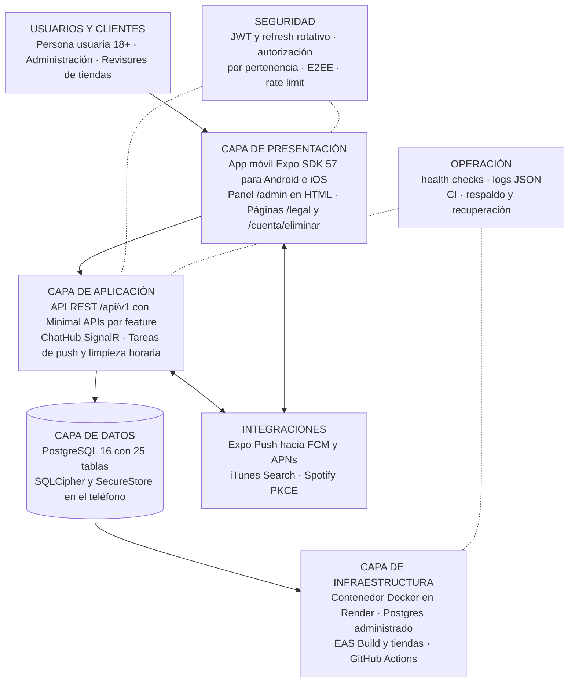

### 4.3 Lenguajes, frameworks y motor de base de datos

| Componente | Lenguaje y versión | Frameworks y librerías principales |
|---|---|---|
| API | C# (`LangVersion` latest sobre .NET 10, `Nullable` y warnings como errores) | ASP.NET Core 10 Minimal APIs, SignalR, EF Core 10.0.13 con Npgsql 10.0.3 y `EFCore.NamingConventions` 10.0.1 (snake_case), Dapper 2.1.89, JwtBearer 10.0.13, BCrypt.Net-Next 4.2.1, Microsoft.AspNetCore.OpenApi 10.0.13, Swashbuckle SwaggerUI 10.3.0 |
| Pruebas del back | C# | xUnit v3 3.2.2, `Microsoft.AspNetCore.Mvc.Testing` (WebApplicationFactory), Testcontainers.PostgreSql 4.16.0, cliente SignalR |
| App | TypeScript ~6.0.3 estricto | Expo ~57.0.28, React Native 0.86.3, React 19.2.3, expo-router, TanStack Query 5, `@microsoft/signalr` 10, `@noble/curves`, `@noble/ciphers` y `@noble/hashes` 2.4, `expo-sqlite` (SQLCipher), `expo-secure-store`, `expo-notifications`, `expo-auth-session`, `expo-audio`, `expo-camera`, Reanimated 4.5, `phosphor-react-native` |
| Pruebas de la app | TypeScript | Jest 29 con `jest-expo`, Testing Library para React Native, Maestro (E2E en YAML) |
| Base de datos | SQL de PostgreSQL 16 | Migraciones de EF Core; una consulta CTE con Dapper para el radar |
| Scripts | Bash, Python 3 | `scripts/update-contract.sh`, `scripts/curate_songs.py` |
| Infraestructura | YAML, Dockerfile | GitHub Actions, Docker Compose, Render Blueprint, `eas.json` |

### 4.4 Módulos del back

Cada feature tiene `*Endpoints.cs` (rutas y metadatos OpenAPI), `*Contracts.cs` (DTOs validados), `*Service.cs` (reglas) y sus entidades.

| Módulo | Propósito | Entradas | Salidas | Dependencias | Responsable |
|---|---|---|---|---|---|
| `Auth` | Registro, login, Spotify, refresh con rotación, logout | `/auth/*` | Access JWT, refresh opaco, `user` | `users`, `refresh_tokens`, `banned_emails`, `TokenService`, `LoginThrottle`, Spotify | Equipo Encorely |
| `Users` | Perfil propio, consentimientos, exportación y borrado de cuenta | `/me`, `/me/consents`, `/me/export`, `/me/spotify/link` | Perfil, archivo de datos, borrado en cascada | `users`, `user_genres`, `user_consents`, `SessionRevoker` | Equipo Encorely |
| `Profiles` | Perfil social: perfil ajeno, reacciones | `/users/{id}/profile`, `/users/{id}/reactions`, `/me/reactions/received` | `PublicProfileDto`, reacciones paginadas | `profile_reactions`, `user_artists`, `blocks`, consentimiento | Equipo Encorely |
| `Legal` | Versión de términos, páginas públicas, borrado web | `/legal/current`, `/account-deletion`, `/legal/*`, `/cuenta/eliminar` | Versión vigente, HTML, borrado | `appsettings.json` (`Legal`), `Auth` | Equipo Encorely |
| `Music` | Géneros, feed de canciones, swipes, ADN musical, importación de Spotify | `/genres`, `/songs/feed`, `/swipes`, `/me/dna`, `/me/spotify/import` | Canciones, vector de géneros, estado del radar | `genres`, `songs`, `swipes`, `user_genre_scores`, `user_artists` | Equipo Encorely |
| `Events` | Eventos curados, asistencia, radar por afinidad | `/events`, `/events/{id}/attendance`, `/events/{id}/radar`, `/me/events` | Eventos, asistentes con `affinity` | `events`, `event_attendances`, `Dna`, Dapper | Equipo Encorely |
| `Matching` | Interés entre personas, match recíproco, deshacer match | `/likes`, `/matches` | `{matched, matchId}`, lista de matches, evento `MatchCreated` | `user_likes`, `matches`, `AdvisoryLock`, `Notifier`, push | Equipo Encorely |
| `Chat` | Directorio de llaves públicas, mensajes cifrados, ack | `/keys/me`, `/matches/{id}/peer-keys`, `/matches/{id}/messages` | Ciphertext ordenado por `seq`, eventos `MessageAvailable` y `PeerKeyChanged` | `user_keys`, `user_box_keys`, `chat_messages`, `delivered_message_ids`, `message_franking_records` | Equipo Encorely |
| `Moderation` | Bloqueos y reportes con franking | `/blocks`, `/reports` | Bloqueo efectivo, reporte con evidencia verificada | `blocks`, `reports`, `message_franking_records`, `matches` | Equipo Encorely |
| `Devices` | Tokens push por sesión | `/devices/push-token` | Registro o borrado del token | `device_push_tokens` | Equipo Encorely |
| `Sync` | Respaldo cifrado y vinculación de dispositivos | `/me/backup`, `/keys/link-requests` | Blob opaco, buzón de un solo uso | `encrypted_backup`, `device_link_request` | Equipo Encorely |
| `Sessions` | Sesiones abiertas (familias de refresh) | `/me/sessions` | Lista y cierre de sesiones | `refresh_tokens`, `device_push_tokens`, `SessionRevoker` | Equipo Encorely |
| `Admin` | Eventos, canciones, reportes, suspensión; panel HTML | `/admin/*`, `/admin` | Catálogo y cola de moderación actualizados | Todas las anteriores, `ITunesClient`, `AdminRoleFilter` | Equipo Encorely |
| `Infrastructure/Auth` | JWT, BCrypt, bloqueo por intentos, revocación de sesiones | Cada petición autenticada | Identidad (`sub`, `sid`) validada | `refresh_tokens`, `users` | Equipo Encorely |
| `Infrastructure/Database` | `AppDbContext`, advisory locks, health check, limpieza horaria | Servicios | Persistencia, purgas | PostgreSQL | Equipo Encorely |
| `Infrastructure/Realtime` | `ChatHub` y `Notifier` | Conexiones WebSocket autenticadas | Avisos al usuario | Sesión vigente | Equipo Encorely |
| `Infrastructure/Push` | Cola acotada, envío a Expo Push, receipts | Eventos de match y mensaje | Notificaciones sin contenido | `device_push_tokens`, `exp.host` | Equipo Encorely |
| `Infrastructure/Http` | ProblemDetails, validación, cabeceras de seguridad | Toda petición | Errores uniformes y cabeceras | Ninguna | Equipo Encorely |
| `Infrastructure/Configuration` | `.env` en Development, mapeo de variables, validación al arrancar | Variables de entorno | Opciones tipadas o arranque fallido | Ninguna | Equipo Encorely |

### 4.5 Módulos de la app

| Módulo (`src/…`) | Propósito | Entradas | Salidas | Dependencias | Responsable |
|---|---|---|---|---|---|
| `app/` | Rutas de expo-router: grupos `(auth)`, `(onboarding)`, `(app)` con tabs Descubrir, Conciertos, Chats y Tú | Navegación, deep links `encorely://` | Pantalla de la feature | `features/*`, `lib/session` | Equipo Encorely |
| `lib/api` | Cliente HTTP: base `/api/v1`, timeout de 15 s, un solo refresh en vuelo, errores en español | Llamadas de las features | Datos tipados o `ApiError` | `schema.d.ts` generado, `lib/session` | Equipo Encorely |
| `lib/session` | Sesión única y tokens en SecureStore | Login, refresh, logout | Estado de sesión | `expo-secure-store` | Equipo Encorely |
| `features/auth`, `onboarding`, `account` | Entrar, crear cuenta, onboarding, consentimiento, sesiones, exportar y borrar cuenta | Formularios | Llamadas a `Auth` y `Users` | `lib/api`, `spotify` | Equipo Encorely |
| `features/discover` | Mazo de canciones con muestra de 30 s y ADN | Gestos y botones accesibles | `POST /swipes` | `expo-audio`, `Music` | Equipo Encorely |
| `features/events`, `match` | Conciertos, asistencia, radar, "Me interesa", matches | Selección del usuario | Llamadas a `Events` y `Matching` | `lib/api` | Equipo Encorely |
| `features/chat` | Cifrado, llaves, historial SQLCipher, sincronización y ack, hub, respaldo, traspaso, verificación | Texto del usuario, avisos del hub | Sobres cifrados, mensajes descifrados | `@noble/*`, `expo-sqlite`, `@microsoft/signalr`, `expo-camera` | Equipo Encorely |
| `features/social`, `profile` | Pestaña Tú, perfil ajeno, reacciones, visibilidad | Perfil y reacciones | Llamadas a `Profiles` y `Users` | `src/ui` (stickers, motion) | Equipo Encorely |
| `features/safety` | Bloquear, reportar con evidencia, textos de E2EE | Acción del usuario | `POST /blocks`, `POST /reports` | `chat` (evidencia de franking) | Equipo Encorely |
| `features/push` | Permiso, canal Android, registro del token, navegación desde la notificación | Token de Expo, toque en notificación | `PUT /devices/push-token`, navegación | `expo-notifications`, EAS project ID | Equipo Encorely |
| `features/spotify` | PKCE, login, vinculación, importación de artistas | Redirect `encorely://spotify-callback` | Code al back o artistas importados | `expo-auth-session`, Spotify | Equipo Encorely |
| `features/admin` | Panel admin en la app: conciertos, canciones, reportes | Formularios de admin | Llamadas a `/admin/*` | Rol admin | Equipo Encorely |
| `ui/` | Design system "La boleta compartida": tokens, tema, componentes, iconos, motion | Props | Componentes accesibles | Fuentes Google, Phosphor, Reanimated | Equipo Encorely |

### 4.6 Diagrama de componentes

#### 4.6.1 Componentes de la app

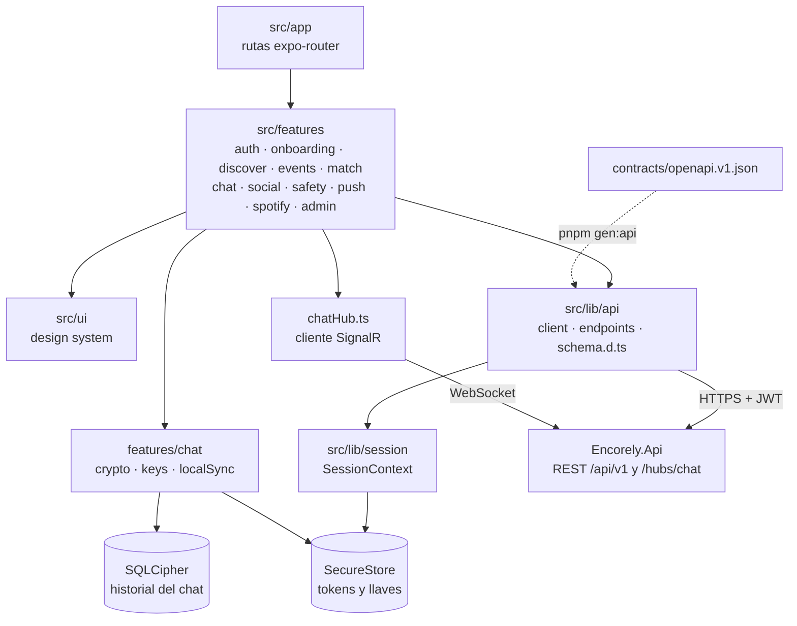

#### 4.6.2 Componentes de la API

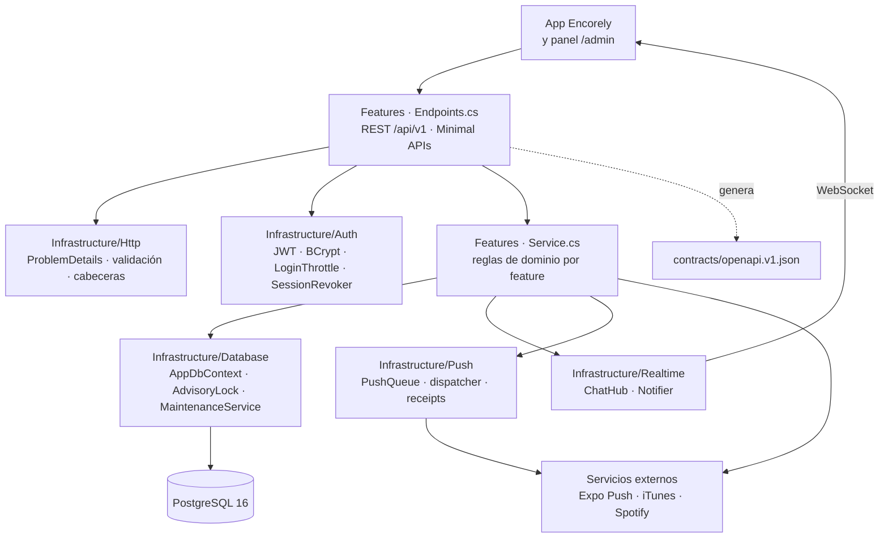

### 4.7 Relaciones y flujo de información

#### 4.7.1 Pipeline de una petición en la API

```
[ForwardedHeaders solo con FORWARDED_TRUSTED_NETWORKS] → ExceptionHandler → StatusCodePages → SecurityHeaders
→ log de acceso sin query → CORS → Authentication (JWT) → ActiveUserCheck (cuenta y sesión vivas)
→ Authorization (fallback: autenticado) → RateLimiter → validación (DataAnnotations) → handler → servicio → EF Core o Dapper
```

- La identidad sale del claim `sub` del JWT (`ClaimsPrincipal.UserId()`); ningún DTO recibe un `userId` para decidir quién llama.
- `ActiveUserCheck` confirma en la base, en cada petición, que la cuenta existe, no está suspendida y que la sesión (`sid`) sigue abierta. Cerrar sesión, suspender o borrar corta el acceso en el acto, sin esperar a que venza el token.
- Un recurso ajeno responde 404 para no confirmar que existe.

#### 4.7.2 Secuencia del match recíproco

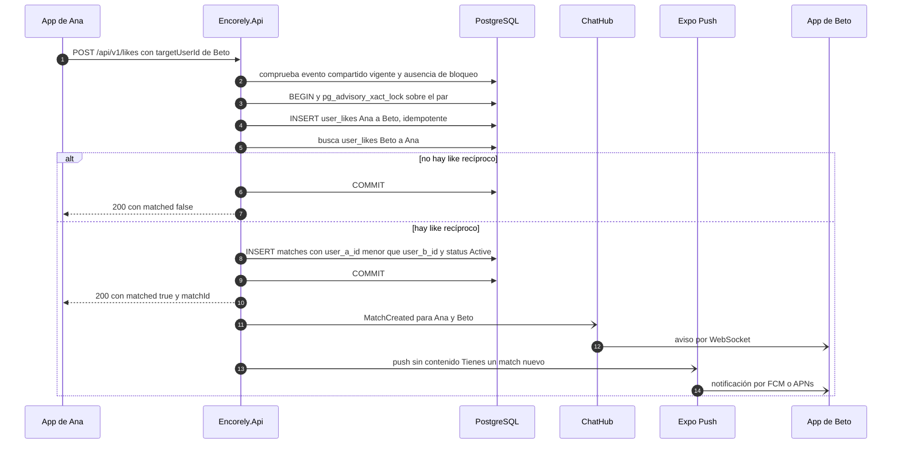

El advisory lock por par serializa likes cruzados, unmatch y bloqueo: dos likes simultáneos crean exactamente un match (hay una prueba con 20 rondas concurrentes) y un bloqueo concurrente no puede resucitar un match. El índice único parcial `ix_matches_user_a_id_user_b_id` (solo `status = 'Active'`) respalda la regla en la base.

#### 4.7.3 Secuencia del envío de un mensaje cifrado

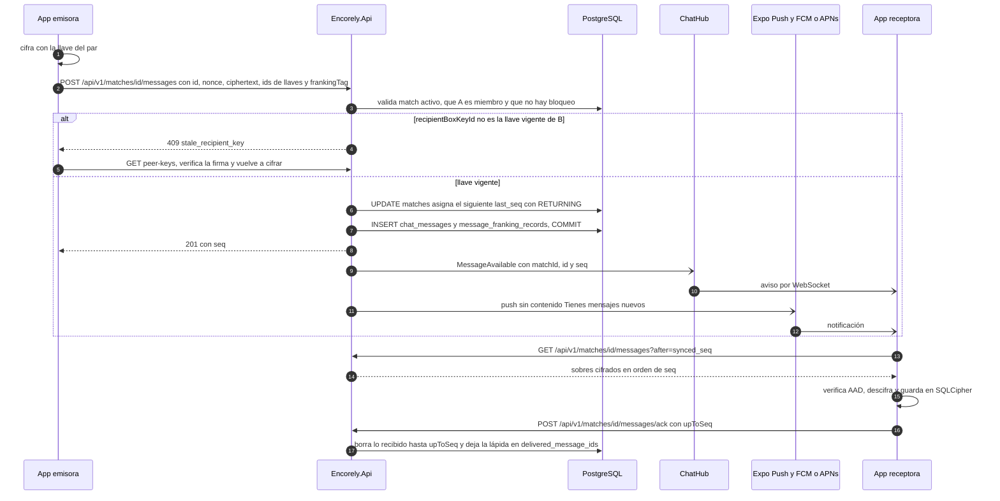

En el paso 1 la app deriva la llave del par con X25519 y HKDF y cifra con XChaCha20-Poly1305, con el AAD de 8.5. El servidor guarda por mensaje solo `id`, `match_id`, `sender_id`, `seq`, versión, ids de llaves, `nonce`, `ciphertext`, `franking_tag` opcional y fecha. Si el mismo `id` llega dos veces con el mismo contenido, responde 200 sin duplicar.

### 4.8 Matriz de componentes

| Módulo | Componente | Tecnología | Dependencias | Responsable |
|---|---|---|---|---|
| Usuarios | Autenticación (`Features/Auth`, `Infrastructure/Auth`) | C# / ASP.NET Core 10, JwtBearer, BCrypt | BD (`users`, `refresh_tokens`, `banned_emails`), Spotify | Equipo Encorely |
| Usuarios | Perfil y cuenta (`Features/Users`, `Features/Sessions`) | C# / EF Core 10 | BD (`users`, `user_genres`, `user_consents`) | Equipo Encorely |
| Usuarios | Perfil social (`Features/Profiles`) | C# / EF Core 10 | BD (`profile_reactions`, `user_artists`, `blocks`) | Equipo Encorely |
| Legal | Términos, privacidad y borrado web (`Features/Legal`) | C# / HTML con CSP | `appsettings.json`, `Auth` | Equipo Encorely |
| Música | Catálogo, swipes y ADN (`Features/Music`) | C# / EF Core 10 | BD (`genres`, `songs`, `swipes`, `user_genre_scores`) | Equipo Encorely |
| Eventos | Eventos, asistencia y radar (`Features/Events`) | C# / EF Core 10 + Dapper | BD (`events`, `event_attendances`), `Dna` | Equipo Encorely |
| Match | Like y match recíproco (`Features/Matching`) | C# / EF Core 10, advisory locks | BD (`user_likes`, `matches`), `Notifier`, push | Equipo Encorely |
| Chat | Llaves y mensajes cifrados (`Features/Chat`) | C# / EF Core 10 | BD (tablas de chat), `ChatHub`, push | Equipo Encorely |
| Chat | Tiempo real (`ChatHub`, `Notifier`) | SignalR (WebSocket) | Sesión JWT vigente | Equipo Encorely |
| Moderación | Bloqueos y reportes (`Features/Moderation`) | C# / EF Core 10, HMAC-SHA256 | BD (`blocks`, `reports`, `message_franking_records`) | Equipo Encorely |
| Respaldo | Respaldo cifrado y vinculación (`Features/Sync`) | C# / EF Core 10 | BD (`encrypted_backup`, `device_link_request`) | Equipo Encorely |
| Administración | API y panel (`Features/Admin`) | C# / HTML | Todas las features, iTunes Search | Equipo Encorely |
| Integraciones | Push (`Infrastructure/Push`, `Features/Devices`) | C# / HttpClient, cola en memoria | Expo Push API → FCM/APNs, `device_push_tokens` | Equipo Encorely |
| Integraciones | Conector Spotify (`SpotifyClient`, `features/spotify`) | C# y TypeScript, OAuth PKCE | Spotify Accounts y Web API | Equipo Encorely |
| Integraciones | Catálogo iTunes (`ITunesClient`, `scripts/curate_songs.py`) | C# y Python | iTunes Search API | Equipo Encorely |
| App móvil | Navegación y pantallas (`src/app`, `src/features`) | TypeScript / Expo SDK 57, React Native 0.86 | API REST, `src/ui` | Equipo Encorely |
| App móvil | Cliente API y sesión (`src/lib`) | TypeScript, TanStack Query | Contrato OpenAPI, SecureStore | Equipo Encorely |
| App móvil | Cifrado del chat (`src/features/chat`) | TypeScript, `@noble/*`, SQLCipher | SecureStore, API de llaves y mensajes | Equipo Encorely |
| Infraestructura | Base de datos | PostgreSQL 16 | Servidor o servicio administrado, respaldo | Equipo Encorely |
| Infraestructura | Imagen de la API (`Dockerfile`, `render.yaml`) | Docker, Render | Registro de imágenes, variables de entorno | Equipo Encorely |
| Infraestructura | CI (`ci.yml`, `frontend.yml`) | GitHub Actions | Docker en el runner, pnpm, .NET SDK | Equipo Encorely |
| Infraestructura | Builds de la app (`eas.json`) | EAS Build | Cuenta de Expo, credenciales de tiendas | Equipo Encorely |

### 4.9 Componentes críticos y puntos únicos de falla

| Componente | Por qué es crítico | Punto único de falla | Mitigación actual | Mitigación propuesta para producción |
|---|---|---|---|---|
| PostgreSQL | Toda la información del servidor | Sí: una sola instancia | Migraciones versionadas, `/health/ready` | Postgres administrado con respaldo continuo y PITR (9.5); réplica de lectura si la carga lo exige |
| Instancia de la API | Única puerta de REST, hub y tareas | Sí: una instancia (`plan: starter`) | Health check `/health/live` en Render, reinicio automático del contenedor | Segunda instancia con backplane de SignalR, contador de intentos compartido y migraciones como paso previo (`efbundle`) |
| `JWT_SIGNING_KEY` | Firma de todas las sesiones | Sí | Generada por Render (`generateValue`) y validada al arrancar | Guardarla además en un gestor de secretos del equipo; procedimiento de rotación en 10.2 |
| `BANNED_EMAIL_KEY` | Vetos de correos suspendidos | Sí: si se pierde, los vetos guardados dejan de servir | Igual que la anterior | Igual que la anterior |
| `LoginThrottle` y `PushQueue` | Bloqueo por intentos y cola de push | Viven en memoria: un reinicio los vacía | Aceptado como riesgo residual (8.10) | Mover a Postgres o a un almacén compartido al pasar a varias instancias |
| Expo Push, FCM y APNs | Avisos fuera de la app | Dependencia externa | La app consulta al abrir; el hub avisa con la app abierta | Monitorear receipts y tasa de errores (9.3) |
| Llaves privadas del chat | Leer el historial | Viven solo en el teléfono | Respaldo cifrado opcional y traspaso | Promover el respaldo en la app |
| Contrato `openapi.v1.json` | Acuerdo entre app y API | Un cambio que rompa deja clientes viejos sin servicio | `OpenApiContractTests`, CHANGELOG con marca **Rompe** | Política de compatibilidad hacia atrás durante un ciclo de release (5.6) |

### 4.10 Trazabilidad entre módulos, requisitos, datos, integraciones y seguridad

| Módulo | Requisitos | Tablas | Integraciones | Controles de seguridad |
|---|---|---|---|---|
| `Auth` | RF-01, RF-02, RNF-03 | `users`, `refresh_tokens`, `banned_emails` | Spotify Accounts | BCrypt, rate limit por IP, bloqueo (correo, IP), refresh con detección de reuso |
| `Users`, `Legal`, `Sessions` | RF-03, RF-04, RF-16, RNF-10 | `users`, `user_genres`, `user_consents`, `refresh_tokens` | Ninguna | Consentimiento versionado, borrado en cascada, 18+ |
| `Profiles` | RF-10 | `profile_reactions`, `user_artists`, `blocks` | Spotify (imágenes `i.scdn.co`) | Visibilidad con consentimiento propio; 404 con bloqueo |
| `Music` | RF-05, RF-06 | `genres`, `songs`, `swipes`, `user_genre_scores`, `user_artists` | iTunes (previews), Spotify (importación) | Upsert atómico; token de Spotify nunca llega al servidor |
| `Events` | RF-07, RF-08 | `events`, `event_attendances` | Ninguna | Radar solo para asistentes; excluye bloqueos y suspendidos |
| `Matching` | RF-09 | `user_likes`, `matches` | Expo Push | Advisory lock por par, CHECK de par ordenado |
| `Chat` | RF-11, RF-12, RNF-02 | `user_keys`, `user_box_keys`, `chat_messages`, `delivered_message_ids`, `message_franking_records` | Expo Push | E2EE, solo miembros del match, push sin contenido |
| `Sync` | RF-13 | `encrypted_backup`, `device_link_request` | Ninguna | Blob opaco, buzón de 10 min y un solo uso |
| `Moderation` | RF-14 | `blocks`, `reports`, `message_franking_records` | Ninguna | Franking verificable, un reporte abierto por par, retención de 180 días |
| `Devices` | RF-15 | `device_push_tokens` | Expo Push → FCM/APNs | Token ligado a la sesión |
| `Admin` | RF-17 | Todas | iTunes Search | Rol admin confirmado en la base en cada petición |

## 5. Instalación, configuración y despliegue

### 5.1 Instalación local de la API y la base de datos

**Prerrequisitos**

- Software de 3.3.1 instalado: mise, Docker con `docker compose` v2.
- Repositorio `encorly_back` clonado y en la rama `dev`.
- Puertos 5000 y 5432 libres (o usar los puertos alternos del final de esta sección).
- Si mise no está activado en la shell (`eval "$(mise activate zsh)"`), anteponer `mise exec --` a cada `dotnet`.

**Pasos**

1. Instalar el SDK definido por el repositorio:

   ```bash
   mise trust     # solo la primera vez en un clon nuevo
   mise install
   ```

2. Crear la configuración local y completar los cuatro valores marcados (los demás ya sirven para local):

   ```bash
   cp .env.example .env
   # DB_PASSWORD         la que se quiera; docker compose crea la BD con ella
   # JWT_SIGNING_KEY     openssl rand -base64 48
   # BANNED_EMAIL_KEY    openssl rand -base64 48   (distinta de la anterior)
   # DEMO_USER_PASSWORD  opcional: contraseña de las 16 cuentas demo
   ```

3. Levantar PostgreSQL y esperar a que esté sano:

   ```bash
   docker compose up -d --wait
   ```

4. Arrancar la API. En `Development` aplica las 11 migraciones y siembra el catálogo al arrancar:

   ```bash
   mise exec -- dotnet run --project src/Encorely.Api
   ```

5. Comprobar el servicio y, si se definió `DEMO_USER_PASSWORD`, iniciar sesión con una cuenta demo:

   ```bash
   curl http://localhost:5000/health/live
   curl http://localhost:5000/health/ready
   curl -s http://localhost:5000/openapi/v1.json | jq -r .info.title
   curl -s -X POST http://localhost:5000/api/v1/auth/login \
     -H 'content-type: application/json' \
     -d '{"email":"valentina.rojas@encorely.demo","password":"<DEMO_USER_PASSWORD>"}' | jq '.user'
   ```

**Criterio de validación**

- El log de arranque muestra `Applying migration '20261014050309_Initial'` hasta `'20261015155802_IndicesPurga'` y las líneas `Seed: 15 géneros`, `Seed: 120 canciones`, `Seed: 24 eventos` (más `Seed: 16 usuarios demo` y `Seed: match demo del revisor` si hay `DEMO_USER_PASSWORD`). En una base que ya tenía datos estas líneas no aparecen porque el seed solo inserta lo que falta.
- `/health/live` y `/health/ready` responden `Healthy`.
- `/openapi/v1.json` devuelve el título `Encorely API`.
- El login responde `accessToken`, `refreshToken`, `expiresIn: 900` y `user`.

Verificado el 2026-10-20 en un clon limpio de `dev`: `/health/live` y `/health/ready` respondieron `Healthy` unos 20 s después de `dotnet run`.

**Variantes**

- API en otro puerto: `mise exec -- dotnet run --project src/Encorely.Api --urls http://127.0.0.1:5100`. La variable `ASPNETCORE_URLS` no sirve porque `appsettings.Development.json` fija `Urls`.
- Postgres en otro puerto: `DB_PORT=5433 docker compose up -d --wait` y la misma variable al arrancar la API. Una variable de la shell gana sobre el `.env`.
- Todo en contenedores, sin SDK: `docker compose --profile full up -d --build` (API en `http://localhost:5000`, entorno `Development`).
- Volver a empezar: `docker compose down -v` borra el contenedor y el volumen `encorely_pg` con los datos locales. Es destructivo: confirmar antes de ejecutarlo.

### 5.2 Instalación local de la app

**Prerrequisitos**

- Software de 3.3.2: Node 24, pnpm 12.11.2, JDK 17 activo, Android SDK 36 con `ANDROID_HOME` apuntando a él y un AVD (referencia: `encorely_api35`).
- `encorely-front` clonado en la rama `Dev`, con `encorly_back` en la carpeta hermana.
- API local corriendo y validada según 5.1.

**Pasos**

1. Instalar dependencias exactamente como dice el lockfile:

   ```bash
   pnpm install --frozen-lockfile
   ```

2. Verificar el código sin emulador:

   ```bash
   pnpm typecheck && pnpm lint && pnpm test
   ```

3. Configurar la URL de la API:

   ```bash
   cp .env.example .env
   # EXPO_PUBLIC_API_URL=http://10.0.2.2:5000        (emulador Android)
   # EXPO_PUBLIC_API_URL=http://<IP-del-PC>:5000     (teléfono en la misma red)
   ```

4. Compilar e instalar el development build y arrancar Metro en otra terminal:

   ```bash
   export ANDROID_HOME="$HOME/Android/Sdk"
   ~/Android/Sdk/emulator/emulator -avd encorely_api35 &
   pnpm android     # expo run:android: genera android/, compila e instala
   pnpm start       # expo start --dev-client, Metro en el puerto 8081
   ```

**Criterio de validación**

- `pnpm install --frozen-lockfile` termina sin cambiar `pnpm-lock.yaml`.
- `typecheck`, `lint` y `test` pasan (referencia del 2026-10-20: 56 suites y 490 pruebas en verde).
- La app abre en la pantalla de bienvenida; no aparece "Falta configurar el servidor" (eso indica que falta `EXPO_PUBLIC_API_URL`).
- Con una cuenta demo se entra y la pestaña Conciertos lista los eventos del seed.

La app corre en un development build (`expo-dev-client`), no en Expo Go: SQLCipher, push y el controlador de teclado necesitan código nativo. Para probar match y chat hacen falta dos cuentas en dos dispositivos. Los pasos 3 y 4 no se re-ejecutaron al redactar el manual porque el emulador estaba en uso por otra sesión; el paso 2 sí.

### 5.3 Configuración

#### 5.3.1 Variables de entorno de la API

Cómo se carga: en `Development`, `DotEnv` lee el `.env` más cercano sin pisar variables ya definidas; fuera de `Development` el `.env` se ignora. `EnvironmentMapping` traduce las variables planas a secciones (`DB_HOST` → `Database:Host`) y las opciones se validan al arrancar: si falta un obligatorio, la API no levanta. Ningún secreto tiene valor por defecto en el código.

| Variable | Qué controla | Defecto | Obligatoria |
|---|---|---|---|
| `DB_HOST`, `DB_NAME`, `DB_USER` | Conexión a Postgres | Sin defecto (compose usa `encorely` para nombre y usuario) | Sí |
| `DB_PORT` | Puerto de Postgres | `5432` | No |
| `DB_PASSWORD` | Contraseña de Postgres (secreto) | Sin defecto | Sí |
| `DB_SSL_MODE` | `Disable`, `Allow`, `Prefer`, `Require`, `VerifyCA`, `VerifyFull` | `Prefer` | Fuera de Development debe ser `Require` o superior |
| `DB_MIGRATE_ON_STARTUP` | Aplica migraciones al arrancar | `false` (`true` en Development) | No |
| `JWT_SIGNING_KEY` | Llave HS256 de los access tokens, 32 caracteres o más (secreto) | Sin defecto | Sí |
| `JWT_ISSUER`, `JWT_AUDIENCE` | Emisor y audiencia validados | `encorely-api`, `encorely-app` | No |
| `JWT_ACCESS_TOKEN_MINUTES`, `JWT_REFRESH_TOKEN_DAYS` | Vida de los tokens (5–60 min, 1–90 días) | `15`, `30` | No |
| `BANNED_EMAIL_KEY` | Llave HMAC de los correos vetados, distinta de la del JWT (secreto) | Sin defecto | Sí |
| `SEED_CATALOG` | Siembra géneros, canciones y eventos si faltan | `false` (`true` en Development) | No |
| `DEMO_USER_PASSWORD` | Crea las cuentas demo con esa contraseña (secreto) | Vacío | Fuera de Development solo con `SEED_REVIEWER_ONLY=true` |
| `SEED_REVIEWER_ONLY` | Siembra solo `revisor@encorely.demo` y su par, nunca el admin | `false` | No |
| `RADAR_MIN_SWIPES`, `RADAR_MIN_AFFINITY`, `AFFINITY_MIN_SWIPES` | Reglas del radar y de la afinidad | `15`, `0`, `25` | No |
| `RATE_LIMIT_AUTH_PER_MINUTE`, `AUTH_MAX_FAILED_LOGINS`, `AUTH_LOCKOUT_MINUTES` | Límite de autenticación por IP y bloqueo por (correo, IP) | `10`, `5`, `15` | No |
| `RATE_LIMIT_USER_WRITES_PER_MINUTE`, `RATE_LIMIT_REPORTS_PER_HOUR`, `RATE_LIMIT_TOKENS_PER_MINUTE` | Escrituras por usuario, reportes por usuario, refresh y logout por IP | `120`, `10`, `60` | No |
| `FORWARDED_TRUSTED_NETWORKS` | CIDR de los proxies de confianza | Vacío (se ignora `X-Forwarded-For`) | Sí fuera de Development |
| `CHAT_MESSAGE_RETENTION_DAYS` | Días que se guarda un mensaje sin ack; `0` sin límite | `30` | No |
| `PUSH_ENABLED`, `EXPO_PUSH_ACCESS_TOKEN` | Envío por Expo Push y su token (secreto) | `false`, vacío | No |
| `CORS_ORIGINS` | Orígenes CORS (solo Expo web) | Vacío | No |
| `PUBLIC_BASE_URL` | URL pública para enlaces legales y de borrado | Vacío (se deriva del host) | Sí fuera de Development, y https |
| `PRIVACY_CONTACT_EMAIL` | Correo de consultas de datos personales | Vacío | No |
| `SPOTIFY_CLIENT_ID`, `SPOTIFY_ALLOWED_REDIRECTS` | Client ID público de Spotify y redirects aceptadas | Vacío, `encorely://spotify-callback` | No |

Valores fijos en `appsettings.json`: versión de consentimiento `Legal:ConsentVersion = 2026-10-14` y su fecha. Cambiarlos obliga a todas las personas a aceptar de nuevo (`POST /me/consents`).

#### 5.3.2 Variables de entorno de la app

| Variable | Obligatoria | Dónde se lee | Qué hace | Si falta |
|---|---|---|---|---|
| `EXPO_PUBLIC_API_URL` | Sí | `src/lib/config.ts` | URL base de la API sin `/api/v1`; de ella salen `API_BASE` y `HUB_URL` (`/hubs/chat`) | La app muestra "Falta configurar el servidor" |
| `EXPO_PUBLIC_EAS_PROJECT_ID` | No | `src/features/push/config.ts` | ID del proyecto EAS para pedir el token push, si no está en `app.json` | Push desactivado (`missingProjectId`) |
| `MAESTRO_E2E_*` | Solo E2E | Maestro | Cuenta, contraseña y datos de los flujos E2E | Ver `encorely-front/docs/e2e.md` |

Las variables `EXPO_PUBLIC_*` quedan dentro del bundle: nunca llevan secretos.

#### 5.3.3 Configuración estática de la app

| Archivo | Campo | Valor |
|---|---|---|
| `app.json` | `name`, `slug`, `scheme` | `Encorely`, `encorely-app`, `encorely` |
| `app.json` | `ios.bundleIdentifier`, `android.package` | `com.encorely.app` |
| `app.json` | `android.allowBackup` | `false` (llaves y base local fuera del backup de Android) |
| `app.json` | `ios.config.usesNonExemptEncryption` | `true` (cifrado propio: E2EE y SQLCipher) |
| `app.json` | Plugins | `expo-router` (raíz `src/app`), `expo-secure-store`, `expo-notifications` (canal `messages`), `expo-sqlite` (`useSQLCipher: true`), `expo-camera` (sin micrófono), `expo-audio` (sin grabación) |
| `app.json` | Permisos bloqueados en Android | `RECORD_AUDIO`, `SYSTEM_ALERT_WINDOW`, `READ_EXTERNAL_STORAGE`, `WRITE_EXTERNAL_STORAGE` |
| `eas.json` | Perfiles | `development` (APK dev client, API `http://10.0.2.2:5000`), `development-simulator`, `preview` (APK interno, API de staging), `production` (AAB e IPA, `autoIncrement`) |
| `eas.json` | `cli.appVersionSource` | `remote`: EAS lleva `versionCode` y `buildNumber` |

### 5.4 Integración continua

| Repositorio | Archivo | Disparadores | Pasos |
|---|---|---|---|
| `encorly_back` | `.github/workflows/ci.yml` | Push a `main`, `dev`, `rebuild/v1` y todo pull request | Job `build-test`: restore → `dotnet format --verify-no-changes` → paquetes vulnerables (incluye transitivos) → build Release con warnings como errores → pruebas con Postgres real. Job `docker`: build de la imagen y smoke en modo `Production` (`/health/live` y `Cache-Control: no-store`) |
| `encorely-front` | `.github/workflows/frontend.yml` | Push y PR a `main` y `rebuild/v1` | `pnpm install --frozen-lockfile` → `check:expo` → `typecheck` → `lint` → `test --silent` → `build:bundles` |

La CI del front no corre en `Dev` (pendiente en 10.6). Antes de abrir un PR al back se corren los mismos pasos en local:

```bash
mise exec -- dotnet format Encorely.slnx --verify-no-changes --exclude src/Encorely.Api/Data/Migrations
mise exec -- dotnet build Encorely.slnx -c Release
mise exec -- dotnet test tests/Encorely.Tests
```

Resultado del 2026-10-20 sobre `dev`: formato sin cambios, build Release con 0 advertencias y 0 errores, 332 de 332 pruebas en unos 2 minutos.

### 5.5 Plan de despliegue a producción

#### 5.5.1 Estado actual del despliegue

El sistema no está publicado (D15): el entregable es código, pruebas, documentación y demo local. Lo que existe para publicar es el `Dockerfile` (imagen sin secretos, usuario no root, puerto 8080), el Blueprint `render.yaml` (servicio web, Postgres 16, health check y secretos generados o marcados para completar), `eas.json` con perfiles `preview` y `production`, y el checklist de tiendas en `encorely-front/docs/tiendas.md`. Este plan describe cómo pasar a producción cuando se decida.

#### 5.5.2 Cronograma, responsables y ventana

El cronograma es relativo al día de salida (D). Todas las actividades las asume el Equipo Encorely de forma compartida; quien ejecuta un paso lo registra en el informe de aceptación.

| Semana o día | Actividad | Responsable | Entregable |
|---|---|---|---|
| D-28 a D-21 | Planificación: fecha de salida, ventana, criterios de aceptación, plan de rollback revisado | Equipo Encorely | Plan de despliegue aprobado |
| D-21 a D-7 | Prueba cerrada de Google Play (12 testers o más, 14 días seguidos, exigencia de cuentas personales nuevas) con build `preview` o `production` | Equipo Encorely | Track de prueba cerrada activo |
| D-21 a D-14 | Preparación del entorno: Render, dominio y TLS, Postgres con respaldo continuo, proyecto EAS, Firebase (FCM v1), APNs, Spotify Dashboard | Equipo Encorely | Entornos creados, secretos cargados |
| D-14 a D-10 | Instalación y configuración en staging: API y app `preview` apuntando a `https://api-staging…` | Equipo Encorely | Staging funcionando |
| D-10 | Migración de datos: aplicar las 11 migraciones sobre la base vacía y sembrar el catálogo | Equipo Encorely | Esquema y catálogo validados |
| D-10 a D-3 | Pruebas de aceptación: suite completa, flujos Maestro sobre `preview`, smoke manual, revisión de seguridad | Equipo Encorely | Informe de aceptación |
| D-3 a D-1 | Capacitación: administración del panel, guardia y runbooks, manual de usuario publicado | Equipo Encorely | Personas de guardia asignadas |
| D, 05:00 a 07:00 (hora de Colombia, UTC-5) | Go-live: despliegue de la API de producción y envío de la app a revisión | Equipo Encorely | Software en producción |
| D a D+14 | Monitoreo posterior intensivo (revisión diaria de alertas, receipts de push, reportes) | Equipo Encorely | Cierre de la puesta en marcha |

Ventana de despliegue propuesta: martes de 05:00 a 07:00 hora de Colombia, la franja de menor uso esperado para una app de conciertos (la actividad se concentra en las noches y los fines de semana). Es un objetivo; no hay tráfico real que lo confirme.

#### 5.5.3 Actividades de la fase de despliegue

| N.º | Actividad | Qué se hace en Encorely | Criterio de validación |
|---|---|---|---|
| 1 | Planificación | Fijar D, ventana, responsables de guardia y criterios de aceptación; revisar el plan de rollback de 5.6 | Plan revisado por todo el equipo |
| 2 | Preparación del entorno | Crear el Blueprint de Render desde `render.yaml`; dominio con TLS; Postgres con respaldo continuo; secretos (`JWT_SIGNING_KEY` y `BANNED_EMAIL_KEY` generados por Render, el resto con `sync: false`); EAS `init` y credenciales; FCM v1 y APNs; redirect de Spotify | Todas las variables obligatorias definidas; la API no arranca si falta alguna |
| 3 | Instalación y configuración | Desplegar la imagen; completar `FORWARDED_TRUSTED_NETWORKS`, `PUBLIC_BASE_URL` (https), `PRIVACY_CONTACT_EMAIL`, `EXPO_PUSH_ACCESS_TOKEN` y `SPOTIFY_CLIENT_ID` | `/health/live` y `/health/ready` en `Healthy` sobre el dominio público |
| 4 | Migración de datos | No se migran datos del sistema anterior (D7 y D16: eran ficticios y su esquema no tenía fuente de verdad). Se aplican las migraciones al arrancar (`DB_MIGRATE_ON_STARTUP=true`, una sola instancia) y se siembra el catálogo (`SEED_CATALOG=true`) | La última fila de `__EFMigrationsHistory` es `20261015155802_IndicesPurga`; `genres` tiene 15 filas y `songs` 120 |
| 5 | Pruebas de aceptación | Smoke de la API, flujos Maestro 01 a 06 sobre un build apuntando a producción o staging, revisión de cabeceras y de páginas legales | Informe de aceptación firmado con cada caso en "pasa" |
| 6 | Capacitación | Recorrido del panel `/admin` para quien modera; repaso de runbooks (10.2) para la guardia; publicación del manual de usuario | Cada persona de guardia ejecutó al menos un runbook en staging |
| 7 | Puesta en marcha (go-live) | Crear el admin de producción (5.5.4, paso 6); enviar la app a revisión con la cuenta `revisor@encorely.demo` (`SEED_REVIEWER_ONLY=true`) | App aprobada por las tiendas; API en producción sin alertas abiertas |
| 8 | Monitoreo posterior | Revisión diaria durante 14 días: alertas, tasa de 5xx, receipts de push, reportes de moderación | Sin incidentes de severidad 1 o 2 abiertos al cierre |

#### 5.5.4 Procedimiento de despliegue de la API

**Prerrequisitos**

- CI en verde sobre el commit a desplegar (jobs `build-test` y `docker`).
- Cuenta de Render con acceso al repositorio y dominio propio con DNS administrable.
- Valores de `FORWARDED_TRUSTED_NETWORKS` (rangos del proxy de Render, según su documentación), `PUBLIC_BASE_URL`, `PRIVACY_CONTACT_EMAIL` y, si aplica, `EXPO_PUSH_ACCESS_TOKEN` y `SPOTIFY_CLIENT_ID`.
- Plan de Postgres con respaldo continuo confirmado (9.5).

**Pasos**

1. Fusionar a `main` el commit aprobado y etiquetarlo (`api-v1.0.0`).
2. En Render, crear el Blueprint desde `render.yaml`. Se crean `encorely-api` (Docker, `starter`) y `encorely-db` (Postgres 16).
3. Completar las variables `sync: false`. No copiar secretos en chats ni documentos; se cargan directamente en el panel del proveedor.
4. Lanzar el primer despliegue. La API migra la base al arrancar y siembra el catálogo.
5. Asociar el dominio y esperar el certificado TLS.
6. Crear el admin de producción: registrar la cuenta desde la app con una contraseña propia y promoverla con una sentencia revisada por dos personas del equipo, ejecutada una sola vez:

   ```sql
   UPDATE users SET role = 'Admin' WHERE email = '<correo-del-admin>';
   ```

7. Ejecutar el smoke:

   ```bash
   curl -fsS https://<dominio>/health/live
   curl -fsS https://<dominio>/health/ready
   curl -sI https://<dominio>/api/v1/events | grep -i '^cache-control: no-store'
   curl -fsS https://<dominio>/api/v1/legal/current | jq .
   ```

**Criterio de validación**

- Los dos health checks responden `Healthy`.
- `/api/v1/events` sin token responde 401 con `Cache-Control: no-store`.
- `/legal/current` devuelve la versión `2026-10-14` y URLs https bajo `PUBLIC_BASE_URL`.
- El admin entra a `https://<dominio>/admin` y ve la cola de reportes.
- El log del servicio muestra líneas JSON con `traceId` y ninguna excepción de arranque.

#### 5.5.5 Procedimiento de build y publicación de la app

**Prerrequisitos**

- Cuentas de Apple Developer, Google Play Console y Expo (`encorely-front/docs/tiendas.md` §1).
- `eas.json` con `EXPO_PUBLIC_API_URL` del perfil `production` apuntando al dominio real (hoy es un marcador).
- API de producción validada (5.5.4).

**Pasos**

1. Configurar EAS una sola vez:

   ```bash
   pnpm dlx eas-cli@24.13.0 login
   pnpm dlx eas-cli@24.13.0 init          # escribe extra.eas.projectId en app.json
   pnpm dlx eas-cli@24.13.0 credentials   # keystore Android, certificados iOS, FCM v1, APNs
   ```

2. Compilar:

   ```bash
   pnpm dlx eas-cli@24.13.0 build -p android --profile production
   pnpm dlx eas-cli@24.13.0 build -p ios --profile production
   ```

3. Enviar a las tiendas con `pnpm dlx eas-cli@24.13.0 submit`, primero a la prueba cerrada de Play y a TestFlight.
4. Completar las fichas: etiquetas de privacidad, URL de política (`/legal/privacidad`), URL de borrado (`/cuenta/eliminar`), cuenta demo del revisor y declaración de cifrado.
5. Publicar en producción con lanzamiento escalonado (Play) y publicación por fases (App Store).

**Criterio de validación**

- El build instalado desde la prueba cerrada se registra, entra, recibe un push real y abre el chat desde la notificación.
- Las tiendas aprueban la revisión.
- En la consola de Play y en App Store Connect no hay fallos nuevos durante las primeras 48 horas del lanzamiento escalonado.

### 5.6 Plan de rollback

El rollback acompaña toda la secuencia: cada paso de 5.5 tiene una forma de deshacerse antes de seguir.

| Qué falla | Cómo se revierte | Criterio para decidir | Validación |
|---|---|---|---|
| Nueva versión de la API (error de código) | Render: "Rollback" al despliegue anterior desde el historial de deploys del servicio, o redeploy del tag anterior | Alerta de 5xx sostenida, health check en rojo o caso de aceptación fallido | `/health/ready` en `Healthy`, smoke de 5.5.4 en verde con la versión anterior |
| Variable de entorno mal definida | Restaurar el valor anterior en el panel del proveedor y reiniciar | La API no arranca (la validación lo detiene) o un caso falla | Arranque sin errores de configuración en el log |
| Migración de esquema | Regla preventiva: cada migración es compatible con la versión anterior de la API (agregar antes de quitar), así el rollback de la API no exige tocar el esquema. Si hay que deshacerla: `dotnet ef migrations script <Nueva> <Anterior>` genera el SQL de reversa, se revisa y se aplica en la ventana. Último recurso: restaurar con PITR al minuto anterior al despliegue (se pierden las escrituras posteriores) | Error de datos o de esquema que no se corrige con un hotfix | Última fila de `__EFMigrationsHistory` igual a la esperada; pruebas de humo en verde |
| Build de la app con error | Detener el lanzamiento escalonado en Play o pausar la publicación por fases en App Store; publicar un hotfix con número de build mayor. Una versión ya instalada no se puede retirar del teléfono | Fallos nuevos en la consola o reportes de usuarios | El hotfix llega al 100 % sin fallos nuevos |
| Cambio de contrato que rompe clientes viejos | Política: un cambio marcado **Rompe** en el CHANGELOG solo sale cuando la versión de la app que lo soporta ya está publicada; mientras tanto la API mantiene el comportamiento anterior | Clientes con errores 400 o 404 nuevos | Errores vuelven al nivel previo |

**Procedimiento de rollback de la API**

Prerrequisitos

- Decisión de rollback tomada por la guardia según la columna "Criterio para decidir" y registrada en el incidente.
- Identificado el último despliegue sano (tag `api-v…` o deploy anterior en el historial de Render).
- Confirmado que la versión anterior es compatible con el esquema actual (regla de migraciones compatibles); si no lo es, seguir antes la fila "Migración de esquema".

Pasos

1. Anotar la hora de inicio y avisar al canal del equipo.
2. En Render, abrir el servicio `encorely-api`, ir al historial de deploys y ejecutar "Rollback" sobre el último deploy sano (alternativa: redeploy manual del tag anterior).
3. Si el problema venía de una variable, restaurar su valor anterior en el panel y reiniciar el servicio.
4. Esperar a que el health check de Render marque el servicio como disponible.
5. Ejecutar el smoke de 5.5.4 (paso 7).
6. Registrar en el incidente la versión restaurada, la hora de fin y la causa.

Criterio de validación

- `/health/live` y `/health/ready` responden `Healthy` sobre el dominio público.
- El smoke de 5.5.4 pasa completo y la tasa de 5xx vuelve a su nivel previo durante 30 minutos.
- El historial de Render muestra como activo el deploy elegido.

Antes de cada despliegue se confirma que existe un punto de restauración de la base (respaldo continuo activo) y se anota la hora exacta de inicio, que es el punto de PITR si hiciera falta.

### 5.7 Productos del despliegue

| Producto | Dónde está o estará | Estado |
|---|---|---|
| Plan de despliegue | Este manual, 5.5 | Elaborado |
| Manual de instalación | Este manual, 5.1 a 5.3, y los README de cada repositorio | Elaborado y verificado en local |
| Software en producción | Render y tiendas | No aplica en esta entrega (D15); preparado |
| Documentación de usuario | `encorely-front/docs/MANUAL-USUARIO.md` | Elaborada |
| Informe de aceptación | Plantilla en el Anexo C; se llena en la actividad 5 de 5.5.3 | Plantilla lista |
| Plan de rollback | Este manual, 5.6 | Elaborado |

### 5.8 Diagramas de despliegue

#### 5.8.1 Despliegue objetivo en producción

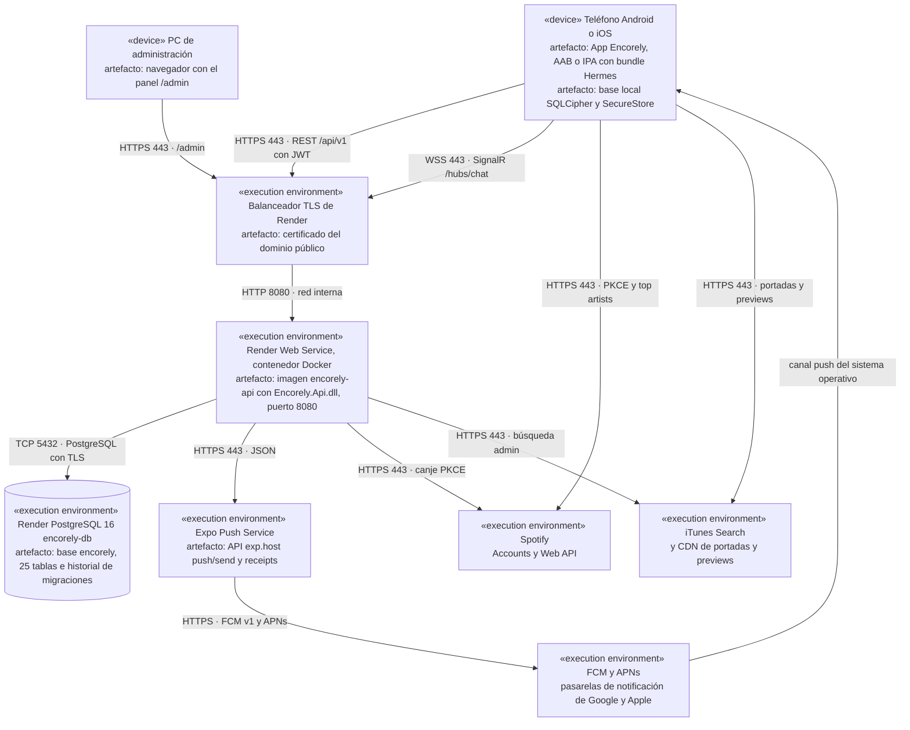

Cada nodo lleva su estereotipo UML y, debajo, los artefactos que aloja: la app y su base local en el teléfono, la imagen `encorely-api` en el contenedor, la base `encorely` en el Postgres administrado. La API no tiene estado en disco; todo el estado persistente del servidor está en `encorely-db`.

#### 5.8.2 Despliegue actual de la demo local

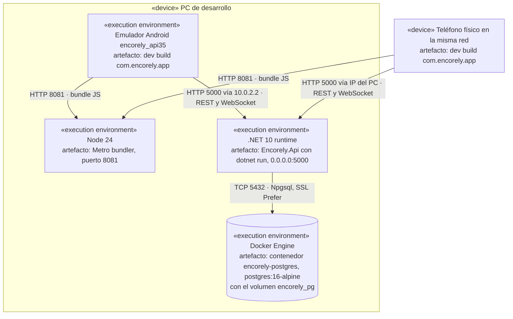

Este es el despliegue que existe y se usa hoy para la demo, en un PC con Ubuntu 22.04. Con `PUSH_ENABLED=false` (valor por defecto) no sale tráfico hacia Expo Push.

## 6. Base de datos y modelo de información

### 6.1 Motor, conexión y convenciones

| Aspecto | Valor |
|---|---|
| Motor | PostgreSQL 16 (local: imagen `postgres:16-alpine`; producción propuesta: Render PostgreSQL 16) |
| Base de datos | `encorely` (nombre por defecto de compose; en producción el que entregue el proveedor) |
| Acceso | EF Core 10 con Npgsql 10.0.3; Dapper solo para la consulta del radar (`Features/Events/RadarService.cs`) |
| Cadena de conexión | Se arma con `DB_HOST`, `DB_PORT`, `DB_NAME`, `DB_USER`, `DB_PASSWORD` y `DB_SSL_MODE`; nunca se escribe en archivos versionados |
| Pool | El de Npgsql por defecto; una instancia de la API comparte el pool entre REST, hub y tareas de fondo |
| Nombres | `snake_case` generado por `UseSnakeCaseNamingConvention`; restricciones `pk_`, `fk_`, `ix_`, `ck_` |
| Identificadores | UUID versión 7 generados por la API (`Guid.CreateVersion7()`), salvo `genres.id` y `user_consents.id` (identidad de Postgres) y `chat_messages.id` (lo genera el cliente) |
| Enums | Guardados como texto de hasta 32 caracteres (`varchar(32)`), legibles y sin CHECK numéricos |
| Fechas | `timestamp with time zone` en UTC; `users.birth_date` es `date` |
| Concurrencia | Advisory locks de transacción por usuario o par (`Infrastructure/Database/AdvisoryLock.cs`): `keys`, `profile`, `dna-import`, `account-state` y el par del match |
| Tablas | 25 de dominio más `__EFMigrationsHistory` de EF Core |
| Dependencias de la base | Ninguna extensión de Postgres; `sha256()` nativo se usa en una migración de datos |

Tablas por área:

| Área | Tablas |
|---|---|
| Cuenta y sesiones | `users`, `user_consents`, `refresh_tokens`, `device_push_tokens`, `banned_emails` |
| Música y perfil | `genres`, `songs`, `swipes`, `user_genres`, `user_genre_scores`, `user_artists`, `profile_reactions` |
| Eventos y match | `events`, `event_attendances`, `user_likes`, `matches` |
| Chat | `user_keys`, `user_box_keys`, `chat_messages`, `delivered_message_ids`, `message_franking_records` |
| Moderación | `blocks`, `reports` |
| Respaldo y vinculación | `encrypted_backup`, `device_link_request` |

### 6.2 Diagrama entidad-relación

El modelo completo se presenta en cinco vistas para que se pueda leer en una página. Cada tabla aparece con su llave primaria, sus llaves foráneas y los campos que definen su regla principal; `users` y `matches` se repiten como ancla entre vistas. Las cinco vistas juntas cubren las 25 tablas y todas sus relaciones. El detalle de cada campo está en las fichas de 6.3.

#### 6.2.1 Vista de cuenta, sesiones y moderación

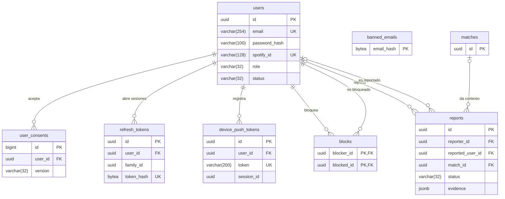

#### 6.2.2 Vista de música y perfil social

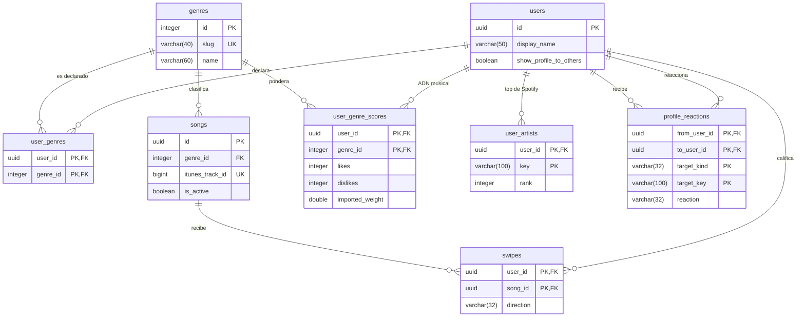

#### 6.2.3 Vista de eventos y match

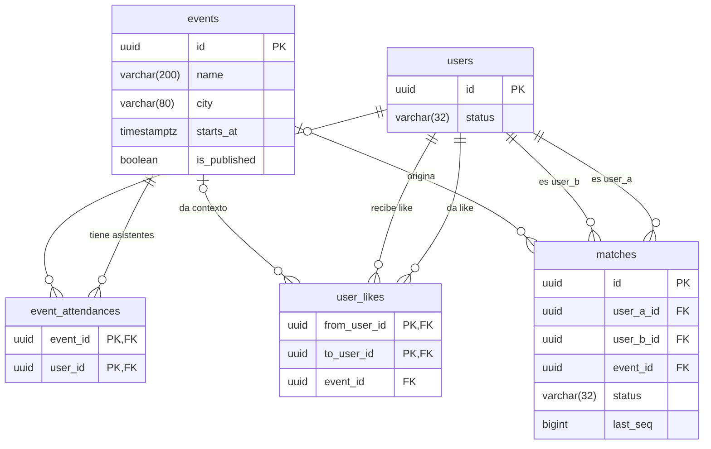

#### 6.2.4 Vista de chat y mensajes

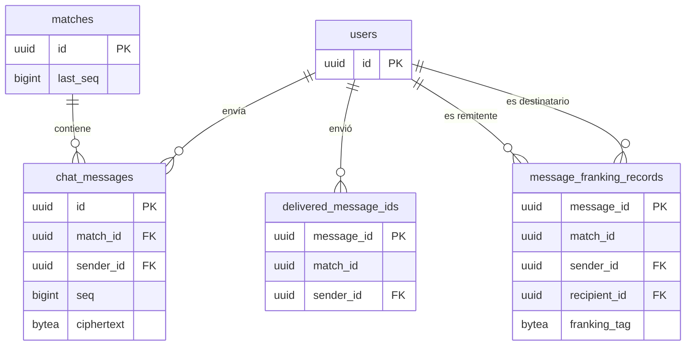

`delivered_message_ids.match_id` y `message_franking_records.match_id` guardan el match sin llave foránea: deben sobrevivir al borrado del mensaje.

#### 6.2.5 Vista de llaves, respaldo y vinculación

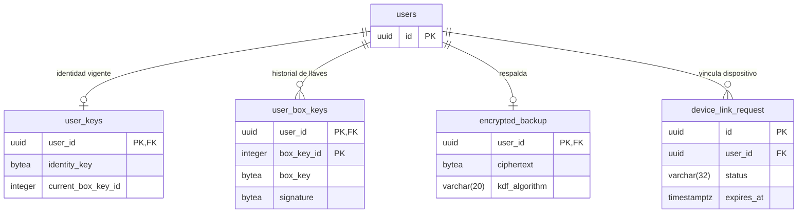

### 6.3 Fichas técnicas de las tablas

Convenciones de las fichas: **Nulo** indica si la columna admite `NULL`; `timestamptz` abrevia `timestamp with time zone`; "Sin FK" señala columnas que referencian otra entidad por diseño pero sin llave foránea declarada. Los valores de los campos enumerados están en 6.4. Las columnas `created_at` y `updated_at` las asigna la API en UTC al crear o modificar la fila.

#### 6.3.1 Tabla users

Propósito: cuenta y perfil de cada persona. Es la tabla central: 20 tablas la referencian. PK `pk_users (id)`. Índices únicos `ix_users_email (email)` e `ix_users_spotify_id (spotify_id)` (Postgres admite varios `NULL` en el único). Borrar una fila borra en cascada sus swipes, likes, matches, mensajes, llaves, sesiones y respaldos; los reportes quedan con la referencia en `NULL`. Componentes: `Auth`, `Users`, `Profiles`, `Admin`.

| Campo | Tipo | Nulo | Restricción o defecto | Significado |
|---|---|---|---|---|
| id | uuid | NOT NULL | PK | Identificador de la cuenta |
| email | varchar(254) | NOT NULL | UNIQUE | Correo de acceso, guardado sin espacios y en minúsculas |
| password_hash | varchar(100) | NULL | | Hash BCrypt (factor 12) de la contraseña; `NULL` si la cuenta se creó con Spotify |
| spotify_id | varchar(128) | NULL | UNIQUE | Usuario de Spotify vinculado para entrar con Spotify |
| show_profile_to_others | boolean | NOT NULL | DEFAULT `true` | Si la persona permite que otras vean su perfil (requiere además el consentimiento de esa finalidad) |
| display_name | varchar(50) | NOT NULL | | Nombre que ven las demás personas |
| birth_date | date | NULL | | Fecha de nacimiento; se exige 18 años o más para terminar el onboarding |
| city | varchar(80) | NULL | | Ciudad que escribe la persona |
| bio | varchar(300) | NULL | | Texto libre del perfil |
| role | varchar(32) | NOT NULL | Valores de 6.4 | Rol: persona usuaria o administración |
| status | varchar(32) | NOT NULL | Valores de 6.4 | Cuenta activa o suspendida |
| created_at | timestamptz | NOT NULL | | Alta de la cuenta |
| updated_at | timestamptz | NOT NULL | | Último cambio del perfil |

#### 6.3.2 Tabla user_consents

Propósito: prueba del consentimiento de términos y política de datos (Ley 1581), una fila por aceptación. PK `pk_user_consents (id)`. FK `fk_user_consents_users_user_id` → `users.id` ON DELETE CASCADE. Índice `ix_user_consents_user_id`. Componentes: `Users`, `Legal`, `Profiles` (consentimiento del perfil público).

| Campo | Tipo | Nulo | Restricción o defecto | Significado |
|---|---|---|---|---|
| id | bigint | NOT NULL | PK, identidad generada por defecto | Número de la aceptación |
| user_id | uuid | NOT NULL | FK → `users.id` | Quién aceptó |
| version | varchar(32) | NOT NULL | | Versión de los documentos aceptados (vigente: `2026-10-14`) |
| accepted_at | timestamptz | NOT NULL | | Cuándo aceptó |

#### 6.3.3 Tabla refresh_tokens

Propósito: sesiones. Cada fila es un refresh token opaco del que solo se guarda el SHA-256; las filas de una misma `family_id` son una sesión. PK `pk_refresh_tokens (id)`. FK `fk_refresh_tokens_users_user_id` → `users.id` CASCADE. Índices: `ix_refresh_tokens_token_hash` (único), `ix_refresh_tokens_family_id`, `ix_refresh_tokens_user_id`, `ix_refresh_tokens_expires_at` (purga horaria). Componentes: `Auth`, `Sessions`, `Infrastructure/Auth`, `MaintenanceService`.

| Campo | Tipo | Nulo | Restricción o defecto | Significado |
|---|---|---|---|---|
| id | uuid | NOT NULL | PK | Identificador del token |
| user_id | uuid | NOT NULL | FK → `users.id` | Dueño de la sesión |
| family_id | uuid | NOT NULL | Índice | Sesión (viaja en el claim `sid` del access token) |
| token_hash | bytea | NOT NULL | UNIQUE | SHA-256 del refresh token; el token en claro nunca se guarda |
| created_at | timestamptz | NOT NULL | | Emisión |
| expires_at | timestamptz | NOT NULL | Índice | Vencimiento (30 días por defecto) |
| revoked_at | timestamptz | NULL | | Cuándo se revocó (logout, rotación, reuso o suspensión) |
| replaced_by_token_id | uuid | NULL | Sin FK | Token que lo reemplazó al rotar |

#### 6.3.4 Tabla device_push_tokens

Propósito: tokens push de Expo por dispositivo, ligados a la sesión que los registró. PK `pk_device_push_tokens (id)`. FK `fk_device_push_tokens_users_user_id` → `users.id` CASCADE. Índices: `ix_device_push_tokens_token` (único), `ix_device_push_tokens_user_id`, `ix_device_push_tokens_session_id`. Componentes: `Devices`, `Sessions`, `Infrastructure/Push`.

| Campo | Tipo | Nulo | Restricción o defecto | Significado |
|---|---|---|---|---|
| id | uuid | NOT NULL | PK | Identificador del registro |
| user_id | uuid | NOT NULL | FK → `users.id` | Cuenta que recibe los avisos |
| token | varchar(200) | NOT NULL | UNIQUE | Token `ExponentPushToken[…]` o `ExpoPushToken[…]`; si otra cuenta lo registra, pasa a ella |
| platform | varchar(32) | NOT NULL | Valores de 6.4 | Sistema operativo del teléfono |
| session_id | uuid | NULL | Índice, sin FK | Sesión (`family_id`) que lo registró; al cerrarla se borra el token |
| created_at | timestamptz | NOT NULL | | Primer registro |
| updated_at | timestamptz | NOT NULL | | Último registro o cambio de dueño |

#### 6.3.5 Tabla banned_emails

Propósito: impedir que una cuenta suspendida se borre y se registre otra vez con el mismo correo. Guarda solo el HMAC-SHA256 del correo normalizado con `BANNED_EMAIL_KEY` (los vetos anteriores a la llave quedaron en SHA-256 y se siguen consultando). PK `pk_banned_emails (email_hash)`. Sin relaciones. Componentes: `Auth`, `Admin`.

| Campo | Tipo | Nulo | Restricción o defecto | Significado |
|---|---|---|---|---|
| email_hash | bytea | NOT NULL | PK | Huella del correo vetado; no permite recuperar el correo sin la llave |
| created_at | timestamptz | NOT NULL | | Fecha del veto |

#### 6.3.6 Tabla genres

Propósito: catálogo de los 15 géneros musicales. PK `pk_genres (id)`. Índice único `ix_genres_slug`. Referenciada por `songs`, `user_genres` y `user_genre_scores` con ON DELETE RESTRICT (un género en uso no se puede borrar). Componentes: `Music`, `Users`, `Events` (radar).

| Campo | Tipo | Nulo | Restricción o defecto | Significado |
|---|---|---|---|---|
| id | integer | NOT NULL | PK, identidad generada por defecto | Identificador interno |
| slug | varchar(40) | NOT NULL | UNIQUE | Identificador estable que viaja en la API (por ejemplo `vallenato`) |
| name | varchar(60) | NOT NULL | | Nombre visible del género |

#### 6.3.7 Tabla songs

Propósito: catálogo curado de canciones para calificar, con portada y muestra de 30 s de iTunes. PK `pk_songs (id)`. FK `fk_songs_genres_genre_id` → `genres.id` RESTRICT. Índices `ix_songs_genre_id` e `ix_songs_itunes_track_id` (único). Componentes: `Music`, `Admin`, `scripts/curate_songs.py` (seed).

| Campo | Tipo | Nulo | Restricción o defecto | Significado |
|---|---|---|---|---|
| id | uuid | NOT NULL | PK | Identificador de la canción |
| title | varchar(200) | NOT NULL | | Título |
| artist | varchar(200) | NOT NULL | | Artista |
| genre_id | integer | NOT NULL | FK → `genres.id` | Género al que suma la calificación |
| cover_url | varchar(500) | NOT NULL | | URL de la portada |
| preview_url | varchar(500) | NULL | | URL de la muestra de 30 s; puede faltar |
| itunes_track_id | bigint | NULL | UNIQUE | Id de la pista en iTunes, evita duplicados en el catálogo |
| is_active | boolean | NOT NULL | | `false` la saca del feed sin borrarla |
| created_at | timestamptz | NOT NULL | | Alta en el catálogo |

#### 6.3.8 Tabla swipes

Propósito: calificaciones de canciones. La PK compuesta garantiza que repetir una canción no suma. PK `pk_swipes (user_id, song_id)`. FK `fk_swipes_users_user_id` → `users.id` CASCADE y `fk_swipes_songs_song_id` → `songs.id` CASCADE. Índice `ix_swipes_song_id`. Componentes: `Music`, `Admin` (conteo de likes por canción).

| Campo | Tipo | Nulo | Restricción o defecto | Significado |
|---|---|---|---|---|
| user_id | uuid | NOT NULL | PK, FK → `users.id` | Quién calificó |
| song_id | uuid | NOT NULL | PK, FK → `songs.id` | Canción calificada |
| direction | varchar(32) | NOT NULL | Valores de 6.4 | Me gusta o paso |
| created_at | timestamptz | NOT NULL | | Momento de la calificación |

#### 6.3.9 Tabla user_genres

Propósito: géneros que la persona declara como favoritos en el onboarding o el perfil. PK `pk_user_genres (user_id, genre_id)`. FK `fk_user_genres_users_user_id` → `users.id` CASCADE y `fk_user_genres_genres_genre_id` → `genres.id` RESTRICT. Índice `ix_user_genres_genre_id`. Componentes: `Users`, `Music` (bono en el ADN), `Profiles`.

| Campo | Tipo | Nulo | Restricción o defecto | Significado |
|---|---|---|---|---|
| user_id | uuid | NOT NULL | PK, FK → `users.id` | Persona |
| genre_id | integer | NOT NULL | PK, FK → `genres.id` | Género declarado |

#### 6.3.10 Tabla user_genre_scores

Propósito: componentes del ADN musical por género. El peso efectivo es `max(0, likes − 0,5·dislikes + imported_weight + 2·[género declarado])` y la afinidad entre dos personas es el coseno de sus vectores. Se actualiza con un upsert atómico en la misma transacción del swipe. PK `pk_user_genre_scores (user_id, genre_id)`. FK `fk_user_genre_scores_users_user_id` → `users.id` CASCADE y `fk_user_genre_scores_genres_genre_id` → `genres.id` RESTRICT. Índice `ix_user_genre_scores_genre_id`. Componentes: `Music`, `Events` (radar), `Profiles`.

| Campo | Tipo | Nulo | Restricción o defecto | Significado |
|---|---|---|---|---|
| user_id | uuid | NOT NULL | PK, FK → `users.id` | Persona |
| genre_id | integer | NOT NULL | PK, FK → `genres.id` | Género |
| likes | integer | NOT NULL | | Canciones de ese género marcadas "me gusta" |
| dislikes | integer | NOT NULL | | Canciones de ese género marcadas "paso" |
| imported_weight | double precision | NOT NULL | | Aporte de la importación de Spotify; se reemplaza en cada importación |

#### 6.3.11 Tabla user_artists

Propósito: artistas más escuchados importados de Spotify, para el perfil y las reacciones. Cada importación reemplaza la lista. PK `pk_user_artists (user_id, key)`. FK `fk_user_artists_users_user_id` → `users.id` CASCADE. Componentes: `Music`, `Profiles`.

| Campo | Tipo | Nulo | Restricción o defecto | Significado |
|---|---|---|---|---|
| user_id | uuid | NOT NULL | PK, FK → `users.id` | Persona |
| key | varchar(100) | NOT NULL | PK | Nombre normalizado (sin tildes ni signos, con guiones) para cruzar artistas entre perfiles |
| name | varchar(200) | NOT NULL | | Nombre del artista como lo da Spotify |
| rank | integer | NOT NULL | | Posición en el top (0 es el más escuchado) |
| image_url | varchar(500) | NULL | | Imagen; solo se guarda si es https de `i.scdn.co` |
| genres | text[] | NOT NULL | | Géneros que Spotify asigna al artista |
| imported_at | timestamptz | NOT NULL | | Fecha de la importación |

#### 6.3.12 Tabla profile_reactions

Propósito: reacciones de una persona a un artista o género del perfil de otra ("Yo también", "Vamos a verlo", "Pásame una"). Una por objetivo y par; reaccionar de nuevo cambia el tipo. No cuenta para el match ni envía push. PK `pk_profile_reactions (from_user_id, to_user_id, target_kind, target_key)`. FK `fk_profile_reactions_users_from_user_id` y `fk_profile_reactions_users_to_user_id` → `users.id` CASCADE. Índice `ix_profile_reactions_to_user_id_updated_at`. Bloquear borra las del par y suspender las de la cuenta. Componente: `Profiles`.

| Campo | Tipo | Nulo | Restricción o defecto | Significado |
|---|---|---|---|---|
| from_user_id | uuid | NOT NULL | PK, FK → `users.id` | Quién reacciona |
| to_user_id | uuid | NOT NULL | PK, FK → `users.id` | Dueño del perfil |
| target_kind | varchar(32) | NOT NULL | PK, valores de 6.4 | Si el objetivo es un artista o un género |
| target_key | varchar(100) | NOT NULL | PK | `slug` del género o `key` del artista |
| target_name | varchar(200) | NOT NULL | DEFAULT `''` (agregado por la migración `PublicProfileConsent`) | Nombre del objetivo al reaccionar, para que la lista no dependa del perfil actual |
| reaction | varchar(32) | NOT NULL | Valores de 6.4 | Tipo de reacción |
| created_at | timestamptz | NOT NULL | | Primera reacción |
| updated_at | timestamptz | NOT NULL | Índice con `to_user_id` | Último cambio; ordena la lista de recibidas |

#### 6.3.13 Tabla events

Propósito: conciertos curados por la administración (seed y panel). PK `pk_events (id)`. Índice `ix_events_city_starts_at (city, starts_at)`. Referenciada por `event_attendances` (CASCADE), `user_likes` y `matches` (SET NULL). Componentes: `Events`, `Admin`, `Matching`.

| Campo | Tipo | Nulo | Restricción o defecto | Significado |
|---|---|---|---|---|
| id | uuid | NOT NULL | PK | Identificador del evento |
| name | varchar(200) | NOT NULL | | Nombre del concierto |
| artist_lineup | text[] | NOT NULL | | Artistas del cartel |
| venue | varchar(200) | NOT NULL | | Lugar |
| city | varchar(80) | NOT NULL | Índice con `starts_at` | Ciudad |
| starts_at | timestamptz | NOT NULL | | Fecha y hora de inicio |
| image_url | varchar(500) | NULL | | Imagen del cartel |
| description | varchar(2000) | NULL | | Descripción |
| is_published | boolean | NOT NULL | | Visible para las personas usuarias |
| created_at | timestamptz | NOT NULL | | Alta del evento |

#### 6.3.14 Tabla event_attendances

Propósito: quién marcó que va a cada evento; habilita el radar y el like entre asistentes. PK `pk_event_attendances (event_id, user_id)`. FK `fk_event_attendances_events_event_id` → `events.id` CASCADE y `fk_event_attendances_users_user_id` → `users.id` CASCADE. Índice `ix_event_attendances_user_id`. Componentes: `Events`, `Matching`, `Profiles`.

| Campo | Tipo | Nulo | Restricción o defecto | Significado |
|---|---|---|---|---|
| event_id | uuid | NOT NULL | PK, FK → `events.id` | Evento |
| user_id | uuid | NOT NULL | PK, FK → `users.id` | Persona que va |
| created_at | timestamptz | NOT NULL | | Cuándo marcó la asistencia |

#### 6.3.15 Tabla user_likes

Propósito: interés de una persona en otra con la que comparte un evento. El match nace solo con el like recíproco. PK `pk_user_likes (from_user_id, to_user_id)`. FK `fk_user_likes_users_from_user_id` y `fk_user_likes_users_to_user_id` → `users.id` CASCADE; `fk_user_likes_events_event_id` → `events.id` SET NULL. Índices `ix_user_likes_to_user_id`, `ix_user_likes_event_id`. CHECK `ck_user_likes_not_self (from_user_id <> to_user_id)`. Componente: `Matching`.

| Campo | Tipo | Nulo | Restricción o defecto | Significado |
|---|---|---|---|---|
| from_user_id | uuid | NOT NULL | PK, FK → `users.id`, CHECK | Quién da el like |
| to_user_id | uuid | NOT NULL | PK, FK → `users.id`, CHECK | Quién lo recibe |
| event_id | uuid | NULL | FK → `events.id` | Evento compartido en que se dio |
| created_at | timestamptz | NOT NULL | | Momento del like |

#### 6.3.16 Tabla matches

Propósito: relación mutua entre dos personas que habilita el chat. El par se guarda ordenado y solo puede haber un match activo por par; los cerrados quedan como historial. PK `pk_matches (id)`. FK `fk_matches_users_user_a_id` y `fk_matches_users_user_b_id` → `users.id` CASCADE; `fk_matches_events_event_id` → `events.id` SET NULL. Índices: `ix_matches_user_a_id_user_b_id` único parcial `WHERE status = 'Active'`, `ix_matches_user_b_id`, `ix_matches_event_id`. CHECK `ck_matches_ordered_pair (user_a_id < user_b_id)`. Componentes: `Matching`, `Chat`, `Moderation`, `Admin`.

| Campo | Tipo | Nulo | Restricción o defecto | Significado |
|---|---|---|---|---|
| id | uuid | NOT NULL | PK | Identificador del match (también es la sal del HKDF del chat) |
| user_a_id | uuid | NOT NULL | FK → `users.id`, CHECK | Persona con el UUID menor del par |
| user_b_id | uuid | NOT NULL | FK → `users.id`, CHECK | Persona con el UUID mayor |
| status | varchar(32) | NOT NULL | Valores de 6.4; parte del índice parcial | Activo o cerrado |
| event_id | uuid | NULL | FK → `events.id` | Evento donde nació el match |
| created_at | timestamptz | NOT NULL | | Fecha del match |
| closed_at | timestamptz | NULL | | Fecha de cierre |
| closed_by_user_id | uuid | NULL | Sin FK | Quién lo cerró |
| close_reason | varchar(32) | NULL | Valores de 6.4 | Por qué se cerró |
| last_seq | bigint | NOT NULL | | Último número de secuencia asignado a un mensaje |
| last_message_at | timestamptz | NULL | | Fecha del último mensaje; ordena la lista de chats |

#### 6.3.17 Tabla user_keys

Propósito: estado vigente de las llaves públicas del chat de cada persona. PK `pk_user_keys (user_id)`. FK `fk_user_keys_users_user_id` → `users.id` CASCADE, relación uno a uno. Componentes: `Chat` (`KeyService`).

| Campo | Tipo | Nulo | Restricción o defecto | Significado |
|---|---|---|---|---|
| user_id | uuid | NOT NULL | PK, FK → `users.id` | Persona |
| identity_key | bytea | NOT NULL | | Llave pública de identidad Ed25519 (32 bytes) |
| current_box_key_id | integer | NOT NULL | | Número de la llave de caja vigente |
| updated_at | timestamptz | NOT NULL | | Última publicación o rotación |

#### 6.3.18 Tabla user_box_keys

Propósito: historial de llaves de caja X25519 públicas, firmadas por la identidad, para descifrar mensajes viejos. Nunca guarda llaves privadas. PK `pk_user_box_keys (user_id, box_key_id)`. FK `fk_user_box_keys_users_user_id` → `users.id` CASCADE. Componente: `Chat`.

| Campo | Tipo | Nulo | Restricción o defecto | Significado |
|---|---|---|---|---|
| user_id | uuid | NOT NULL | PK, FK → `users.id` | Persona |
| box_key_id | integer | NOT NULL | PK | Número de la llave, estrictamente creciente |
| identity_key | bytea | NOT NULL | | Identidad que firmó esta llave |
| box_key | bytea | NOT NULL | | Llave pública X25519 |
| signature | bytea | NOT NULL | | Firma Ed25519 de `ENCORELY-BOXKEY-v1 ‖ box_key_id ‖ box_key`, verificada por el cliente |
| created_at | timestamptz | NOT NULL | | Publicación |

#### 6.3.19 Tabla chat_messages

Propósito: mensajes cifrados de extremo a extremo pendientes de entrega. El servidor no puede leerlos; se borran con el ack del receptor o al cumplir `CHAT_MESSAGE_RETENTION_DAYS`. PK `pk_chat_messages (id)`. FK `fk_chat_messages_matches_match_id` → `matches.id` CASCADE y `fk_chat_messages_users_sender_id` → `users.id` CASCADE. Índices `ix_chat_messages_match_id_seq` (único), `ix_chat_messages_sender_id`, `ix_chat_messages_created_at` (purga). Componentes: `Chat`, `MaintenanceService`.

| Campo | Tipo | Nulo | Restricción o defecto | Significado |
|---|---|---|---|---|
| id | uuid | NOT NULL | PK, lo genera el cliente | Identificador del mensaje; forma parte del AAD e impide duplicados |
| match_id | uuid | NOT NULL | FK → `matches.id`, UNIQUE con `seq` | Conversación |
| sender_id | uuid | NOT NULL | FK → `users.id` | Remitente |
| seq | bigint | NOT NULL | UNIQUE con `match_id` | Orden total del mensaje en la conversación, sin huecos |
| version | smallint | NOT NULL | | Versión del formato del sobre |
| sender_box_key_id | integer | NOT NULL | | Llave de caja del remitente usada |
| recipient_box_key_id | integer | NOT NULL | | Llave de caja del destinatario usada; si no es la vigente, el envío da 409 |
| nonce | bytea | NOT NULL | | Nonce aleatorio de 24 bytes de XChaCha20-Poly1305 |
| ciphertext | bytea | NOT NULL | | Mensaje cifrado con relleno a múltiplos de 256 bytes |
| franking_tag | bytea | NULL | | Compromiso HMAC-SHA256 para reportes verificables |
| created_at | timestamptz | NOT NULL | Índice | Recepción en el servidor |

#### 6.3.20 Tabla delivered_message_ids

Propósito: "lápida" del id de un mensaje sin franking ya confirmado por el receptor. Al borrar el mensaje, impide que el mismo id se reutilice con otro `seq`. PK `pk_delivered_message_ids (message_id)`. FK `fk_delivered_message_ids_users_sender_id` → `users.id` CASCADE. Índices `ix_delivered_message_ids_sender_id` e `ix_delivered_message_ids_delivered_at` (purga a los 180 días). Componentes: `Chat`, `MaintenanceService`.

| Campo | Tipo | Nulo | Restricción o defecto | Significado |
|---|---|---|---|---|
| message_id | uuid | NOT NULL | PK | Id del mensaje entregado |
| match_id | uuid | NOT NULL | Sin FK | Conversación |
| sender_id | uuid | NOT NULL | FK → `users.id` | Remitente |
| delivered_at | timestamptz | NOT NULL | Índice | Momento del ack |

#### 6.3.21 Tabla message_franking_records

Propósito: copia del compromiso de franking de cada mensaje con tag, con vida propia: el ack borra el mensaje pero un reporte posterior debe poder verificarse. Nunca guarda ciphertext; vence a los 180 días. PK `pk_message_franking_records (message_id)`. FK `fk_message_franking_records_users_sender_id` y `fk_message_franking_records_users_recipient_id` → `users.id` CASCADE. Índices por `match_id`, `sender_id`, `recipient_id` y `created_at`. Componentes: `Chat`, `Moderation`, `MaintenanceService`.

| Campo | Tipo | Nulo | Restricción o defecto | Significado |
|---|---|---|---|---|
| message_id | uuid | NOT NULL | PK | Mensaje al que pertenece el compromiso |
| match_id | uuid | NOT NULL | Índice, sin FK | Conversación |
| sender_id | uuid | NOT NULL | FK → `users.id` | Remitente (el reportable) |
| recipient_id | uuid | NOT NULL | FK → `users.id` | Destinatario (quien puede reportar) |
| franking_tag | bytea | NOT NULL | | HMAC-SHA256 del mensaje con la llave de franking |
| created_at | timestamptz | NOT NULL | Índice | Fecha del mensaje |

#### 6.3.22 Tabla blocks

Propósito: bloqueos entre personas. Un bloqueo cierra el match, saca a ambas del radar mutuo y borra likes y reacciones del par. PK `pk_blocks (blocker_id, blocked_id)`. FK `fk_blocks_users_blocker_id` y `fk_blocks_users_blocked_id` → `users.id` CASCADE. Índice `ix_blocks_blocked_id`. CHECK `ck_blocks_not_self (blocker_id <> blocked_id)`. Componentes: `Moderation`, `Events`, `Profiles`, `Matching`.

| Campo | Tipo | Nulo | Restricción o defecto | Significado |
|---|---|---|---|---|
| blocker_id | uuid | NOT NULL | PK, FK → `users.id`, CHECK | Quién bloquea |
| blocked_id | uuid | NOT NULL | PK, FK → `users.id`, CHECK | Quién queda bloqueado |
| created_at | timestamptz | NOT NULL | | Fecha del bloqueo |

#### 6.3.23 Tabla reports

Propósito: reportes de moderación con evidencia verificable. Sobreviven al borrado de las cuentas (las referencias pasan a `NULL`). Solo puede haber un reporte abierto por par (quien reporta, reportado); repetir el reporte suma evidencia al mismo. PK `pk_reports (id)`. FK `fk_reports_users_reporter_id` y `fk_reports_users_reported_user_id` → `users.id` SET NULL; `fk_reports_matches_match_id` → `matches.id` SET NULL. Índices: `ix_reports_reporter_id_reported_user_id` único parcial `WHERE status = 'Open'`, `ix_reports_status_created_at`, `ix_reports_resolved_at` parcial `WHERE evidence_purged_at IS NULL`, `ix_reports_reporter_id`, `ix_reports_reported_user_id`, `ix_reports_match_id`. Componentes: `Moderation`, `Admin`, `MaintenanceService`.

| Campo | Tipo | Nulo | Restricción o defecto | Significado |
|---|---|---|---|---|
| id | uuid | NOT NULL | PK | Identificador del reporte |
| reporter_id | uuid | NULL | FK → `users.id` | Quién reporta; `NULL` si borró su cuenta |
| reported_user_id | uuid | NULL | FK → `users.id` | Persona reportada |
| match_id | uuid | NULL | FK → `matches.id` | Conversación en la que ocurrió, si aplica |
| reason | varchar(32) | NOT NULL | Valores de 6.4 | Motivo |
| detail | varchar(1000) | NULL | | Explicación libre; se borra 180 días después de resolver |
| evidence | jsonb | NULL | | Lista de `{MessageId, Plaintext, Verified}`: mensajes revelados y si su franking coincide |
| status | varchar(32) | NOT NULL | Valores de 6.4 | Estado en la cola de moderación |
| resolution_note | varchar(1000) | NULL | | Nota de quien modera |
| resolved_by_user_id | uuid | NULL | Sin FK | Admin que resolvió |
| resolved_at | timestamptz | NULL | Índice parcial | Fecha de resolución |
| evidence_purged_at | timestamptz | NULL | | Cuándo se borraron `detail` y el texto de la evidencia (quedan `MessageId` y `Verified`) |
| created_at | timestamptz | NOT NULL | Índice con `status` | Fecha del reporte |

#### 6.3.24 Tabla encrypted_backup

Propósito: respaldo opcional del historial y las llaves, cifrado en el teléfono con una frase que el servidor nunca ve. Un blob por persona, se reemplaza completo. PK `pk_encrypted_backup (user_id)`. FK `fk_encrypted_backup_users_user_id` → `users.id` CASCADE, uno a uno. Componente: `Sync`.

| Campo | Tipo | Nulo | Restricción o defecto | Significado |
|---|---|---|---|---|
| user_id | uuid | NOT NULL | PK, FK → `users.id` | Dueño del respaldo |
| version | integer | NOT NULL | | Versión del formato del respaldo |
| ciphertext | bytea | NOT NULL | | Contenido cifrado (hasta 15 MB por petición) |
| nonce | bytea | NOT NULL | | Nonce del cifrado |
| salt | bytea | NOT NULL | | Sal de la derivación de la llave |
| kdf_algorithm | varchar(20) | NOT NULL | | Algoritmo de derivación aceptado (`argon2id`, `scrypt` o `pbkdf2-sha256`); la app usa `scrypt` |
| kdf_ops_limit | bigint | NOT NULL | | Parámetro de costo de la derivación |
| kdf_mem_limit | bigint | NOT NULL | | Parámetro de memoria de la derivación |
| updated_at | timestamptz | NOT NULL | | Última subida |

#### 6.3.25 Tabla device_link_request

Propósito: buzón de un solo uso (10 minutos) para traspasar las llaves a un teléfono nuevo; el servidor solo ve material cifrado. PK `pk_device_link_request (id)`. FK `fk_device_link_request_users_user_id` → `users.id` CASCADE. Índice `ix_device_link_request_user_id_expires_at`. Componentes: `Sync`, `MaintenanceService` (borra los vencidos).

| Campo | Tipo | Nulo | Restricción o defecto | Significado |
|---|---|---|---|---|
| id | uuid | NOT NULL | PK | Identificador del buzón (va en el QR) |
| user_id | uuid | NOT NULL | FK → `users.id` | Cuenta que vincula |
| new_device_ephemeral_key | bytea | NOT NULL | | Llave efímera X25519 pública del teléfono nuevo |
| status | varchar(32) | NOT NULL | Valores de 6.4 | Pendiente o listo para recoger |
| sender_ephemeral_key | bytea | NULL | | Llave efímera del teléfono viejo |
| nonce | bytea | NULL | | Nonce del material cifrado |
| ciphertext | bytea | NULL | | Llaves cifradas hacia el teléfono nuevo |
| created_at | timestamptz | NOT NULL | | Apertura del buzón |
| expires_at | timestamptz | NOT NULL | Índice con `user_id` | Vencimiento |

### 6.4 Diccionario de datos

Valores permitidos de los campos enumerados (se guardan como texto con estos nombres exactos):

| Tabla.campo | Valores | Significado de negocio |
|---|---|---|
| `users.role` | `User`, `Admin` | Persona usuaria; administración con acceso a `/admin` |
| `users.status` | `Active`, `Banned` | Cuenta en uso; cuenta suspendida por moderación (no entra y su correo queda vetado) |
| `swipes.direction` | `Like`, `Dislike` | "Me gusta" suma 1 al género; "Paso" resta 0,5 |
| `device_push_tokens.platform` | `Android`, `Ios` | Sistema operativo del teléfono |
| `matches.status` | `Active`, `Closed` | Conversación habilitada; conversación cerrada (se puede leer el historial, no escribir) |
| `matches.close_reason` | `Unmatched`, `Blocked`, `AccountDeleted`, `Banned` | Una persona deshizo el match; hubo bloqueo; se borró una cuenta; se suspendió una cuenta |
| `reports.reason` | `Spam`, `Harassment`, `Inappropriate`, `FakeProfile`, `Underage`, `Other` | Spam; acoso; contenido inapropiado; perfil falso; menor de edad; otro |
| `reports.status` | `Open`, `Resolved`, `Dismissed` | En cola; resuelto con acción; descartado |
| `profile_reactions.target_kind` | `Artist`, `Genre` | La reacción es a un artista o a un género del perfil |
| `profile_reactions.reaction` | `MeToo`, `LetsGo`, `SendOne` | "Yo también", "Vamos a verlo", "Pásame una" |
| `device_link_request.status` | `Pending`, `Ready` | Esperando al teléfono viejo; material listo para recoger |

Términos de negocio que aparecen en varias tablas:

| Término | Significado |
|---|---|
| ADN musical | Vector de pesos por género de una persona, calculado desde `user_genre_scores` y `user_genres` |
| Afinidad | Coseno entre dos ADN, de 0 a 100; `null` si alguna persona no tiene señal suficiente (menos de `AFFINITY_MIN_SWIPES` calificaciones y sin Spotify) |
| Radar | Lista de asistentes de un evento ordenada por afinidad; se desbloquea con `RADAR_MIN_SWIPES` calificaciones |
| Match | Relación mutua entre dos personas que se dieron like en un evento compartido |
| Ack | Confirmación del receptor de que guardó los mensajes hasta un `seq`; el servidor los borra |
| Franking | Compromiso criptográfico que permite verificar un mensaje reportado sin leer el resto del chat |
| Llave de caja | Llave X25519 con la que se cifran los mensajes hacia una persona; rota cada 7 días en la app |
| Sesión | Familia de refresh tokens (`refresh_tokens.family_id`), visible en Tú → Sesiones |

### 6.5 Almacenamiento en el dispositivo

La app tiene además una base SQLite por persona, `encorely_chat_<userId>.db`, abierta con SQLCipher. La llave de la base son 32 bytes aleatorios en SecureStore (`e2ee_v1_<userId>_dbkey`). Si el llavero no se puede leer, la base no se abre y no se crea otra llave. Código: `encorely-front/src/features/chat/local/sqliteStore.ts`.

#### 6.5.1 Tabla local messages

Propósito: historial descifrado del chat en el teléfono. PK `id`. Índices `messages_match_seq (match_id, seq)` y `messages_undecryptable (match_id) WHERE status = 'undecryptable'`.

| Campo | Tipo | Nulo | Restricción | Significado |
|---|---|---|---|---|
| id | TEXT | NOT NULL | PK | Id del mensaje (el mismo del servidor) |
| match_id | TEXT | NOT NULL | Índice | Conversación |
| seq | INTEGER | NOT NULL | Índice con `match_id` | Orden en la conversación |
| sender_id | TEXT | NOT NULL | | Remitente |
| sent_at | INTEGER | NOT NULL | | Hora del servidor en milisegundos desde 1970 |
| kind | TEXT | NOT NULL | `text` o `system` | Tipo de mensaje |
| body | TEXT | NULL | | Texto descifrado |
| p | TEXT | NULL | | Texto interno exacto, evidencia para un reporte |
| fk | TEXT | NULL | | Llave de franking en base64 |
| status | TEXT | NOT NULL | `sent` o `undecryptable` | Si se pudo descifrar |
| envelope | TEXT | NULL | | Sobre cifrado de lo que no se pudo abrir, para reintentar |

#### 6.5.2 Tabla local sync_state

Propósito: hasta dónde se sincronizó y confirmó cada conversación. PK `match_id`.

| Campo | Tipo | Nulo | Restricción | Significado |
|---|---|---|---|---|
| match_id | TEXT | NOT NULL | PK | Conversación |
| synced_seq | INTEGER | NOT NULL | Solo sube | Hasta qué `seq` se leyó el servidor sin huecos |
| acked_seq | INTEGER | NOT NULL | Solo sube | Hasta qué `seq` el servidor ya borró lo recibido |
| completed_at | INTEGER | NULL | | Última sincronización completa |

En SecureStore (`WHEN_UNLOCKED_THIS_DEVICE_ONLY`) viven los tokens de sesión y las llaves con espacio de nombres por persona: `e2ee_v1_<userId>_identity`, `_meta`, `_chain`, `_box_<n>`, `_install_id`, los pines de contactos (`e2ee_v1_<userId>_peer_…`) y el token push (`encorely_push_token_v1`).

### 6.6 Migraciones

El esquema solo cambia con migraciones de EF Core en `encorly_back/src/Encorely.Api/Data/Migrations`. En `Development` se aplican al arrancar; las pruebas aplican todas sobre un Postgres real.

| Migración | Cambio |
|---|---|
| `20261014050309_Initial` | Esquema base: cuentas, música, eventos, match, chat, bloqueos y reportes |
| `20261014053201_BackupAndDeviceLinking` | `encrypted_backup` y `device_link_request` |
| `20261014061136_SecurityHardening` | `device_push_tokens.session_id`, `banned_emails`, `message_franking_records`; copia vetos y compromisos previos con SQL |
| `20261014174742_SpotifyLogin` | `users.password_hash` pasa a admitir `NULL`; `users.spotify_id` único |
| `20261014194322_LoginThrottlePerIp` | Quita `failed_login_attempts` y `lockout_ends_at` de `users`: el bloqueo pasa a memoria por (correo, IP) |
| `20261014202024_ProfileSocial` | `profile_reactions` y `user_artists` |
| `20261014232924_PublicProfileConsent` | `users.show_profile_to_others`, `profile_reactions.target_name` e índice por `(to_user_id, updated_at)` |
| `20261015003212_ReporteAbiertoUnicoPorPar` | Descarta reportes abiertos duplicados y crea el índice único parcial |
| `20261015003902_RetencionEvidenciaReportes` | `reports.evidence_purged_at` e índice parcial de purga |
| `20261015134656_LapidaMensajesEntregados` | `delivered_message_ids` |
| `20261015155802_IndicesPurga` | Índices `ix_refresh_tokens_expires_at` e `ix_chat_messages_created_at` |

**Procedimiento para crear una migración**

Prerrequisitos: entidades o `AppDbContext` modificados; SDK de 3.3.1.

1. Restaurar las herramientas locales: `mise exec -- dotnet tool restore`.
2. Generar la migración:

   ```bash
   mise exec -- dotnet ef migrations add <Nombre> -p src/Encorely.Api -o Data/Migrations
   # si dotnet-ef no está disponible:
   mise exec -- dnx --yes dotnet-ef@10.0.13 migrations add <Nombre> -p src/Encorely.Api -o Data/Migrations
   ```

3. Revisar el diff de la migración y del `AppDbContextModelSnapshot.cs`. La fábrica de diseño usa una cadena ficticia, así que `migrations add` no necesita base ni secretos.
4. Arrancar la API en local para aplicarla y correr la suite.
5. Actualizar en el mismo PR las fichas, el diccionario, el ERD y la tabla de migraciones de este capítulo.

Criterio de validación: el log de arranque muestra `Applying migration '<timestamp>_<Nombre>'`, `mise exec -- dotnet test tests/Encorely.Tests` pasa completo y `\d <tabla>` en `psql` coincide con la ficha actualizada.

Con más de una instancia en producción, las migraciones dejan de correr al arrancar y pasan a un paso previo del despliegue con `efbundle` (`DB_MIGRATE_ON_STARTUP=false`).

### 6.7 Datos semilla

`Data/Seeder.cs` inserta lo que falta desde JSON embebidos en `Data/Seed/`; es idempotente.

| Archivo | Contenido | Se activa con |
|---|---|---|
| `genres.json` | 15 géneros (reguetón, vallenato, salsa, champeta, cumbia, rock en español, indie, entre otros) | `SEED_CATALOG=true` |
| `songs.json` | 120 canciones con portada y muestra de iTunes; se regenera con `scripts/curate_songs.py` | `SEED_CATALOG=true` |
| `events.json` | 24 eventos en Bogotá y Medellín, con fechas relativas al día del seed (siempre futuras) | `SEED_CATALOG=true` |
| `demo-users.json` | 16 cuentas `@encorely.demo` con gustos y asistencias cruzadas, más el match del revisor | `DEMO_USER_PASSWORD` con valor |

Fuera de `Development` las cuentas demo solo se siembran con `SEED_REVIEWER_ONLY=true` (únicamente `revisor@encorely.demo` y su par, nunca el admin).

### 6.8 Relación entre componentes y estructuras de datos

| Componente | Lee | Escribe | Tipo de acceso |
|---|---|---|---|
| `AuthService`, `TokenService` | `users`, `refresh_tokens`, `banned_emails` | `users`, `refresh_tokens`, `user_consents` | EF Core |
| `UserService` | `users`, `user_genres`, `user_consents` y todas las del usuario (exportación) | `users`, `user_genres`, `user_consents`; borrado en cascada | EF Core |
| `ProfileService` | `users`, `user_artists`, `user_genre_scores`, `event_attendances`, `profile_reactions`, `blocks` | `profile_reactions` | EF Core |
| `MusicService`, `Dna` | `songs`, `genres`, `swipes`, `user_genre_scores`, `user_genres` | `swipes`, `user_genre_scores`, `user_artists` | EF Core con upsert atómico |
| `EventService` | `events`, `event_attendances` | `event_attendances` | EF Core |
| `RadarService` | `event_attendances`, `swipes`, `user_genre_scores`, `user_genres`, `user_artists`, `blocks`, `users`, `user_likes`, `matches` | Ninguna | Dapper (CTE con coseno en SQL) |
| `MatchingService` | `user_likes`, `matches`, `event_attendances`, `blocks` | `user_likes`, `matches` | EF Core + advisory lock por par |
| `ChatService`, `KeyService` | `matches`, `user_keys`, `user_box_keys`, `chat_messages` | `chat_messages`, `matches.last_seq`, `delivered_message_ids`, `message_franking_records`, `user_keys`, `user_box_keys` | EF Core + `UPDATE … RETURNING` |
| `ModerationService` | `blocks`, `reports`, `message_franking_records`, `matches` | `blocks`, `reports`, `matches`, `user_likes`, `profile_reactions` | EF Core + advisory lock |
| `SyncService` | `encrypted_backup`, `device_link_request` | Las mismas | EF Core |
| `DeviceService`, `PushDispatcher`, `PushReceiptChecker` | `device_push_tokens` | `device_push_tokens` | EF Core |
| `AdminService` | Todas | `events`, `songs`, `reports`, `users.status`, `banned_emails` | EF Core |
| `MaintenanceService` | Tablas con vencimiento | Borra en `device_link_request`, `refresh_tokens`, `chat_messages`, `message_franking_records`, `delivered_message_ids`; purga `reports` | EF Core `ExecuteDelete` |
| `DatabaseHealthCheck` | Conexión | Ninguna | `CanConnectAsync` |
| App `features/chat/local` | `messages`, `sync_state` (SQLite local) | Las mismas | `expo-sqlite` con SQLCipher |

### 6.9 Política de respaldo de la base de datos

Resumen (detalle y procedimientos en 9.5):

- Producción: respaldo continuo del proveedor con recuperación a un punto en el tiempo (PITR) más un volcado lógico diario (`pg_dump -Fc`) guardado fuera del proveedor durante 30 días. Objetivos propuestos: RPO de 15 minutos y RTO de 2 horas.
- Local y demo: volcado manual antes de cualquier operación destructiva (`docker compose down -v` borra el volumen `encorely_pg`).
- Qué no cubre el respaldo del servidor: los mensajes ya confirmados, que solo existen cifrados en los teléfonos. Es una decisión de diseño (E2EE con borrado tras el ack); cada persona puede respaldar su historial con `/me/backup`.
- Secretos: `JWT_SIGNING_KEY` y `BANNED_EMAIL_KEY` se respaldan aparte en el gestor de secretos del equipo. Sin `BANNED_EMAIL_KEY` una base restaurada pierde la utilidad de sus vetos.

### 6.10 Retención y purga de datos

`MaintenanceService` corre cada hora:

| Dato | Regla |
|---|---|
| `device_link_request` | Se borra al vencer (10 minutos) |
| `refresh_tokens` | Se borran 30 días después de vencer |
| `chat_messages` | Se borran con el ack o, sin ack, a los `CHAT_MESSAGE_RETENTION_DAYS` días (30 por defecto) |
| `message_franking_records`, `delivered_message_ids` | Se borran a los 180 días |
| `reports.detail` y texto de `reports.evidence` | Se borran 180 días después de resolver, o en cuanto la cuenta reportada ya no existe; queda `evidence_purged_at` |

### 6.11 Mantenimiento de este capítulo

Este capítulo se actualiza con cada cambio de esquema, en el mismo PR de la migración: fichas (6.3), diccionario (6.4), ERD (6.2), tabla de migraciones (6.6) y relación con componentes (6.8). La fuente que manda es `AppDbContextModelSnapshot.cs`; antes de aprobar el PR se compara campo por campo con las fichas.

## 7. Integraciones, APIs y servicios externos

### 7.1 API REST v1

| Aspecto | Regla |
|---|---|
| Base | `/api/v1` (en las tablas de este capítulo se omite) |
| Contrato | `encorly_back/contracts/openapi.v1.json`, generado desde el código; `OpenApiContractTests` falla si no coincide. 68 operaciones |
| Versionado | `v1.0.0-draft.N` en `contracts/CHANGELOG.md`, la entrada más reciente arriba; **Rompe** marca lo que obliga a ajustar el cliente. `info.version` del JSON se queda en `1.0.0` |
| Formato | JSON en `camelCase`, enums como string `camelCase`, fechas ISO-8601 en UTC, binarios en base64 estándar |
| Autenticación | `Authorization: Bearer <accessToken>` en todo lo que no está marcado como público |
| Errores | `application/problem+json` con `title` en español, `code` estable, `traceId` y `errors` por campo en validación |
| Límites de cuerpo | 256 KiB (413), salvo `PUT /me/backup` (15 MB) y `POST /reports` (1 MB) |
| Límites de frecuencia | 429 con `Retry-After` (ver 8.4) |
| Documentación viva | `/openapi/v1.json` solo en `Development` |

Ejemplo de error:

```json
{"title":"Necesitas iniciar sesión.","status":401,"traceId":"0HNPF0DJF4DJ5:00000001","code":"unauthorized"}
```

Códigos estables frecuentes: `invalid_body`, `validation_failed`, `unauthorized`, `invalid_refresh_token`, `account_banned`, `user_not_found`, `stale_recipient_key`, `message_already_delivered`, `message_id_conflict`, `chat_quota_exceeded`, `too_much_evidence`, `report_already_resolved`, `cannot_change_admin_status`, `spotify_unavailable`, `payload_too_large`. Los posibles por operación están en el contrato.

### 7.2 Catálogo de operaciones

"Pública" significa sin token. El detalle de cuerpos, respuestas y errores está en el contrato.

| Módulo | Operación | Auth | Qué hace |
|---|---|---|---|
| Auth | `POST /auth/register` | Pública | Crea una cuenta con correo y contraseña e inicia sesión |
| Auth | `POST /auth/login` | Pública | Inicia sesión |
| Auth | `POST /auth/spotify` | Pública | Entra con Spotify canjeando el code PKCE; crea la cuenta si el Spotify no está vinculado |
| Auth | `POST /auth/refresh` | Pública | Rota el refresh token y emite un access token nuevo |
| Auth | `POST /auth/logout` | Pública | Revoca el refresh token y su familia |
| Legal | `GET /legal/current` | Pública | Versión vigente de términos y política, y sus URL |
| Legal | `POST /account-deletion` | Pública | Borra la cuenta con correo y contraseña desde la web |
| Perfil | `GET /me` | JWT | Perfil propio |
| Perfil | `PATCH /me` | JWT | Edita el perfil (los campos `null` no cambian) |
| Perfil | `DELETE /me` | JWT | Borra la cuenta, con contraseña o reconfirmando con Spotify. Irreversible |
| Perfil | `POST /me/spotify/link` | JWT | Vincula Spotify para poder entrar con él |
| Perfil | `DELETE /me/spotify/link` | JWT | Desvincula Spotify (no si es la única forma de entrar) |
| Perfil | `POST /me/consents` | JWT | Acepta una nueva versión de términos y política |
| Perfil | `GET /me/export` | JWT | Descarga los datos personales (Ley 1581) |
| Perfil social | `GET /users/{id}/profile` | JWT | Perfil de otra persona; 404 si no existe, está suspendida o hay bloqueo |
| Perfil social | `PUT /users/{id}/reactions` | JWT | Reacciona a un artista o género de su perfil |
| Perfil social | `DELETE /users/{id}/reactions` | JWT | Quita la reacción a ese objetivo |
| Perfil social | `GET /me/reactions/received` | JWT | Reacciones recibidas, paginadas con `before` |
| Música | `GET /genres` | Pública | Catálogo de géneros |
| Música | `GET /songs/feed` | JWT | Canciones aún no calificadas |
| Música | `POST /swipes` | JWT | Califica una canción |
| Música | `GET /me/dna` | JWT | ADN musical y estado del radar |
| Música | `POST /me/spotify/import` | JWT | Importa los artistas más escuchados leídos en el teléfono |
| Eventos | `GET /events` | JWT | Eventos futuros publicados |
| Eventos | `GET /events/{id}` | JWT | Detalle de un evento |
| Eventos | `PUT /events/{id}/attendance` | JWT | Marca asistencia (idempotente) |
| Eventos | `DELETE /events/{id}/attendance` | JWT | Quita la asistencia (idempotente) |
| Eventos | `GET /me/events` | JWT | Eventos futuros a los que voy |
| Eventos | `GET /events/{id}/radar` | JWT | Asistentes por afinidad; exige asistir y haber desbloqueado el radar |
| Match | `POST /likes` | JWT | Like a una persona con la que comparto evento; match solo si es recíproco |
| Match | `GET /matches` | JWT | Matches activos, paginables con `limit`, `beforeAt` y `beforeId` |
| Match | `GET /matches/{id}` | JWT | Un match propio |
| Match | `DELETE /matches/{id}` | JWT | Deshace el match y cierra el chat |
| Llaves E2EE | `PUT /keys/me` | JWT | Publica o rota las llaves públicas; si cambia la identidad avisa `PeerKeyChanged` |
| Llaves E2EE | `GET /keys/me` | JWT | Llaves públicas vigentes propias |
| Llaves E2EE | `GET /matches/{id}/peer-keys` | JWT | Llaves públicas vigentes de la otra persona |
| Llaves E2EE | `GET /matches/{id}/peer-keys/box/{boxKeyId}` | JWT | Una llave de caja histórica de la otra persona |
| Chat | `POST /matches/{id}/messages` | JWT | Envía un mensaje cifrado (201; 200 si el mismo id ya existía con el mismo contenido) |
| Chat | `GET /matches/{id}/messages` | JWT | Mensajes cifrados; `before` pagina hacia atrás y `after` trae los nuevos |
| Chat | `POST /matches/{id}/messages/ack` | JWT | Confirma lo guardado hasta `upToSeq`; el servidor lo borra |
| Moderación | `POST /blocks` | JWT | Bloquea a una persona (idempotente) |
| Moderación | `GET /blocks` | JWT | Personas bloqueadas |
| Moderación | `DELETE /blocks/{userId}` | JWT | Desbloquea (no reabre el match) |
| Moderación | `POST /reports` | JWT | Reporta; si ya hay uno abierto contra esa persona, suma la evidencia |
| Push | `PUT /devices/push-token` | JWT | Registra el token push del dispositivo |
| Push | `DELETE /devices/push-token` | JWT | Quita el token push al cerrar sesión |
| Respaldo | `PUT /me/backup` | JWT | Sube o reemplaza el respaldo cifrado |
| Respaldo | `GET /me/backup` | JWT | Descarga el respaldo cifrado |
| Respaldo | `DELETE /me/backup` | JWT | Borra el respaldo |
| Respaldo | `GET /me/backup/info` | JWT | Tamaño y fecha del respaldo |
| Vinculación | `POST /keys/link-requests` | JWT | Teléfono nuevo: abre un buzón (vence en 10 min) |
| Vinculación | `GET /keys/link-requests/{id}` | JWT | Consulta el buzón |
| Vinculación | `PUT /keys/link-requests/{id}` | JWT | Teléfono viejo: deja el material cifrado (una vez) |
| Vinculación | `DELETE /keys/link-requests/{id}` | JWT | Destruye el buzón tras recoger el material |
| Sesiones | `GET /me/sessions` | JWT | Sesiones abiertas |
| Sesiones | `DELETE /me/sessions` | JWT | Cierra todas las sesiones, incluida la actual |
| Sesiones | `DELETE /me/sessions/{id}` | JWT | Cierra una sesión |
| Administración | `GET /admin/events` | JWT admin | Eventos, incluidos no publicados y pasados |
| Administración | `POST /admin/events` | JWT admin | Crea un evento |
| Administración | `PUT /admin/events/{id}` | JWT admin | Edita un evento |
| Administración | `DELETE /admin/events/{id}` | JWT admin | Borra un evento y sus asistencias |
| Administración | `GET /admin/songs` | JWT admin | Catálogo con conteo de likes y dislikes |
| Administración | `POST /admin/songs` | JWT admin | Agrega una canción |
| Administración | `PUT /admin/songs/{id}` | JWT admin | Edita una canción (`isActive=false` la saca del feed) |
| Administración | `GET /admin/itunes/search` | JWT admin | Busca en iTunes para dar de alta canciones con muestra |
| Administración | `GET /admin/reports` | JWT admin | Cola de reportes, los más antiguos primero |
| Administración | `POST /admin/reports/{id}/resolve` | JWT admin | Resuelve un reporte; `ban` suspende, cierra matches y revoca sesiones |
| Administración | `PUT /admin/users/{id}/status` | JWT admin | Suspende o reactiva una cuenta |

### 7.3 Rutas fuera del contrato

| Ruta | Qué es | Acceso |
|---|---|---|
| `/health/live` | El proceso responde (sin dependencias) | Pública, sin detalle |
| `/health/ready` | El proceso y la base responden | Pública, sin detalle |
| `/hubs/chat` | Hub SignalR | JWT |
| `/admin` | Panel de administración en HTML | Login con cuenta admin |
| `/cuenta/eliminar` | Borrado de cuenta desde la web (exigido por Google Play) | Pública |
| `/legal/terminos`, `/legal/privacidad` | Términos y política de privacidad | Pública |
| `/openapi/v1.json`, `/swagger` | Contrato y UI de Swagger | Solo `Development` (ver 10.6 sobre `/swagger`) |

### 7.4 Tiempo real con SignalR

`Infrastructure/Realtime/ChatHub.cs`, en `/hubs/chat`. Exige autenticación, se cierra cuando vence el token (`CloseOnAuthenticationExpiration`) y no tiene métodos invocables desde la app: solo avisa. La app se conecta con `src/features/chat/realtime/chatHub.ts`, con el access token vigente y reconexión a los 0, 2, 5, 10 y 30 s.

| Evento | Carga | Qué hace la app |
|---|---|---|
| `MessageAvailable` | `{matchId, id, seq}` | `GET /matches/{id}/messages?after=<seq>` |
| `PeerKeyChanged` | `{matchId, userId}` | Vuelve a pedir `peer-keys` y avisa del cambio de llave |
| `MatchClosed` | `{matchId}` | Cierra el chat |
| `MatchCreated` | `{matchId}` | Refresca la lista de matches |

El token viaja en `?access_token=` solo en `/hubs/*` porque los WebSocket no admiten cabeceras desde el navegador. El log de acceso nunca registra query strings.

### 7.5 Notificaciones push

| Aspecto | Detalle |
|---|---|
| Proveedor | Expo Push API (`https://exp.host/--/api/v2/push/send`), que entrega por FCM (Android) y APNs (iOS) |
| Activación | `PUSH_ENABLED=true`; `EXPO_PUSH_ACCESS_TOKEN` si el proyecto lo exige |
| Registro | La app pide el token con `getExpoPushTokenAsync` y lo envía a `PUT /devices/push-token`. Solo se aceptan `ExponentPushToken[…]` o `ExpoPushToken[…]` |
| Contenido | `title: "Encorely"`, `body: "Tienes mensajes nuevos"` o `"Tienes un match nuevo"`, `channelId: "messages"`, `data: {t, matchId}`. Nunca el texto, el nombre ni la foto del remitente |
| Envío | Cola acotada en memoria (1000 avisos, descarta el más viejo si se llena) con timeout de 10 s por llamada; no frena la petición |
| Receipts | `PushReceiptChecker` revisa cada 15 min y borra los tokens que FCM/APNs marcan `DeviceNotRegistered` |
| Si falla | La app sigue funcionando: el hub avisa con la app abierta y la app consulta al volver a primer plano |
| Pendiente para producción | Proyecto EAS (`extra.eas.projectId`), credencial FCM v1 en EAS y llave APNs |

### 7.6 iTunes Search

| Aspecto | Detalle |
|---|---|
| Uso | Portadas y muestras de 30 s de las canciones del catálogo |
| Quién llama | El panel de administración (`GET /admin/itunes/search`, `ITunesClient`, timeout de 10 s) y el script `scripts/curate_songs.py`, que regenera `songs.json` con pausas de 1 s entre llamadas |
| La app | Reproduce las URL de muestra guardadas en `songs.preview_url` directamente desde el CDN de Apple |
| Credenciales | Ninguna |
| Si falla | El alta de canciones nuevas queda en pausa; el catálogo existente sigue funcionando. Una muestra que falte deja portada y artista |
| Condición de uso | Uso académico con atribución; revisar términos antes de un uso comercial |

### 7.7 Spotify

PKCE S256, sin client secret en ningún lado. Redirect única `encorely://spotify-callback`, idéntica en el Dashboard de Spotify.

| Flujo | Alcance | Quién canjea el code | Endpoint de la API |
|---|---|---|---|
| Entrar con Spotify | `user-read-email` | La API (`SpotifyClient`, timeout de 10 s) | `POST /auth/spotify` |
| Vincular o reconfirmar el borrado | `user-read-email` | La API | `POST /me/spotify/link`, `DELETE /me` |
| Importar artistas | `user-top-read` | El teléfono | `POST /me/spotify/import` (máximo 50 artistas) |

En la importación el token de Spotify no sale del teléfono: la app lee `GET /v1/me/top/artists?limit=50&time_range=medium_term` y manda a la API solo nombres, géneros e imagen. La API nunca vincula cuentas por correo. Limitación vigente: en modo desarrollo Spotify solo admite las cuentas registradas a mano como usuarios de prueba (máximo 5); a las demás responde 403, que la app explica con un mensaje propio. Sin `SPOTIFY_CLIENT_ID` la API responde 502 `spotify_unavailable` y la app sigue funcionando con correo y contraseña.

### 7.8 Cliente de la API en la app

| Archivo | Papel |
|---|---|
| `src/lib/api/schema.d.ts` | Tipos generados con `openapi-typescript` desde el contrato; no se edita a mano |
| `src/lib/api/types.ts` | Alias legibles de los tipos generados |
| `src/lib/api/endpoints.ts` | Una función por endpoint, agrupadas por dominio (`authApi`, `meApi`, `eventsApi`, `chatApi`, `adminApi`…) |
| `src/lib/api/client.ts` | Transporte: token, un solo refresh en vuelo ante 401, timeout de 15 s, un reintento en GET ante corte de red |
| `src/lib/api/errors.ts` | Traduce `ProblemDetails` a texto para la persona y ramifica por `code` |

**Procedimiento para integrar un nuevo draft del contrato**

Prerrequisitos: back en la carpeta hermana en la rama que tiene el draft; app con dependencias instaladas.

1. Leer en `../encorly_back/contracts/CHANGELOG.md` las entradas posteriores al draft integrado (hoy draft.17).
2. Regenerar los tipos: `pnpm gen:api`.
3. `pnpm typecheck` y corregir lo que señale, empezando por `types.ts`, luego `endpoints.ts` y los hooks de cada feature.
4. Si el draft solo cambia comportamiento (códigos de error nuevos), buscar los `code` afectados en `src/` y en `errors.ts`.
5. `pnpm verify` y recorrido manual de las pantallas afectadas.
6. Commit con el draft en el mensaje: `Integra el contrato draft.N: …`.

Criterio de validación: `pnpm gen:api` no deja diferencias sin commitear en `schema.d.ts` y `pnpm verify` pasa.

### 7.9 Resumen de servicios externos

| Servicio | Dirección | Protocolo | Credencial | Dato que recibe | Impacto si cae |
|---|---|---|---|---|---|
| Expo Push → FCM/APNs | API → Expo → teléfono | HTTPS | `EXPO_PUSH_ACCESS_TOKEN` (opcional), credenciales FCM v1 y APNs en EAS | Token push y aviso sin contenido | Sin avisos fuera de la app; el resto funciona |
| iTunes Search | API y script → Apple; app → CDN de Apple | HTTPS | Ninguna | Términos de búsqueda | Sin altas nuevas en el catálogo |
| Spotify Accounts y Web API | App y API → Spotify | HTTPS (OAuth PKCE) | `SPOTIFY_CLIENT_ID` (público) | Code PKCE (API); token del usuario (solo en el teléfono) | Sin login ni importación con Spotify; correo y contraseña siguen funcionando |
| Render (propuesto) | Hosting de API y base | HTTPS, TCP 5432 TLS | Cuenta del equipo | Todo el estado del servidor | Caída total del servicio (ver 9 y 10) |
| EAS Build | Compilación de la app | HTTPS | Cuenta de Expo y credenciales de firma | Código de la app | No se pueden publicar versiones nuevas; la app instalada sigue funcionando |

## 8. Seguridad, perfiles y permisos

### 8.1 Perfiles de usuario y permisos

| Perfil | Cómo se obtiene | Qué puede hacer | Qué no puede hacer |
|---|---|---|---|
| Visitante anónimo | Sin token | Registrarse, entrar, renovar sesión, ver géneros, términos, política y borrar su cuenta desde la web | Cualquier otra operación (401) |
| Persona usuaria con onboarding pendiente | Cuenta `User` sin fecha, ciudad o géneros | Completar el onboarding, aceptar consentimiento, gestionar su cuenta | La app no la deja pasar a las tabs hasta completar el onboarding |
| Persona usuaria | `role = User`, `status = Active` | Todo lo de 7.2 salvo `/admin/*`, solo sobre sus propios recursos | Ver o modificar recursos ajenos (404), entrar a `/admin` (403) |
| Administración | `role = Admin`, confirmado en la base en cada petición | Todo lo anterior más `/admin/*` y el panel `/admin` | Suspender a otra cuenta admin (403 `cannot_change_admin_status`) |
| Cuenta suspendida | `status = Banned` por moderación | Borrar su cuenta (derecho de supresión) | Entrar: recibe 403 `account_banned` solo con la contraseña correcta; todos sus tokens dejan de servir al instante |
| Revisor de tiendas | Cuenta `revisor@encorely.demo` sembrada con `SEED_REVIEWER_ONLY=true` | Lo mismo que una persona usuaria, con un match ya creado para probar el chat | Lo mismo que una persona usuaria |

Matriz de permisos por módulo:

| Módulo | Anónimo | Persona usuaria | Administración |
|---|---|---|---|
| Registro, login, refresh, logout | Sí | Sí | Sí |
| Perfil propio, consentimientos, exportación, borrado | Solo borrado web | Sí, solo el propio | Sí, solo el propio |
| Perfil ajeno y reacciones | No | Sí, si la otra persona lo permite y no hay bloqueo | Igual que una persona usuaria |
| Catálogo, swipes, ADN | Solo géneros | Sí | Sí |
| Eventos y radar | No | Sí; radar solo si asiste y desbloqueó | Igual; además ve eventos no publicados en `/admin/events` |
| Likes, matches y chat | No | Sí, solo sus matches | Igual que una persona usuaria (no lee chats ajenos: son ciphertext) |
| Bloqueos y reportes | No | Sí | Sí, y resuelve reportes |
| Eventos y canciones (gestión) | No | No | Sí |
| Suspender y reactivar cuentas | No | No | Sí, salvo otras cuentas admin |

Perfiles técnicos de operación (propuestos, con mínimo privilegio): acceso al panel de Render y a la base de producción solo para quien esté de guardia; acceso de lectura a la base para consultas de diagnóstico; cuentas de Expo, Apple y Google con dos factores; secretos solo en el proveedor y en el gestor de secretos del equipo.

### 8.2 Autenticación y sesiones

- Contraseñas con BCrypt factor 12, de 12 a 72 bytes; una contraseña más larga se rechaza en vez de truncarse.
- Access token JWT HS256 de 15 minutos con `issuer` y `audience` validados y tolerancia de reloj de 30 s; lleva `sub` (persona) y `sid` (sesión).
- Refresh token opaco de 256 bits, guardado como SHA-256, válido 30 días, rotado en cada uso. Presentar uno ya usado revoca la familia completa (detección de robo).
- Cada petición autenticada comprueba en la base que la cuenta existe, no está suspendida y que la sesión sigue abierta: logout, cierre de sesión remoto, reuso de refresh o suspensión cortan el acceso al instante, también en el hub.
- Contra la enumeración de cuentas, un correo inexistente se verifica contra un hash ficticio (mismo tiempo y mismo 401).
- En la app, una sola sesión (`SessionContext`) con tokens en SecureStore y un único refresh en vuelo para no disparar la revocación por reuso.

### 8.3 Autorización

- La identidad sale solo del JWT (`ClaimsPrincipal.UserId()`); ningún contrato acepta un `userId` para decidir quién llama.
- Política de respaldo: todo endpoint exige autenticación salvo los marcados `AllowAnonymous()`.
- Autorización por pertenencia en cada servicio; un recurso ajeno responde 404.
- `/admin/*` exige rol admin confirmado en la base en cada petición (`AdminRoleFilter`).
- Cada endpoint con recursos tiene su prueba "A no accede a lo de B".

### 8.4 Protección contra abuso

| Control | Límite por defecto | Ámbito |
|---|---|---|
| Registro, login y borrado web | 10 por minuto | Por IP |
| Bloqueo por intentos fallidos | 5 fallos seguidos bloquean 15 minutos | Por par (correo, IP), en memoria |
| Refresh y logout | 60 por minuto | Por IP |
| Escrituras | 120 por minuto (ventana deslizante) | Por persona |
| Reportes | 10 por hora | Por persona |
| Tamaño de cuerpo | 256 KiB; 15 MB en respaldo; 1 MB en reportes | Por petición |

El 429 se decide antes de calcular el hash y también para correos inexistentes: no delata cuentas ni confirma contraseñas. Detrás de un proxy, `FORWARDED_TRUSTED_NETWORKS` es obligatorio; sin él todas las peticiones compartirían la IP del proxy.

### 8.5 Cifrado de extremo a extremo del chat

| Pieza | Especificación |
|---|---|
| Identidad | Ed25519 por persona, generada en el teléfono; la privada solo en SecureStore |
| Llave de caja | X25519 con `boxKeyId` creciente, firmada por la identidad; el cliente siempre verifica la firma |
| Llave del par | `HKDF-SHA256(X25519(mi_privada, pública_del_otro), salt = matchId, info = "ENCORELY-CHAT-v1")` |
| Cifrado | XChaCha20-Poly1305 con nonce aleatorio de 24 bytes por mensaje |
| AAD | `"ENCORELY-MSG-v1"`, versión, id, matchId, remitente y los dos ids de llave: el servidor no puede mover un mensaje a otro chat ni cambiar su remitente sin que falle el descifrado |
| Relleno | ISO/IEC 7816-4 a múltiplos de 256 bytes, oculta la longitud |
| Franking | `HMAC-SHA256(fk, "ENCORELY-FRANK-v1" ‖ id ‖ texto)`; al reportar se revelan texto y `fk`, y el servidor verifica en tiempo constante |
| Código de seguridad | 60 dígitos derivados de SHA-256 de las dos identidades, también como QR para comparar en persona |
| Rotación | Cadena `chain_{n+1} = HKDF(chain_n)` y nueva llave de caja cada 7 días; las cajas viejas se borran del teléfono cuando todo quedó guardado y confirmado |
| Respaldo | scrypt (N = 2^14, r = 8, p = 1) y XChaCha20-Poly1305; la frase nunca sale del teléfono |
| Traspaso | Buzón de 10 minutos, QR fuera de banda y código corto de 6 dígitos confirmado en el teléfono nuevo |
| Librerías | `@noble/curves`, `@noble/ciphers`, `@noble/hashes` (JavaScript puro, auditadas); `crypto.getRandomValues` lo provee `expo-crypto` |

Modelo de amenazas:

| Amenaza | ¿Protege? | Por qué |
|---|---|---|
| Servidor curioso o administrador de la base | Sí, el contenido | Solo hay ciphertext y se borra tras el ack. Sí ve quién habla con quién, cuándo y el tamaño aproximado |
| Volcado de la base | Sí | Sin las llaves privadas el ciphertext no sirve |
| Volcado y robo posterior de la llave vigente | Parcial | Lo cifrado a cajas ya borradas no se descifra; lo de la semana vigente sí |
| Servidor que sustituye una llave pública | Parcial | Se detecta comparando el código de seguridad; el primer contacto sin verificar queda expuesto |
| Servidor que interfiere en un traspaso | Sí | QR fuera de banda y código de 6 dígitos confirmado |
| MITM de red | Sí | TLS más E2EE |
| Robo de la contraseña | Parcial | Quien la robe puede publicar una llave nueva; el contacto ve el aviso de cambio y la persona puede cerrar sesiones |
| Teléfono robado y bloqueado | Sí | Keystore o Keychain solo con desbloqueo; la base local es inútil sin su llave |
| Teléfono desbloqueado o con malware | No | Ningún E2EE protege un dispositivo comprometido |
| Acoso o spam | Parcial | Chat solo con match mutuo, bloqueo y reporte con franking; las capturas de pantalla no se pueden impedir |
| Notificaciones push | Sí | No llevan contenido |

Límites declarados en la app y aquí: protección parcial de mensajes anteriores (rotación semanal, no por mensaje), historial que vive en el teléfono, respaldo que nadie recupera si se olvida la frase, traspaso y no multi-dispositivo, verificación manual. El producto dice "cifrado de extremo a extremo" y nunca "como Signal".

### 8.6 Seguridad en el dispositivo

- SecureStore con `WHEN_UNLOCKED_THIS_DEVICE_ONLY`: llaves y tokens fuera de iCloud y del backup de Android (`android.allowBackup: false`).
- En iOS el Keychain sobrevive a la desinstalación; un `installId` en AsyncStorage detecta la reinstalación y regenera llaves.
- Cerrar sesión conserva llaves, pines e historial; borrar la cuenta los destruye junto con la base local y su llave.
- ESLint prohíbe `console.*` en `crypto/` y `keys/`.
- Permisos mínimos: cámara solo para el QR, notificaciones tras una pantalla propia; micrófono, Face ID, ubicación, fotos y contactos no se piden.
- La navegación desde una notificación valida el `matchId` con `^[A-Za-z0-9-]{1,64}$` antes de abrir el chat.

### 8.7 Cabeceras, superficie expuesta y registros

- Toda respuesta de `/api` lleva `Cache-Control: no-store`, `X-Content-Type-Options: nosniff`, `X-Frame-Options: DENY`, `Referrer-Policy: no-referrer` y `Content-Security-Policy: default-src 'none'; frame-ancestors 'none'`. Las páginas HTML llevan CSP con hashes, sin `unsafe-inline`. HSTS fuera de `Development`.
- Swagger y `/openapi/v1.json` solo en `Development`; health checks sin detalle; sin cadenas de conexión ni trazas de pila en las respuestas.
- Los logs nunca registran cuerpos, tokens, query strings ni contenido de mensajes. Los comandos SQL de EF están en nivel `Critical` para que no salgan parámetros.
- La imagen Docker corre con usuario no root y no contiene secretos.
- La CI falla si hay paquetes NuGet vulnerables (incluidos transitivos); en la app, `.npmrc` desactiva scripts de instalación de terceros y exige peers compatibles.

### 8.8 Gestión de secretos

| Secreto | Dónde vive | Cómo se genera | Rotación |
|---|---|---|---|
| `DB_PASSWORD` | `.env` local (ignorado por git); en producción lo entrega el proveedor | Libre en local; proveedor en producción | Desde el proveedor; reiniciar la API |
| `JWT_SIGNING_KEY` | `.env` local; Render (`generateValue`) | `openssl rand -base64 48` | Invalida los access tokens vigentes (los refresh siguen sirviendo porque son opacos); para cerrar sesiones hay que revocarlas |
| `BANNED_EMAIL_KEY` | Igual que la anterior | `openssl rand -base64 48`, distinta de la del JWT | Rotarla anula los vetos guardados: solo ante compromiso confirmado |
| `DEMO_USER_PASSWORD` | `.env` local; consola de cada tienda para el revisor | Libre, 12 caracteres o más | Por revisión de tienda |
| `EXPO_PUSH_ACCESS_TOKEN` | Render | Panel de Expo | Desde Expo |
| Credenciales de firma, FCM v1 y APNs | EAS | `eas credentials` | Desde EAS |

Reglas: nunca commitear `.env` ni `db/certs/` (ambos ignorados); las variables `EXPO_PUBLIC_*` no llevan secretos porque quedan en el APK; el client ID de Spotify es público por diseño de PKCE.

### 8.9 Datos personales y Ley 1581

| Requisito | Implementación |
|---|---|
| Consentimiento previo y versionado | `user_consents` y `POST /me/consents`; versión `2026-10-14` |
| Finalidad del perfil público con consentimiento propio | `ProfileService.PublicProfileConsentSince` y `users.show_profile_to_others` |
| Acceso | `GET /me/export` |
| Supresión | `DELETE /me` en la app y `/cuenta/eliminar` en la web; borrado en cascada |
| Mayoría de edad | Validación de `birth_date` (18+) |
| Minimización | La IP no se guarda (solo en memoria para el rate limit); push sin contenido; Spotify sin token en el servidor |
| Retención limitada | Purgas de 6.10 |
| Encargados del tratamiento | Proveedor de hosting y base de datos (al desplegar) y Expo Push (token y aviso sin contenido) |

El inventario completo de datos y las respuestas para App Store y Google Play están en `encorly_back/docs/privacidad-y-tiendas.md` y `encorely-front/docs/tiendas.md`.

### 8.10 Riesgos residuales aceptados

- El bloqueo por intentos es por (correo, IP) y no por cuenta, para que nadie deje a otra persona sin acceso conociendo solo su correo. Un ataque distribuido desde muchas IP no se bloquea; lo frenan el rate limit, BCrypt y el mínimo de 12 caracteres. El contador vive en memoria y un reinicio lo pone en cero.
- El registro responde 409 si el correo ya existe (no hay verificación por correo en la v1).
- Una cuenta suspendida recibe 403 `account_banned` solo con la contraseña correcta: confirma la contraseña de una cuenta inutilizable a cambio de que la persona sepa por qué no entra.
- Sin forward secrecy por mensaje (D6), declarado en la app.
- El primer contacto de un chat sin verificar el código de seguridad confía en la llave que entrega el servidor.

## 9. Operación, monitoreo, respaldo y recuperación

### 9.1 Estado operativo real y objetivos propuestos

Encorely no está en producción (D15). Por eso este capítulo separa dos cosas:

- **Lo que existe y está verificado hoy**: health checks, logs estructurados, tareas de limpieza, validación de configuración al arrancar, pruebas automatizadas y CI. Se puede comprobar en el código y en la demo local.
- **Lo propuesto para producción**: horario, SLA, tiempos de respuesta, umbrales, alertas, tableros, RTO y RPO. Son objetivos de diseño para cuando el sistema se despliegue. Ninguno es una medición: no hay tráfico real que medir.

| Capacidad operativa | Existe hoy | Evidencia | Propuesto para producción |
|---|---|---|---|
| Health check de vida | Sí: `/health/live` | `Program.cs`; smoke del job `docker` de la CI | Usado por Render para reiniciar el contenedor (`healthCheckPath` en `render.yaml`) |
| Health check de preparación (incluye la base) | Sí: `/health/ready` | `DatabaseHealthCheck` | Monitor externo cada minuto |
| Logs estructurados | Sí: JSON por línea con timestamp UTC, scopes y `traceId` fuera de `Development` | `Program.cs` (`AddJsonConsole`), `ObservabilityTests` | Envío a un almacén de logs con búsqueda y retención |
| Log de acceso | Sí: método, ruta sin query, status y duración | `UseSafeRequestLogging` | Fuente de las métricas de latencia y de 5xx |
| Correlación de errores | Sí: `traceId` en cada ProblemDetails y en el log | `Infrastructure/Http/Problems.cs` | Búsqueda por `traceId` en el almacén de logs |
| Limpieza de datos | Sí: cada hora | `MaintenanceService` | Igual |
| Revisión de receipts de push | Sí: cada 15 min | `PushReceiptChecker` | Alerta si sube la tasa de errores |
| Validación de configuración | Sí: la API no arranca sin secretos ni con TLS débil fuera de `Development` | `StartupConfigurationTests` | Igual |
| Pruebas y CI | Sí: 332 pruebas del back, 490 de la app, CI en GitHub Actions | 5.4 | Gate obligatorio antes de desplegar |
| Métricas de CPU, memoria y conexiones | No en el código | No aplica | Panel de métricas del proveedor; exportador OpenTelemetry como mejora |
| Alertas automáticas | No | No aplica | 9.3 |
| Respaldo de la base | Solo manual en local | 9.5.2 | Respaldo continuo del proveedor y volcado diario |
| Fallos de la app en los teléfonos | No hay SDK de reporte de fallos | No aplica | Android vitals de Play Console y reportes de fallos de App Store Connect (sin SDK adicional) |

### 9.2 Disponibilidad y rendimiento

Objetivos propuestos para producción. No son mediciones.

| Aspecto | Objetivo propuesto | Justificación |
|---|---|---|
| Horario de operación | 24×7; mayor uso esperado de 18:00 a 02:00 y fines de semana, hora de Colombia | Los conciertos y la conversación previa ocurren en las noches |
| Ventana de mantenimiento | Martes de 05:00 a 07:00 (UTC-5), anunciada con 48 horas de anticipación | Franja de menor uso esperado |
| Disponibilidad (SLA interno) | 99,5 % mensual de `/health/ready` (unas 3,6 horas de caída al mes como máximo) | Una sola instancia y una sola base en una región no sostienen 99,9 % |
| Tiempo de respuesta de lecturas REST | p95 menor a 500 ms medido en el log de acceso | Consultas indexadas sobre tablas pequeñas |
| Tiempo de respuesta de escrituras | p95 menor a 1 s | Incluye transacción y, en el chat, asignación de `seq` |
| Radar de un evento | p95 menor a 1,5 s con hasta 200 asistentes | Única consulta pesada (CTE con coseno) |
| Aviso de mensaje en tiempo real | Menos de 2 s entre el `POST` y el evento `MessageAvailable` con la app abierta | El hub solo avisa |
| Timeout del cliente | 15 s (valor real en `client.ts`) | Pasado ese tiempo la app muestra error y permite reintentar |
| Capacidad inicial | 1 instancia `starter` y Postgres `basic-256mb` | Suficiente para piloto; revisar con los umbrales siguientes |

Umbrales de degradación y plan de escalamiento:

| Señal | Umbral propuesto | Acción |
|---|---|---|
| CPU de la instancia | Mayor a 80 % durante 10 min | Subir de plan la instancia (escalamiento vertical) |
| Memoria de la instancia | Mayor a 85 % durante 10 min | Subir de plan; revisar la cola de push (máximo 1000 elementos) |
| p95 de lecturas | Mayor a 1 s durante 15 min | Revisar consultas lentas en Postgres; subir de plan la base |
| Conexiones a Postgres | Mayor al 80 % del máximo del plan | Subir de plan la base |
| Tasa de 5xx | Mayor a 1 % de las peticiones en 5 min | Abrir incidente (10.1) |
| Instancias necesarias | Más de una | Antes de escalar horizontalmente: backplane de SignalR, contador de intentos compartido y migraciones con `efbundle` (4.9) |

### 9.3 Monitoreo y observabilidad

| Componente monitoreado | Qué se mide | Herramienta propuesta | Alerta y umbral propuestos |
|---|---|---|---|
| API (vida) | `/health/live` | Health check de Render | Render reinicia el contenedor; aviso al canal del equipo si hay más de 3 reinicios en 1 hora |
| API y base (preparación) | `/health/ready` desde fuera | Monitor de disponibilidad HTTP externo (por ejemplo UptimeRobot o Better Stack) cada 1 min | 2 fallos seguidos → alerta de severidad 1 |
| Errores de la API | Respuestas 5xx y excepciones en el log JSON | Log streams de Render hacia un almacén de logs (por ejemplo Better Stack o Grafana Loki) | Más de 1 % de 5xx en 5 min → severidad 2 |
| Latencia | Duración del log de acceso, p95 por ruta | Mismo almacén de logs, consulta agregada | p95 de lecturas mayor a 1 s por 15 min → severidad 3 |
| Base de datos | CPU, memoria, almacenamiento, conexiones | Métricas del Postgres administrado | Almacenamiento mayor a 80 % → severidad 3 |
| Push | Errores de envío y receipts `DeviceNotRegistered` en el log | Almacén de logs | Más de 20 % de errores de envío en 1 hora → severidad 3 |
| Seguridad | 429 por IP, fallos de login, `invalid_refresh_token` por reuso | Almacén de logs | Pico de 429 o de reusos de refresh → severidad 2 y revisión |
| App | Fallos y ANR | Android vitals (Play Console) y App Store Connect | Tasa de fallos mayor a la del release anterior → severidad 2 |
| CI | Estado de los workflows | GitHub Actions | Rama principal en rojo → no se despliega |

Trazas: el `traceId` de cada error permite seguir una petición en el log. La mejora propuesta es agregar el exportador de OpenTelemetry para .NET (trazas y métricas de ASP.NET Core y Npgsql) hacia un backend compatible como Grafana Cloud; no está implementado.

Tablero propuesto ("Encorely · Producción"):

| Panel | Fuente |
|---|---|
| Disponibilidad de `/health/ready` en 24 h y 30 días | Monitor externo |
| Peticiones por minuto y tasa de 4xx y 5xx | Log de acceso |
| p50 y p95 de latencia por grupo de rutas (`/auth`, `/events`, `/matches`, `/admin`) | Log de acceso |
| CPU, memoria y reinicios de la instancia | Métricas de Render |
| Conexiones, CPU y almacenamiento de Postgres | Métricas del Postgres administrado |
| Envíos de push y errores de receipts | Log de la API |
| Cola de moderación: reportes abiertos | Consulta de solo lectura a `reports` |

### 9.4 Tareas programadas del sistema

| Tarea | Frecuencia | Qué hace | Cómo se verifica |
|---|---|---|---|
| `MaintenanceService` | Cada hora | Purga de 6.10 | Conteos en el log de la tarea; filas vencidas en 0 |
| `PushReceiptChecker` | Cada 15 min | Lee receipts de Expo y borra tokens no registrados | Log sin errores de lectura |
| `PushDispatcher` | Continuo | Envía la cola de push | Log de envíos |
| Volcado lógico de la base (propuesto) | Diario, 03:00 UTC-5 | `pg_dump -Fc` hacia almacenamiento externo | Procedimiento de 9.5.2 |
| Prueba de restauración (propuesta) | Mensual | Restaura el último volcado en una base temporal | Procedimiento de 9.5.3 |
| Revisión de dependencias | Semanal | Dependabot del back y `pnpm audit` de la app | PR de actualización con CI en verde |

### 9.5 Respaldo y recuperación

#### 9.5.1 Política de respaldo

| Aspecto | Propuesta para producción |
|---|---|
| RTO (tiempo máximo para restaurar el servicio) | 2 horas |
| RPO (pérdida máxima de datos tolerable) | 15 minutos |
| Tipo de respaldo 1 | Continuo (WAL) con recuperación a un punto en el tiempo, provisto por el Postgres administrado. El plan elegido debe incluirlo; verificar su retención antes del go-live |
| Tipo de respaldo 2 | Completo lógico diario con `pg_dump -Fc`, cifrado y guardado fuera del proveedor |
| Frecuencia | Continua (tipo 1) y diaria (tipo 2) |
| Retención | 7 días de PITR como mínimo; 30 volcados diarios |
| Prueba de restauración | Mensual, en una base temporal |
| Qué no se respalda en el servidor | Los mensajes ya confirmados (solo existen cifrados en los teléfonos) y la base SQLCipher de cada teléfono; la persona los protege con el respaldo cifrado de la app |
| Secretos | `JWT_SIGNING_KEY` y `BANNED_EMAIL_KEY` en el gestor de secretos del equipo, aparte de la base |
| Local y demo | Volcado manual antes de cualquier operación destructiva |

Riesgo conocido: restaurar a un punto anterior puede devolver cuentas que pidieron su borrado después de ese punto. Mientras no exista un registro de borrados (pendiente en 10.6), tras una restauración el equipo revisa las solicitudes recibidas por `PRIVACY_CONTACT_EMAIL` y repite los borrados.

#### 9.5.2 Procedimiento de respaldo manual

**Prerrequisitos**

- Cliente `pg_dump` versión 16 instalado (o el contenedor `encorely-postgres` en local).
- En producción: host, puerto, base y usuario del Postgres administrado con acceso externo habilitado; la contraseña se lee de `~/.pgpass` (permisos 600) o se escribe cuando el cliente la pide, nunca en el comando.
- Destino de almacenamiento con espacio suficiente y cifrado.

**Pasos (producción)**

1. Ejecutar el volcado en formato personalizado:

   ```bash
   pg_dump "host=<host> port=5432 dbname=<base> user=<usuario> sslmode=require" \
     -Fc --no-owner -f encorely-$(date +%Y%m%d-%H%M).dump
   ```

2. Calcular la suma de verificación: `sha256sum encorely-*.dump > encorely-$(date +%Y%m%d).sha256`.
3. Copiar el volcado y su suma al almacenamiento externo cifrado.

**Pasos (local)**

```bash
docker exec encorely-postgres pg_dump -U encorely -Fc encorely > encorely-local-$(date +%Y%m%d).dump
```

**Criterio de validación**

- `pg_restore --list <archivo>.dump | grep -c 'TABLE DATA'` devuelve 26 (25 tablas de dominio más `__EFMigrationsHistory`).
- El archivo pesa más de 0 bytes y su `sha256sum -c` da `OK` en el destino.

#### 9.5.3 Procedimiento de restauración

**Prerrequisitos**

- Volcado validado según 9.5.2, o un punto de PITR elegido (hora exacta anterior a la falla).
- Una base vacía nueva de PostgreSQL 16. Nunca se restaura encima de la base de producción en uso.
- API detenida o en mantenimiento, para que no escriba durante la restauración.

**Pasos**

1. Si se usa PITR: en el panel del proveedor, crear una base nueva restaurada a la hora elegida y continuar en el paso 4.
2. Si se usa un volcado: crear la base vacía y restaurar:

   ```bash
   pg_restore --no-owner --dbname "host=<host> port=5432 dbname=<base-nueva> user=<usuario> sslmode=require" <archivo>.dump
   ```

3. Comparar conteos con los del volcado (`users`, `matches`, `reports`).
4. Apuntar la API a la base restaurada (`DB_HOST`, `DB_NAME`, `DB_USER` y `DB_PASSWORD` en el panel del proveedor) y reiniciar.
5. Repetir los borrados de cuenta pendientes (riesgo de 9.5.1).
6. Registrar la restauración en el informe del incidente.

**Criterio de validación**

- `/health/ready` responde `Healthy`.
- La consulta `SELECT "MigrationId" FROM "__EFMigrationsHistory" ORDER BY 1 DESC LIMIT 1;` devuelve `20261015155802_IndicesPurga` (o la última migración vigente).
- Los conteos coinciden con los del volcado o con lo esperado para la hora de PITR.
- Una cuenta de prueba entra, lista eventos y abre su lista de matches.
- El tiempo total desde la declaración del incidente quedó dentro del RTO de 2 horas; si no, se anota como lección aprendida.

### 9.6 Ficha de operatividad

| Aspecto | Descripción | Objetivo / métrica | Herramienta |
|---|---|---|---|
| Disponibilidad | API REST, hub de chat y base de datos activos 24×7 | 99,5 % mensual de `/health/ready` (objetivo propuesto) | Health check de Render + monitor HTTP externo |
| Rendimiento | Respuesta de la API a la app | p95 de lecturas menor a 500 ms y de escrituras menor a 1 s (objetivo); timeout del cliente 15 s (real) | Log de acceso con duración + almacén de logs |
| Monitoreo | Supervisión de API, base, push y fallos de la app | Alerta en menos de 2 min tras 2 fallos seguidos de `/health/ready` (objetivo) | Monitor externo, log streams, métricas del proveedor, Play Console y App Store Connect |
| Respaldo | Copia de la base `encorely` | RPO 15 min / RTO 2 h (objetivo) | PITR del Postgres administrado + `pg_dump -Fc` diario |
| Limpieza de datos | Purga de tokens, buzones, mensajes y evidencia vencidos | Ejecución cada hora (real) | `MaintenanceService` |
| Mantenimiento | Actualización de dependencias, parches de SDK y migraciones | Ventana semanal de martes 05:00 a 07:00 (objetivo) | CI de GitHub Actions + `contracts/CHANGELOG.md` + Dependabot |
| Seguridad | Abuso de autenticación y sesiones robadas | 429 por IP y bloqueo de 15 min tras 5 fallos (real); revocación de familia ante reuso (real) | Rate limiter de ASP.NET Core + `LoginThrottle` + logs |
| Incidentes | Caída de la API, de la base o de Expo Push | Respuesta a severidad 1 en menos de 15 min (objetivo) | Runbooks de 10.2 + guardia del Equipo Encorely |

### 9.7 Flujo operativo ante una falla

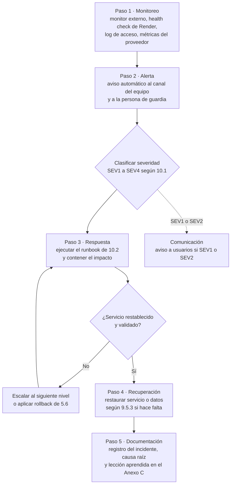

Ejemplo aplicado: el monitor externo detecta dos fallos seguidos de `/health/ready` (paso 1); avisa a la guardia (paso 2); se clasifica SEV1 porque nadie puede entrar; la guardia ejecuta el runbook RB-02, encuentra la base sin conexiones disponibles y reinicia la API para liberar el pool (paso 3); si no se recupera en 30 minutos escala al nivel 2 y evalúa restaurar (paso 4); al cerrar, registra el incidente y la lección (paso 5).

## 10. Solución de incidentes, mantenimiento y anexos

### 10.1 Gestión de incidentes

Clasificación por severidad e impacto:

| Severidad | Impacto | Ejemplos | Respuesta objetivo | Resolución o mitigación objetivo |
|---|---|---|---|---|
| SEV1 · Crítica | Servicio caído o datos expuestos | API o base caídas, fuga de datos, compromiso de un secreto | 15 min | 2 h (RTO) |
| SEV2 · Alta | Función principal degradada para muchas personas | Chat sin entrega, login con errores, 5xx mayor a 1 %, push caído | 30 min | 8 h |
| SEV3 · Media | Función secundaria afectada | Importación de Spotify, búsqueda de iTunes en el panel, latencia alta | 4 h hábiles | 3 días hábiles |
| SEV4 · Baja | Cosmético o con alternativa | Texto, estilo, mensaje de error poco claro | Siguiente revisión semanal | Siguiente release |

Escalamiento y responsables por nivel (los tiempos son objetivos propuestos):

| Nivel | Quién | Qué hace | Escala cuando |
|---|---|---|---|
| N1 · Guardia | Persona del Equipo Encorely de turno (rotación semanal) | Recibe la alerta, clasifica, ejecuta el runbook, comunica | El runbook no resuelve en 30 min (SEV1) o 2 h (SEV2) |
| N2 · Responsable del componente | Integrante del Equipo Encorely que conoce el módulo afectado (back, app, base) | Diagnóstico de código o datos, hotfix, rollback | Requiere decisión de producto, restauración de datos o soporte del proveedor |
| N3 · Equipo completo y proveedores | Equipo Encorely en pleno; soporte de Render, Expo, Apple o Google | Restauración con PITR, rotación de secretos, comunicación pública | No aplica |

Comunicación: mantenimiento programado anunciado con 48 horas de anticipación por los canales del proyecto; en SEV1 y SEV2, aviso al inicio, cada hora mientras dure y al cierre. La app no tiene hoy un mecanismo de avisos dentro de la app (pendiente en 10.6).

Mantenimiento preventivo y correctivo:

| Tipo | Actividades | Frecuencia |
|---|---|---|
| Preventivo | Revisar PR de Dependabot y `pnpm audit`; aplicar parches del SDK de Expo; revisar alertas y tablero; probar una restauración; revisar espacio de la base | Semanal (dependencias), mensual (restauración) |
| Correctivo | Hotfix con prueba que reproduce el fallo, PR con CI en verde, despliegue en la ventana o de inmediato si es SEV1 | Por incidente |
| Evolutivo | Cambios de contrato con entrada en el CHANGELOG, migraciones con actualización del capítulo 6 | Por release |

Lecciones aprendidas: cada incidente SEV1 o SEV2 cierra con un registro (plantilla del Anexo C) que incluye línea de tiempo, causa raíz, qué funcionó, qué no y acciones con responsable. Las lecciones que cambian un procedimiento se llevan a este manual en la siguiente versión.

### 10.2 Runbooks de incidentes

| ID | Síntoma | Diagnóstico | Acción | Validación |
|---|---|---|---|---|
| RB-01 | `/health/live` no responde | Log del servicio en Render: excepción de arranque o falta de memoria | Si es configuración, corregir la variable (el log nombra la que falta); si es código, rollback (5.6); si es memoria, reiniciar y subir de plan | `/health/live` en `Healthy` |
| RB-02 | `/health/live` bien y `/health/ready` mal | La base no responde: estado del Postgres en el proveedor, conexiones y almacenamiento | Esperar o reiniciar la base según el proveedor; si se agotó el pool, reiniciar la API; si hay corrupción o pérdida, 9.5.3 | `/health/ready` en `Healthy` y login de prueba |
| RB-03 | Tasa de 5xx mayor a 1 % | Buscar en el log las excepciones por `traceId` y la ruta afectada | Hotfix o rollback de la última versión | Tasa de 5xx de vuelta a su nivel normal durante 30 min |
| RB-04 | Los mensajes llegan solo al reabrir el chat | Conexiones al hub en el log; ¿el token vence y el hub se cierra? | Verificar que la app renueva el token; reiniciar la API si el hub no acepta conexiones | `MessageAvailable` llega con la app abierta |
| RB-05 | No llegan notificaciones push | `PUSH_ENABLED`, errores de envío a `exp.host`, receipts; estado de Expo, FCM y APNs | Corregir `EXPO_PUSH_ACCESS_TOKEN` o credenciales FCM/APNs en EAS; si el proveedor está caído, esperar (la app sigue funcionando) | Push de prueba recibido en un teléfono real |
| RB-06 | Pico de 429 o de fallos de login | Log de acceso por IP; ¿ataque o falta de `FORWARDED_TRUSTED_NETWORKS`? | Si todas las IP son la del proxy, corregir la variable; si es ataque, bloquear la IP en el proveedor | 429 solo para la IP atacante |
| RB-07 | Sospecha de compromiso de `JWT_SIGNING_KEY` | Origen de la sospecha | Generar una nueva (`openssl rand -base64 48`), cargarla en el proveedor y reiniciar; los access tokens vigentes dejan de servir. Si también se comprometieron refresh tokens, revocar las sesiones afectadas | Los tokens anteriores reciben 401; los clientes renuevan y siguen |
| RB-08 | `POST /auth/spotify` responde 502 `spotify_unavailable` o 403 | `SPOTIFY_CLIENT_ID` vacío; cuenta fuera de la lista de prueba de Spotify; redirect distinta | Definir la variable; agregar la cuenta en el Dashboard (máximo 5 en modo desarrollo); registrar exactamente `encorely://spotify-callback` | Login con Spotify de una cuenta de prueba |
| RB-09 | Reporte de contenido abusivo | Cola en `/admin`; evidencia con `Verified = true` | Resolver con descarte o suspensión; la suspensión cierra matches, revoca sesiones y veta el correo | Reporte en `Resolved` y cuenta en `Banned` si correspondía |
| RB-10 | La app muestra "Falta configurar el servidor" | `EXPO_PUBLIC_API_URL` ausente en el perfil del build | Corregir `eas.json` o `.env` y recompilar; en local, reiniciar Metro | La app llega a la pantalla de bienvenida |

### 10.3 Solución de problemas en desarrollo

Errores vistos en el proyecto, con el mensaje real.

#### 10.3.1 Problemas frecuentes del back

| Síntoma | Causa | Solución |
|---|---|---|
| `A compatible .NET SDK was not found. Requested SDK version: 10.0.402` | `dotnet` es el del sistema porque mise no está activado en esa shell | `mise exec -- dotnet …` o activar mise en `~/.zshrc` |
| `mise ERROR Config files in …/mise.toml are not trusted` | Clon nuevo | `mise trust` en la raíz |
| La API arranca en 5000 aunque se defina `ASPNETCORE_URLS` | `appsettings.Development.json` fija `Urls` | `--urls http://127.0.0.1:<puerto>` |
| `Conflict. The container name "/encorely-postgres" is already in use` | `container_name` fijo en `docker-compose.yml` | Reusar el contenedor existente o renombrarlo con un override fuera del repo |
| `docker compose` falla con `Define DB_PASSWORD en .env` | Falta `.env` o `DB_PASSWORD` | `cp .env.example .env` y completar |
| `dotnet-ef not found` | Herramientas locales sin restaurar | `mise exec -- dotnet tool restore` o `dnx --yes dotnet-ef@10.0.13 …` |
| `SSL connection requested. No SSL enabled connection from this host is configured.` | `DB_SSL_MODE=Require` contra el Postgres local sin TLS | En local, `DB_SSL_MODE=Prefer` |
| `FORWARDED_TRUSTED_NETWORKS es obligatorio fuera de desarrollo…` o `PUBLIC_BASE_URL es obligatorio…` | Validación de arranque de producción | Definir ambas variables |
| `DataAnnotation validation failed for 'JwtOptions' members: 'SigningKey'…` | Falta el secreto o tiene menos de 32 caracteres | `openssl rand -base64 48` |
| Una contraseña del `.env` con ` #` no funciona | Un `#` precedido de espacio abre un comentario | Valor entre comillas o contraseña sin ` #` |
| `OpenApiContractTests` falla en la CI | Cambiaron endpoints o DTOs sin regenerar el contrato | `scripts/update-contract.sh` y entrada en el CHANGELOG |
| `SyncSessionsTests.Cotas_de_tamano_y_de_parametros` corta con `TaskCanceledException` | Sube cuerpos de 15 MB y la máquina está cargada | Repetir con `--filter "FullyQualifiedName~SyncSessionsTests"`; si falla solo, es un error real |

#### 10.3.2 Problemas frecuentes de la app

| Síntoma | Causa | Solución |
|---|---|---|
| `node_modules` vacío o incompleto | Otro gestor (npm o yarn) sobre la instalación de pnpm | Detectar el gestor por el lockfile y usar pnpm; para solo arrancar, `npx expo start --dev-client` |
| El bundle no resuelve `@react-navigation/…` | Expo Router 56+ trae React Navigation adentro | Importar desde `expo-router/react-navigation`; no agregar el paquete |
| Metro se cae al instalar un paquete | `pnpm add` reescribe `node_modules` mientras Metro lo vigila | Parar Metro, instalar, volver a arrancar |
| Metro sirve un bundle viejo | Límite de inotify sin watchman | Reiniciar Metro y matar el proceso que queda en el puerto 8081 (`ss -ltnp`, luego `kill <pid>`) |
| La terminal se cierra al matar un proceso (exit 144) | `pkill -f <patrón>` coincide con la propia shell | `pgrep -f` aparte y `kill <pid>`, o un patrón con corchetes |
| El primer deep link no abre nada | El dev client en frío pierde el primer enlace | Enviarlo de nuevo con la app cargada |
| `pnpm check:expo` falla con "Found outdated dependencies" | Expo publicó parches del SDK 57 después del lockfile | `pnpm exec expo install --fix` con Metro parado y verificar (10.5) |
| Jest tarda en salir: "Jest did not exit one second after the test run has completed." | Una prueba deja una operación asíncrona abierta | No es un fallo; las 490 pruebas pasan. Para buscarla, `--detectOpenHandles` |
| El push no se registra en el emulador | `Device.isDevice` es falso o falta el ID de EAS | Probar en un teléfono real con `extra.eas.projectId` |
| `pnpm gen:api` no encuentra el contrato | El back no está en `../encorly_back` | Clonar el back en la carpeta hermana |

### 10.4 Mantenimiento preventivo

| Actividad | Procedimiento | Validación |
|---|---|---|
| Actualizar paquetes NuGet | Revisar el PR de Dependabot; `dotnet build` y `dotnet test` en local | CI en verde, incluido el paso de paquetes vulnerables |
| Actualizar el SDK de Expo o sus parches | Leer las notas de la versión; parar Metro; `pnpm exec expo install --fix`; `pnpm install --frozen-lockfile` en limpio; `pnpm check:expo`, `pnpm verify`, `pnpm build:bundles`; nuevo dev build si cambió algo nativo; revisar los `overrides` de `pnpm-workspace.yaml` | Los tres comandos en verde y recorrido manual en el emulador |
| Revisar el espacio y los índices de la base | Consultas de solo lectura sobre `pg_stat_user_tables` y tamaño por tabla | Ninguna tabla crece fuera de lo esperado; purgas en 0 pendientes |
| Probar la restauración | 9.5.3 sobre una base temporal | Criterios de 9.5.3 |
| Revisar este manual | Comparar fichas con `AppDbContextModelSnapshot.cs` y el catálogo de 7.2 con el contrato | Sin diferencias |

### 10.5 Mantenimiento correctivo y evolutivo

**Agregar un endpoint de punta a punta**

Prerrequisitos: back y app instalados (5.1 y 5.2).

1. DTOs con validación en `Features/<Feature>/<Feature>Contracts.cs`.
2. Regla en `<Feature>Service.cs` que recibe el `userId` del token y filtra por él; errores con `ApiException`.
3. Ruta en `<Feature>Endpoints.cs` con nombre, resumen en español y errores declarados; `.UserWrites()` en las escrituras. Un endpoint nuevo exige token por defecto.
4. Si hay entidades nuevas, configurarlas en `AppDbContext` y crear la migración (6.6).
5. Pruebas: caso feliz, validación (400 y nunca 500) y aislamiento "A no accede a lo de B".
6. Regenerar el contrato con `scripts/update-contract.sh` y revisar `git diff contracts/openapi.v1.json`.
7. Entrada nueva en `contracts/CHANGELOG.md` con fecha y `v1.0.0-draft.<N+1>`, marcando **Rompe** si aplica.
8. En la app: `pnpm gen:api`, alias en `types.ts`, función en `endpoints.ts`, hook de TanStack Query en la feature y prueba (7.8).

Criterio de validación: CI del back en verde (incluye `OpenApiContractTests`), `pnpm verify` en verde y el flujo probado en el emulador.

**Pantalla nueva en la app**: pantalla en `src/features/<dominio>/screens/` y ruta delgada en `src/app/` dentro del grupo que corresponda. **Color o espacio nuevo**: solo en `src/ui/tokens.ts`, verificando contraste AA en los dos temas. **Dependencia nativa nueva**: `pnpm exec expo install <paquete>` con Metro parado, plugin en `app.json` si lo pide y nuevo dev build.

### 10.6 Pendientes técnicos conocidos

Diferencias y deudas detectadas al 2026-10-20, priorizadas. Ninguna impide la demo.

| Prioridad | Pendiente | Repositorio |
|---|---|---|
| Importante | La CI de la app no corre en `Dev` (solo `main` y `rebuild/v1`), y al activarla fallaría en `pnpm check:expo` por 8 parches pendientes del SDK 57 | `encorely-front` |
| Importante | `/swagger` responde 401 en `Development`: `UseSwaggerUI` se registra después de la autorización. `/openapi/v1.json` sí funciona | `encorly_back` |
| Importante | No hay registro de borrados de cuenta para repetirlos tras una restauración (9.5.1) | `encorly_back` |
| Importante | No hay mecanismo de avisos dentro de la app para mantenimientos o incidentes | `encorely-front` |
| Importante | `LoginThrottle` y la cola de push viven en memoria: bloquean el escalamiento horizontal | `encorly_back` |
| Menor | `README.md` de ambos repos remite a la rama `rebuild/v1`; las ramas vigentes son `dev` y `Dev` | Ambos |
| Menor | `ARCHITECTURE.md` del back omite `Profiles`, nombra en plural `encrypted_backups` y `device_link_requests` y dice SHA-256 donde hoy es HMAC-SHA256 | `encorly_back` |
| Menor | `.env.example` de la app no incluye `EXPO_PUBLIC_EAS_PROJECT_ID` | `encorely-front` |
| Menor | `vercel.json` llama a un script `build:web` que no existe | `encorely-front` |
| Menor | No hay `testID` en `src/`: los flujos de Maestro dependen de textos visibles | `encorely-front` |
| Menor | `docker-compose.yml` fija `container_name`, lo que impide un segundo proyecto de compose sin override | `encorly_back` |
| Menor | `info.version` del contrato es `1.0.0` mientras el CHANGELOG va en draft.17 | `encorly_back` |

## Anexo A. Glosario

| Término | Definición |
|---|---|
| AAD | Datos autenticados adicionales: se verifican al descifrar pero no se cifran |
| Ack | Confirmación de entrega del receptor; el servidor borra lo confirmado |
| Advisory lock | Bloqueo de PostgreSQL por clave numérica, usado para serializar operaciones sin fila natural |
| CI | Integración continua (GitHub Actions) |
| Draft del contrato | Versión `v1.0.0-draft.N` del OpenAPI, registrada en el CHANGELOG |
| E2EE | Cifrado de extremo a extremo: solo los teléfonos de la conversación pueden leer los mensajes |
| EAS | Expo Application Services: compilación y envío de la app a las tiendas |
| Franking | Compromiso criptográfico que permite verificar un mensaje reportado |
| IDOR | Referencia directa insegura a objetos: acceder a recursos ajenos cambiando un identificador |
| JWT | Token firmado que identifica a la persona en cada petición |
| PITR | Recuperación de la base a un punto en el tiempo |
| PKCE | Variante de OAuth sin secreto de cliente, para apps móviles |
| RPO | Pérdida máxima de datos tolerable, medida en tiempo |
| RTO | Tiempo máximo aceptable para restaurar el servicio |
| SecureStore | Almacén cifrado del sistema operativo (Keychain o Keystore) expuesto por Expo |
| SignalR | Librería de tiempo real de ASP.NET Core sobre WebSocket |
| SLA | Acuerdo de nivel de servicio; aquí, objetivo interno de disponibilidad |
| SQLCipher | SQLite cifrado, usado para el historial del chat en el teléfono |

## Anexo B. Archivos de referencia de los repositorios

| Archivo | Para qué se consulta |
|---|---|
| `encorly_back/src/Encorely.Api/Program.cs` | Composición: opciones, middlewares, rate limits, health checks, hub |
| `encorly_back/src/Encorely.Api/Infrastructure/Database/AppDbContext.cs` | Configuración del modelo de datos |
| `encorly_back/src/Encorely.Api/Data/Migrations/AppDbContextModelSnapshot.cs` | Estado exacto del esquema (fuente de las fichas de 6.3) |
| `encorly_back/src/Encorely.Api/Infrastructure/Configuration/EnvironmentMapping.cs` y `Options.cs` | Variables de entorno y sus validaciones |
| `encorly_back/.env.example` | Lista de variables con su explicación |
| `encorly_back/docker-compose.yml`, `Dockerfile`, `render.yaml` | Infraestructura local y de producción |
| `encorly_back/.github/workflows/ci.yml` | CI del back |
| `encorly_back/contracts/openapi.v1.json`, `contracts/CHANGELOG.md` | Contrato y su historial |
| `encorly_back/ARCHITECTURE.md`, `docs/privacidad-y-tiendas.md` | Diseño y datos personales |
| `encorely-front/app.json`, `eas.json`, `package.json` | Configuración, perfiles de build y dependencias de la app |
| `encorely-front/src/lib/api/client.ts` | Transporte HTTP, refresh y timeout |
| `encorely-front/src/features/chat/crypto/envelope.ts` | Cifrado de mensajes |
| `encorely-front/src/features/chat/local/sqliteStore.ts` | Esquema de la base local |
| `encorely-front/.github/workflows/frontend.yml` | CI de la app |
| `encorely-front/ARCHITECTURE.md`, `docs/tiendas.md`, `docs/e2e.md` | Diseño de la app, publicación y pruebas E2E |

## Anexo C. Plantillas de aceptación e incidentes

**Informe de aceptación del despliegue**

| Campo | Valor |
|---|---|
| Versión desplegada | API `api-v<x.y.z>` (commit `<sha>`) · App `<versión>` (build `<n>`) |
| Ambiente | Staging / Producción |
| Fecha y ventana | `<AAAA-MM-DD hh:mm>` a `<hh:mm>` (UTC-5) |
| Ejecutado por | Equipo Encorely: `<nombres>` |

| Caso | Resultado esperado | Resultado (pasa / falla) | Evidencia |
|---|---|---|---|
| Health checks | `/health/live` y `/health/ready` en `Healthy` | | |
| Registro y onboarding (Maestro 01) | La cuenta nueva llega a Descubrir | | |
| Calificar canciones (Maestro 02) | El ADN cambia | | |
| Asistencia y radar (Maestro 03) | Radar visible o estado vacío correcto | | |
| Chat cifrado (Maestro 04) | El mensaje llega y se descifra | | |
| Bloquear (Maestro 05) | La persona aparece en bloqueadas | | |
| Borrar cuenta (Maestro 06) | La cuenta deja de existir | | |
| Push en teléfono real | Llega el aviso sin contenido | | |
| Cabeceras de seguridad | `Cache-Control: no-store` en `/api` | | |
| Páginas legales | `/legal/privacidad` y `/cuenta/eliminar` en https | | |

Decisión: Aceptado / Rechazado (motivo). Firma: Equipo Encorely · Fecha: `<AAAA-MM-DD>`.

**Registro de incidente y lección aprendida**

| Campo | Contenido |
|---|---|
| ID y severidad | `INC-<AAAA>-<nnn>` · SEV1 a SEV4 |
| Detección | Cómo y cuándo se detectó (alerta, reporte de usuario) |
| Línea de tiempo | Detección, alerta, respuesta, mitigación, cierre (hora UTC-5) |
| Impacto | Personas y funciones afectadas, duración |
| Causa raíz | Qué falló y por qué |
| Runbook usado | RB-xx o "ninguno" |
| Qué funcionó y qué no | |
| Acciones | Acción, responsable (Equipo Encorely: nombre), fecha límite |
| Cambio en el manual | Sección afectada y versión del documento |

## Anexo D. Matriz de cumplimiento de la rúbrica

| Ítem | Requisito | Dónde se cumple |
|---|---|---|
| A1 | Control de versiones: fecha, versión, autor, cambios y aprobaciones | Portada, Control documental, Historial de cambios |
| A2 | Lenguaje técnico claro, preciso y consistente | Todo el documento; convenciones de redacción en 1.4 |
| A3 | Convenciones de nombres de servidores, bases de datos, APIs, módulos y ambientes | 1.3 |
| A4 | Diagramas normalizados y legibles | 4.2 (arquitectura lógica), 4.6.1 y 4.6.2 (componentes), 4.7.2 y 4.7.3 (secuencia UML), 5.8.1 y 5.8.2 (despliegue UML), 6.2.1 a 6.2.5 (ERD), 9.7 (flujo ante falla) |
| A5 | Sin contraseñas, secretos ni datos sensibles | 1.5, 8.8; los comandos usan `<valor>` |
| A6 | Prerrequisitos, dependencias, procedimientos y criterios de validación | 5.1, 5.2, 5.5.4, 5.5.5, 5.6, 6.6, 7.8, 9.5.2, 9.5.3, 10.5 |
| A7 | Responsables y periodicidad de actualización | Control documental, 1.2 |
| B1 | Portada, control documental e historial de cambios | Portada, Control documental, Historial de cambios |
| B2 | Objetivo, alcance y descripción general | Capítulo 2 |
| B3 | Requisitos de hardware, software y red | Capítulo 3 |
| B4 | Arquitectura y diagramas de componentes | Capítulo 4 |
| B5 | Instalación, configuración y despliegue | Capítulo 5 |
| B6 | Base de datos y modelo de información | Capítulo 6 |
| B7 | Integraciones, APIs y servicios externos | Capítulo 7 |
| B8 | Seguridad, perfiles y permisos | Capítulo 8 |
| B9 | Operación, monitoreo, respaldo y recuperación | Capítulo 9 |
| B10 | Solución de incidentes, mantenimiento y anexos | Capítulo 10 y Anexos A a D |
| C1 | Capa de presentación | 4.2 |
| C2 | Capa de aplicación | 4.2, 4.4 |
| C3 | Capa de datos | 4.2, capítulo 6 |
| C4 | Capa de infraestructura | 4.2, 3.2.3, 5.8 |
| C5 | Capa de integraciones | 4.2, capítulo 7 |
| C6 | Capa de seguridad | 4.2, capítulo 8 |
| C7 | Capa de operación | 4.2, capítulo 9 |
| C8 | Diagrama de arquitectura lógica (usuarios → presentación → aplicación → datos → infraestructura) | 4.2 |
| D1 | Perfiles y roles del equipo | 2.8 |
| D2 | Lenguajes, versiones, frameworks, librerías y motor de BD | 4.3, 3.3, 6.1 |
| D3 | Entidades, tablas, relaciones, claves, restricciones, ERD, conexiones, dependencias, migraciones, índices, respaldo, relación componente ↔ datos | 6.1 a 6.9 |
| D4 | Contexto, problema central, causas, impacto, usuarios afectados, requisitos funcionales y no funcionales separados, objetivo y su medición | 2.3.1 a 2.3.5, 2.4, 2.5, 2.6 |
| D5 | Módulos con propósito, entradas, salidas, dependencias y responsables; flujo de información; componentes críticos y puntos únicos de falla; relación con requisitos, BD, integraciones y seguridad | 4.4, 4.5, 4.7, 4.9, 4.10 |
| D6 | Matriz de componentes (Módulo, Componente, Tecnología, Dependencias, Responsable) | 4.8 |
| E1 | Ficha técnica por tabla: nombre, propósito, campos con tipo y longitud, PK, FK, restricciones e índices | 6.3.1 a 6.3.25 (servidor) y 6.5.1 a 6.5.2 (dispositivo) |
| E2 | Diccionario de datos en lenguaje de negocio | Columna "Significado" de cada ficha y 6.4 |
| E3 | Diagrama entidad-relación | 6.2.1 a 6.2.5 |
| E4 | Nombres de tablas y campos idénticos al código | 6.3 (tomados de `AppDbContextModelSnapshot.cs`), 6.5 (de `sqliteStore.ts`) |
| E5 | Actualización con cada cambio de esquema | 1.2, 6.6 (paso 5), 6.11 |
| F1 | Plan de despliegue con cronograma, responsables, ventana y plan de rollback | 5.5.2, 5.6 |
| F2 | Actividades de planificación a monitoreo posterior | 5.5.3 |
| F3 | Productos del despliegue | 5.7 y Anexo C |
| F4 | Diagrama de despliegue UML con nodos, artefactos y rutas etiquetadas con protocolo | 5.8.1 (producción) y 5.8.2 (demo actual) |
| G1 | Disponibilidad y rendimiento: horario, ventanas, SLA, capacidad, tiempos, umbrales, escalamiento | 9.2 |
| G2 | Monitoreo y observabilidad: componentes, alertas, umbrales, herramientas, tableros | 9.3 |
| G3 | Respaldo y recuperación: RTO, RPO, frecuencia y tipo | 9.5 |
| G4 | Mantenimiento e incidentes: preventivo y correctivo, ventanas y comunicación, severidad, escalamiento por nivel, lecciones aprendidas | 10.1, 10.2, 10.4, 10.5, Anexo C |
| G5 | Ficha de operatividad (Aspecto, Descripción, Objetivo/Métrica, Herramienta) | 9.6 |
| G6 | Flujo operativo ante una falla | 9.7 |
| G7 | Refleja el comportamiento real y distingue objetivos de mediciones | 9.1 y la marca "objetivo" o "real" en 9.2, 9.6; 2.6 (resultados medidos) |
| H1 | Tabla de contenido jerárquica numerada con página real | Tabla de contenido generada al inicio del documento |
| H2 | Entradas idénticas a los títulos | Tabla de contenido generada desde los propios títulos |
| H3 | Formato consistente con sangría por nivel y línea de puntos | Tabla de contenido generada |
