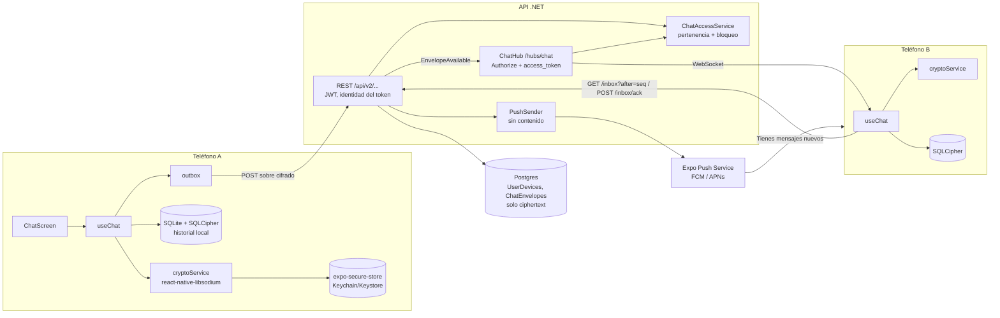
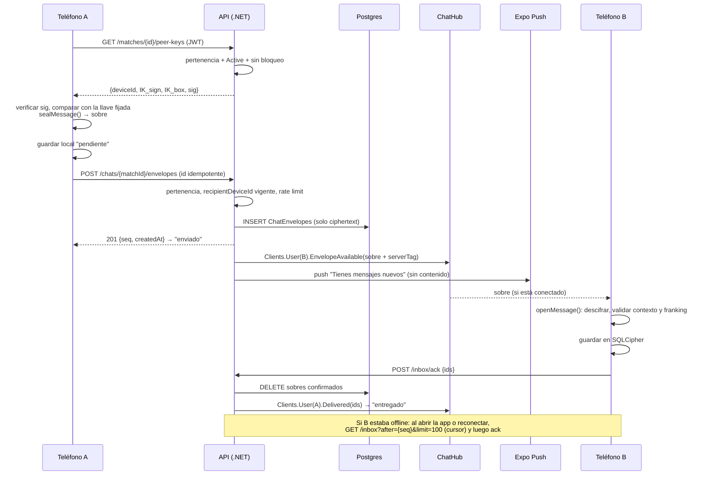

# Chat 1:1 con cifrado de extremo a extremo: propuesta

Fecha: 2026-10-13 · Alcance: chat 1:1 de matches en la app nativa (Expo, iOS y Android). La landing web y la app web quedan fuera · Base: código en `encorly_back@bba861a`, `encorely-front@ff11541` y los hallazgos de `01-auditoria-externa.md` y `02-enjambre-qa.md`.

---

## 1. Resumen

- El chat actual se reemplaza entero. Hoy el envío falla por contrato (C11), cualquier usuario puede leer y escribir chats ajenos (C1/C2 de la auditoría, C5 del enjambre), los hubs aceptan conexiones sin autenticar, las notificaciones llegan a la persona equivocada (I6), los matches no tienen estado (I4/I5) y la tabla `Messages` guarda el texto en claro.
- En React Native con Expo no hay hoy una librería madura de Signal Protocol ni de MLS. Integrar libsignal exigiría escribir y mantener un módulo nativo para Java y Swift, con licencia AGPL; ts-mls no tiene auditoría. Para un equipo de 3 personas, cualquiera de las dos sería el sitio más probable de un fallo grave.
- Propongo un E2EE "clase Threema v1": primitivas de libsodium (`crypto_box`, X25519 + XSalsa20-Poly1305) con una llave de identidad por dispositivo y verificación del contacto con código de seguridad o QR. A eso se suma un modelo **store-and-forward**: el servidor borra el ciphertext cuando el destinatario confirma la entrega, y el historial vive solo en el teléfono, en SQLCipher.
- Limitación que hay que decir claro: **la v1 no ofrece forward secrecy ni post-compromise security en la capa E2E.** Quien robe la llave privada de un dispositivo puede descifrar lo que capture después y lo que siga sin entregar en el servidor. El borrado tras la entrega reduce ese riesgo, pero no lo elimina.
- Esfuerzo de la v1 (fases 0 a 4): unos **37 días-persona**. Con 3 personas son de 4 a 5 semanas de calendario, contando integración y pruebas. El backup cifrado, la rotación de llaves y la forward secrecy quedan para fases posteriores.

**Recomendación en una frase:** E2EE 1:1 con `react-native-libsodium` (`crypto_box` y llaves de identidad Ed25519 + X25519 por dispositivo), entrega por REST + SignalR autenticado, push sin contenido, borrado en servidor tras la entrega e historial local cifrado. Signal o MLS se dejan para cuando exista un binding RN mantenido.

---

## 2. Requisitos

### 2.1 Funcionales

| # | Requisito | Criterio |
|---|---|---|
| F1 | Enviar y recibir en tiempo real | Con la app abierta en ambos lados, el mensaje aparece en menos de 1 s (p95, red local) |
| F2 | Persistencia | El historial sobrevive al cierre de la app; se guarda en SQLite cifrado en el dispositivo |
| F3 | Historial y paginación | El scroll hacia atrás lee de la base local de 50 en 50. La sincronización con el servidor usa cursor (`after=seq`) |
| F4 | Estados | `pendiente` (en la cola local), `enviado` (el servidor lo aceptó, 201), `entregado` (el destinatario hizo ACK) y `leído` (opcional, desactivado por defecto, enviado como mensaje de control cifrado) |
| F5 | Offline | Cola local (outbox) con reintento idempotente por `id` generado en el cliente |
| F6 | Push | Aviso de "mensaje nuevo" sin contenido, sin nombre y sin texto |
| F7 | Bloquear | El servidor rechaza envíos en ambos sentidos, cierra la conversación y la oculta en los dos clientes |
| F8 | Reportar | Quien reporta elige mensajes como evidencia; el servidor verifica que son auténticos (franking, §8) |
| F9 | Borrar cuenta | Se borran dispositivos, llaves, sobres pendientes y matches. La UI avisa que las copias locales del otro usuario no se pueden borrar |
| F10 | Solo hay chat con un match mutuo | `Matches.Status = Active`, es decir, los dos aceptaron y no hay bloqueo |

### 2.2 Seguridad

| # | Requisito |
|---|---|
| S1 | **E2EE 1:1:** el texto se cifra en el dispositivo emisor y solo se descifra en el receptor. El servidor, la BD, los logs, Kafka y el push nunca ven texto plano |
| S2 | **Identidad desde el JWT:** se elimina `userId` en query y body (corrige C1). La identidad sale siempre de `ClaimTypes.NameIdentifier` |
| S3 | **Autorización por pertenencia:** cada lectura o escritura de sobres, llaves de un par, acks o hubs comprueba `uid ∈ {UserId1, UserId2}`, `Status = Active` y que no haya bloqueo. Si falla, la respuesta es `404`, para no confirmar que el match existe |
| S4 | **Llaves privadas** solo en Keychain/Keystore (`expo-secure-store`, `WHEN_UNLOCKED_THIS_DEVICE_ONLY`). Nunca en AsyncStorage, en logs ni en backups del sistema operativo |
| S5 | **Verificación:** código de seguridad numérico más QR, y aviso bloqueante si cambia la llave del contacto |
| S6 | **Metadatos mínimos:** el servidor guarda solo lo necesario para enrutar (match, dispositivos, tamaño con padding y hora) y borra el sobre al recibir el ACK. Los sobres no entregados expiran a los 30 días |
| S7 | **Integridad del contexto:** el sobre no se puede mover a otra conversación ni reproducir (el `id`, el match y los participantes van dentro del texto cifrado y se verifican al descifrar) |
| S8 | **Prerrequisitos:** el login de Google debe validar el token (C3 de la auditoría, C7 del enjambre) y el JWT no debe tener un secreto por defecto (C5 de la auditoría). Sin eso, un atacante suplanta la cuenta y publica su propia llave, y el E2EE no protege nada |

---

## 3. Modelo de amenazas

| Amenaza | Qué hace el atacante | A: libsodium box (recomendada) | B: Signal | C: MLS |
|---|---|---|---|---|
| **Servidor curioso** (operador o admin con acceso a la BD) | Leer conversaciones | **Cubierta** para el contenido. Sigue viendo quién habla con quién, cuándo y el tamaño con padding | Cubierta. Con sealed sender oculta además el remitente | Cubierta |
| **Servidor malicioso** (sustituye llaves) | Hacer MITM publicando su propia llave | **Parcial:** se detecta con el código o QR verificado y con el aviso de cambio de llave. El primer contacto sin verificar (TOFU) queda expuesto. Igual en B y C | Igual (TOFU + safety numbers) | Igual (depende del Authentication Service) |
| **BD filtrada** (dump, backup de Render o Supabase) | Leer mensajes | **Cubierta:** solo hay ciphertext de mensajes aún no entregados y nada de historial | Cubierta | Cubierta |
| **BD filtrada y después robo de la llave del dispositivo** | Descifrar lo capturado | **No cubierta** para lo que estaba en el dump (no hay forward secrecy). El borrado tras ACK reduce lo que hay en el dump | Cubierta (FS) | Cubierta (FS) |
| **Dispositivo robado y bloqueado** | Extraer datos | Cubierta por el cifrado del sistema operativo, el Keychain (`WHEN_UNLOCKED`) y SQLCipher | Igual | Igual |
| **Dispositivo robado y desbloqueado, o con malware** | Leerlo todo | **No cubierta** por ningún E2EE. Mitigación: bloqueo de app opcional con biometría y revocar el dispositivo desde otro login | Igual. PCS permite recuperarse cuando se expulsa al atacante | Igual, con PCS |
| **MITM de red** | Interceptar | TLS más E2EE: cubierta | Cubierta | Cubierta |
| **Usuario malicioso** (acoso, spam, suplantación) | Abusar del chat | Bloqueo, reporte con franking verificable, rate limit y chat solo con match mutuo. Las capturas de pantalla no se pueden impedir | Igual (el franking hay que añadirlo aparte) | Igual |
| **Robo de cuenta** (contraseña o JWT) | Registrar un dispositivo nuevo | El contacto recibe el aviso de cambio de llave. El dispositivo anterior queda revocado y deja de recibir | Igual | Igual |

---

## 4. Opciones comparadas

| Criterio | **A. libsodium `crypto_box`** (X25519 + XSalsa20-Poly1305, llaves de identidad por dispositivo) | **B. Signal Protocol** (X3DH/PQXDH + Double Ratchet) | **C. MLS** (RFC 9420) |
|---|---|---|---|
| Forward secrecy | ❌ En la capa E2E no hay. Se puede mitigar con borrado tras ACK y, en una v2, rotación periódica de la llave de caja (FS gruesa) | ✅ Por mensaje | ✅ Por época |
| Post-compromise security | ❌ Solo al rotar la llave o reinstalar | ✅ Con cada intercambio DH del ratchet | ✅ Con cada commit/update |
| Multi-dispositivo | 🟡 Posible con fan-out (un sobre por dispositivo). En v1 queda fuera por decisión | 🟡 Requiere Sesame y vinculación de dispositivos; es complejo | ✅ Nativo (cada dispositivo es una hoja) |
| Madurez en RN/Expo | ✅ `react-native-libsodium` 1.7.0 (2026-02-09): JSI nativo, config plugin, app de ejemplo en RN 0.83 con New Architecture. Alternativa en JS puro: `@noble/curves` y `@noble/ciphers` 2.4.0 (auditadas por Cure53) | ❌ `@signalapp/libsignal-client` 0.105.0 es un addon nativo de Node, AGPL-3.0, y Signal no da soporte a su uso fuera de Signal. No hay binding RN; habría que envolver Java y Swift en un Expo Module. `@privacyresearch/libsignal-protocol-typescript` está estancado desde 2023-05 y no tiene auditoría | ❌ `ts-mls` 1.6.4 está sin auditar y su README pide revisión independiente. OpenMLS no tiene binding RN publicado (solo ejemplos con UniFFI, como SkyChat). `@wireapp/core-crypto` es GPL y está pensado para WASM o nativo. Hermes no ejecuta WASM |
| Esfuerzo (3 personas) | **M**, unos 37 días-persona para la v1 completa | **XL**: módulo nativo doble, más almacenamiento de sesiones, prekeys y reposición. Más de 3 meses | **XL+**: además hace falta Delivery Service y Authentication Service. Es demasiado para 1:1 |
| Riesgo de implementarlo mal | **Bajo-medio:** primitivas de alto nivel y una sola llamada por operación. El riesgo está en la composición (contexto y nonces), que §5.4 deja cerrada | **Alto:** estado de sesión, orden de mensajes, prekeys agotadas, desincronización del ratchet y bindings caseros | **Muy alto:** commits concurrentes, orden de épocas, librería sin auditoría |
| Precedente | Threema usó NaCl box con llaves de larga duración en la capa E2E durante años antes de añadir Ibex (FS) | WhatsApp y Signal | Wire, Webex, RCS (GSMA) |

**Recomendación: A**, con cuatro refuerzos obligatorios: el contexto va dentro del texto cifrado, borrado tras ACK, verificación de llaves y franking. Es la única opción que el equipo puede implementar y probar bien con librerías mantenidas y auditadas. Las opciones B y C son más fuertes en teoría, pero aquí acabarían como un binding casero o una librería sin auditoría, que en la práctica es menos seguro.
**Alternativa en una línea:** si la nota o el dueño exigen forward secrecy en la v1, añadir la fase 6 (llave de caja de mediano plazo firmada y rotada cada 7 días, con la privada borrada al vencer). Son unos 8 días-persona más y da FS gruesa sin pasar a Double Ratchet.

> Lección de Threema ([breakingthe3ma.app](https://breakingthe3ma.app/)): sus fallos venían de **reutilizar la misma llave en dos protocolos** (handshake de transporte y E2E), no del `crypto_box`. Por eso aquí cada llave tiene un único uso y lleva separación de dominio (§5.2).

---

## 5. Arquitectura recomendada

### 5.1 Vista de componentes



### 5.2 Gestión de llaves

**Llaves por dispositivo, generadas en el teléfono al primer arranque después del login:**

| Llave | Algoritmo | Uso único | Dónde se guarda |
|---|---|---|---|
| `IK_sign` | Ed25519 (`crypto_sign_keypair`) | Identidad. Firma la llave de caja; el código de seguridad se deriva de ella | Privada (64 B) en SecureStore |
| `IK_box` | X25519 (`crypto_box_keypair`) | Cifrar y descifrar mensajes, nada más | Privada (32 B) en SecureStore |
| `DB_key` | 32 B aleatorios (`randombytes_buf`) | Clave de SQLCipher | SecureStore |
| Llaves fijadas de contactos | Públicas | Comparar con el directorio y detectar cambios | En la base SQLCipher, no en SecureStore (son N entradas) |

Por qué dos llaves y no una: separan dominios, y permiten rotar `IK_box` en la fase 6 sin que cambie el código de seguridad del contacto. Además, `react-native-libsodium` no expone la conversión `ed25519_sk_to_curve25519`.

**Límites de `expo-secure-store`** ([docs](https://docs.expo.dev/versions/latest/sdk/securestore/)): algunas versiones de iOS rechazaban valores de más de ~2048 bytes y Expo no impone límite propio, así que solo se guardan llaves en base64 (menos de 100 caracteres cada una), nunca el historial. Otros comportamientos documentados que hay que manejar:
- `keychainAccessible: WHEN_UNLOCKED_THIS_DEVICE_ONLY`: la llave no migra a otro iPhone por backup, que es lo correcto para llaves por dispositivo.
- En **iOS, el Keychain puede sobrevivir a la desinstalación.** Si al arrancar existe la llave pero falta un flag `installId` en AsyncStorage, se trata como instalación nueva: se borran las llaves viejas y se registra un dispositivo nuevo.
- En Android, los datos no sobreviven a la desinstalación, y hay que excluir SecureStore del Auto Backup porque no se puede descifrar después de restaurar.
- `requireAuthentication` no se usa para las llaves de mensajería: en Android pide biometría en cada operación.

**Publicación (directorio de llaves):**
`POST /api/v2/devices` con `{ identitySignKey, identityBoxKey, boxKeySig }`, donde
`boxKeySig = Ed25519.sign(IK_sign, "ENCORELY-BOXKEY-v1" ‖ deviceId ‖ IK_box_pub)`.
El servidor comprueba los tamaños (32/32/64) y, opcionalmente, la firma con `NSec.Cryptography` 26.4.0. El cliente **siempre** verifica la firma al descargar la llave de un contacto.

**Prekeys:** no hacen falta en la opción A. `crypto_box` funciona con la llave pública estática del destinatario aunque esté offline. Aparecen solo en la fase 6 (rotación) o en una migración a Signal.

**Rotación:**
- En v1, la llave cambia solo al reinstalar, cambiar de teléfono o revocar el dispositivo (nuevo `deviceId` y aviso a los contactos).
- En la fase 6, `IK_box` rota cada 7 días firmada por `IK_sign`. El emisor usa la más reciente y el receptor conserva las privadas viejas solo hasta vaciar su inbox. Eso da FS gruesa.

**Verificación (código de seguridad y QR):**
```
fp(u)       = BLAKE2b-256("ENCORELY-FP-v1" ‖ userId ‖ IK_sign_pub)
código      = 60 dígitos = 30 de fp(menor userId) ‖ 30 de fp(mayor userId)
              (cada 5 bytes → número mod 100000, 6 bloques por usuario)
QR          = "encorely:v1:" ‖ base64url(fp_A ‖ fp_B)
```
Encaja con el producto: los dos usuarios se encuentran en el concierto y escanean el QR (`expo-camera`). El contacto queda **verificado** ✅. Si la llave cambia después, pasa a **cambiada** ⚠️ y no se puede enviar sin confirmación explícita.

### 5.3 Flujo de envío y recepción



### 5.4 Formato del mensaje (envelope v1)

**Texto interno (antes de cifrar)**: la cadena exacta `p` se firma con el franking, así no hace falta canonicalizar:
```json
{"v":1,"id":"<uuid sobre>","m":"<matchId>","s":"<senderUserId>","r":"<recipientUserId>",
 "t":1760400000000,"k":"text","b":"nos vemos en la entrada 3"}
```
`k` puede ser `text`, `read` (recibo de lectura) o `system`. Los tipos de control van cifrados y con padding, así que el servidor no los distingue del texto normal.

**Payload cifrado:** `pad256(utf8(JSON.stringify({ p, fk })))`. `fk` son 32 bytes aleatorios (la llave de franking) y el padding es ISO/IEC 7816-4 hasta múltiplos de 256 B, para ocultar la longitud.

**Sobre en el cable y en la BD:**

| Campo | Tipo | Notas |
|---|---|---|
| `id` | uuid | Lo genera el cliente (`expo-crypto.randomUUID()`). Es la clave de idempotencia |
| `matchId` | uuid | En la ruta |
| `senderDeviceId` / `recipientDeviceId` | uuid | El emisor declara el `recipientDeviceId` que usó; si ya no está vigente, el servidor responde `409 peer_key_changed` |
| `version` | int16 | `1` = `crypto_box_easy` + padding 256 + franking `crypto_auth` |
| `nonce` | 24 B | `randombytes_buf(crypto_box_NONCEBYTES)`. Siempre aleatorio: 192 bits hacen la colisión despreciable. No se usan contadores |
| `ciphertext` | bytea | `crypto_box_easy(payload, nonce, peer.IK_box_pub, my.IK_box_sk)` (incluye MAC de 16 B) |
| `frankingTag` | 32 B | `crypto_auth(p, fk)` (HMAC-SHA-512-256) |
| `serverTag` | 32 B | Lo calcula el servidor al recibir y lo entrega al receptor; no se guarda en la BD (§8) |

**Al descifrar, el receptor rechaza y descarta el mensaje si falla cualquiera de estas comprobaciones**, y lo cuenta en la telemetría sin incluir contenido:
1. `crypto_box_open_easy` falla.
2. `p.id ≠ sobre.id`, `p.m ≠ matchId`, `p.s ≠ remitente del sobre` o `p.r ≠ yo`. Esto impide mover el sobre de conversación o cambiarle el remitente.
3. `crypto_auth_verify(frankingTag, p, fk)` falla.
4. El `id` ya existe en la base local (repetición).

### 5.5 Qué guarda el servidor

| Guarda | No guarda |
|---|---|
| Llaves **públicas** del dispositivo y el push token | Llaves privadas, texto plano, nombres de archivo |
| Sobres **no entregados**: ciphertext, nonce, dispositivos, `seq`, `createdAt`. Se borran con el ACK o a los 30 días | El historial entregado |
| Matches con estado, bloqueos y reportes (estos con la evidencia que el usuario decide revelar) | `serverTag` (lo recalcula a partir de la clave HMAC) |
| Evento Kafka `MatchConvertedToChat` (ids y hora, sin contenido) | Contenido del push, longitud real del mensaje |

### 5.6 Tiempo real, push y sincronización

**SignalR autenticado** ([docs MS](https://learn.microsoft.com/aspnet/core/signalr/authn-and-authz?view=aspnetcore-8.0)):
- Hub nuevo `ChatHub` en `/hubs/chat` con `RequireAuthorization()`. El JWT llega como `access_token` en la query porque los WebSockets no admiten cabeceras desde RN. Se lee en `JwtBearerEvents.OnMessageReceived`, solo para la ruta `/hubs/*`.
- `Context.UserIdentifier` sale de `ClaimTypes.NameIdentifier`, que `TokenService.cs:30` ya emite.
- **Entrega con `Clients.User(peerId)` y no con grupos por `matchId`.** Discrepo del enfoque de grupos para la entrega: el servidor ya sabe quién es el destinatario por la fila del match, así que el cliente no tiene que unirse a nada. Con grupos aparecen problemas evitables: miembros obsoletos tras un bloqueo, lógica de re-join al reconectar y un método `Join` que habría que autorizar. Los grupos `match:{id}` solo valen para la función "escribiendo…" (v2), y su método `Join` tiene que validar la pertenencia.
- El hub **no recibe mensajes**: el envío va por REST, que ya tiene idempotencia, rate limiting, códigos HTTP claros y es fácil de probar. El hub solo empuja eventos: `EnvelopeAvailable`, `Delivered`, `PeerKeyChanged` y `ConversationClosed`.
- Cliente: `@microsoft/signalr` 10.0.11 con `withAutomaticReconnect()` y `accessTokenFactory` (se llama en cada reconexión, así que depende de arreglar el refresh de JWT, C12). Con **AppState** `background` se hace `stop()` (iOS mata los sockets de todos modos). Con `active` se hace `start()` y después `syncInbox()`. Con `onreconnected` también `syncInbox()`. El socket es una optimización; **la fuente de verdad es el inbox REST**.
- Si el API corre en más de una instancia: backplane de Redis (`Microsoft.AspNetCore.SignalR.StackExchangeRedis`, en la línea 8.0.x mientras el proyecto siga en .NET 8). Redis ya está en el stack.
- Los access tokens en la query terminan en logs: hay que excluir o enmascarar `access_token` en el request logging del API y revisar los logs del proxy (Render).

**Push sin contenido:** `expo-notifications` (57.0.22 en SDK 57) con el **Expo Push Service** (una sola API HTTP para FCM y APNs, con *enhanced security* activado: access token en el servidor).
- Payload: `{ title: "Encorely", body: "Tienes mensajes nuevos", data: { t: "chat" } }`. Sin nombre, sin `matchId` y sin texto. Hay que usar `collapseId` / `channelId` para no acumular avisos.
- Con la app en primer plano, `setNotificationHandler` suprime el aviso.
- Se envía siempre, sin seguimiento de presencia, porque saber si el usuario está conectado exigiría un mapa de conexiones en Redis.
- Alternativa: FCM directo con `FirebaseAdmin` (ya está en el proyecto) más APNs. En iOS eso exige integrar el SDK de Firebase, así que cuesta más.
- Desde SDK 53, Expo Go en Android no recibe push remotas. Con esto y con SQLCipher y libsodium, **el proyecto necesita development builds** (`expo-dev-client` + EAS Build o `npx expo run:*`). Hoy no hay `eas.json`.

**Sincronización REST con cursor:**
- `GET /api/v2/inbox?after={seq}&limit=100` devuelve `{ items, nextCursor }` solo para el dispositivo autenticado.
- `POST /api/v2/inbox/ack { ids }` borra esos sobres.
- `seq` es `bigint identity`, monotónico, así que no hay saltos por empates de timestamp.

---

## 6. Cambios de backend

### 6.1 Contrato (OpenAPI resumido)

Todas las rutas son `[Authorize]`, toman la identidad del JWT y no aceptan `userId` en query ni body. Llevan además la cabecera `X-Device-Id`, que se valida contra `UserDevices` del usuario. Se versionan como `/api/v2` para retirar el chat v1 sin ambigüedad.

| Método y ruta | Body o query | Respuesta | Errores |
|---|---|---|---|
| `POST /api/v2/devices` | `{identitySignKey, identityBoxKey, boxKeySig, platform, pushToken?}` (base64) | `201 {deviceId}`. Revoca el dispositivo activo anterior y emite `PeerKeyChanged` a los contactos | 400 por tamaños |
| `PUT /api/v2/devices/{id}/push-token` | `{pushToken}` | 204 | 404 si no es tuyo |
| `DELETE /api/v2/devices/{id}` | — | 204 | 404 |
| `GET /api/v2/matches` | — | `[{matchId, status, peer:{userId, displayName, avatarUrl}, createdAt}]` | — |
| `POST /api/v2/matches/{id}/accept` | — | `200 {status}`, idempotente | 404 |
| `GET /api/v2/matches/{id}/peer-keys` | — | `{userId, deviceId, identitySignKey, identityBoxKey, boxKeySig}` | 404 (no miembro, bloqueado o sin dispositivo) |
| `POST /api/v2/chats/{matchId}/envelopes` | `{id, recipientDeviceId, version, nonce, ciphertext, frankingTag}` | `201 {id, seq, createdAt}`; si se repite el `id`, `200` con el mismo resultado | 404 · 409 `peer_key_changed` · 410 `conversation_closed` · 413 si el ciphertext pasa de 64 KiB · 429 |
| `GET /api/v2/inbox?after=&limit=` | — | `{items:[{…sobre, senderUserId, senderDeviceId, serverTag}], nextCursor}` | — |
| `POST /api/v2/inbox/ack` | `{ids: uuid[]}` (máx. 500) | 204. Notifica `Delivered` al emisor | — |
| `POST /api/v2/blocks` / `DELETE /api/v2/blocks/{userId}` | `{userId}` | 204. Pone el match en `Blocked` y emite `ConversationClosed` | — |
| `POST /api/v2/reports` | `{matchId, reportedUserId, reason, details?, evidence:[{envelopeId, senderUserId, createdAt, p, fk, frankingTag, serverTag}]}` (máx. 50) | `201 {reportId, verifiedCount}` | 404 |
| `DELETE /api/v2/users/me` | — | 204 (borrado en cascada, §2 F9) | — |
| Hub `/hubs/chat` | Eventos servidor→cliente: `EnvelopeAvailable`, `Delivered`, `PeerKeyChanged`, `ConversationClosed` | — | 401 sin token |

### 6.2 SQL (migración versionada, no editar `01_schema.sql` a mano)

```sql
-- Estado del match (corrige I4/I5). 0 Pending, 1 Active, 2 Closed, 3 Blocked
ALTER TABLE "Matches"
  ADD COLUMN "Status"         smallint    NOT NULL DEFAULT 0,
  ADD COLUMN "User1AcceptedAt" timestamptz NULL,
  ADD COLUMN "User2AcceptedAt" timestamptz NULL,
  ADD COLUMN "ClosedAt"       timestamptz NULL,
  ADD CONSTRAINT "CK_Matches_Status" CHECK ("Status" IN (0,1,2,3));

CREATE TABLE "UserDevices" (
  "Id"              uuid PRIMARY KEY,
  "UserId"          uuid        NOT NULL REFERENCES "Users"("Id") ON DELETE CASCADE,
  "IdentitySignKey" bytea       NOT NULL CHECK (octet_length("IdentitySignKey") = 32),
  "IdentityBoxKey"  bytea       NOT NULL CHECK (octet_length("IdentityBoxKey")  = 32),
  "BoxKeySig"       bytea       NOT NULL CHECK (octet_length("BoxKeySig")       = 64),
  "Platform"        smallint    NOT NULL,             -- 0 iOS, 1 Android
  "PushToken"       text        NULL,
  "CreatedAt"       timestamptz NOT NULL DEFAULT now(),
  "LastSeenAt"      timestamptz NULL,
  "RevokedAt"       timestamptz NULL
);
-- v1: un solo dispositivo activo por usuario (decisión §9)
CREATE UNIQUE INDEX "UX_UserDevices_OneActive" ON "UserDevices"("UserId") WHERE "RevokedAt" IS NULL;

-- Sustituye a "Messages". Solo ciphertext; se borra al recibir el ACK.
CREATE TABLE "ChatEnvelopes" (
  "Id"                uuid PRIMARY KEY,                -- lo genera el cliente (idempotencia)
  "Seq"               bigint GENERATED ALWAYS AS IDENTITY UNIQUE,
  "MatchId"           uuid        NOT NULL REFERENCES "Matches"("Id") ON DELETE CASCADE,
  "SenderUserId"      uuid        NOT NULL REFERENCES "Users"("Id") ON DELETE CASCADE,
  "SenderDeviceId"    uuid        NOT NULL REFERENCES "UserDevices"("Id") ON DELETE CASCADE,
  "RecipientDeviceId" uuid        NOT NULL REFERENCES "UserDevices"("Id") ON DELETE CASCADE,
  "Version"           smallint    NOT NULL CHECK ("Version" = 1),
  "Nonce"             bytea       NOT NULL CHECK (octet_length("Nonce") = 24),
  "Ciphertext"        bytea       NOT NULL CHECK (octet_length("Ciphertext") BETWEEN 272 AND 65552),
  "FrankingTag"       bytea       NOT NULL CHECK (octet_length("FrankingTag") = 32),
  "CreatedAt"         timestamptz NOT NULL DEFAULT now()
);
CREATE INDEX "IX_ChatEnvelopes_Inbox" ON "ChatEnvelopes"("RecipientDeviceId", "Seq");
-- Detecta reutilización de nonce o reenvío del mismo sobre
CREATE UNIQUE INDEX "UX_ChatEnvelopes_Nonce" ON "ChatEnvelopes"("SenderDeviceId", "Nonce");
-- Job diario: DELETE FROM "ChatEnvelopes" WHERE "CreatedAt" < now() - interval '30 days'

CREATE TABLE "Blocks" (
  "BlockerId" uuid NOT NULL REFERENCES "Users"("Id") ON DELETE CASCADE,
  "BlockedId" uuid NOT NULL REFERENCES "Users"("Id") ON DELETE CASCADE,
  "CreatedAt" timestamptz NOT NULL DEFAULT now(),
  PRIMARY KEY ("BlockerId", "BlockedId"),
  CHECK ("BlockerId" <> "BlockedId")
);

CREATE TABLE "Reports" (
  "Id"             uuid PRIMARY KEY,
  "ReporterId"     uuid NULL REFERENCES "Users"("Id")   ON DELETE SET NULL,
  "ReportedUserId" uuid NULL REFERENCES "Users"("Id")   ON DELETE SET NULL,
  "MatchId"        uuid NULL REFERENCES "Matches"("Id") ON DELETE SET NULL,
  "Reason"         smallint NOT NULL,       -- 0 acoso, 1 spam, 2 contenido sexual, 3 suplantación, 4 menor de edad, 5 otro
  "Details"        text NULL,
  "Status"         smallint NOT NULL DEFAULT 0,  -- 0 abierto, 1 en revisión, 2 resuelto
  "CreatedAt"      timestamptz NOT NULL DEFAULT now()
);
-- La evidencia es la única copia de texto plano en el servidor: la revela quien reporta, con consentimiento explícito.
-- Retención limitada (p. ej. 180 días) y acceso restringido (Ley 1581 de 2012, habeas data).
CREATE TABLE "ReportEvidence" (
  "ReportId"     uuid NOT NULL REFERENCES "Reports"("Id") ON DELETE CASCADE,
  "EnvelopeId"   uuid NOT NULL,
  "SenderUserId" uuid NOT NULL,
  "SentAt"       timestamptz NOT NULL,
  "Plaintext"    text NOT NULL,
  "Verified"     boolean NOT NULL,
  PRIMARY KEY ("ReportId", "EnvelopeId")
);

-- Retiro del chat en claro (DESTRUCTIVO: requiere confirmación explícita; hoy son datos demo)
-- DROP TABLE "Messages";
```

### 6.3 Autorización y hub (C#)

```csharp
// Program.cs: el JWT del hub llega por query (los WebSockets no admiten cabeceras desde RN)
.AddJwtBearer(o =>
{
    o.TokenValidationParameters = /* igual, con secreto obligatorio, sin fallback */;
    o.Events = new JwtBearerEvents
    {
        OnMessageReceived = ctx =>
        {
            var token = ctx.Request.Query["access_token"];
            if (!string.IsNullOrEmpty(token) && ctx.HttpContext.Request.Path.StartsWithSegments("/hubs"))
                ctx.Token = token;
            return Task.CompletedTask;
        }
    };
});
app.MapHub<ChatHub>("/hubs/chat").RequireAuthorization();
// Se retiran NotificationHub.JoinUserGroup y VenueHub anónimo (C16/C6)
```

```csharp
public sealed record ChatMembership(Guid MatchId, Guid PeerUserId);

public sealed class ChatAccessService(IDbConnectionFactory db) : IChatAccessService
{
    // Un 404 para "no existe", "no eres miembro" y "bloqueado": no se filtra si el match existe.
    public async Task<ChatMembership> RequireActiveMemberAsync(Guid matchId, Guid userId, CancellationToken ct)
    {
        const string sql = """
            SELECT m."Id" AS MatchId,
                   CASE WHEN m."UserId1" = @userId THEN m."UserId2" ELSE m."UserId1" END AS PeerUserId
            FROM "Matches" m
            WHERE m."Id" = @matchId
              AND @userId IN (m."UserId1", m."UserId2")
              AND m."Status" = 1
              AND NOT EXISTS (
                  SELECT 1 FROM "Blocks" b
                  WHERE (b."BlockerId" = m."UserId1" AND b."BlockedId" = m."UserId2")
                     OR (b."BlockerId" = m."UserId2" AND b."BlockedId" = m."UserId1"))
            """;
        using var conn = db.Create();
        return await conn.QuerySingleOrDefaultAsync<ChatMembership>(
                   new CommandDefinition(sql, new { matchId, userId }, cancellationToken: ct))
               ?? throw new NotFoundException("Conversation");
    }
}

[Authorize]
public sealed class ChatHub : Hub<IChatClient> { } // sin métodos de cliente en v1: solo eventos servidor→cliente

public interface IChatClient
{
    Task EnvelopeAvailable(EnvelopeDto envelope);
    Task Delivered(Guid[] envelopeIds);
    Task PeerKeyChanged(Guid matchId);
    Task ConversationClosed(Guid matchId);
}
```

```csharp
[HttpPost("{matchId:guid}/envelopes")]
[EnableRateLimiting("chat-send")] // p. ej. 30/min por usuario (Microsoft.AspNetCore.RateLimiting, incluido en .NET 8)
public async Task<IActionResult> Send(Guid matchId, SendEnvelopeRequest req, CancellationToken ct)
{
    var me = CurrentUserId;                                    // del JWT, nunca del cliente
    var membership = await _access.RequireActiveMemberAsync(matchId, me, ct);
    var myDevice = await _devices.RequireActiveAsync(me, CurrentDeviceId, ct);
    var peerDevice = await _devices.GetActiveAsync(membership.PeerUserId, ct)
                     ?? throw new NotFoundException("Conversation");
    if (peerDevice.Id != req.RecipientDeviceId)
        return Conflict(new { code = "peer_key_changed" });

    var stored = await _envelopes.InsertIdempotentAsync(req.ToEntity(matchId, me, myDevice.Id), ct);
    var dto = stored.ToDto(serverTag: _franking.Tag(stored)); // HMAC del servidor, no se persiste

    await _hub.Clients.User(membership.PeerUserId.ToString()).EnvelopeAvailable(dto);
    await _push.NotifyNewMessageAsync(peerDevice, ct);         // texto genérico, sin datos
    return Created($"/api/v2/chats/{matchId}/envelopes/{stored.Id}", new { stored.Id, stored.Seq, stored.CreatedAt });
}
```

**Librerías .NET:** el servidor no cifra ni descifra. Solo necesita:
- `HMACSHA512` del BCL para el franking (truncado a 32 B, que es lo mismo que el `crypto_auth` de libsodium).
- Opcionalmente, `NSec.Cryptography` 26.4.0 para verificar Ed25519 al registrar dispositivos.
- `Microsoft.AspNetCore.SignalR.StackExchangeRedis` si se escala a varias instancias.
- **Quitar** `Microsoft.AspNetCore.SignalR.Core` 1.2.0, que es redundante y tiene un advisory (C17 de la auditoría).
- .NET 8 termina soporte el 10-nov-2026: conviene planear el salto a .NET 10 LTS en paralelo. La API de SignalR no cambia.

---

## 7. Cambios de front

### 7.1 Dependencias y build

| Paquete | Versión (SDK 57 / SDK 54) | Para qué |
|---|---|---|
| `react-native-libsodium` | 1.7.0 (config plugin) | Primitivas nativas |
| `expo-dev-client` | la de cada SDK | Development builds. **Expo Go deja de servir** |
| `expo-sqlite` con `useSQLCipher: true` | 57.0.4 | Historial cifrado. Paquete oficial de Expo, más fácil de mantener al subir de SDK que `op-sqlite` 18.2.5 (que también trae SQLCipher y es más rápido) |
| `expo-notifications` | 57.0.22 | Push |
| `@microsoft/signalr` | 10.0.11 | Tiempo real |
| `expo-camera` | la de cada SDK | QR de verificación |
| `expo-secure-store`, `expo-crypto` | ya están | Llaves, `randomUUID`, `getRandomValues` |

**Riesgo de compatibilidad:** `react-native-libsodium` no declara `codegenConfig`; funciona como JSI con la capa de interoperabilidad, y su app de ejemplo corre RN 0.83 con New Architecture. Desde SDK 55, Expo solo admite New Architecture. Hay issues abiertos: #106 "Expo Plugin does nothing" y #79, de CMake en Android. **Primer día de la fase 1: un spike** que compile un dev build de SDK 57 en Android físico y en el simulador de iOS y que pase los vectores de prueba. Si falla, se usa el plan B, que en JS puro funciona hasta en Expo Go: `@noble/curves` 2.4.0 (x25519, ed25519) + `@noble/ciphers` 2.4.0 (`xsalsa20poly1305`, auditadas por Cure53 en 2024) + `@noble/hashes` (HMAC-SHA512, BLAKE2b), con `getRandomValues` de `expo-crypto`. El formato de §5.4 se puede reproducir byte a byte con noble (X25519 → HSalsa20 → XSalsa20-Poly1305), así que **las dos implementaciones se cruzan contra los mismos vectores**. `react-native-quick-crypto` 1.1.8 (Nitro, solo New Architecture) no aporta `crypto_box` y no hace falta.

### 7.2 Estructura del módulo

```
src/modules/chat/
  crypto/
    provider.ts          # interfaz CryptoProvider (sodium | noble) — permite el plan B sin tocar el resto
    sodiumProvider.ts
    envelope.ts          # sealMessage / openMessage (§5.4) — ÚNICO lugar donde se cifra/descifra
    padding.ts           # ISO/IEC 7816-4 a 256 B
    safetyNumber.ts
    __tests__/vectors.test.ts   # vectores fijos generados con libsodium-wrappers 0.8.4 en Node
  keys/
    deviceKeys.ts        # generar/cargar IK_sign, IK_box, DB_key (SecureStore) + detección de reinstalación iOS
    keyDirectory.ts      # llaves fijadas por contacto en SQLCipher: verified | unverified | changed
  data/
    db.ts                # abrir SQLCipher con PRAGMA key desde SecureStore
    messagesRepo.ts      # paginación local (keyset por sentAt,id)
    outbox.ts            # cola de envío con reintentos/backoff
  realtime/
    chatConnection.ts    # singleton SignalR + AppState + syncInbox()
  hooks/
    useChat.ts
    usePeerKeys.ts
  screens/
    ChatScreen.tsx
    VerifyContactScreen.tsx
```

```ts
// crypto/envelope.ts (resumen)
export async function sealMessage(i: SealInput): Promise<OutgoingEnvelope> {
  const p = JSON.stringify({ v: 1, id: i.id, m: i.matchId, s: i.myUserId, r: i.peerUserId, t: Date.now(), k: i.kind, b: i.body });
  const fk = sodium.randombytes_buf(sodium.crypto_auth_KEYBYTES);
  const frankingTag = sodium.crypto_auth(p, fk);
  const payload = pad(utf8(JSON.stringify({ p, fk: toB64(fk) })), 256);
  const nonce = sodium.randombytes_buf(sodium.crypto_box_NONCEBYTES); // siempre nuevo, nunca derivado
  const ciphertext = sodium.crypto_box_easy(payload, nonce, i.peer.boxPub, i.me.boxSec);
  return { id: i.id, recipientDeviceId: i.peer.deviceId, version: 1, nonce, ciphertext, frankingTag };
}
```

```ts
// hooks/useChat.ts (forma)
export function useChat(matchId: string) {
  const { messages, loadOlder, hasMore } = useLocalMessages(matchId); // SQLCipher, 50 por página
  const peer = usePeerKeys(matchId);                                  // { status: 'verified' | 'unverified' | 'changed', ... }

  useEffect(() => chatConnection.subscribe(matchId), [matchId]);      // EnvelopeAvailable/Delivered → repo local

  const send = useCallback(async (text: string) => {
    if (peer.status === 'changed') throw new PeerKeyChangedError();   // la UI pide confirmación
    await outbox.enqueue({ matchId, kind: 'text', body: text });      // queda 'pendiente' en local
    void outbox.flush();                                              // cifra con la llave fijada y hace POST idempotente
  }, [matchId, peer.status]);

  return { messages, loadOlder, hasMore, send, peer };
}
```

**Reglas del módulo:**
- Ningún `console.log` de `p`, `payload`, llaves ni `access_token`. En producción hay que quitar los logs (`babel-plugin-transform-remove-console`) y añadir una regla de lint que prohíba loguear dentro de `crypto/`.
- El texto plano no sale de `envelope.ts`, `messagesRepo.ts` y la UI.
- Si llega un `409 peer_key_changed`, el outbox se pausa, se refrescan las llaves, la conversación pasa a `changed` y se espera la confirmación del usuario.

### 7.3 UX de seguridad

- **Indicador E2EE** en la cabecera del chat: candado más "Cifrado de extremo a extremo". Al tocarlo se abre una explicación de dos líneas y el botón "Verificar código".
- **Verificación:** pantalla con los 60 dígitos en 12 bloques y un QR, más el botón "Escanear el de tu match". Al verificar se muestra la marca ✅ junto al nombre.
- **Cambio de llave:** aviso en línea en el chat ("La llave de seguridad de Ana cambió, quizá reinstaló la app. Verifica antes de enviar algo sensible."). Si el contacto estaba verificado, el envío se bloquea hasta que el usuario acepte.
- **Mensajes no entregables** (el contacto cambió de dispositivo antes del ACK): estado "No entregado · Reintentar". El reintento vuelve a cifrar con la llave nueva.
- **Primer mensaje de la conversación:** una tarjeta local "Hicieron match en <evento>" generada a partir del estado del match. Se elimina el mensaje de sistema del servidor (`Guid.Empty`), porque el servidor no puede escribir dentro de un chat E2EE.
- **Contraste:** la burbuja propia blanca sobre `#F366FF` tiene una relación de 2,57:1 (auditoría). Para cumplir AA hay que oscurecer el fondo de la burbuja o usar texto `#181818`.

---

## 8. Moderación y abuso con E2EE

1. **Reporte iniciado por el cliente:** quien reporta elige hasta 50 mensajes y acepta un aviso: "Estos mensajes se enviarán sin cifrar al equipo de moderación de Encorely." El cliente envía `p`, `fk`, `frankingTag` y `serverTag` de cada mensaje.
2. **Message franking** ([Facebook, Messenger Secret Conversations](https://about.fb.com/wp-content/uploads/2016/07/messenger-secret-conversations-technical-whitepaper.pdf); [Grubbs, Lu y Ristenpart, CRYPTO 2017](https://eprint.iacr.org/2017/664)):
   - El emisor se compromete con `frankingTag = HMAC(fk, p)`.
   - Al recibir el sobre, el servidor calcula `serverTag = HMAC-SHA512-256(K_srv, frankingTag ‖ senderUserId ‖ recipientUserId ‖ matchId ‖ envelopeId ‖ createdAt)` y lo entrega junto al sobre **sin guardarlo**.
   - El receptor comprueba el compromiso al descifrar; si no coincide, descarta el mensaje. Así un emisor malicioso no puede mandar mensajes que luego no se puedan reportar.
   - En el reporte, el servidor recalcula ambos HMAC. Si coinciden, la evidencia queda como **`Verified = true`**: está probado que ese remitente envió ese texto en ese momento. Una captura de pantalla no prueba nada de eso.
   - Coste: un HMAC por mensaje y un secreto `FRANKING_KEY` en la configuración (no en el código; rotación anual con versión).
3. **Bloqueo:** tiene efecto inmediato en el servidor (match en `Blocked`, rechazo de envíos, `ConversationClosed` a los dos) y en el cliente (se oculta y se para el outbox). No depende de la buena fe del cliente bloqueado.
4. **Controles que no necesitan leer contenido:** chat solo con match mutuo, rate limit por usuario y por match, límite de matches nuevos por día (C1 del enjambre), un tamaño máximo por sobre y reputación por número de reportes.
5. **Las salas de evento (`VenueRooms`) no van con E2EE, y es intencional:**
   - Son públicas: cualquiera que entra puede leer, así que cifrar no protege de nadie que interese, ni siquiera del atacante, que solo tiene que unirse.
   - Tienen cientos de miembros que entran y salen; el E2EE grupal (MLS) sería XL de esfuerzo sin beneficio.
   - Necesitan moderación en el servidor: filtro, `IsModerated` y expulsión.
   - Se dejan con TLS, `[Authorize]`, persistencia, moderación en el servidor y retención hasta `ExpiresAt + 24 h`. En la UI hay que etiquetarlas con claridad: "Sala pública · no cifrada de extremo a extremo" (con el ícono de candado abierto, distinto del chat 1:1).

---

## 9. Multi-dispositivo y respaldo: decisiones de la v1

| Tema | Decisión v1 | Por qué |
|---|---|---|
| Dispositivos por cuenta | **Uno activo.** Al iniciar sesión en otro teléfono se revoca el anterior | El fan-out por dispositivo es fácil de cifrar, pero obliga a sincronizar el historial entre dispositivos y a vincularlos con QR. Es el doble de pruebas. Es lo primero de la v2 |
| App web | No tendrá chat | La plataforma objetivo es nativa, y en un navegador las llaves no tendrían un almacén equivalente al Keychain |
| Pérdida o cambio de teléfono | **Se pierde el historial**, y los sobres pendientes para el dispositivo viejo no se entregan (el emisor ve "No entregado · Reintentar") | Es la consecuencia honesta de no guardar texto plano ni llaves en el servidor |
| Backup | Fase 5 (opcional): export cifrado con passphrase. `crypto_pwhash` (Argon2id, ≥ 64 MiB, opslimit MODERATE) deriva la llave y `crypto_aead_xchacha20poly1305_ietf` cifra el dump en bloques. El archivo lo guarda el usuario donde quiera (`expo-sharing`: Drive o Files); **el servidor no lo recibe** | Si el usuario olvida la passphrase, no hay recuperación. Así debe ser |
| Backups del sistema operativo | Se excluye SecureStore y la base SQLCipher del Auto Backup de Android y del backup de iCloud | Las llaves no se pueden restaurar en otro dispositivo, y la base sin su llave no sirve |

---

## 10. Plan por fases

Tamaños: **S** ≤ 3 días-persona · **M** 4–8 · **L** 10–15.

| Fase | Contenido | Esfuerzo | Criterios de aceptación verificables |
|---|---|---|---|
| **0. Saneamiento y retiro del chat en claro** | `CurrentUserId` desde el JWT en Matches y Chat. `JwtOptions` sin fallback. Validar `idToken` de Google (C7). `Matches.Status` y aceptación mutua idempotente. Arreglar el destinatario de la notificación (I6). **Se borra:** `ChatController` actual, `MatchService.GetChatMessagesAsync/SendMessageAsync`, el mensaje de bienvenida `Guid.Empty`, `NotificationHub.JoinUserGroup`, el paquete `SignalR.Core 1.2.0`, `MapHub` anónimos, `getChatMessages/sendChatMessage` del front, `openedRooms` en memoria y los avatares de pravatar en el chat. Tabla `Messages`: `DROP` con confirmación explícita | **M** (6) | Test de integración (Testcontainers + Postgres): con el token de B, `GET`/`POST` sobre el match de A devuelve `404`. Mandar `userId=<A>` en la query no cambia nada. `accept` repetido 5 veces produce 1 estado y 1 notificación |
| **1. Llaves y dispositivo** | Dev build (EAS, `expo-dev-client`). Spike de `react-native-libsodium` en SDK 57. `CryptoProvider`, `deviceKeys`, `POST /devices`, `GET /peer-keys`, `keyDirectory`, código de seguridad | **M** (7) | Los vectores de prueba (libsodium-wrappers en Node, 20 casos, incluidos manipulación de MAC y cambio de contexto) pasan en Jest y en el dispositivo. Ninguna llave privada aparece en AsyncStorage (test que lee todas las claves). Reinstalar en iOS genera un `deviceId` nuevo |
| **2. Mensajería E2EE y tiempo real** | `ChatEnvelopes`, `POST envelopes`, `GET inbox`, `POST ack` con borrado, `ChatHub` autenticado, `chatConnection` con AppState, SQLCipher, outbox, `useChat`, paginación local | **L** (13) | **El servidor no ve texto plano:** un test E2E envía `CANARIO-7f3a9` desde un cliente simulado; después `pg_dump` + `grep` (en claro, base64 y hex) da 0 coincidencias, y los logs del API también 0. **Latencia:** dos clientes conectados, p95 < 1 s en 100 mensajes. **Integridad:** reenviar un sobre a otro `matchId` o cambiar 1 bit da rechazo en el cliente. Un `id` repetido produce 1 fila. Tras el ACK, `count(*) = 0` para ese dispositivo. Hub sin token: `401` en `negotiate` |
| **3. Push y estados** | Registro del token, `PushSender` (Expo Push) con texto fijo, `collapseId`, supresión en primer plano, estados enviado/entregado | **S** (3) | **Push sin contenido:** un `FakePushSender` captura el payload y el test comprueba que no contiene el texto, el `displayName`, el `matchId` ni más de un campo en `data`. Prueba manual en Android físico: llega con la app cerrada |
| **4. UX de seguridad y moderación** | Aviso de cambio de llave, QR (`expo-camera`), bloqueo, reporte con franking, `DELETE /users/me`, salas de evento autenticadas y etiquetadas | **M** (8) | Un reporte con texto alterado queda con `Verified = false`, y con el texto real `true`. Un bloqueado recibe `404` al enviar y el otro recibe `ConversationClosed`. Al borrar la cuenta quedan 0 filas en `UserDevices`, `ChatEnvelopes` y `Matches`. Cambiar la llave del contacto verificado bloquea el envío hasta confirmar |
| **5. Backup cifrado** (opcional) | Export e import con Argon2id + XChaCha20-Poly1305 | **M** (6) | Un backup restaurado con otra passphrase falla. Con la correcta, el historial vuelve completo |
| **6. FS gruesa** (v2) | `IK_box` rota cada 7 días firmada por `IK_sign` y la privada vieja se borra al vaciar el inbox | **M** (8) | Con la llave actual robada, un sobre de hace 8 días capturado en un dump no se descifra |
| **7. Multi-dispositivo** (v2) | Fan-out por dispositivo y vinculación por QR | **L** | — |

**Total v1 (fases 0–4): unos 37 días-persona, es decir, unas 7,5 semanas-persona.** Con 3 personas en paralelo (back: fases 0, 2 y 4; front: fases 1, 2 y 3; una tercera persona en tests y UX) son de **4 a 5 semanas** de calendario. Con las fases 5 y 6, unos 51 días-persona.

---

## 11. Riesgos y anti-patrones a evitar

| Anti-patrón | Cómo se manifestaría aquí | Prevención |
|---|---|---|
| **Cripto casera** | "Mejorar" el protocolo con AES-CBC, un XOR propio o una KDF inventada; cifrar con `expo-crypto.digest` | Solo `crypto_box`, `crypto_auth`, `crypto_sign`, `crypto_pwhash` y AEAD de libsodium. Todo cifrado y descifrado vive en `envelope.ts`. Cualquier cambio de formato sube `version` y pasa por revisión |
| **Reusar nonces** | Nonce contador reiniciado tras reinstalar, o constante en tests que acaba en producción | Nonce aleatorio de 24 B por mensaje, índice único `(SenderDeviceId, Nonce)` en la BD y un test que lo comprueba |
| **Llaves en AsyncStorage** | Copiar el patrón de `secureStorage.web.ts` (AsyncStorage/localStorage) | No hay chat en web. En nativo, solo SecureStore; un lint prohíbe importar AsyncStorage dentro de `chat/keys` y `chat/crypto` |
| **Logs con texto plano** | `console.log(message)`, `ExceptionMiddleware` volcando el body, Serilog con la query `access_token` | El servidor solo recibe ciphertext. Enmascarar `access_token`. En el front, quitar `console` en producción. El test del canario incluye los logs |
| **Push con contenido** | Reutilizar `FirebasePushNotificationService` con `body = message` | `PushSender` solo acepta un enum de plantillas fijas, nunca un string libre |
| **Sobre sin contexto autenticado** | Confiar en el `matchId` o el `senderId` del sobre externo | Ids dentro de `p`, verificados al abrir (§5.4) |
| **Reutilizar llaves entre protocolos** | Usar `IK_box` para autenticarse ante el API o para el backup | Una llave, un uso, con prefijos de dominio (`ENCORELY-…-v1`) |
| **Identidad del cliente** | Volver a `[FromQuery] Guid userId` | Base `ApiController` con `CurrentUserId`. Un test de arquitectura falla si algún controller declara un parámetro `userId` |
| **TOFU silencioso** | Aceptar la llave nueva del contacto sin avisar | Estado `changed` y aviso. Bloqueo de envío si el contacto estaba verificado |
| **Confundir "cifrado" con "E2EE" en salas públicas** | Prometer privacidad en `VenueRooms` | Etiquetar la sala como "pública, no cifrada de extremo a extremo" |

**Riesgos de proyecto:**
- `react-native-libsodium` con SDK 57 (mitigado con el spike y el plan B en noble).
- Dev builds de iOS sin cuenta de Apple Developer: se prueba en simulador y en Android físico.
- El refresh de JWT sigue roto (C12): el hub se reconectaría con un token vencido, así que hay que arreglarlo en la fase 0.
- .NET 8 llega a EOL el 10-nov-2026.
- Venderlo como "igual que Signal" sería **falso**: el texto de producto debe decir "cifrado de extremo a extremo" y documentar que la v1 no tiene forward secrecy.

---

## Fuentes (consultadas el 2026-10-13)

- react-native-libsodium 1.7.0 (2026-02-09), README e issues #106 y #79: https://github.com/serenity-kit/react-native-libsodium · npm: https://www.npmjs.com/package/react-native-libsodium
- libsodium-wrappers 0.8.4 (2026-04-19): https://www.npmjs.com/package/libsodium-wrappers
- @noble/ciphers 2.4.0 y @noble/curves 2.4.0 (2026-08-27), auditoría Cure53 de sep-2024: https://github.com/paulmillr/noble-ciphers · https://github.com/paulmillr/noble-curves
- libsignal (AGPL-3.0, "use outside Signal unsupported"): https://github.com/signalapp/libsignal · @signalapp/libsignal-client 0.105.0 (2026-10-07): https://www.npmjs.com/package/@signalapp/libsignal-client
- @privacyresearch/libsignal-protocol-typescript 0.0.16 (2023-05-06): https://www.npmjs.com/package/@privacyresearch/libsignal-protocol-typescript
- Especificaciones de Signal (X3DH, PQXDH, Double Ratchet, Sesame): https://signal.org/docs/
- MLS, RFC 9420: https://www.rfc-editor.org/rfc/rfc9420 · ts-mls 1.6.4 (sin auditoría): https://github.com/LukaJCB/ts-mls · SkyChat (OpenMLS + UniFFI + RN): https://github.com/fossephate/skychat · @wireapp/core-crypto 10.5.4 (GPL-3.0), openmls-wasm 0.1.0
- react-native-quick-crypto 1.1.8 (2026-10-08; Nitro, solo New Architecture): https://github.com/margelo/react-native-quick-crypto
- Expo SDK 55 (fin de la Legacy Architecture): https://expo.dev/changelog/sdk-55
- expo-secure-store (límite de ~2048 B en iOS, keychainAccessible, backup): https://docs.expo.dev/versions/latest/sdk/securestore/
- expo-sqlite con SQLCipher (`useSQLCipher`, no disponible en Expo Go): https://docs.expo.dev/versions/latest/sdk/sqlite/
- Push en Expo (dev builds, projectId): https://docs.expo.dev/push-notifications/push-notifications-setup/
- SignalR, autenticación y autorización (access_token en query, IUserIdProvider): https://learn.microsoft.com/aspnet/core/signalr/authn-and-authz
- @microsoft/signalr 10.0.11, expo-notifications 57.0.22, expo-sqlite 57.0.4, @op-engineering/op-sqlite 18.2.5, NSec.Cryptography 26.4.0 (registros npm y NuGet)
- Threema: whitepaper https://threema.com/assets/documents/cryptography_whitepaper.pdf · Ibex https://threema.com/en/blog/ibex · ataques https://breakingthe3ma.app/
- Message franking: https://about.fb.com/wp-content/uploads/2016/07/messenger-secret-conversations-technical-whitepaper.pdf · https://eprint.iacr.org/2017/664
