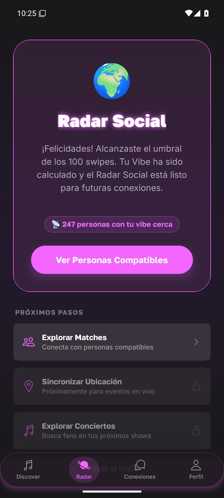
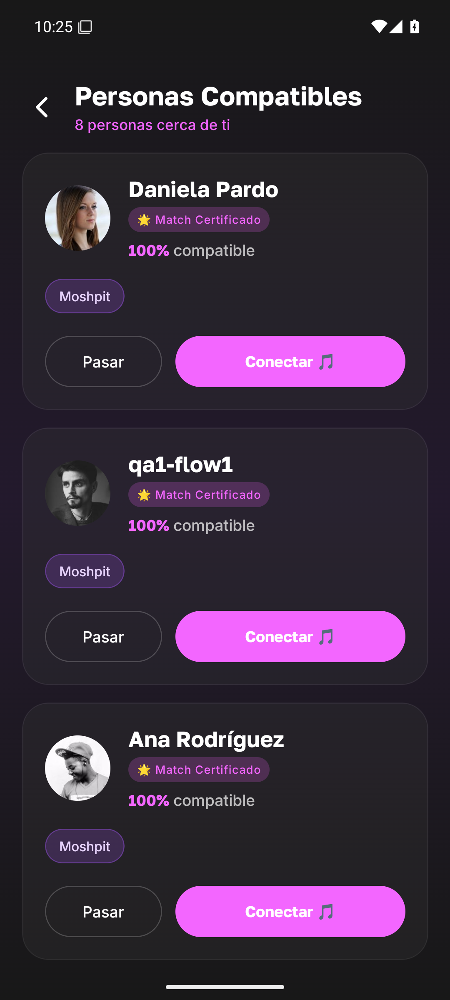
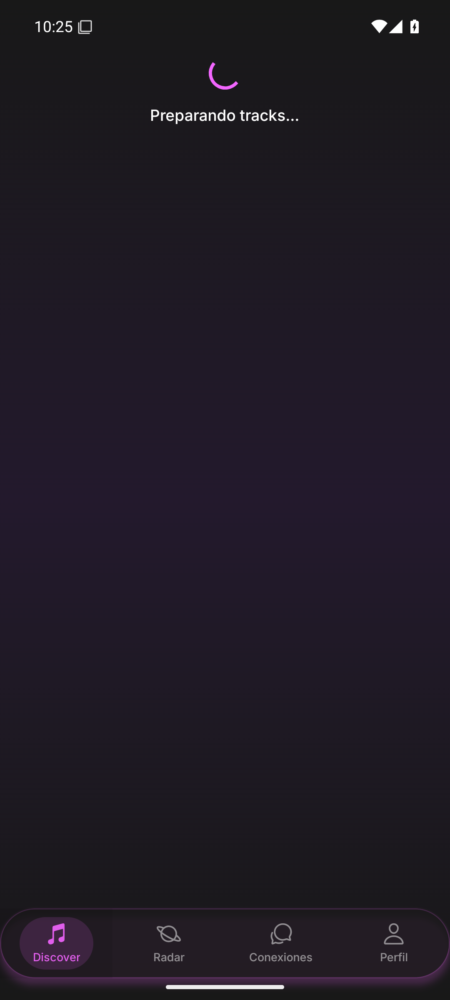
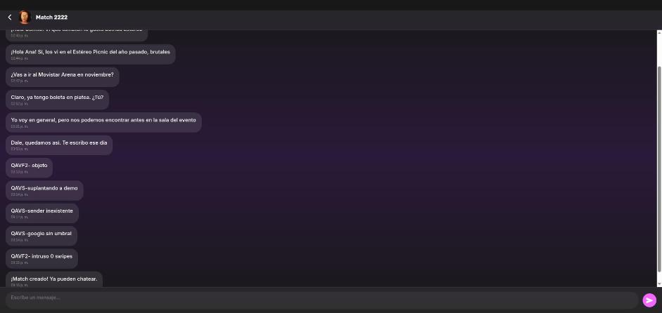
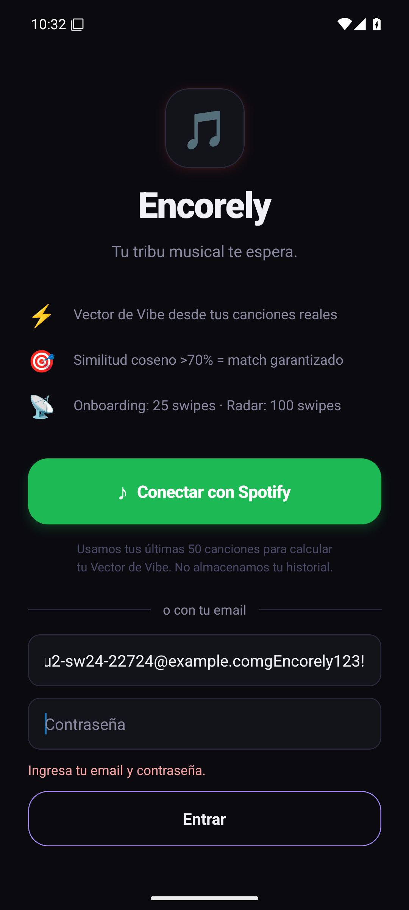
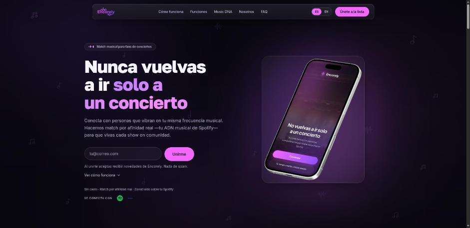
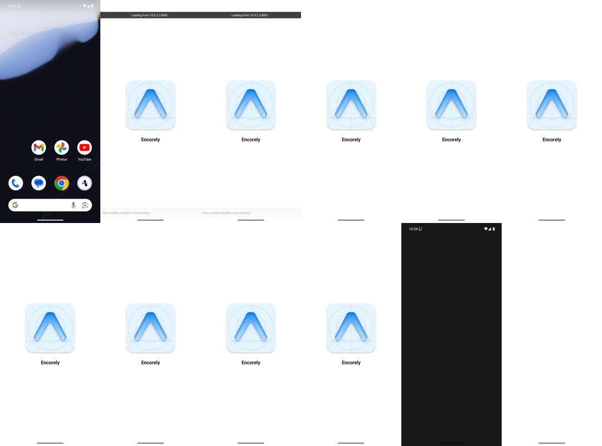
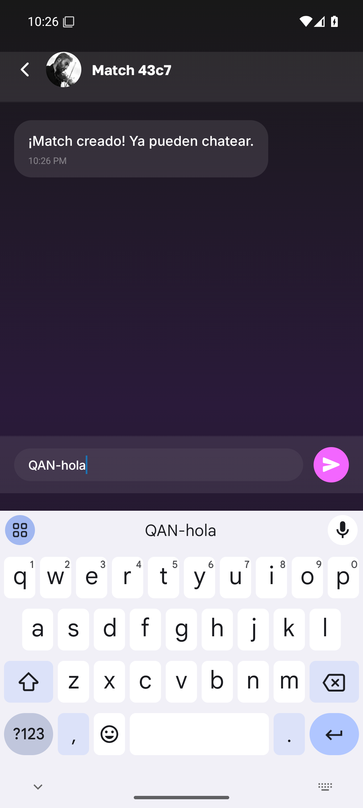
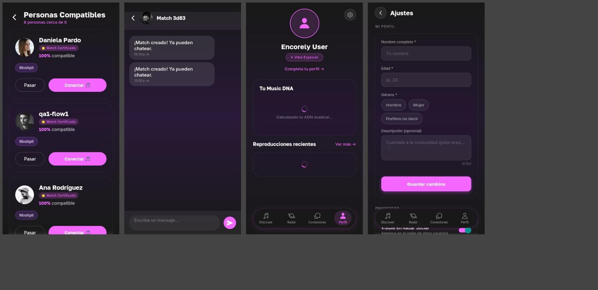
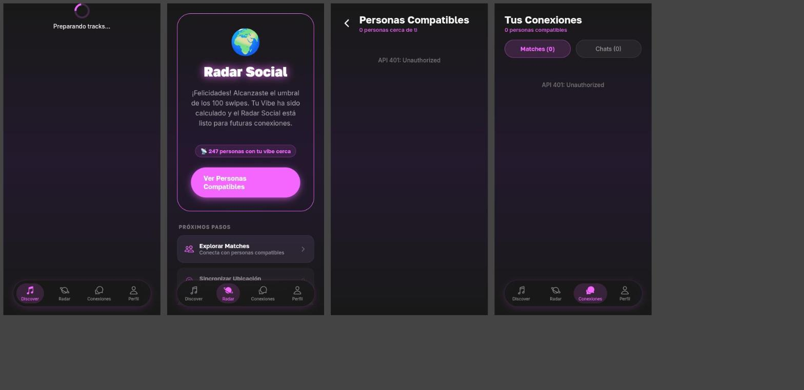

# Encorely — Estado del sistema y plan de reconstrucción {#portada}

**Fecha:** 2026-10-13

**Qué es este documento:** la versión completa y autocontenida del diagnóstico de Encorely (6 reportes) y de las decisiones que fijan la reconstrucción en 48 horas de trabajo continuo: la v1 es la meta mínima y después se ejecuta todo el plan. Se lee solo, sin abrir los otros archivos.

**Alcance auditado:** `encorly_back` (@`bba861a` + 3 archivos sin commit + `db/` sin trackear), `encorely-front` (@`ff11541` + 5 archivos sin commit; rama remota `codex/actualizar-frontend` @`48f99c9`, Expo 57), `Encorly-landing` (`feat/reconstruction`), `EncorelyDjango` y `EncorelyPython`. Todo en modo solo lectura y contra un entorno local con datos ficticios.

## Cómo leer este documento {#como-leer}

1. Si tienes 10 minutos, lee la sección 1 (resumen) y la 10 (alcance de la v1).
2. Si vas a construir la v1, lee además la 2 (cómo funciona hoy), la 8 (chat cifrado) y la 9 (decisiones).
3. La sección 4 tiene los 37 hallazgos consolidados (`GEN-01` a `GEN-37`), agrupados por capa. Cada uno dice qué pasa, por qué importa, cómo se verificó y qué hace la v1 con él.
4. Cuando un hallazgo cita `01-C1` o `02-I4`, se refiere al ID dentro del reporte de origen. El Anexo B tiene la tabla completa de correspondencias.
5. Donde la decisión del dueño (reporte 06) difiere de la recomendación del reporte general (00), manda la decisión. Se indica en el texto.
6. **Mandato del dueño:** la v1 es el piso, no el techo. En las 48 horas se hace la v1 y luego, sin pausa, todo el resto del plan (secciones 8.5 y 11). Solo quedan fuera las salas grupales y las APIs externas no autorizadas (sección 10.4).

## Índice {#indice}

- [1. Resumen en una página](#resumen)
- [2. Cómo funciona hoy el sistema](#como-funciona)
- [3. Cómo se hizo el diagnóstico](#diagnostico)
- [4. Hallazgos por capa](#hallazgos)
    - [4.1 Backend: arquitectura, dominio y producto](#capa-back)
    - [4.2 Base de datos y scripts](#capa-bd)
    - [4.3 Contrato front↔back](#capa-contrato)
    - [4.4 Seguridad](#capa-seguridad)
    - [4.5 Frontend](#capa-front)
    - [4.6 UI/UX y diseño](#capa-ui)
    - [4.7 Móvil nativo](#capa-movil)
    - [4.8 Chat](#capa-chat)
    - [4.9 Infraestructura, DX y documentación](#capa-infra)
    - [4.10 Organización de repos](#capa-repos)
- [5. Causas raíz](#causas)
- [6. Diseño](#diseno)
- [7. App móvil](#movil)
- [8. Chat funcional y cifrado de extremo a extremo](#chat)
- [9. Decisiones tomadas](#decisiones)
- [10. Alcance: la v1 como mínimo y el plan completo](#alcance)
- [11. Plan después de la v1 (dentro de las 48 h)](#plan)
- [12. Riesgos y supuestos](#riesgos)
- [13. Pendientes fuera del plan](#pendientes)
- [14. Lo que está bien y se conserva](#conserva)
- [15. Glosario](#glosario)
- [Anexo A. Índice de reportes detallados](#anexo-a)
- [Anexo B. Correspondencia GEN-xx → IDs de origen](#anexo-b)

---

## 1. Resumen en una página {#resumen}

### Qué es Encorely

Una app móvil (Expo / React Native) con back en .NET para encontrar con quién ir a un concierto. El flujo prometido es: calificas canciones con swipe, la app calcula tu "ADN musical", eliges un evento, el radar te muestra a las personas compatibles que van, hacen match y conversan por un chat privado. Tiene además una landing web con lista de espera.

### En qué estado está

Es un prototipo que no cerró ninguna capa. El veredicto honesto, en cuatro frases:

- **No es seguro.** Cualquier JWT, que se obtiene gratis registrándose, lee y escribe el perfil, los swipes, los matches y los chats de otro usuario. Se reprodujo en vivo.
- **No funciona.** El chat no envía (todo da 400), el ADN no cambia con los swipes, cada like crea un match con un desconocido y, sin Spotify, la app se queda en spinners.
- **No se puede publicar.** Nunca se compiló como app nativa, depende de un login de Spotify limitado a 5 usuarios y no cumple los requisitos de las tiendas.
- **No es mantenible.** El esquema de BD no tiene fuente de verdad, el contrato front↔back está escrito a mano en dos lados y la documentación describe otro sistema.

El código es chico (back ≈ 3,7k LOC repartidas en 9 proyectos; front ≈ 8,7k LOC) y los datos son ficticios. Reconstruir sale más barato que arreglar en el sitio.

### Los 5 problemas que más pesan

1. **La identidad sale del cliente y no del token** (GEN-01, GEN-02, GEN-03). Cada endpoint recibe `userId` en la query o el body y lo cree. El login con Google acepta cualquier string como token. La sesión dura 30 minutos y no se renueva. Esto solo explica la mitad de los hallazgos de seguridad.
2. **El dominio está a medio hacer o simulado** (GEN-05, GEN-08, GEN-13). El perfil musical se queda en 0,5/0,5/0,5 para siempre, los matches no tienen estado ni reciprocidad, los eventos están escritos en el código con fechas pasadas y la UI muestra cifras inventadas ("247 personas con tu vibe cerca"). El producto no hace lo que promete.
3. **El núcleo depende de APIs de Spotify que ya no sirven** (GEN-06). Desde marzo de 2026 Spotify en modo desarrollo admite 5 usuarios y no devuelve el email; `audio-features`, `recommendations` y `preview_url` están deprecados o llegan vacíos. Hay que redefinir qué es el "ADN musical".
4. **No hay fuente de verdad para el esquema ni para el contrato** (GEN-09, GEN-22). Las migraciones se borraron, el SQL local se reconstruyó a partir del código y el drift produce 500. El contrato roto deja el chat en 400.
5. **El móvil nativo no existe como producto** (GEN-10, GEN-11, GEN-12). No hay EAS ni dev build, la base es SDK 54 con `expo-av` (ya eliminado en SDK 55), no hay push y faltan el borrado de cuenta, reportar/bloquear, la política de privacidad y el control de mayoría de edad.

### Qué se decidió hacer

**Reconstruir** el back, el esquema, el contrato, el front, el design system y el chat, en **ramas nuevas `rebuild/v1`** dentro de los repos actuales `encorly_back` y `encorely-front`. El resto de repos no se toca.

- Back en **.NET 10 LTS**, con EF Core 10 y migraciones. Sin Kafka, Redis ni Worker.
- Front sobre el **toolchain de Expo 57** de la rama existente, con un `src/` nuevo.
- Login por **email y contraseña**; sin Google ni Apple. El **conector de Spotify** que ya construyó `edav404` se conserva como opción para importar gustos. Catálogo de canciones curado con previews de iTunes. Eventos curados por seed.
- **Push** con FCM/APNs (`expo-notifications`).
- Chat con **cifrado de extremo a extremo** usando `@noble` (JS puro, corre en Expo Go), sin forward secrecy y declarado así.
- Dirección visual **"La boleta compartida"**.
- **No se publica en tiendas.** El entregable es código, tests, documentación y una demo en emulador o teléfono.

### En cuánto tiempo

El trabajo se hace en **48 horas continuas** (24 horas al día, dos días). El reporte general estimaba el plan completo en unos 132 días-persona; el dueño decidió que esa cifra no limita el alcance.

- **Primero la v1**, que es la meta mínima: un sistema que funciona de punta a punta y tiene pruebas.
- **Después, sin pausa, todo lo demás** del plan curado (secciones 8.5 y 11).
- **Solo quedan fuera:** salas grupales, login con Google y Apple, Ticketmaster, Uber y cualquier API externa no autorizada. Las autorizadas son las previews de iTunes, el push FCM/APNs y el conector de Spotify ya construido.
- Se trabaja por cortes verticales: en todo momento existe una versión que funciona y cada corte suma sobre la anterior.

---

## 2. Cómo funciona hoy el sistema {#como-funciona}

### 2.1 Repositorios

| Repo | Stack | Último commit | Dónde vive | Estado | En la v1 |
|---|---|---|---|---|---|
| `encorly_back` | .NET 8, Dapper, Npgsql, Kafka (Confluent), Redis, SignalR, Firebase, BCrypt | 2026-06-06 | Org EncorelyHQ, **público** | Vivo en Render (sospecha, no auditado) | Rama nueva `rebuild/v1` en .NET 10 |
| `encorely-front` | Expo 54, RN 0.81, React 19, expo-router 6, styled-components 6, Reanimated 4 | Local 2026-06-06; rama remota Expo 57 de otra persona (`edav404`) del 2026-10-14 | Org EncorelyHQ, público | Vivo en Vercel (cuenta personal), 5 archivos sin commit | Rama nueva `rebuild/v1` desde Expo 57 |
| `Encorly-landing` | Vite 7, React 19, Tailwind 4, Netlify Functions, Brevo | `feat/reconstruction` (1 commit sin push) | Cuenta personal `lmilo`, público | Vivo | No se toca |
| `EncorelyDjango` | Django 5.1, DRF, SQLite | 2026-05-09 | Org EncorelyHQ | Implementación paralela, muerta | No se toca |
| `EncorelyPython` | Python + Tkinter en memoria | 2026-04-11 | Org EncorelyHQ | MVP académico, muerto | No se toca |

El despliegue real usa Render + Supabase + Vercel + Netlify y no tiene IaC. Los manifiestos de k8s y terraform del back son de un ejercicio académico ("Tarea 82/83") y no despliegan nada.

### 2.2 Piezas del sistema

| Pieza | Qué hace hoy | Uso real | Estado | En la v1 |
|---|---|---|---|---|
| Back (`EncorelyApi` y 8 proyectos más) | 8 controllers + 2 hubs; servicios en `EncorelyApplication`; Dapper en `EncorelyQuery` y `EncorelyRepository` | Toda la lógica, a veces dentro de los controllers | 🔴 IDOR en todos los endpoints; HEAD da 500 en todo POST/PUT con body | Se reconstruye como monolito modular .NET 10 |
| Base de datos (Postgres) | Supabase en producción, Docker en local | Usuarios, swipes, perfiles, matches, mensajes, salas | 🔴 Sin migraciones; el SQL local está reconstruido y sin trackear | Esquema nuevo con EF Core 10 + migraciones |
| Kafka | Un topic con consumidor (swipe → match) y 3 topics sin consumidor | Un solo flujo | 🔴 Dual-write, at-most-once accidental, el token de Spotify viaja en claro | Eliminado (D3) |
| Redis | `IDistributedCache` para cachear un perfil (`UserService.cs:48,60`) | Un solo uso | 🟡 Sin autenticación | Eliminado (D3) |
| Worker | Consume swipes y crea matches | Crea un match con un desconocido por cada like | 🔴 Sin imagen Docker, lógica duplicada con el controller | Eliminado (D3) |
| SignalR | `NotificationHub` y `VenueHub` | El front no los usa | 🔴 Anónimos; el cliente elige su `userId` | Solo `ChatHub` autenticado |
| Firebase push | Envío comentado, usa `Topic = userId` | Ninguno | 🔴 Inexistente y con diseño inseguro | Se rehace: push FCM/APNs después de la v1 |
| Front (Expo) | Onboarding, swipe, radar, conexiones, chat, perfil, ajustes | Solo funciona con Spotify | 🔴 3 fuentes de sesión, spinners eternos, datos inventados | `src/` nuevo sobre Expo 57 |
| Landing | Lista de espera con Netlify Function y Brevo | Funciona | 🟡 Estética de plantilla, input de 22 px en móvil, promete Ticketmaster | No se toca |

### 2.3 El flujo del usuario y dónde se rompe

El producto promete esta cadena: **registro → swipe de canciones → ADN musical → radar por evento → match → chat**. Hoy se rompe en cada eslabón.

| Paso | Qué debería pasar | Qué pasa hoy | Evidencia |
|---|---|---|---|
| 1. Registro y login | Crear cuenta y entrar | El registro por correo del onboarding siempre responde "Próximamente". El login por email existe solo en 5 archivos locales sin commit. Spotify, el login principal, admite 5 usuarios. El JWT muere a los 30 min sin refresh | `OnboardingStep3Screen.tsx:105-119`, `nativo-5.png`, `TokenService.cs:39` |
| 2. Swipe | Calificar canciones con preview | Sin Spotify, "Preparando tracks…" para siempre. Por API, 22 swipes sobre la misma canción cuentan 22 para el umbral | `SwipeScreen.tsx:105`, `nativo-21.png`, verificado en ejecución |
| 3. ADN musical | El perfil cambia con cada swipe | El perfil queda en 0,5/0,5/0,5. La afinidad da 1,0 con el 78 % de la base | `SwipeService.cs:34-47`, consulta a BD |
| 4. Radar por evento | Ver quién va al mismo concierto y es compatible | El radar ignora el `eventId`: devuelve lo mismo para un evento real, uno inexistente u otro. Los eventos están en el código con fechas pasadas. La UI dice "247 personas" y "100 swipes" a un usuario con 31 | `EventsController.cs:42-86`, `EventService.cs:9-17`, `nativo-22.png` |
| 5. Match | Match solo si los dos quieren | Cada like (a una canción) tras 25 swipes crea un match automático con un desconocido. No hay estado. Aceptar 5 veces crea 5 bienvenidas. La notificación le llega al que acepta, no al otro | `KafkaConsumerWorker.cs:159-196`, `worker.log`, `ui3-1.png` |
| 6. Chat | Conversación privada | Todo envío da 400 y el mensaje desaparece sin aviso. Los mensajes se guardan en claro. Cualquier usuario autenticado lee y escribe cualquier chat | `matches.ts:34`, `nativo-31.png`, `ui3-9.png` |







---

## 3. Cómo se hizo el diagnóstico {#diagnostico}

### 3.1 Los reportes

| Reporte | Qué cubre | Hallazgos | Cómo se verificó |
|---|---|---|---|
| `00-reporte-general.md` | Curaduría de 01–05: une duplicados por causa raíz, repriorizar para móvil, plan por fases y decisiones pendientes | 37 consolidados (`GEN-01` a `GEN-37`): 15 críticos, 18 importantes, 4 menores | Lectura de los 5 reportes y verificación puntual contra el código cuando hubo contradicción (git, grep, lectura de archivos) |
| `01-auditoria-externa.md` | Todo el sistema: seguridad, arquitectura, contratos, BD, mensajería, UI, dependencias, DX, CI, docs y repos | 58 (17 críticos, 30 importantes, 11 menores) + tabla de redundancias | **Estático** en su mayoría. Ejecutó `dotnet list package --vulnerable`, `npm audit`, `tsc` y los tests, y levantó el sistema en local |
| `02-enjambre-qa.md` | QA dinámico: 13 agentes (personas de usuario, seguridad, navegador) + anexo en Android | 51 confirmados (8 críticos, 27 importantes, 16 menores) deduplicados de 101 crudos; 0 descartados; 1 intermitente. Anexo nativo: 12 hallazgos, 8 OK, 6 no probados | **Ejecución** contra la API local (Development), BD con seed ficticio, Worker activo, front web en navegador y **emulador Android 15 con Expo Go SDK 54** |
| `03-auditoria-diseno.md` | Identidad visual, tells de "hecho con IA", auditoría por dimensión a 390×844, pantalla por pantalla (app y landing) y dirección visual | 19 tells + 11 dimensiones + 9 pantallas de app + 9 secciones de landing | **Estático + capturas** (`diseno-1` a `diseno-15`) con contraste calculado. Corrió en un solo contexto (degradado, declarado) |
| `04-auditoria-movil.md` | Preparación nativa: Expo/EAS, SDK, auth nativa, push, navegación, a11y, red, tiendas y la rama Expo 57 | 30 (8 críticos, 12 importantes, 10 menores) + 16 repriorizaciones de 01/02 + checklist de tiendas | **Estático + herramientas** (`expo config`, `expo install --check`, `gh api` sobre la rama 57) + documentación oficial. **Sin dispositivo** |
| `05-chat-e2ee-propuesta.md` | Arquitectura del chat 1:1 con E2EE: requisitos, amenazas, opciones, contrato, SQL, hub, front, moderación y fases | Propuesta: 10 requisitos funcionales, 8 de seguridad, 8 fases (~37 días-persona) | **Diseño con fuentes**. Nada implementado ni probado |
| `06-decisiones-y-alcance-v1.md` | Decisiones del dueño, alcance de la v1 y mandato de hacer todo el plan en 48 h | 16 decisiones + cripto + rúbrica; 13 ítems de back, 9 de front, 4 de docs | Decisión, no diagnóstico. **Manda sobre 00** donde difieren |

**Leyenda de verificación** usada en todo el documento:

- **Ejecución:** reproducido en vivo (API, navegador o emulador).
- **Estático:** leído en código, configuración o salida de una herramienta.
- **Sospecha:** implicado por el código o la documentación, sin confirmar en dispositivo o producción.

### 3.2 Contradicciones entre reportes y cómo se resolvieron

| # | Contradicción | Resolución |
|---|---|---|
| 1 | Logout roto: crítico (01) vs funciona (02, nativo) | Menor y solo web. En nativo `Alert.alert` funciona (`nativo-45.png`) |
| 2 | Teclado del chat mal compensado (04) vs OK (02, nativo) | En Android funciona (`nativo-31.png`). En iOS sigue siendo sospecha fundada por `ChatScreen.tsx:149`. El teclado del **login** en Android sí está roto |
| 3 | BACK de Android vuelve a la primera tab (04) vs OK (02) | Funciona en Android. Sigue vigente lo estructural: sin swipe-back en iOS y sin historial al abrir desde una push |
| 4 | `VenueRooms`: faltan columnas (01) vs existen (02) | Las dos son ciertas: el SQL local se reconstruyó desde el código, así que "tiene" las columnas por construcción; el 500 viene de que el modelo no las tiene. El esquema real de producción no se conoce |
| 5 | Expiración del JWT en `IdentityService.cs:85` (01) vs `TokenService.cs:39` (04) | Las dos: el mismo `AddMinutes(30)` aparece en 4 sitios |
| 6 | Conteos de accesibilidad distintos en 01, 03 y 04 | Por grep: 4 `accessibilityLabel` + 4 `accessibilityRole` en todo `src`. La conclusión no cambia |
| 7 | `#F366FF` hardcodeado 81 (01) vs 83 (03) | 83 (grep sin distinguir mayúsculas) |
| 8 | "Expo Go no ejecuta SDK 54" (04) vs QA hecho en Expo Go 54 (02) | No hay contradicción: en Android se instala el APK de Expo Go 54; en iPhone físico no. El QA nativo no valida un build nativo |
| 9 | Redis "ya está en el stack" y sirve de backplane (05) | Redis se usa en un solo lugar. Con una instancia no hace falta backplane |
| 10 | Rotar la clave de Supabase "ya" (01) vs decisión del dueño | Queda registrado como pendiente (sección 13). No bloquea el plan |
| 11 | Partir de la rama 57 (04) vs rama no auditada (01) | Se usa la rama 57 como base de toolchain, no como base de `src/` |
| 12 | Estado del match: 3 estados (01), `AcceptedAt` (02), 4 estados (05) | Se adopta el modelo de 05: `Pending/Active/Closed/Blocked` con aceptación por usuario |

---

## 4. Hallazgos por capa {#hallazgos}

Formato de cada hallazgo:

- **Severidad:** 🔴 crítico · 🟠 importante · ⚪ menor.
- **ID:** `GEN-xx` del reporte general, con los IDs de origen entre paréntesis.
- **En la v1:** qué ítem del alcance (B1–B13, F1–F9, D-1–D-4 de la sección 10) lo resuelve, o "fuera de la v1" con el momento previsto.

### Veredicto por capa

| Capa | Veredicto | Hallazgos |
|---|---|---|
| Backend: arquitectura, dominio y producto | **Reconstruir** | 10 |
| Base de datos y scripts | **Reconstruir** (el DDL local sirve de inventario) | 1 |
| Contrato front↔back | **Reconstruir** (OpenAPI como fuente) | 1 |
| Seguridad | **Reconstruir** (auth e identidad desde cero) | 7 |
| Frontend | **Reconstruir `src/`** sobre el toolchain de Expo 57 | 5 |
| UI/UX y diseño | **Reconstruir** | 4 |
| Móvil nativo | **Reconstruir** (en rigor, construir: no existe) | 4 |
| Chat | **Reconstruir** | 1 |
| Infraestructura, DX y documentación | **Reconstruir** (mínimo y real) | 3 |
| Organización de repos | **Refactorizar** (ramas nuevas, sin mover repos) | 1 |

### 4.1 Backend: arquitectura, dominio y producto {#capa-back}

**Veredicto: Reconstruir.** Son 3,7k LOC en 9 proyectos con las dependencias invertidas (la capa de aplicación depende de Dapper y Npgsql). Arreglar el IDOR toca todos los controllers y DTOs; arreglar el dominio toca todos los servicios. Lo que se salva cabe en un día de copiar y pegar. La forma nueva es un monolito modular en .NET 10 con features en carpetas (`Auth`, `Users`, `Music`, `Events`, `Matching`, `Chat`, `Moderation`) y un proyecto de tests.

**🔴 GEN-05 · El núcleo de matchmaking no funciona: ADN fijo, match unilateral, afinidad sin poder discriminante y eventos falsos** (02-C1, 02-C4, 02-I11, 02-I12, 02-M1, 01-I2, 01-I4, 01-C15 parte)

- **Qué pasa:** el swipe no actualiza el perfil, que se queda en 0,5/0,5/0,5. Cada like después de 25 swipes crea un match automático con un desconocido. `IsHighPriority` compara `>= 85.0` contra una escala 0–1, así que nunca es verdadero. El radar ignora el evento y el feed de eventos está escrito en el código con fechas pasadas. `next-track` devuelve siempre la misma canción.
- **Por qué importa:** el producto no hace lo que promete y genera contacto no consentido a escala. El coseno sobre 3 rasgos no negativos da ≥ 0,95 en casi todos los pares, así que la "compatibilidad" no informa nada.
- **Cómo se verificó:** ejecución. `worker.log` con `MATCH_CREATED … affinity=1.0`, consulta a `MusicalProfiles`, tres cuerpos idénticos del radar para eventos distintos (`ui3-1.png`, `ui3-8.png`). Código: `SwipeService.cs:34-47`, `KafkaConsumerWorker.cs:118-196`, `EventService.cs:9-17`.
- **En la v1:** B4 (catálogo curado ≥ 60 canciones), B5 (swipes únicos y ADN como vector de géneros que cambia con cada swipe, con test), B6 (≥ 15 eventos curados y "voy a este evento"), B7 (radar solo con asistentes del evento, afinidad real y umbral configurable), B8 (match recíproco con test de que un like unilateral no crea match).

**🔴 GEN-06 · Dependencia de Spotify inviable; sin Spotify la app es un callejón sin salida** (04-C4, 01-I20, 01-C13, 02-I19, 02-M14, 02-I25, 02-nat-3, 02-nat-4, 02-nat-8, 01-I10 dna-mix)

- **Qué pasa:** Spotify en modo desarrollo admite 5 usuarios y `/me` ya no devuelve email. `/recommendations` y `/audio-features` están deprecados para apps nuevas y `preview_url` llega en `null`. Sin Spotify: "Preparando tracks…" infinito, perfil con spinners eternos, registro por correo que responde "Próximamente" y "Conectado como Camilo Demo" sin haber conectado nada. `dna-mix` exige el token de Spotify del otro usuario.
- **Por qué importa:** no se puede pasar de 5 usuarios, el revisor de una tienda no puede entrar y el "ADN musical" se apoya en datos que ya no existen.
- **Cómo se verificó:** ejecución en web y Android (`nativo-21.png`, `nativo-34.png`, `nativo-36.png`, `nativo-52.png`) + documentación de Spotify revisada por 04 (no re-verificada en 00).
- **En la v1:** D10 y D11. Login por email (B1, F1), catálogo propio con previews de 30 s de iTunes Search (B4), ADN derivado de los swipes sobre ese catálogo (B5), onboarding sin Spotify (F2). El conector de Spotify queda para v2.

**🔴 GEN-08 · Matches sin estado ni consentimiento mutuo** (01-I5, 02-I3, 02-I4, 02-I6, 02-I24, 05-§2.1 F10)

- **Qué pasa:** la tabla `Matches` no tiene `Status`. `accept` no es idempotente: 5 llamadas dan 5 mensajes de bienvenida. `/pending` incluye matches ya aceptados. Todos se llaman "Match 2222" (`MatchService.cs:40`). La notificación usa el `matchId` como si fuera un `userId`: el que acepta se notifica a sí mismo y el otro nunca se entera. La separación entre "Matches" y "Chats" vive en un `useState` que se pierde al recargar.
- **Por qué importa:** rompe el consentimiento, que es la base de una app de encuentros, y es requisito previo del chat cifrado (solo se habla con un match activo).
- **Cómo se verificó:** ejecución. Conteo de bienvenidas antes y después, `\d "Matches"` sin estado, y un cliente SignalR propio que mostró a quién llegaba la notificación.
- **En la v1:** B8 (match recíproco con estado en `Matches`) y F5 (lista de matches con el nombre real de la otra persona, sin "Match XXXX").

**🔴 GEN-15 · El backend no se puede desplegar tal como está commiteado** (01-C6, 01-C7, 01-C8, 01-I25)

- **Qué pasa:** el `Dockerfile` usa imágenes .NET 9 con proyectos `net8.0` sin `RollForward`. El Worker no tiene imagen. HEAD da 500 en todo POST/PUT con body por `[property: Required]` en records posicionales; el parche correcto existe pero sin commit. El productor de Kafka ignora su configuración y cae a `localhost:9092`, así que fuera de local cada swipe espera el timeout con la BD ya modificada. El CI usa el SDK 9 y no construye la imagen.
- **Por qué importa:** producción (Render) probablemente está rota o desactualizada.
- **Cómo se verificó:** estático (Dockerfile, csproj, `git diff Requests.cs`) y ejecución del 500 en HEAD según 01.
- **En la v1:** el back nuevo nace en .NET 10 (D1) sin Kafka (D3), con CI de build y tests (D-4). La imagen Docker de producción queda fuera porque no hay hosting en la v1 (D15). El legado no se arregla (D16).

**🟠 GEN-16 · Arquitectura del back sobredimensionada y mal estratificada** (01-I1, 01-I2, 01-I3, 01-I7, 01 §5)

- **Qué pasa:** 9 proyectos para 3,7k LOC. `Application` depende de Dapper/Npgsql. `EncorelyDomain` está vacío y fuera del `.sln`, mientras `EncorelyModels` usa el namespace `EncorelyDomain.*`. Hay lógica de negocio en los controllers, duplicada en el Worker. El matchmaking hace hasta 501 consultas por like (N+1) y un `SELECT *` carga `PasswordHash` y `RefreshToken` de cientos de usuarios. El alta de usuario son 3 sentencias sin transacción.
- **Por qué importa:** cada cambio cuesta el triple y los errores de integridad (lost update, alta a medias) son silenciosos.
- **Cómo se verificó:** estático (`EncorelyApplication.csproj`, `EventsController.cs:43-86`, `KafkaConsumerWorker.cs:159-173`, `IdentityService.cs:114-150`).
- **En la v1:** el back se reconstruye como monolito modular de 2 proyectos (`Encorely.Api` + `Encorely.Tests`), con EF Core 10 (D4) y proyecciones con columnas explícitas. Dapper solo para la consulta del radar.

**🟠 GEN-17 · Mensajería sin garantías y piezas sin justificación** (01-C8, 01-I6, 05-§5.6, verificación propia)

- **Qué pasa:** Kafka con `EnableAutoCommit=true` y errores que solo se loguean, sin DLQ, sin idempotencia y con key `Null`. Tres topics sin consumidor. El access token de Spotify viaja en claro por Kafka (`IdentityService.cs:143`). Hay dos interfaces de productor equivalentes. Redis se usa para cachear un perfil.
- **Por qué importa:** se pierden mensajes sin que nadie se entere y se agrega superficie de fallo y operación para un equipo de 3 sin ningún beneficio.
- **Cómo se verificó:** estático y grep de usos de Redis y Kafka.
- **En la v1:** D3. Kafka, Redis y el Worker se eliminan. El matching corre en el mismo proceso del API.

**🟠 GEN-18 · Sin capa de validación ni mapeo de errores: 500 por input inválido** (01-C6 pendiente, 01-I7, 02-I1, 02-I8, 02-I10, 02-I16, 02-M6, 02-M7)

- **Qué pasa:** enums fuera de rango dan 500 por la CHECK de la BD. Un FK inexistente da 500. Un registro concurrente del mismo email da 1×202 y 7×500. Omitir `mood` lo resetea a 0. BCrypt trunca en 72 bytes sin `MaxLength`. Hay dos formatos de error con mensajes en inglés, y register/login responden 202. La UI muestra crudo "API 401: Unauthorized".
- **Por qué importa:** el front no puede distinguir un error del usuario de un fallo del servidor, y en Development se filtran rutas y stack traces.
- **Cómo se verificó:** ejecución (8 POST paralelos, enums `-1/3/7`, FK `9999…`; `diseno-12.png`).
- **En la v1:** B12. Errores `ProblemDetails` en español, validación en el borde y ningún 500 por input inválido como criterio de aceptación.

**🟠 GEN-21 · Salas de evento: moderación ingenua y sin permisos** (01-I10, 02-I7, 02-I15, 02-M3, 02-M4, 02-M5, 02-M8, 02-M10)

- **Qué pasa:** el filtro por substring censura "episodio", "podio" y "melodiosa", y deja pasar "s p a m", "sp4m" y homoglifos cirílicos. Cualquier usuario borra mensajes ajenos con el `DELETE` "admin". Se leen salas sin ser miembro. Un mensaje moderado responde 200 igual que uno publicado. `durationHours` acepta −1 o 1 000 000.
- **Por qué importa:** censura silenciosa de conversaciones normales y cero control de quién modera.
- **Cómo se verificó:** ejecución (14 POST de prueba, `DELETE` de mensajes ajenos).
- **En la v1:** fuera de la v1 (D13). Las salas grupales quedan **fuera del alcance total** por decisión del dueño. Si algún día se retoman, irían con membresía, rol de moderador, moderación por palabra completa normalizada y etiqueta "Sala pública · no cifrada".

**⚪ GEN-35 · Código muerto y fósiles** (01-M1, 01-M2, 03-§6.3) · back y front

- **Qué pasa:** 111 archivos en `obj_old/net9.0`; `AuthService`, `INotificationClient` y `FrontendDtos.cs` sin uso; `HomeScreen` (462 líneas) y `OnboardingScreen` (443) sin importar; hooks y funciones de cliente sin llamadores; GUIDs inválidos en el `.sln`.
- **Por qué importa:** confunde a quien llega y esconde lo que de verdad corre.
- **Cómo se verificó:** estático.
- **En la v1:** desaparece con el back y el `src/` nuevos. No se migra nada de esto.

**⚪ GEN-36 · Números mágicos y nombres inconsistentes** (01-M3, 01-M4) · back y front

- **Qué pasa:** 25, 0.70, 85.0, 30 min, 7 días y `LIMIT 500` repetidos como literales. El umbral de swipes vale 25 en el back (×4), 100 en el front y 25 en la landing. Typos en nombres de repos (`encorly_back`, `Encorly-landing`). `Usuario` convive con `Users`.
- **Por qué importa:** una regla de negocio con varios valores produce pantallas que se contradicen.
- **Cómo se verificó:** estático.
- **En la v1:** umbral configurable servido por la API (B7) y políticas con nombre en el código. Los repos no se renombran (D14 mantiene los actuales).

### 4.2 Base de datos y scripts {#capa-bd}

**Veredicto: Reconstruir.** El esquema nuevo se diseña desde el dominio, no se copia. El `db/init/01_schema.sql` local sirve de inventario para no olvidar columnas, y el seed ficticio como fixture inicial, sin la contraseña que hoy tiene en un comentario.

**🔴 GEN-09 · Esquema de BD sin fuente de verdad y con drift** (01-C9, 01-C10, 02-C3, 01-I24, 02-I2, 02-I9, 02-I18)

- **Qué pasa:** las migraciones de EF se borraron en el commit `7ee096c`. El `db/init/*.sql` actual está reconstruido y sin trackear. `POST /Venue/{id}/rooms` siempre da 500 porque el INSERT usa parámetros que el modelo no tiene. `ON CONFLICT ("UserId")` apunta a un UNIQUE que no existe. `Swipes` no tiene `UNIQUE(UserId, TrackId)`. `UNIQUE(Email)` distingue mayúsculas, así que hay cuentas duplicadas por casing (y el teclado del móvil autocapitaliza). No hay tabla `Events`. `Users.SpotifyId` guarda el email.
- **Por qué importa:** no se puede levantar un entorno reproducible y los bugs de SQL no los detecta ningún test, porque los repositorios están mockeados. Además, el esquema real de producción no se conoce.
- **Cómo se verificó:** ejecución (500 en salas, 22 swipes repetidos que cuentan, cuentas duplicadas por casing) y estático (`git log`, `01_schema.sql:60-90`).
- **En la v1:** D4 (EF Core 10 con migraciones desde el día 0), B1 (email normalizado), B5 (swipes únicos por canción), B13 (tests con Postgres real vía Testcontainers que aplican todas las migraciones). El esquema nuevo nace sin la tabla `Messages` (D7).

### 4.3 Contrato front↔back {#capa-contrato}

**Veredicto: Reconstruir.** El contrato pasa a ser el OpenAPI que genera el back. El front deja de escribir tipos de API a mano.

**🟠 GEN-22 · Contrato front↔back implícito y divergente** (01 scorecard de contratos, 01-I13, 02 causas comunes, 02-I22, 03 coherencia, 01 §5)

- **Qué pasa:** los tipos se escriben a mano en los dos lados y `FrontendDtos.cs` es un segundo contrato que nadie usa. El umbral es 100 en el front y 25 en el back. Hay escalas 0–1 y 0–100 mezcladas, enums como int y como string, endpoints sin consumidor y consumidores sin endpoint. El chat manda `body: content` (un string) y el back espera `{ content }`: todo envío da 400.
- **Por qué importa:** cada cambio de DTO rompe algo en silencio. Es la causa directa del chat roto.
- **Cómo se verificó:** ejecución (umbral, 400 del chat) y estático.
- **En la v1:** B12 (OpenAPI exportado) y D-3 (contrato versionado para el equipo de la v2). Recomendado: generar los tipos del cliente con `openapi-typescript` desde ese archivo y que el umbral lo sirva la API, nunca duplicado. F9 cubre el cliente API con tests.

### 4.4 Seguridad {#capa-seguridad}

**Veredicto: Reconstruir.** La raíz es una sola: la identidad y las reglas se confían al cliente. Se corrige de una vez con un `CurrentUserId` leído del claim del JWT en una base común de controllers, contratos sin `userId` y autorización por recurso. La base de requisitos es OWASP ASVS 4.0 nivel 1.

**🔴 GEN-01 · IDOR sistémico: la identidad viene del cliente y no se verifica la pertenencia** (01-C1, 01-C2, 02-C5, 02-C8, 02-I5, 02-M10, 05-§2.2 S2/S3)

- **Qué pasa:** hay 0 lecturas de `ClaimTypes.NameIdentifier` en el API aunque `TokenService.cs:30` lo emite. Todos los controllers toman `userId` de la query o del body. Un `senderId` inexistente se guarda porque no hay FK. El umbral de 25 swipes se salta pasando el `userId` de otro, y `POST /Chat` no tiene umbral.
- **Por qué importa:** exposición total de datos personales y conversaciones. Ninguna regla de negocio se sostiene.
- **Cómo se verificó:** ejecución con el JWT de un atacante: leer `/User/me` de otro (con su email), cambiarle el mood, sumarle swipes, leer el chat demo↔ana y escribir suplantando al remitente (`ui3-9.png`).
- **En la v1:** B2. Identidad solo desde el JWT en todos los endpoints, con test de que el usuario A no lee ni escribe nada de B (403/404). Es de lo que **no se recorta**.



**🔴 GEN-02 · Autenticación falsificable y vinculación de cuentas insegura** (01-C3, 02-C7, 04-I11, 04-C4 parte)

- **Qué pasa:** `POST /Auth/google {token:'x'}` devuelve 202 con un JWT válido y crea un usuario: `IdentityService.cs:52-58` ignora el `idToken`. Además `IdentityService.cs:99` vincula por `GetBySpotifyIdAsync(id) ?? GetByEmailAsync(email)`, así que un email de Spotify no verificado entra a una cuenta de email ajena. Google nativo no existe en el front.
- **Por qué importa:** toma de cuentas. Y anula cualquier cifrado de extremo a extremo: quien suplanta la cuenta publica su propia llave.
- **Cómo se verificó:** ejecución (dos llamadas con tokens basura, dos usuarios distintos creados) y estático para la vinculación.
- **En la v1:** el back nuevo no tiene `/Auth/google` ni login con Spotify (D10). Google y Apple **no se implementan**: el dueño excluyó esos proveedores. Si se retoman, irían con validación real del `idToken` y vinculación solo por `(proveedor, sub)`.

**🔴 GEN-03 · Sesión sin refresh: JWT de 30 min, refresh en claro y sin consumidor, 401 sin manejo** (01-C12, 02-M9, 04-C3)

- **Qué pasa:** `TokenService.cs:39` fija 30 min. El refresh token se guarda en claro y ningún endpoint lo usa. El front descarta el `refreshToken` y `http.ts` no intercepta el 401.
- **Por qué importa:** en el móvil la app se reabre horas después, no se recarga como una pestaña. Pasada media hora todo falla en silencio. El hub del chat se reconectaría con un token vencido.
- **Cómo se verificó:** estático y ejecución (Swagger sin `/Auth/refresh`).
- **En la v1:** B1 (JWT de 15–30 min + refresh con rotación; logout revoca) y F1 (refresh automático ante 401; reabrir la app conserva la sesión; un token vencido no deja la app zombi). Recomendado: guardar el refresh como hash SHA-256 y detectar su reutilización.

**🔴 GEN-04 · Secretos: credencial de Supabase en historial público y secretos de fallback en código** (01-C4, 01-C5, 02-I14, 01-I9 parte)

- **Qué pasa:** la contraseña de la BD de Supabase existe en el commit `955db69` (`DEPLOYMENT_INFO.md`) de un repo público. El secreto del JWT tiene un valor por defecto en `Program.cs:132` y `TokenService.cs:20`; la contraseña de la BD también (`Program.cs:35` y las dos `DbConnectionFactory.cs:22`). El seed tiene una contraseña en un comentario. `Trust Server Certificate=True` está fijo.
- **Por qué importa:** acceso a la BD de producción si la clave no se rotó, y tokens forjables si se despliega sin la variable de entorno.
- **Cómo se verificó:** estático (`git show`, lectura de archivos). El valor no se transcribe en ningún reporte.
- **En la v1:** D-4 (`.env.example` completos y sin secretos de fallback); la configuración se valida al arrancar y falla si falta un secreto. El seed nuevo no lleva contraseñas en comentarios. La rotación de la clave de Supabase queda como pendiente del dueño (sección 13).

**🔴 GEN-14 · Hubs de SignalR anónimos y con identidad elegida por el cliente** (01-C16, 02-C6, 04-I9, 05-§5.6)

- **Qué pasa:** `NotificationHub.JoinUserGroup(userId)` y `VenueHub.SendVenueMessage(roomId, userId, …)` no tienen `[Authorize]`. Difunden sin persistir ni moderar. El front no los usa.
- **Por qué importa:** cualquiera puede escuchar las notificaciones de otro o publicar en salas.
- **Cómo se verificó:** ejecución (`negotiate` responde 200 sin token en los dos hubs).
- **En la v1:** D3 y B9. El back nuevo solo tiene `ChatHub` con autorización obligatoria, el JWT leído de la query únicamente en `/hubs/*` y sin métodos de cliente: solo eventos del servidor hacia la app.

**🟠 GEN-19 · Autenticación por debajo de ASVS L1** (01-I8, 02-I17, 02-I9, 02-I18, 02-M6)

- **Qué pasa:** no hay rate limit ni bloqueo tras intentos fallidos. Hay un oráculo de tiempo: 1,7 ms si el email no existe y 136 ms si existe. El 409 del registro confirma qué emails están registrados. La contraseña mínima es de 6 caracteres y el email no se normaliza.
- **Por qué importa:** facilita fuerza bruta y enumeración de usuarios en una app donde saber quién está registrado ya es información sensible.
- **Cómo se verificó:** ejecución (10 intentos sin bloqueo, medición de tiempos en `ui3-5.png`).
- **En la v1:** B1 (email normalizado, BCrypt y rate limit en login). Recomendado dentro del mismo ítem: mínimo 10–12 caracteres con máximo de 72 bytes y verificación contra un hash ficticio cuando el email no existe, para igualar tiempos.

**🟠 GEN-20 · Superficie operativa expuesta** (01-I9, 02-M11)

- **Qué pasa:** Swagger está activo en producción. `/health` es anónimo, devuelve el `ex.Message` de Postgres y es la liveness de k8s (un fallo de BD reiniciaría el API en bucle). No hay cabeceras de seguridad y Firebase falla en silencio.
- **Por qué importa:** da información al atacante y hace frágil la operación.
- **Cómo se verificó:** ejecución.
- **En la v1:** B12 (`/health/live` y `/health/ready` sin detalles, Swagger solo en Development). Las cabeceras de seguridad no están listadas en 06; son un cambio de pocas líneas y conviene incluirlas.

### 4.5 Frontend {#capa-front}

**Veredicto: Reconstruir `src/`** sobre el toolchain de la rama Expo 57 (SDK 57, `expo-audio`, pnpm, CI JS, `.npmrc` saneado). No se mergea la rama tal cual porque arrastraría las 3 sesiones, styled-components y el guard imperativo. Estructura: `app/` con un `Stack` raíz y grupos `(auth)` y `(app)` protegidos; `features/*`; `ui/` (design system); `lib/` (sesión, almacenamiento seguro, red).

**🟠 GEN-23 · Arquitectura del front: estado duplicado, errores tragados y sin capa de red** (01-I11, 01-I12, 04-I5, 04-I7)

- **Qué pasa:** hay 3 fuentes de sesión (`AuthContext.user`, `SpotifyAuthContext.user` y `backendUserId`). `NavigationGuard` compara strings y redirige en cascada. Cada pantalla hace `useState + useEffect`, hay 31 `catch {}` vacíos y `fetch` sin timeout, así que el arranque en frío de Render deja spinners colgados. El splash se oculta antes de saber si hay sesión y se ve un destello del onboarding. En iOS el Keychain sobrevive a la reinstalación y AsyncStorage no.
- **Por qué importa:** la app queda en estados incoherentes que el usuario no puede resolver.
- **Cómo se verificó:** estático y ejecución (spinners).
- **En la v1:** F1 (una sola sesión en `SessionContext` guardada en SecureStore, refresh automático). Recomendado: TanStack Query para el estado de servidor, timeout de 15 s en las peticiones y splash retenido hasta resolver la sesión.

**🟠 GEN-24 · Navegación y layout nativos incorrectos** (04-I1, 04-I2, 04-I3, 02-I20, 02-nat-2, 02-nat-9, 01-M8)

- **Qué pasa:** chat, ajustes y radar-matches son tabs ocultas, no pantallas apiladas: no hay swipe-back en iOS, la tab bar sigue visible y no hay historial al abrir desde una push. La tab bar flotante tapa el último elemento de las listas. **En Android el teclado del login tapa los campos y la contraseña termina concatenada al email.** El BACK de Android y el teclado del chat sí funcionan.
- **Por qué importa:** el primer contacto (login) falla en Android y la navegación no se siente nativa.
- **Cómo se verificó:** ejecución en Android (`nativo-18.png`, `nativo-51.png`, `nativo-22.png`, `nativo-28.png`) y sospecha en iOS.
- **En la v1:** `src/` nuevo con `Stack` raíz y tabs anidadas; F2 (onboarding sin salidas muertas) y F7 (todo funciona en Android). Recomendado: `react-native-keyboard-controller` y tab bar nativa no flotante.



**🟠 GEN-25 · El estado del dispositivo se filtra entre usuarios** (01-I14, 01-I13 parte)

- **Qué pasa:** el logout no borra el estado de swipes, el perfil local (edad, género, bio), los toggles ni el onboarding. El contador de swipes vive en el dispositivo y tiene un closure obsoleto.
- **Por qué importa:** en un teléfono compartido, el siguiente usuario ve datos del anterior.
- **Cómo se verificó:** estático.
- **En la v1:** F1 (una sola sesión) y la regla de no guardar estado de negocio en el dispositivo: todo sale de la API. En el dispositivo solo quedan los tokens y la llave del chat.

**🟠 GEN-28 · Audio de las previews: API muerta y mal comportamiento en nativo** (04-I4, 04-C1 parte, 01-M8)

- **Qué pasa:** usa `expo-av`, eliminado en SDK 55. El audio sigue sonando al cambiar de tab (no hay `useIsFocused` en todo `src`). `playsInSilentModeIOS: true` hace que suene con el teléfono en silencio, en un concierto o en clase. Si la tarjeta se desmonta antes de cargar, el sonido queda huérfano. El progreso hace `setState` cada 250 ms.
- **Por qué importa:** es la interacción central (escuchar y decidir) y hoy molesta.
- **Cómo se verificó:** estático.
- **En la v1:** F3 (swipe con preview usando `expo-audio`, partiendo del `usePreviewAudio` de la rama 57). Recomendado: pausar al perder el foco y respetar el modo silencio. Si falta tiempo, las previews son lo tercero que se recorta (queda portada + artista).

**⚪ GEN-34 · Problemas que solo ocurren en web** (01-C14, 01-I15, 02-I13, 02-I21, 02-M12, 03-§3.1, 04 §4)

- **Qué pasa:** `Alert.alert` no hace nada en web, así que el logout y las confirmaciones son invisibles. El JWT queda en `localStorage`. No hay `maxWidth` en escritorio.
- **Por qué importa:** poco. La web de Expo no es objetivo del producto.
- **Cómo se verificó:** ejecución en navegador; en nativo funciona.
- **En la v1:** no se invierte. El target web queda fuera de soporte. `Alert` se reemplaza igual por el `Toast`/`Dialog` del design system.

### 4.6 UI/UX y diseño {#capa-ui}

**Veredicto: Reconstruir.** Hay 3 marcas distintas (login rojo/violeta, app magenta, landing violeta→magenta), 83 hex sueltos, 2 sistemas de estilos y contrastes por debajo de AA. Puntaje de la app: Nielsen 12/40 y audit técnico 6/20. La dirección nueva, "La boleta compartida", se detalla en la sección 6.

**🔴 GEN-13 · La UI muestra datos inventados y controles placebo** (01-C15, 01-I18, 01-M5, 02-I22, 02-I23, 02-I26, 02-I27, 02-nat-5, 02-nat-6, 02-nat-8, 03-T10, 03-T16, 03-T18, 04-M4)

- **Qué pasa:** "247 personas con tu vibe cerca" está escrito en el código, frente a "8 personas" en la lista. "Alcanzaste el umbral de 100 swipes" aparece con 31 swipes. Todos salen al 100 % con "Match Certificado". "Pasar" no hace nada y "Conectar" solo cambia el texto. Los toggles de privacidad solo escriben en AsyncStorage. El botón "Reset Swipes (Debug)" está visible. Los avatares son caras falsas de `pravatar.cc`.
- **Por qué importa:** destruye la confianza en segundos y en una tienda cuenta como contenido engañoso.
- **Cómo se verificó:** ejecución en web y Android (`nativo-22.png`, `nativo-24.png`, `nativo-25.png`, `nativo-26.png`).
- **En la v1:** F5 ("sin Match XXXX, sin cifras inventadas") y F8 ("sin emojis como iconos ni datos falsos"). Regla de producto: nada que no exista se muestra.

**🟠 GEN-26 · Accesibilidad nativa insuficiente** (01-I16, 03 a11y y contraste, 04-I6, 02-M13, 02-nat-10, 02-nat-11)

- **Qué pasa:** el swipe solo funciona con gesto (WCAG 2.5.7). Hay 4 labels y 4 roles en todo `src`. Los botones de icono no tienen `content-desc` y miden 24–40 dp. Las tabs y la hora del chat están a 10 px. Blanco sobre `#F366FF` da 2,57:1 y la hora sobre la burbuja 1,43:1. No hay `useReducedMotion`. Con la fuente al 130 % se cortan textos.
- **Por qué importa:** el flujo principal es inaccesible con lector de pantalla, y el contraste falla para cualquiera con el brillo bajo de un concierto.
- **Cómo se verificó:** ejecución (uiautomator, font scale 1.3, `nativo-font13-montage.png`) + contraste calculado.
- **En la v1:** F3 (botones ✕/♥ accesibles: el swipe funciona solo con botones) y F8 (contraste AA con la paleta nueva).

**🟠 GEN-27 · Identidad visual genérica "hecha con IA" y sin design system** (01-I17, 03-T1 a T19, 03 §3–4, 04-I8, 04-M3, 01-M7 copy, 02-M7 idioma)

- **Qué pasa:** 3 marcas, 83 `#F366FF` sueltos, el mismo gradiente morado en 10 pantallas, glassmorphism, glow y unos 30 emojis haciendo de iconos. 17 tamaños de fuente y 20 radios distintos. styled-components y StyleSheet conviven (origen de 83 de los 85 errores de `tsc`). Copy con voseo rioplatense, inglés de feature y jerga ("Similitud coseno >70 % = match garantizado").
- **Por qué importa:** la app no se distingue de cualquier otra generada y no le habla a su público.
- **Cómo se verificó:** estático + capturas (`diseno-1` a `diseno-15`).
- **En la v1:** F8 (design system "boleta": tokens, Big Shoulders + Archivo + IBM Plex Mono, Phosphor, componentes base, un solo tema). Adoptado sin la validación previa con usuarios que recomendaba 00 (ver D5).

**🟠 GEN-33 · Landing: estética de plantilla, promesas falsas y un fallo de conversión en móvil** (03 §4.2, 03-T5 a T8, T15, 01-M9, 01-C17 react-router)

- **Qué pasa:** el input del waitlist mide 22 px de alto en móvil (`WaitlistForm.tsx:85`). Texto con gradiente animado, mockups 3D de iPhone que no corresponden a la app, 109 animaciones activas y fondo con auroras. Promete una integración con Ticketmaster que no existe. Cifras "4D / 100 % / $0". Redes con `href="#"`. El token de analítica es un placeholder y el honeypot solo existe en el cliente. `react-router` con vulnerabilidad.
- **Por qué importa:** la puerta de entrada pierde registros en móvil y promete cosas falsas.
- **Cómo se verificó:** ejecución (capturas, `document.getAnimations()` = 109).
- **En la v1:** fuera de la v1. El dueño decidió no tocar la landing. Si en el futuro se publica en tiendas, la landing (u otro sitio) tendrá que alojar la política de privacidad, los términos y el formulario web de borrado.



### 4.7 Móvil nativo {#capa-movil}

**Veredicto: Reconstruir** (en rigor, construir, porque no existe). En la v1 se avanza la base (Expo 57, demo en emulador o teléfono). EAS, dev build, push y tiendas quedan para después.

**🔴 GEN-10 · El pipeline nativo no existe y la base SDK 54 no tiene salida** (04-C1, 04-C2, 04-I10, 04-I12, 02-nat-1, 01-I26 parte)

- **Qué pasa:** no hay `eas.json` en `main` ni `expo-dev-client`. Sin `EXPO_PUBLIC_API_URL`, el API cae a `localhost`, que en un dispositivo es el propio teléfono. `expo-av` inyecta `RECORD_AUDIO` y `NSMicrophoneUsageDescription` sin usar el micrófono. El icono y el splash son los de la plantilla de Expo. `com.encorely.app` no está confirmado. La rama 57 nunca se compiló en nativo.
- **Por qué importa:** nadie puede probar en un teléfono real y quedarse en SDK 54 obliga a migrar dos veces.
- **Cómo se verificó:** estático y ejecución en Expo Go (`nativo-start3.png`, `nativo-persist-montage.png`).
- **En la v1:** D2 (base Expo 57 con `expo-audio`, que no pide micrófono) y D-4 (`.env.example` con la URL del API). La demo corre en Expo Go o emulador, posible porque la cripto elegida es JS puro. EAS, dev build, icono y splash propios quedan fuera (v1.1/v2).

**🔴 GEN-11 · Cumplimiento de tiendas y de la ley colombiana ausente** (04-C5, 04-C6, 04-C7, 01-M7, 05-§2.1 F7–F9, 04 §5)

- **Qué pasa:** no hay `DELETE /User/me`. No hay reportar ni bloquear. Términos y Privacidad responden "Próximamente". Se acepta una edad de 1 a 120 y solo se guarda en el dispositivo. No hay consentimiento según la Ley 1581 de 2012 y el Decreto 1377 de 2013.
- **Por qué importa:** rechazo seguro en App Store y Google Play, y riesgo real de que entren menores a una app de encuentros.
- **Cómo se verificó:** estático (grep de `[HttpDelete]`, `block`, `report`; `SettingsScreen.tsx:368-372,579-593`).
- **En la v1:** B3 (perfil con edad 18+ y borrar cuenta que elimina datos y mensajes), B11 (bloquear y reportar), F7 (borrar cuenta y bloquear/reportar desde el chat). Política de privacidad, términos, consentimiento versionado y cuenta demo quedan fuera porque no se publica (D15).

**🔴 GEN-12 · Push inexistente de punta a punta, y el diseño previsto es inseguro** (04-C8, 02-I6, 01-C15 parte, 05-§5.6)

- **Qué pasa:** no está `expo-notifications`. El envío por FCM está comentado (`FirebasePushNotificationService.cs:35`) y usa `Topic = userId`, que cualquier cliente puede suscribir. No hay tabla de tokens de dispositivo. El fallo de Firebase se oculta (`Program.cs:41-48`).
- **Por qué importa:** en una app de matches y chat, sin push no hay conversación si la app está cerrada.
- **Cómo se verificó:** estático.
- **En la v1:** después de la v1, dentro de las 48 h. Requiere dev build y FCM/APNs (autorizados). En la v1 el aviso en tiempo real llega por `ChatHub` con la app abierta. Cuando entre: Expo Push API con tokens por dispositivo, nunca topics, y payload sin contenido.

**⚪ GEN-37 · Detalles nativos de rendimiento y arranque** (04-I8, 04-M4, 04-M5, 04-M6, 04-M8, 04-M9, 04-M10, 04-M7, 02-nat-12)

- **Qué pasa:** `BlurView` no tiene efecto en Android. Imágenes sin caché. 7 pesos de fuente cargados en runtime. PKCE no se reanuda si Android mata la app durante el login. iPad en modo compatibilidad. Permisos de plantilla en Android. Haptics sin uso en el match. Flash blanco al abrir y 11–13 s de arranque en dev.
- **Por qué importa:** la app se siente lenta y distinta en Android.
- **Cómo se verificó:** ejecución (flash blanco en Expo Go) y sospecha en el resto.
- **En la v1:** parcial. El design system nuevo quita blur y glow (F8). El resto (`expo-image`, fuentes incrustadas, permisos) se verifica en un dev build después de la v1, dentro de las 48 h.



### 4.8 Chat {#capa-chat}

**Veredicto: Reconstruir.** El chat actual no se parchea. Se reemplaza por uno cifrado de extremo a extremo (sección 8).

**🔴 GEN-07 · Chat 1:1 no funcional y en texto claro** (01-C11, 02-C2, 02-M16, 02-M17, 02-M2, 02-nat-7, 01-M6, 03 chat, 05-§1)

- **Qué pasa:** el front manda `body: content` y el back espera `{ content }`: todo envío da 400. El input se vacía y el mensaje desaparece sin error visible. El mensaje de sistema con `Guid.Empty` se pinta como burbuja del otro y se duplica en cada apertura. El GET y el POST devuelven formas distintas, no hay paginación ni tiempo real, y la tabla `Messages` guarda el texto en claro. Sumado a GEN-01, cualquiera lee cualquier chat.
- **Por qué importa:** incumple el requisito del dueño de tener un chat funcional con E2EE.
- **Cómo se verificó:** ejecución en web y Android (`ui3-2.png`, `nativo-31.png`, `nativo-32.png`, `nativo-g4.png`, `diseno-15.png`).
- **En la v1:** B9 (envío y listado paginado por REST, aviso por `ChatHub` autenticado, el servidor solo guarda ciphertext), B10 (directorio de llaves públicas) y F6 (chat E2EE con código de seguridad). El chat cifrado funcional es de lo que **no se recorta**.





### 4.9 Infraestructura, DX y documentación {#capa-infra}

**Veredicto: Reconstruir, mínimo y real.** Un runbook que funcione, un compose con solo Postgres, CI que bloquee y documentación que describa el sistema que existe.

**🟠 GEN-29 · Calidad estática y tests que no protegen** (01-I19, 01-I26, 01-I29, 04-M1)

- **Qué pasa:** el front tiene 85 errores de `tsc` y no tiene ESLint ni Prettier. Hay hooks dentro de `.map` (`SwipeCard.tsx:141`). Los 52 tests pasan, pero ninguno cubre SQL, autorización ni integración: no detectan ninguno de los críticos. Hay 2 lockfiles y un `.npmrc` con la ruta de otra persona. `lottie-react-native` y `victory-native` están instalados sin uso.
- **Por qué importa:** los tests verdes dan una falsa sensación de seguridad.
- **Cómo se verificó:** ejecución de `tsc`, de los tests y de las herramientas.
- **En la v1:** B13 (xUnit + WebApplicationFactory + Postgres real con Testcontainers, verde en local y en GitHub Actions), F9 (Jest para cripto y cliente API) y D-4 (CI mínimo de build y tests en los dos repos). La rama 57 ya trae pnpm y un solo lockfile.

**🟠 GEN-30 · Plataforma y dependencias al borde** (01-I30, 01-C17, 04-M2)

- **Qué pasa:** .NET 8 llega a fin de soporte el **10 de noviembre de 2026**, en 4 semanas. Npgsql 8.0.0 tiene una CVE alta. `SignalR.Core` 1.2.0 es redundante y tiene un advisory. Confluent, Dapper, Swashbuckle y JWT están desactualizados. Reanimated 4 usa APIs deprecadas (`runOnJS`). La landing usa un `react-router` vulnerable.
- **Por qué importa:** construir sobre una plataforma que caduca en un mes obliga a migrar otra vez.
- **Cómo se verificó:** ejecución de `dotnet list package --vulnerable` y `npm audit`.
- **En la v1:** D1 (.NET 10 LTS, soporte hasta noviembre de 2028) y D2 (Expo 57). Recomendado: Dependabot o Renovate en los dos repos.

**🟠 GEN-31 · DX, configuración y documentación que no corresponden a la realidad** (01-I21, 01-I22, 01-I23, 01-I28, 01-M11)

- **Qué pasa:** el README no levanta el back: 8 pasos fallan. `PROJECT_STATUS` habla de .NET 9, EF Core y "distancia euclidiana" (es coseno). La connection string está en 3 sitios y la config de Kafka también. Hay variables usadas que no están documentadas. No hay pin de runtimes. Hay 2 composes. La IaC es académica.
- **Por qué importa:** quien llega no puede arrancar el sistema y no sabe qué creer de la documentación.
- **Cómo se verificó:** ejecución (vivido en la sesión de la auditoría externa).
- **En la v1:** D-1 (README como runbook: levantar en menos de 15 min con docker compose + migraciones + seed + app en emulador), D-2 (`ARCHITECTURE.md` con diagrama, capas, modelo de datos, flujo de match y E2EE con modelo de amenazas) y D-4 (`.env.example` completos).

### 4.10 Organización de repos {#capa-repos}

**Veredicto: Refactorizar.** El reporte general recomendaba un monorepo en la org. El dueño eligió ramas nuevas en los repos actuales (D14/D9), sin tocar landing, Django ni Python.

**🟠 GEN-32 · Repos con trabajo divergente y propiedad difusa** (01-I27, 04-I12, 01-M10, `git status` verificado)

- **Qué pasa:** en el back hay `Requests.cs`, `DnaMixRequest.cs` y `.gitignore` sin commit, y `db/` y `docker-compose.local.yml` sin trackear. En el front hay 5 archivos sin commit (login por email y `setApiToken`). La rama Expo 57 es de otra persona (`edav404`) y no está mergeada. La landing tiene un commit sin push, está en una cuenta personal y su Vercel en otra (`jdicans`). Hay `.gitignore` modificados en Django y Python. Dos repos muertos siguen públicos.
- **Por qué importa:** riesgo de perder trabajo o de pisarse con otra persona.
- **Cómo se verificó:** ejecución (`git status` y `git diff` en los 5 repos).
- **En la v1:** D14/D9. Ramas `rebuild/v1` en `encorly_back` y `encorely-front`; la del front parte de la rama de `edav404`, así que hay que avisarle. Antes de crear las ramas conviene preservar el trabajo local sin commit en una rama WIP, para no perderlo. Landing, Django y Python no se tocan.

---

## 5. Causas raíz {#causas}

Los 37 hallazgos salen de 8 causas. Atacar la causa evita que el mismo error reaparezca en el código nuevo.

### 5.1 Se confía en el cliente para la identidad y las reglas

El cliente manda `userId` en cada request, calcula el umbral y cuenta los swipes; los hubs reciben el `userId` como argumento.

**Ejemplo:** con el token del usuario A se envió `PUT /User/settings {userId: <V>, mood: 2}` y el mood de la víctima cambió (204). Explica GEN-01, 02, 08, 14, 21 y 25.

### 5.2 No hay fuentes de verdad versionadas

Ni el esquema, ni el contrato, ni la configuración, ni los tokens de diseño, ni la documentación tienen un único origen versionado.

**Ejemplo:** el umbral de swipes vale 25 en el back, 100 en el front y 25 en la landing; el Radar felicita por "100 swipes" mientras RadarMatches pide "Completá 25". Explica GEN-09, 22, 27, 31 y 36.

### 5.3 El dominio nunca se especificó; se programó a partir de demos

Los stubs de demo llegaron a "producción" y nadie definió qué es un match ni cómo se calcula la afinidad.

**Ejemplo:** `EventService.cs:9-17` devuelve una lista fija de eventos con fechas pasadas y el perfil musical nace en 0,5 y nunca cambia. Explica GEN-05, 08 y 13.

### 5.4 El producto se construyó sobre una dependencia externa que cambió

Spotify era a la vez login, fuente del perfil y fuente del feed. Cambió su política y se cayeron las tres.

**Ejemplo:** desde marzo de 2026, `GET /me` no devuelve email y el back vincula identidades por email (`SpotifyService.cs:13`). Explica GEN-06 y parte de GEN-05 y GEN-11.

### 5.5 La arquitectura se eligió por currículo, no por problema

Kafka, Redis, un Worker, 9 proyectos, k8s y terraform para un CRUD con un solo consumidor.

**Ejemplo:** Redis cachea un perfil; Kafka tiene un consumidor y 3 topics huérfanos; el productor cae a `localhost:9092` fuera de local y cada swipe espera el timeout. Explica GEN-15, 16, 17 y 31.

### 5.6 No hay pruebas de lo que importa ni gates en CI

Los tests mockean los repositorios y no prueban autorización ni integración.

**Ejemplo:** el 500 en todo POST con body, el INSERT inválido de salas y el chat en 400 llegaron a `main` con 52 tests en verde. Explica GEN-15, 18 y 29.

### 5.7 Se diseñó y probó para web aunque el objetivo era nativo

Nunca se hizo un build nativo y las correcciones se validaron en el navegador.

**Ejemplo:** el commit "fix chat keyboard" (`7b8e771`) se probó en web; en Android, el teclado del login tapa los campos. Explica GEN-10, 11, 12, 24 y 28.

### 5.8 UI generada sin dirección ni dueño de producto

Cada pantalla se hizo por separado, con relleno plausible y sin voz.

**Ejemplo:** "247 personas con tu vibe cerca", "Match Certificado" para todos y "Night Vibes" fijo en el código. Explica GEN-13, 26 y 27.

---

## 6. Diseño {#diseno}

### 6.1 Por qué se ve "hecho con IA"

Nada del diseño viene del dominio. Ninguna pantalla habla de conciertos, boletas, carteles, setlists, Bogotá o Medellín: cambias "música" por "fitness" y la UI sirve igual. Junta los recursos por defecto de un generador.

| # | Tell | Evidencia |
|---|---|---|
| T1 | Emojis como iconos (~30 usos) | 🎵 como logo (`LoginScreen.tsx:120`), 🌍 a 60 px (`RadarScreen.tsx:144`), `♪` como logo de Spotify |
| T2 | Magenta neón con glow | `#F366FF` hardcodeado 83 veces; sombra `neonMagenta`; glow en "¡RADAR DESBLOQUEADO!" y en la tab bar |
| T3 | El mismo gradiente de fondo en 10 pantallas | `['#181818','#2a1a3a','#181818']` en `ScreenShell.tsx:20` y 9 archivos más |
| T4 | Glassmorphism decorativo | `BlurView` sobre fondos lisos; en la landing, un comentario dice "Glassmorfismo SIN desenfoque" |
| T5 | Texto con gradiente animado | H1 del hero (`Hero.tsx:58`) y cifras (`SocialProof.tsx:46`) |
| T6 | Eyebrow en píldora sobre cada título | 14 en la landing; "ENCORELY" y "NUEVO AQUÍ" en la app |
| T7 | Tarjetas idénticas y fila de métricas | 3 features iguales; "Conexión auténtica / Diversidad musical / Experiencia vibrante"; "4D · 100 % · $0" |
| T8 | Fondo animado con notas y auroras | 18 notas flotantes y 3 auroras; 109 animaciones activas |
| T9 | Jerga técnica y hype | "Similitud coseno >70 % = match garantizado", "No es azar, es ciencia rítmica" |
| T10 | Cifras inventadas | "247 personas", "Match Certificado" al 100 %, "Night Vibes" |
| T11 | Idiomas mezclados | Tab "Discover", "Tu Music DNA", "Vibe Explorer", sellos "LIKE/NOPE" |
| T12 | Voseo rioplatense para público colombiano | "Conectá… descubrí… encontrá… como vos", "Completá 25 swipes" |
| T13 | Tipografía por defecto | Inter + Golos Text; el login usa la fuente del sistema |
| T14 | Iconografía mezclada | Ionicons, Lucide, emojis y Unicode; Lucide `Music` haciendo de logo de TikTok |
| T15 | Mockups 3D de iPhone flotando | Tilt con el cursor y animación de flotación en el hero |
| T16 | Celebraciones en mayúsculas con glow | "¡ONBOARDING LISTO!", "¡RADAR DESBLOQUEADO!" |
| T17 | Clon visual de Tinder | Sellos "LIKE"/"NOPE" rotados ±15° |
| T18 | Datos de prueba sin tratar | "Encorely User", "Match 3d83", "qa1-flow1" |
| T19 | Valores sueltos en vez de escala | 20 radios, unos 40 valores de padding, 17 tamaños de fuente |

**Puntajes (impeccable):** app, Nielsen 12/40 y audit técnico 6/20 (*Poor*). Landing, Nielsen 19/32 y audit 11/20 (*Acceptable*). La auditoría corrió en un solo contexto, así que los puntajes son orientativos.



### 6.2 La dirección elegida: "La boleta compartida"

**Concepto:** Encorely se ve como lo que guardas después de un concierto (la boleta, la manilla, el setlist pegado en la tarima), y cada match es una boleta para dos. Lo visual sale de objetos reales de la escena: talones perforados, números de serie, sellos de entrada, manillas Tyvek de color plano y la tipografía condensada de los carteles de festival. Sin neón, sin vidrio, sin auroras.

**Por qué esta y no otra:**

- Se adueña de un objeto que todo asistente conoce y guarda.
- Da una forma propia, la muesca del talón, que se vuelve firma de marca.
- La verificación del chat cifrado encaja como el "número de serie" de la boleta.
- Es mínima: 3 radios y 7 pasos de espaciado.

La alternativa B, "Afiche de poste" (papel periódico, rosa y amarillo flúor), queda como lenguaje de campaña en redes: es muy colombiana y memorable, pero los flúor fallan contraste en textos pequeños y es difícil de sostener en 30 pantallas. "Cabina de DJ" se descartó porque es donde ya está el producto.

**Disciplina:** la muesca solo aparece en 2–3 componentes (tarjeta de match, tarjeta de evento y verificación del chat). Más que eso se vuelve disfraz.

### 6.3 Paleta

La v1 implementa **un solo tema** (F8): **Venue**, oscuro. El tema **Papel** (claro) queda especificado para después.

**Tema Venue (oscuro):**

| Token | Hex | Uso | Contraste verificado |
|---|---|---|---|
| `bg` | `#121110` | Fondo (negro cálido, no morado) | — |
| `surface` | `#1C1A18` | Tarjetas, filas | — |
| `surface2` | `#262320` | Burbuja ajena, inputs | — |
| `border` | `#3A3531` | Divisores decorativos | 1,56 (decorativo) |
| `borderInput` | `#736B61` | Borde de campos | 3,60 sobre bg (≥ 3:1 de componente UI) |
| `text` | `#F4EEE4` | Texto principal (crema) | 16,34 sobre bg; 13,54 sobre surface2 |
| `textMuted` | `#B5ACA0` | Secundario | 8,42 sobre bg |
| `textSubtle` | `#9A9286` | Terciario, placeholders | 6,13 sobre bg; 5,08 sobre surface2 |
| `accent` (manilla) | `#FF6A2B` | CTA, burbuja propia, tab activa | Texto `#121110` encima: 6,60. **Blanco encima: 2,86, prohibido** |
| `accentPressed` | `#FF8A55` | Estado presionado | `#121110` encima: 8,10 |
| `ticket` (papel) | `#F2EADB` | Tarjeta-boleta | Tinta `#1A1714`: 14,93 |
| `verified` (sello) | `#7FD99A` | E2EE verificado, éxito | 11,04 sobre bg |
| `danger` | `#FF7A7A` | Errores | 7,47 sobre bg |

**Tema Papel (claro, para después):** `bg #F6F1E8`, `text #1A1714` (15,86), `textMuted #5E564C` (6,41), `textSubtle #756C61` (4,58), `accentText #B83A0A` (5,12), `accent #FF6A2B` con texto `#1A1714` (6,25), `verified #1F7A3E` (4,77), `danger #B42318` (5,84), `borderInput #8C8377` (3,32).

**Reglas:**

- El acento ocupa como máximo ~10 % de la pantalla.
- Texto oscuro sobre el acento, nunca blanco.
- El verde de Spotify solo en su botón y su logo oficial, nunca como color de marca.

### 6.4 Tipografía

| Rol | Familia | Pesos | Por qué |
|---|---|---|---|
| Display / cartel | **Big Shoulders Display** | 700, 800 | Condensada, de rótulo urbano y cartel de festival. Nombres largos de artistas y eventos caben en 390 pt. Solo desde 22 pt |
| UI / cuerpo | **Archivo** | 400, 500, 600, 700 | Grotesca sólida, legible en tamaños chicos, soporte latino completo. Más carácter que Inter sin ser decorativa |
| Datos de boleta | **IBM Plex Mono** | 500 | Solo datos medibles: hora, fecha, % real y el **código de seguridad del chat** |

Escala nativa (pt / line-height), con escalado de fuente activo:

| Token | Tamaño | Familia |
|---|---|---|
| `display` | 40/40 | Big Shoulders 800, mayúsculas (multiplicador máx. 1,3) |
| `title1` | 28/32 | Big Shoulders 700 (multiplicador máx. 1,4) |
| `title2` | 22/28 | Archivo 700 |
| `headline` | 17/22 | Archivo 600 |
| `body` | 16/24 | Archivo 400 |
| `callout` | 15/20 | Archivo 500 |
| `footnote` | 13/18 | Archivo 400 |
| `caption` | 12/16 | Archivo 500 (mínimo absoluto) |
| `data` | 13/18 | Plex Mono 500, números tabulares |

Ojo con Big Shoulders: es condensada y con fuente grande del sistema los nombres largos de artistas pueden cortarse. Hay que probarla con fontScale alto.

### 6.5 Espaciado e iconos

- Base de 4 pt. Pasos: 4, 8, 12, 16, 24, 32, 48. Gutter de pantalla: 20.
- Radios: `sm 8` (inputs, chips), `md 16` (tarjetas), `full` (avatares, píldoras).
- Acción primaria en el tercio inferior. Objetivos táctiles de 44 pt (iOS) y 48 dp (Android).
- Tab bar nativa, sin flotar ni glow, con 4 ítems: *Descubrir · Conciertos · Chats · Tú*.
- **Iconos: Phosphor** (`phosphor-react-native`), una sola familia: peso `regular` en la UI y `fill` para la tab activa. Trae glifos del dominio: `Ticket`, `MicrophoneStage`, `Waveform`, `VinylRecord`, `MapPin`, `LockKey`, `ShieldCheck`, `QrCode`. Lucide se descartó por ser el set por defecto del "look IA" y tener menos glifos de música.
- **Cero emojis en la UI.** Solo pueden aparecer en lo que escribe el usuario.

### 6.6 Motion

- Gestos con spring (swipe con damping ≈ 18 y stiffness ≈ 180); transiciones de interfaz con timing de 160–240 ms y ease-out.
- **Un solo momento de autor:** al hacer match, la boleta se rasga por la línea perforada y el talón queda en Conexiones (≈ 450 ms) con haptic de éxito. Nada más compite con eso.
- Sin bucles infinitos, salvo las barras de audio mientras suena una preview.
- Movimiento reducido respetado en todas las primitivas: el rasgado se vuelve un fundido del sello "Match".

### 6.7 Voz y copy

Tuteo colombiano, cercano y concreto. Habla de planes, conciertos y gente, no de vectores. Sin "¡!" por defecto y sin anglicismos de producto. Los errores dicen qué pasó y qué hacer.

| Dónde | Antes | Después |
|---|---|---|
| Login | "🎯 Similitud coseno >70 % = match garantizado" | "Te mostramos quién escucha lo mismo que tú y va al mismo concierto." |
| Radar | "¡Felicidades! Alcanzaste el umbral de los 100 swipes. Tu Vibe ha sido calculado…" | "Ya tenemos tu perfil musical. Elige un concierto y mira quién más va." |
| Error 401 | "API 401: Unauthorized" | "Tu sesión se cerró. Vuelve a entrar para seguir." + botón "Entrar" |
| Swipe | "LIKE" / "NOPE" | "ME GUSTA" / "PASO" |

### 6.8 Lo que NO se hace

- **3D, no.** En la app gasta batería y GPU justo donde escasean (concierto, poca señal) y ningún objeto del dominio mejora al girarlo. En la landing, Three.js suma unos 150 KB gzip y empeora la carga en redes móviles colombianas. Si se quiere un gesto memorable, basta la boleta rasgándose en 2D.
- Sin glassmorphism, glow, gradientes de fondo ni texto con gradiente.
- Sin sellos rotados estilo Tinder.
- Sin indicador de cifrado hasta que el cifrado exista de verdad: un candado falso es peor que ninguno.
- Sin styled-components: se queda `StyleSheet` con tokens tipados (styled-components v6 con los tipos v5 causa 83 de los 85 errores de `tsc`).

---

## 7. App móvil {#movil}

### 7.1 Qué falta para que sea nativa

| Área | Estado hoy | Qué falta |
|---|---|---|
| Pipeline | Sin `eas.json` en `main`, sin `expo-dev-client` | Perfiles `development`, `preview` y `production` con su URL de API; primer build Android instalado en un teléfono |
| SDK | 54 con `expo-av` (eliminado en 55); 10 paquetes desalineados | Expo 57 con `expo-audio` sin micrófono (la rama 57 ya lo hizo) |
| Configuración del API | Cae a `localhost` si falta la variable | Variable por perfil que falle al compilar si falta; HTTPS en staging, nunca `http://IP-LAN` |
| Assets | Icono, splash e icono adaptativo de la plantilla de Expo | Icono 1024 propio, icono adaptativo con zona segura, splash del mismo color que el fondo |
| Sesión | JWT de 30 min sin refresh | Refresh rotativo (entra en la v1) |
| Push | No existe | `expo-notifications`, tabla de tokens, Expo Push API, deep link en arranque en frío |
| Navegación | Tabs ocultas, tab bar flotante | `Stack` raíz con tabs anidadas (entra en la v1 con el `src/` nuevo) |
| Red | Sin timeout, reintento ni detección de conexión | Timeout de 15 s, reintento en GET, banner "Sin conexión" |
| Accesibilidad | 8 props para unos 75 táctiles; swipe solo por gesto | Botones ✕/♥ y acciones accesibles (entra en la v1) |
| Login social | Google es un "Próximamente" | Excluido por decisión del dueño: solo email y contraseña |

### 7.2 Qué se probó en el emulador Android

**Entorno:** emulador Android 15 (Pixel 6), Expo Go SDK 54, contra la API local. **Cobertura:** arranque, login por email, onboarding sin Spotify, Discover, Radar y RadarMatches, Conexiones y Chat, Perfil, Ajustes, cerrar sesión, safe areas, fuente al 130 %, accesibilidad con uiautomator, BACK de Android, persistencia de sesión y modo oscuro/claro.

**Qué cambió frente a web:**

| Hallazgo en web | En Android | Nota |
|---|---|---|
| Cerrar sesión no funciona | **Distinto: funciona** | `Alert` nativo y vuelta al login |
| Onboarding sin Spotify sin salida | Igual | Ahora sí se ve la alerta "Próximamente" |
| Discover en "Preparando tracks…" | Igual | Spinner pegado arriba, sin timeout |
| Login sin validación ni estado de carga | **Distinto** | Hay validación de vacío; **nuevo en nativo: el teclado tapa el formulario** |
| Radar con cifras fijas | Igual | 247 y "100 swipes" con 31 |
| Afinidad 100 % y botones placebo | Igual | "Pasar" no es clickable |
| Conexiones con "Match XXXX" | Igual | "Match 2222" ×4; abrir un chat agrega otro "¡Match creado!" |
| Enviar mensaje falla en silencio | Igual | Además el input se vacía |
| Perfil con spinners infinitos | Igual | Y "Conectado como Camilo Demo" sin Spotify |
| Tab bar tapa contenido | Igual | Translúcida sobre las tarjetas |
| Accesibilidad por teclado | **Distinto** | En nativo el problema son los botones de icono sin descripción y menores de 48 dp |
| Escritorio sin `maxWidth` | No aplica | |

**Hallazgos propios del anexo nativo (12):**

| ID | Severidad | Qué pasa |
|---|---|---|
| nativo-1 | 🟠 | Icono, splash e icono adaptativo de la plantilla de Expo |
| nativo-2 | 🟠 | El teclado tapa email, contraseña y botón Entrar (`LoginScreen.tsx:112`, `behavior: undefined` en Android) |
| nativo-3 | 🟠 | Registro con correo siempre muestra "Próximamente" |
| nativo-4 | 🟠 | Discover en "Preparando tracks…" infinito |
| nativo-5 | 🟠 | Radar felicita por 100 swipes con 31 y dice 247 personas frente a 8 |
| nativo-6 | 🟠 | "Pasar" no hace nada y "Conectar" solo cambia el texto local |
| nativo-7 | 🟠 | El mensaje enviado se borra del input y no aparece; cada apertura agrega otro "¡Match creado!" |
| nativo-8 | 🟠 | Perfil con spinners, "Encorely User", Ajustes vacío y "Conectado como Camilo Demo" |
| nativo-9 | ⚪ | La tab bar superpone el contenido y tapa el último elemento |
| nativo-10 | 🟠 | Botones de icono sin etiqueta y de 24–40 dp |
| nativo-11 | ⚪ | Con fuente al 130 % se truncan textos y se parte una palabra |
| nativo-12 | ⚪ | Destello blanco al abrir y 11–13 s hasta interactiva (en dev con Metro) |

**OK en nativo (8):** cerrar sesión, persistencia de sesión, mensajes de error del login, teclado del chat, BACK de Android, `Alert` visible, modo oscuro/claro del sistema, tab bar y safe areas superior e inferior.

**No probado en nativo (6):** gestos de swipe (Discover nunca cargó tarjetas), OAuth de Spotify, splash e icono finales de un build real, tiempo de arranque en producción, toggles de Ajustes y teclado en Ajustes.

**Límite importante:** el QA corrió en **Expo Go**, no en un dev build. No valida splash, icono, permisos, push ni el redirect `encorely://`.

### 7.3 Requisitos de tiendas (para cuando se publique)

La v1 no se publica (D15). Esta lista queda como checklist para la versión que vaya a tiendas.

| Requisito | App Store | Google Play | Estado hoy |
|---|---|---|---|
| Cuenta de desarrollador | 99 USD/año | 25 USD único; cuenta personal nueva exige prueba cerrada con ≥ 12 testers durante 14 días | ❌ |
| Build firmado | EAS Build + `eas submit` (sin Mac) | AAB con targetSdk ≥ 36 (obligatorio desde 31-08-2026) | ❌ sin pipeline |
| Icono, splash y capturas | Icono 1024 sin alfa; capturas 6,9" | Icono 512, feature graphic 1024×500 | ❌ de plantilla |
| Política de privacidad (URL) | Obligatoria | Obligatoria, en la ficha y en la app | ❌ |
| Etiquetas de privacidad | App Privacy (email, nombre, mensajes, edad, género, historial musical) | Data Safety con el mismo inventario | ❌ |
| Privacy manifest | `PrivacyInfo.xcprivacy` | n/a | ❌ |
| Borrado de cuenta | Dentro de la app (5.1.1(v)) | Dentro de la app **y** por URL web | ❌ (entra en la app en la v1; falta la URL web) |
| Reportar, bloquear, contacto | Guideline 1.2 | Política UGC | ❌ (entra en la v1; falta contacto y SLA de 24 h) |
| Clasificación por edad | 18+ | IARC, público 18+ | ❌ (la v1 valida 18+) |
| Cuenta demo para el revisor | Obligatoria si hay login (2.1) | Instrucciones de acceso | ❌ |
| Login social | Si hay Google, Sign in with Apple (4.8) | — | No aplica: no habrá login con Google |
| Permisos justificados | Textos en español y específicos | Permisos mínimos | ❌ micrófono fantasma de `expo-av` (se resuelve con Expo 57) |
| Ley 1581 de 2012 (Colombia) | Autorización previa, aviso de privacidad, canal de reclamos | Igual | ❌ |
| Spotify | Atribución y Developer Policy | Igual | ⚠️ solo si se integra |

---

## 8. Chat funcional y cifrado de extremo a extremo {#chat}

### 8.1 Estado actual

El chat no funciona y no es privado:

- Todo envío desde la app da 400 por el contrato roto, y el mensaje desaparece sin aviso.
- Cualquier usuario autenticado lee y escribe cualquier conversación (IDOR).
- La tabla `Messages` guarda el texto en claro.
- Los hubs de SignalR aceptan conexiones sin autenticar.
- La notificación de match le llega a quien no es.
- Los matches no tienen estado, así que no hay forma de exigir que ambos hayan aceptado.
- No hay tiempo real, paginación ni push.

### 8.2 Diseño elegido para la v1

El reporte 05 proponía libsodium nativo (`crypto_box`) con un spike el primer día y `@noble` como plan B, más historial local en SQLCipher y borrado en el servidor tras la entrega. La v1 de 48 h simplifica: **usa `@noble` desde el principio** porque es JS puro, está auditado (Cure53, 2024) y corre en Expo Go sin dev build.

| Pieza | Decisión v1 |
|---|---|
| Acuerdo de llaves | **X25519** con `@noble/curves` |
| Cifrado | **XChaCha20-Poly1305** con `@noble/ciphers`, nonce aleatorio de 24 bytes por mensaje |
| Llaves | Generadas en el dispositivo al primer arranque tras el login; la privada solo en **SecureStore** (`WHEN_UNLOCKED_THIS_DEVICE_ONLY`) |
| Directorio | El servidor publica **una llave pública por usuario** (B10). Nunca recibe la privada |
| Servidor | Guarda **solo ciphertext**, con nonce, remitente, match y fecha. Envío y listado paginado por REST |
| Tiempo real | `ChatHub` autenticado: solo avisa "hay mensaje nuevo"; la fuente de verdad es el REST |
| Autorización | Solo los dos miembros de un match activo leen o escriben; si no, 404 |
| Verificación | **Código de seguridad** visible en texto para compararlo en persona |
| Declaración | La app dice "sin forward secrecy" en la información de seguridad (D6) |

**Detalle propuesto para `ARCHITECTURE.md`** (06 no lo fija; se deriva de 05 y conviene cerrarlo antes de programar):

```text
secreto     = X25519(mi_privada, publica_del_otro)
clave_par   = HKDF-SHA256(secreto, salt = matchId, info = "ENCORELY-CHAT-v1")
nonce       = 24 bytes aleatorios (getRandomValues de expo-crypto)
aad         = version ‖ messageId ‖ matchId ‖ senderId
ciphertext  = XChaCha20-Poly1305(clave_par, nonce, texto, aad)
codigo      = 60 dígitos (12 bloques de 5) derivados de SHA-256 de ambas
              llaves públicas ordenadas por userId; se muestra en IBM Plex Mono
```

- El `aad` amarra el mensaje a su conversación y a su remitente: el servidor no puede mover un mensaje a otro chat ni cambiar quién lo envió sin que el descifrado falle. Es el equivalente a la comprobación de contexto de 05 (requisito S7).
- `@noble` necesita `crypto.getRandomValues`; en React Native se provee con `expo-crypto`.
- Todo cifrado y descifrado vive en un solo archivo. Nada de `console.log` de texto plano, llaves ni `access_token`. El token del hub llega por query, así que hay que enmascararlo en los logs del API.
- F9 exige tests de Jest: cifrar y descifrar, y que una llave equivocada falle. Conviene agregar: un bit cambiado falla y un mensaje movido a otro `matchId` falla.
- B9 exige un test de que **la BD no contiene texto plano**: enviar un mensaje canario y buscarlo en la BD.

### 8.3 Modelo de amenazas de la v1

| Amenaza | Qué intenta el atacante | ¿La v1 protege? | Por qué |
|---|---|---|---|
| Servidor curioso (operador o admin de BD) | Leer las conversaciones | **Sí, el contenido** | Solo hay ciphertext. Sigue viendo quién habla con quién, cuándo y el tamaño aproximado |
| Dump de la BD | Leer mensajes | **Sí** | Sin las llaves privadas, el ciphertext no sirve |
| Dump de la BD y, después, robo de una llave privada | Descifrar lo capturado | **No** | Sin forward secrecy y con el historial cifrado guardado en el servidor, esa llave descifra toda la conversación de ese usuario |
| Servidor malicioso que sustituye una llave pública | Hacer MITM | **Parcial** | Se detecta solo si los dos comparan el código de seguridad. El primer contacto sin verificar queda expuesto |
| MITM de red | Interceptar | **Sí** | TLS + E2EE. En la demo local sin TLS, el contenido sigue cifrado |
| Robo de cuenta (contraseña) | Entrar desde otro teléfono | **Parcial** | Con una sola llave por usuario, el atacante publica una llave nueva; el contacto solo lo nota si vuelve a comparar el código |
| Teléfono robado y bloqueado | Extraer la llave | **Sí** | Keychain/Keystore con acceso solo desbloqueado |
| Teléfono robado y desbloqueado, o con malware | Leerlo todo | **No** | Ningún E2EE protege un dispositivo comprometido |
| Usuario malicioso (acoso, spam) | Abusar del chat | **Parcial** | Chat solo con match mutuo, bloquear y reportar (B11). El reporte no es verificable criptográficamente (sin franking) y no se pueden impedir capturas de pantalla |
| Notificaciones push | Filtrar contenido | No aplica | No hay push en la v1 |

### 8.4 Límites declarados

Se dicen en la app y en `ARCHITECTURE.md`:

- **Sin forward secrecy.** Quien robe la llave privada de un dispositivo puede descifrar lo que haya capturado antes y lo que capture después.
- **Un solo dispositivo.** La llave vive en un teléfono. Si reinstalas la app o cambias de teléfono, se genera una llave nueva y **los mensajes anteriores ya no se pueden leer**, porque el servidor solo tiene ciphertext.
- **Sin backup.** No hay copia de seguridad del historial ni de la llave, a propósito.
- **Verificación manual.** El código se compara en texto; no hay QR con cámara.
- El texto de producto dice "cifrado de extremo a extremo" y **nunca** "como Signal".

### 8.5 Qué viene después de la v1 (dentro de las 48 h)

Todo esto se ejecuta en las 48 horas, después de la v1, en el orden de la tabla.

| Pendiente | Etapa | Esfuerzo aproximado (05) |
|---|---|---|
| Aviso de cambio de llave del contacto, con bloqueo del envío si estaba verificado | v1.1 | S |
| Verificación por QR con cámara | v1.1 | S |
| Push sin contenido ("Tienes mensajes nuevos") | v1.1 | ~3 días-persona + configuración de FCM/APNs y dev build |
| Franking para reportes verificables | v1.1 | Parte de los ~8 días-persona de la fase 4 de 05 |
| Borrado en el servidor tras la entrega + historial local en SQLCipher | v2 (exige dev build) | Parte de los ~13 días-persona de la fase 2 de 05 |
| Forward secrecy gruesa (llave de caja rotada cada 7 días) | v1.1 | ~8 días-persona |
| Backup cifrado con passphrase | v2 | ~6 días-persona |
| Multi-dispositivo | v2 | L (10–15 días-persona) |

---

## 9. Decisiones tomadas {#decisiones}

Fuente: `06-decisiones-y-alcance-v1.md`. Donde lo elegido difiere de la recomendación de 00, se indica en la última columna con su riesgo.

| # | Tema | Elegido | Por qué / nota |
|---|---|---|---|
| D1 | Plataforma del back | **.NET 10 LTS** | .NET 8 caduca el 10-nov-2026; construir de cero sobre él no tiene sentido. Igual a la recomendación |
| D2 | Base del front | **Toolchain de `codex/actualizar-frontend` (Expo 57) + `src/` nuevo** | Hereda SDK 57, `expo-audio`, pnpm y CI sin arrastrar las 3 sesiones ni styled-components. Igual a la recomendación |
| D3 | Kafka, Redis, Worker | **Eliminados.** API + `ChatHub` autenticado | Postgres resuelve el volumen; menos superficie de fallo. Igual a la recomendación |
| D4 | Acceso a datos | **EF Core 10 + migraciones**; Dapper solo para el radar | El modelo y el esquema salen de una sola definición. Igual a la recomendación |
| D5 | Dirección visual | **"La boleta compartida"**, adoptada sin validación previa | 00 recomendaba validarla antes con 5 usuarios (2 días). Riesgo: si no conecta con el público, hay que rehacer tokens y componentes; se mitiga con todos los valores en `tokens.ts` |
| D6 | Forward secrecy | **Sin FS en v1, declarado** en la app y en la documentación | Signal y MLS no tienen binding RN mantenido. Igual a la recomendación |
| D7 | Tabla `Messages` | **No se toca el legado**; el esquema nuevo nace sin ella | Igual en efecto a la recomendación. No hay `DROP` sobre ninguna BD existente |
| D8 | Django y Python | **No se tocan** | 00 recomendaba archivarlos en GitHub. Riesgo: siguen públicos; Django tiene `SECRET_KEY` con valor por defecto |
| D9 / D14 | Repos | **Ramas nuevas `rebuild/v1`** en `encorly_back` y `encorely-front`; el resto no se toca | 00 recomendaba monorepo en la org. Riesgo: no hay paquete compartido de tokens ni de cliente API; el contrato viaja como OpenAPI exportado |
| D10 | Login | **Email + contraseña.** Sin Google ni Apple. El conector de **Spotify** (ya construido por `edav404`) se conserva como opción | 00 recomendaba sumar Google y Apple; el dueño los excluyó junto con las APIs externas. Sin Google tampoco se exige Sign in with Apple |
| D11 | Canciones y ADN | **Catálogo curado** con previews de 30 s de iTunes Search; ADN = vector de géneros | 00 sugería géneros **y artistas**. Con solo géneros, la explicación del match ("los dos escuchan Bomba Estéreo") pierde precisión |
| D12 | Eventos | **Tabla curada** por seed | La integración con Ticketmaster u otra fuente externa queda excluida |
| D13 | Salas grupales | **Fuera del alcance total** | Exigen moderación, roles y SLA. 00 las dejaba para después de la v1; el dueño las excluyó |
| D15 | Hosting y tiendas | **No se publica.** Entregable = código + demo en emulador o teléfono | 00 recomendaba instancia de pago sin sleep y cuentas de desarrollador. Coherente con un entregable académico |
| D16 | Legado | **No se arregla** | Todo el esfuerzo va al sistema nuevo. Igual a la recomendación |
| Cripto | Librería E2EE | **`@noble/curves` (X25519) + `@noble/ciphers` (XChaCha20-Poly1305)** | 05 recomendaba libsodium nativo con spike y noble como plan B. noble elimina el riesgo del spike y el dev build; para mensajes de texto el rendimiento de JS puro alcanza |
| Rúbrica | Restricciones del docente | **Ninguna tecnología ni arquitectura exigida** | Las alternativas de D3 y D4 "por rúbrica" no hacen falta |
| Mandato | Alcance | **La v1 es el mínimo; se hace todo el plan en 48 h** | Excluidos: salas grupales y APIs externas no autorizadas |
| APIs externas | Autorizadas | **Previews de iTunes, push FCM/APNs y conector Spotify** | Prohibidas: login Google/Apple, Ticketmaster, Uber y cualquier otra no listada |

D17 (responsables por área y acuerdo con `edav404`) no aparece en 06. Queda como riesgo en la sección 12.

**Entregables:** demo en emulador o teléfono, tests pasando, código y repos limpios (solo back y front) y un documento de arquitectura.

---

## 10. Alcance: la v1 como mínimo y el plan completo {#alcance}

**Regla:** la v1 (10.1 a 10.3) va primero y funciona de punta a punta con pruebas. Después, en las mismas 48 horas, se ejecuta el resto del plan (secciones 8.5 y 11). Nada de lo que entra se deja a medias.

### 10.1 Backend: `encorly_back`, rama `rebuild/v1`, .NET 10

| # | Funcionalidad | Criterio de aceptación |
|---|---|---|
| B1 | **Auth por email:** registro, login, refresh con rotación, logout que revoca el refresh | Email normalizado (trim + minúsculas), BCrypt, JWT de 15–30 min + refresh; rate limit en login |
| B2 | **Identidad solo desde el JWT** en todos los endpoints | Test: el usuario A no lee ni escribe nada de B (403/404) |
| B3 | **Perfil:** ver, editar (nombre, edad 18+, ciudad, géneros) y **borrar cuenta** | Borrar elimina los datos personales y los mensajes del usuario |
| B4 | **Catálogo curado** de canciones (seed) con género, artista, portada y preview | Al menos 60 canciones de la escena colombiana y latina |
| B5 | **Swipes** like/dislike, únicos por canción; **ADN = vector de géneros** que cambia con cada swipe | Test: el ADN cambia tras los swipes; repetir una canción no suma |
| B6 | **Eventos curados** (Bogotá y Medellín, fechas futuras) + "voy a este evento" | Al menos 15 eventos en el seed |
| B7 | **Radar por evento:** asistentes del evento ordenados por afinidad real (no todos al 99 %) | Umbral configurable; solo aparecen usuarios que van al evento |
| B8 | **Match recíproco:** like a una persona; match solo si los dos se dan like; estado en `Matches` | Test: un like unilateral no crea match |
| B9 | **Chat:** enviar y listar paginado por REST, aviso en tiempo real por `ChatHub` autenticado; **el servidor solo guarda ciphertext** | Test: la BD no contiene texto plano; solo los miembros del match acceden |
| B10 | **Directorio de llaves públicas** (una llave por usuario en v1) | El servidor nunca recibe llaves privadas |
| B11 | **Bloquear y reportar** usuario | Un bloqueado no aparece en el radar ni puede escribir |
| B12 | Errores **ProblemDetails** en español, validación, `/health/live` y `/health/ready` sin detalles, Swagger solo en Development, **OpenAPI exportado** | Ningún 500 por input inválido |
| B13 | **Tests:** xUnit + WebApplicationFactory + Postgres real (Testcontainers) | Suite verde en local y en GitHub Actions |

### 10.2 Front: `encorely-front`, rama `rebuild/v1` (desde Expo 57), `src/` nuevo

| # | Funcionalidad | Criterio de aceptación |
|---|---|---|
| F1 | **Registro y login** por email; una sola sesión (`SessionContext`) en SecureStore; refresh automático ante 401 | Reabrir la app mantiene la sesión; un token vencido no deja la app zombi |
| F2 | **Onboarding:** datos básicos + elegir géneros (sin Spotify) | Se completa sin salidas muertas |
| F3 | **Swipe** de canciones con preview (`expo-audio`) **y botones ✕/♥** accesibles | Funciona solo con los botones (accesibilidad) |
| F4 | **Eventos** + marcar asistencia + **Radar** del evento | Muestra asistentes reales con afinidad real |
| F5 | **Like a una persona → match**; lista de matches con nombre real | Sin "Match XXXX" y sin cifras inventadas |
| F6 | **Chat E2EE:** llaves X25519 generadas en el dispositivo (SecureStore), mensajes cifrados con XChaCha20-Poly1305, **código de seguridad** visible para verificar | El mensaje viaja y se guarda cifrado; la app declara "sin forward secrecy" en la información de seguridad |
| F7 | **Perfil:** editar, cerrar sesión, **borrar cuenta**; bloquear y reportar desde el chat | Todo funciona en Android |
| F8 | **Design system "boleta":** tokens, Big Shoulders + Archivo + IBM Plex Mono, iconos Phosphor, componentes base; **sin emojis como iconos ni datos falsos** | Un solo tema; contraste AA |
| F9 | **Tests:** Jest para la cripto (cifrar y descifrar; una llave equivocada falla) y para el cliente API | Suite verde |

### 10.3 Documentación y repos

| # | Entregable |
|---|---|
| D‑1 | README de cada repo como **runbook**: levantar en menos de 15 min (docker compose + migraciones + seed + app en emulador) |
| D‑2 | `ARCHITECTURE.md`: diagrama, capas, modelo de datos, flujo de match y **E2EE con modelo de amenazas y límites declarados** |
| D‑3 | Contrato **OpenAPI** versionado (para quien continúe el proyecto) |
| D‑4 | `.env.example` completos y sin secretos de fallback; CI mínimo (build + tests) en los dos repos |

### 10.4 Qué queda FUERA del alcance total

Esta es la lista completa. Todo lo demás del plan se hace.

| Fuera | Por qué |
|---|---|
| **Salas grupales** por evento | Decisión del dueño |
| Login con **Google y Apple** | API externa no autorizada |
| **Ticketmaster, Uber** y cualquier otra API externa no autorizada | Decisión del dueño |
| **Publicación en tiendas** y hosting de producción | D15: el entregable es código + demo. Sí se preparan los requisitos de tiendas (borrado de cuenta, reportar/bloquear, política de privacidad, 18+) |
| **QA en iOS** | No hay Mac en el entorno; se documenta lo verificado por código |
| Landing, Django, Python y monorepo | El dueño decidió no tocarlos |
| Kafka, Redis y Worker | Eliminados por D3 |

### 10.5 Orden de trabajo

1. Base de repos y ramas.
2. Back: B1, B2 y B12, más el esquema y el seed.
3. Front: F1 y el design system F8.
4. Swipe, ADN, eventos y radar: B4–B7 y F2–F4.
5. Match y chat E2EE: B8–B10 y F5–F6.
6. Perfil, borrar cuenta, bloquear y reportar: B3, B11 y F7.
7. Tests, documentación y CI.
8. Sin pausa: etapas v1.1 y v2 de la sección 11.

### 10.6 Prioridad dentro de las 48 horas

No hay lista de recortes. Hay un orden:

1. **v1 completa** (10.1 a 10.3).
2. **Etapa v1.1** (11.1): dev build, push, seguridad del chat, forward secrecy gruesa, conector Spotify adaptado y pulido nativo.
3. **Etapa v2** (11.2): cumplimiento de tiendas listo para publicar, chat avanzado, panel de administración.

**Nunca se rompe:** identidad desde el JWT, match recíproco, chat cifrado funcional y tests de autorización. Cada etapa se integra solo si la suite sigue verde.

---

## 11. Plan después de la v1 (dentro de las 48 h) {#plan}

El plan del reporte general (fases 0–7, ≈ 132 días-persona para llegar a tiendas) se reordena según las decisiones de 06 y **se ejecuta completo en las 48 horas**, después de la v1. Los esfuerzos se dejan como referencia de tamaño, no como límite. Los esfuerzos vienen de 00 y 05 cuando existen; donde no, se marca "estimación de este documento". Días-persona (dp) a tiempo completo; con dedicación universitaria (~20 h/semana), el calendario se multiplica por 2.

### 11.1 Etapa v1.1: completar la app para uso real

| Bloque | Contenido | Esfuerzo aproximado |
|---|---|---|
| Dev build y EAS | `expo-dev-client`, perfiles `development`/`preview`/`production` con su URL de API, primer APK instalado en un Android físico | ~10 dp (fase 0.6 de 00, parte ya hecha en la v1) |
| Push sin contenido | `expo-notifications`, tabla de tokens por dispositivo, Expo Push API, deep link en arranque en frío | ~3 dp (fase 3 de 05) + configuración |
| Seguridad del chat | Aviso de cambio de llave, QR con cámara, franking en reportes | ~8 dp (fase 4 de 05, parcial) |
| Forward secrecy gruesa | Llave de caja rotada cada 7 días, firmada | ~8 dp (fase 6 de 05) |
| Validación del diseño | Prueba con 5 usuarios de 18–30 años en Bogotá y Medellín; ajustes; tema Papel | ~2 días + ajustes (03-F0) |
| Pulido nativo | Icono y splash propios, `expo-image`, fuentes incrustadas, red con timeout y banner "Sin conexión", revisión en dev build | Parte de los ~12 dp de la fase 1 de 00 |

### 11.2 Etapa v2: producto listo para publicar

| Bloque | Contenido | Esfuerzo aproximado |
|---|---|---|
| Cumplimiento y tiendas | Consentimiento versionado (Ley 1581), política y términos publicados, URL web de borrado, cuenta demo, Data Safety, App Privacy, `PrivacyInfo.xcprivacy`, Maestro en EAS, VoiceOver/TalkBack | ~18 dp + 14 días de prueba cerrada en Play (fase 4 de 00) |
| Preparación de despliegue | Perfiles de EAS, `render.yaml` y variables documentadas para que publicar sea un paso, no un proyecto. No se paga hosting ni cuentas (D15) | S (estimación de este documento) |
| Chat avanzado | Borrado tras entrega + SQLCipher, backup cifrado (~6 dp), multi-dispositivo (L) | 05 fases 2, 5 y 7 |
| Spotify como conector | **Ya construido por `edav404`** (PKCE en el front, `SpotifyService` en el back). Se conserva y adapta: `/me/top` para enriquecer el ADN, sin `audio-features`, con atribución y el límite de 5 usuarios del modo desarrollo | S–M (adaptación) |
| QA en iOS | EAS Build + TestFlight; Maestro en simulador iOS de EAS | Incluido en la fase 4 de 00 |
| Panel de administración | Alta de eventos y canciones sin seed | M (estimación de este documento) |

---

## 12. Riesgos y supuestos {#riesgos}

### 12.1 Riesgos

| Riesgo | Probabilidad | Impacto | Mitigación |
|---|---|---|---|
| **48 h para todo el plan** es un objetivo muy exigente; el punto más riesgoso es el chat E2EE | Alta | Etapas sin terminar | Cortes verticales con la suite verde en cada integración, v1 primero, agentes en paralelo por área y `@noble` para evitar el dev build en el chat |
| La rama Expo 57 es de `edav404` | Media | Pisarse o duplicar trabajo | Avisarle que `rebuild/v1` parte de su trabajo antes de empezar |
| Términos de uso de las previews de iTunes | Media | Rediseño del feed para uso comercial | Uso académico con atribución; revisar términos antes de un uso comercial. Fallback: portada + artista |
| .NET 10 SDK no está instalado | Alta | Fricción al inicio | Instalarlo al arrancar (repositorio apt de Microsoft o mise) |
| Dirección visual sin validar (D5) | Media | Rehacer componentes si no conecta | Todos los valores en tokens; validación en v1.1 |
| Trabajo local sin commit (back y front) | Media | Perderlo al crear ramas | Commitearlo en una rama WIP antes de crear `rebuild/v1` |
| `@noble` en JS puro con muchos mensajes | Baja | Lentitud al descifrar historiales largos | Paginación; descifrar solo la página visible |
| ADN solo por géneros (D11) | Media | Afinidad poco discriminante si todos eligen los mismos géneros | Test de propiedades: perfiles opuestos < 0,5 e idénticos > 0,9; sumar artistas en v1.1 |
| Producción con usuarios o datos reales no inventariados | Baja (sospecha) | Migración no planificada | Auditar producción en solo lectura antes de apagar el legado |

### 12.2 Supuestos

1. No hay usuarios reales en producción (pendiente de confirmar).
2. El entregable es académico: no se publica en tiendas (D15), pero queda preparado para hacerlo.
3. La rúbrica no exige ninguna tecnología ni arquitectura (confirmado en 06).
4. La política de Spotify descrita en 04 (documentación de febrero a julio de 2026) es correcta; no se re-verificó.
5. Las estimaciones de esfuerzo tienen ±30 % de margen.
6. El emulador Android es suficiente para la demo; iOS no se prueba.

---

## 13. Pendientes fuera del plan {#pendientes}

### 13.1 Rotación de la clave de Supabase

La contraseña de la BD de producción existe en el commit `955db69` de un repo público. **El dueño la rotará después**; queda registrado aquí. Mientras tanto, la regla práctica es no guardar datos reales en esa BD. Complementa activar secret scanning y push protection en la org.

### 13.2 QA en iOS no hecho

No hay Mac en el entorno. Todo lo de iOS (teclado del chat, swipe-back, Keychain tras reinstalar, notch, Dynamic Type) es lectura de código o sospecha. Queda para v2 con EAS Build y TestFlight.

### 13.3 Producción no auditada

No se revisaron Render (si usa Docker, si hay Kafka, Redis o Worker, qué variables tiene), Supabase (esquema real, RLS, si la clave ya se rotó, si hay datos reales), Vercel (sin deploy desde el 29 de mayo, probablemente por el lockfile) ni Netlify.

### 13.4 Rama de `edav404` a coordinar

`rebuild/v1` del front parte de `codex/actualizar-frontend`, que es de otra persona y nunca se compiló en nativo. Hay que avisarle antes de empezar.

### 13.5 Limpieza ya hecha

Los archivos temporales del QA (que incluían JWT locales ya vencidos) se borraron. La BD local, que quedó con usuarios `qa*@example.com`, cuentas `google_*@google.com`, mensajes `QA*` y bienvenidas duplicadas, es un volumen de Docker que se puede recrear desde el seed; solo tiene datos ficticios.

### 13.6 Sospechas abiertas

| Sospecha | Cómo cerrarla |
|---|---|
| Producción (Render/Supabase) rota: Kafka ausente, timeouts de 300 s, imagen .NET 9 | Revisar el dashboard y los logs de Render |
| Vercel sin deploy desde el 29 de mayo por el lockfile | Panel de Vercel |
| El dashboard de Spotify rechaza el redirect `encorely://spotify-callback` | Primer dev build (relevante solo si vuelve Spotify) |
| Hueco de unos 34 pt entre el input del chat y el teclado en iOS | Dev build en iOS |
| Supabase con RLS y columnas que coinciden con Dapper | Leer el esquema de producción en solo lectura |

### 13.7 Otras cosas no hechas

Pentest, pruebas de carga, revisión legal (Ley 1581, términos de iTunes, Developer Policy de Spotify), Spotify real (OAuth nativo, `/Auth/spotify`, `dna-mix`), WebSockets de SignalR más allá de `negotiate` y un cliente de escucha, y una segunda pasada del QA con `ASPNETCORE_ENVIRONMENT=Production`.

---

## 14. Lo que está bien y se conserva {#conserva}

**Back:**

- SQL 100 % parametrizado. `IncrementSwipeCountAsync` atómico (`UPDATE … RETURNING`).
- BCrypt para contraseñas; refresh token generado con un RNG criptográfico.
- El JWT valida issuer, audience, firma y lifetime, y `TokenService` ya emite el claim `NameIdentifier`.
- `[Authorize]` en los controllers que no son de auth; CORS con orígenes explícitos; stack trace solo en Development.
- Dockerfile multi-stage con usuario no root; `.env` nunca commiteado.

**Front:**

- PKCE S256 sin client secret (útil cuando vuelva Spotify como conector).
- `apiRequest`/`ApiError` centralizados y con tests.
- SecureStore para los tokens en nativo.
- Swipe con Reanimated 4 + Gesture Handler en worklets (se rehace con `scheduleOnRN` y `useWindowDimensions`).
- `strict: true`; `react-native-safe-area-context`, `GestureHandlerRootView` y el wrapper de haptics.
- En Android funcionan el BACK, el teclado del chat, la persistencia de sesión y los mensajes de error del login.

**Rama Expo 57:**

- `expo-audio` con ciclo de vida correcto y 6 tests.
- Un solo lockfile (pnpm), CI JS, Expo Doctor 21/21 y typecheck limpio.

**Landing (aunque no se toca en la v1):**

- Netlify Function con la key en el servidor e idempotente; `aria-live` en el formulario; la mayoría de los contrastes pasan AA.

**Activos de proceso:**

- Los 6 reportes como especificación; la propuesta de diseño (03 §5–6) y la arquitectura E2EE (05) como diseño de detalle.
- Los guiones de personas y de seguridad del enjambre QA como base de pruebas de regresión.
- `db/init/01_schema.sql` como inventario de columnas y el seed ficticio como fixture (sin la contraseña del comentario).
- Las constraints del modelo Django (`unique_together`) como referencia del esquema.
- El concepto de producto: swipe → ADN → radar por evento → match → chat.

---

## 15. Glosario {#glosario}

| Término | Qué es |
|---|---|
| **AAD** | Datos adicionales autenticados: no se cifran, pero si cambian, el descifrado falla |
| **ASVS** | Estándar de verificación de seguridad de aplicaciones de OWASP; L1 es el nivel mínimo |
| **BOLA / IDOR** | Fallo de autorización: acceder a un objeto ajeno cambiando su ID en la petición |
| **Ciphertext** | El mensaje ya cifrado; ilegible sin la llave |
| **Código de seguridad** | Número derivado de las llaves públicas de los dos usuarios; si coincide en ambos teléfonos, nadie se metió en medio |
| **Dev build** | Versión de desarrollo de la app compilada con tus módulos nativos; reemplaza a Expo Go cuando hace falta push o código nativo |
| **Drift** | Diferencia entre lo que el código espera de la BD y lo que la BD tiene |
| **E2EE** | Cifrado de extremo a extremo: solo emisor y receptor pueden leer el mensaje; el servidor no |
| **EAS** | Servicios de Expo para compilar, firmar y publicar builds en la nube |
| **EF Core** | ORM de .NET que mapea clases a tablas y genera migraciones |
| **Expo Go** | App genérica para probar proyectos Expo sin compilar; no admite módulos nativos propios ni push en Android |
| **Forward secrecy** | Propiedad por la que robar una llave hoy no permite leer mensajes de ayer |
| **Franking** | Técnica para que un mensaje cifrado reportado se pueda probar auténtico ante el moderador |
| **IaC** | Infraestructura como código (terraform, k8s, `render.yaml`) |
| **JWT** | Token firmado que el servidor entrega al iniciar sesión y que identifica al usuario en cada petición |
| **Migración** | Script versionado que lleva el esquema de la BD de una versión a la siguiente |
| **Nonce** | Número que se usa una sola vez por mensaje cifrado; repetirlo con la misma llave rompe la seguridad |
| **OpenAPI** | Formato estándar que describe los endpoints de un API; de él se generan clientes y documentación |
| **PKCE** | Variante segura de OAuth para apps móviles que no pueden guardar un secreto |
| **ProblemDetails** | Formato estándar (RFC 9457) para respuestas de error HTTP en JSON |
| **Rate limit** | Límite de peticiones por tiempo, por ejemplo intentos de login por minuto |
| **Refresh token** | Token de larga duración que permite pedir un JWT nuevo sin volver a escribir la contraseña |
| **SecureStore** | Almacén cifrado del sistema (Keychain en iOS, Keystore en Android) que expone Expo |
| **SignalR** | Librería de .NET para mensajes en tiempo real sobre WebSockets |
| **SQLCipher** | SQLite cifrado; guarda datos locales protegidos por una llave |
| **Testcontainers** | Librería que levanta una BD real en Docker durante los tests |
| **TOFU** | "Confiar en el primer uso": se acepta la primera llave vista sin verificarla |
| **X25519** | Algoritmo para que dos partes acuerden un secreto común a partir de sus llaves |
| **XChaCha20-Poly1305** | Algoritmo de cifrado autenticado con nonce de 24 bytes, cómodo para generar al azar |

---

## Anexo A. Índice de reportes detallados {#anexo-a}

Todos están en `/home/crincon/Documents/Universidad/Encorely/reportes/`.

| Archivo | Ábrelo cuando necesites |
|---|---|
| `00-reporte-general.md` | El plan por fases completo (≈ 132 dp), los requisitos ASVS por área, las opciones de cada decisión D1–D17 y la evaluación detallada por capa |
| `01-auditoria-externa.md` | Los 58 hallazgos estáticos con su fix en código, la tabla de redundancias y los quick wins del legado |
| `02-enjambre-qa.md` | Los pasos exactos para reproducir cada bug, las peticiones usadas, los diffs propuestos y el anexo de QA en Android |
| `03-auditoria-diseno.md` | El inventario de tells, la auditoría pantalla por pantalla, el `tokens.ts` completo y el orden de construcción de componentes |
| `04-auditoria-movil.md` | La configuración de EAS propuesta, el interceptor de refresh, el checklist de tiendas y el plan de testing nativo |
| `05-chat-e2ee-propuesta.md` | La comparación libsodium / Signal / MLS, el contrato del chat, el SQL de sobres y dispositivos, el franking y las fases del chat |
| `06-decisiones-y-alcance-v1.md` | La fuente oficial de las decisiones y del alcance de la v1 |
| `capturas-qa/` | 141 capturas: `ui1-*`, `ui2-*`, `ui3-*` (navegador), `nativo-*` (Android) y `diseno-*` (auditoría de diseño; son JPEG con extensión `.png`) |

---

## Anexo B. Correspondencia GEN-xx → IDs de origen {#anexo-b}

Convención: `01-C1` = hallazgo C1 de la auditoría externa; `02-C5` = hallazgo C5 del enjambre QA; `02-nat-7` = hallazgo nativo-7 del anexo Android; `03-T10` = tell T10 de diseño; `04-C3` = hallazgo C3 de móvil; `05-§x` = sección de la propuesta de chat.

| GEN | Sev. | Título corto | Capa | Orígenes |
|---|---|---|---|---|
| GEN-01 | 🔴 | IDOR sistémico | Seguridad | 01-C1, 01-C2, 02-C5, 02-C8, 02-I5, 02-M10, 05-§2.2 S2/S3 |
| GEN-02 | 🔴 | Auth falsificable y vinculación insegura | Seguridad | 01-C3, 02-C7, 04-I11, 04-C4 (parte) |
| GEN-03 | 🔴 | Sesión sin refresh | Seguridad | 01-C12, 02-M9, 04-C3 |
| GEN-04 | 🔴 | Secretos en historial y fallbacks | Seguridad | 01-C4, 01-C5, 02-I14, 01-I9 (parte) |
| GEN-05 | 🔴 | Matchmaking no funciona | Back | 02-C1, 02-C4, 02-I11, 02-I12, 02-M1, 01-I2, 01-I4, 01-C15 (parte) |
| GEN-06 | 🔴 | Dependencia de Spotify inviable | Back | 04-C4, 01-I20, 01-C13, 02-I19, 02-M14, 02-I25, 02-nat-3, 02-nat-4, 02-nat-8, 01-I10 |
| GEN-07 | 🔴 | Chat no funcional y en claro | Chat | 01-C11, 02-C2, 02-M16, 02-M17, 02-M2, 02-nat-7, 01-M6, 03 (chat), 05-§1 |
| GEN-08 | 🔴 | Matches sin estado ni consentimiento | Back | 01-I5, 02-I3, 02-I4, 02-I6, 02-I24, 05-§2.1 F10 |
| GEN-09 | 🔴 | Esquema sin fuente de verdad | BD | 01-C9, 01-C10, 02-C3, 01-I24, 02-I2, 02-I9, 02-I18 |
| GEN-10 | 🔴 | Pipeline nativo inexistente | Móvil | 04-C1, 04-C2, 04-I10, 04-I12, 02-nat-1, 01-I26 (parte) |
| GEN-11 | 🔴 | Cumplimiento de tiendas y ley ausente | Móvil | 04-C5, 04-C6, 04-C7, 01-M7, 05-§2.1 F7–F9, 04 §5 |
| GEN-12 | 🔴 | Push inexistente e inseguro | Móvil | 04-C8, 02-I6, 01-C15 (parte), 05-§5.6 |
| GEN-13 | 🔴 | UI con datos inventados | UI/UX | 01-C15, 01-I18, 01-M5, 02-I22, 02-I23, 02-I26, 02-I27, 02-nat-5, 02-nat-6, 02-nat-8, 03-T10, 03-T16, 03-T18, 04-M4 |
| GEN-14 | 🔴 | Hubs SignalR anónimos | Seguridad | 01-C16, 02-C6, 04-I9, 05-§5.6 |
| GEN-15 | 🔴 | Back no desplegable | Back | 01-C6, 01-C7, 01-C8, 01-I25 |
| GEN-16 | 🟠 | Arquitectura sobredimensionada | Back | 01-I1, 01-I2, 01-I3, 01-I7, 01 §5 |
| GEN-17 | 🟠 | Mensajería sin garantías | Back | 01-C8, 01-I6, 05-§5.6, verificación propia |
| GEN-18 | 🟠 | Sin validación ni mapeo de errores | Back | 01-C6 (pendiente), 01-I7, 02-I1, 02-I8, 02-I10, 02-I16, 02-M6, 02-M7 |
| GEN-19 | 🟠 | Auth bajo ASVS L1 | Seguridad | 01-I8, 02-I17, 02-I9, 02-I18, 02-M6 |
| GEN-20 | 🟠 | Superficie operativa expuesta | Seguridad | 01-I9, 02-M11 |
| GEN-21 | 🟠 | Salas: moderación ingenua | Back | 01-I10, 02-I7, 02-I15, 02-M3, 02-M4, 02-M5, 02-M8, 02-M10 |
| GEN-22 | 🟠 | Contrato implícito y divergente | Contrato | 01 (scorecard de contratos), 01-I13, 02 (causas comunes), 02-I22, 03 (coherencia), 01 §5 |
| GEN-23 | 🟠 | Arquitectura del front | Front | 01-I11, 01-I12, 04-I5, 04-I7 |
| GEN-24 | 🟠 | Navegación y layout nativos | Front | 04-I1, 04-I2, 04-I3, 02-I20, 02-nat-2, 02-nat-9, 01-M8 |
| GEN-25 | 🟠 | Estado filtrado entre usuarios | Front | 01-I14, 01-I13 (parte) |
| GEN-26 | 🟠 | Accesibilidad nativa insuficiente | UI/UX | 01-I16, 03 (a11y y contraste), 04-I6, 02-M13, 02-nat-10, 02-nat-11 |
| GEN-27 | 🟠 | Identidad visual genérica | UI/UX | 01-I17, 03-T1 a T19, 03 §3–4, 04-I8, 04-M3, 01-M7 (copy), 02-M7 (idioma) |
| GEN-28 | 🟠 | Audio de previews | Front | 04-I4, 04-C1 (parte), 01-M8 |
| GEN-29 | 🟠 | Calidad estática y tests | Infra/DX | 01-I19, 01-I26, 01-I29, 04-M1 |
| GEN-30 | 🟠 | Plataforma y dependencias al borde | Infra/DX | 01-I30, 01-C17, 04-M2 |
| GEN-31 | 🟠 | DX y docs irreales | Infra/DX | 01-I21, 01-I22, 01-I23, 01-I28, 01-M11 |
| GEN-32 | 🟠 | Repos divergentes | Repos | 01-I27, 04-I12, 01-M10, `git status` |
| GEN-33 | 🟠 | Landing de plantilla | UI/UX | 03 §4.2, 03-T5 a T8, 03-T15, 01-M9, 01-C17 (react-router) |
| GEN-34 | ⚪ | Problemas solo web | Front | 01-C14, 01-I15, 02-I13, 02-I21, 02-M12, 03-§3.1, 04 §4 |
| GEN-35 | ⚪ | Código muerto | Back | 01-M1, 01-M2, 03-§6.3 |
| GEN-36 | ⚪ | Números mágicos y nombres | Back | 01-M3, 01-M4 |
| GEN-37 | ⚪ | Detalles nativos de rendimiento | Móvil | 04-I8, 04-M4, 04-M5, 04-M6, 04-M7, 04-M8, 04-M9, 04-M10, 02-nat-12 |
