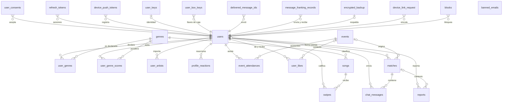
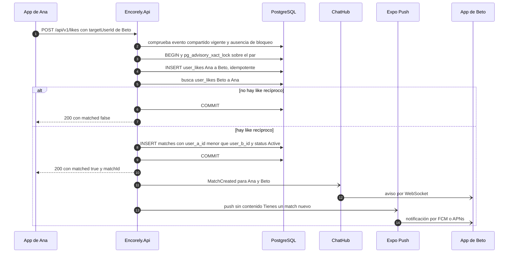
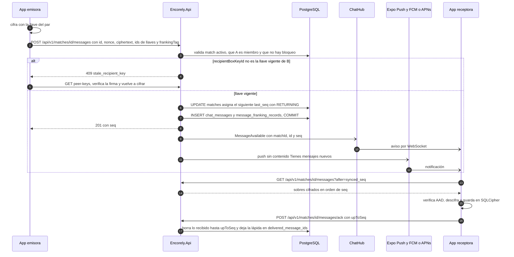

<section class="portada">

ENCORELY

Documentación técnica · Análisis

Análisis del software

El problema que resuelve Encorely, sus requisitos, el equipo, las tecnologías y los componentes que lo forman.

Preparado por
Camilo Rincón · Emmanuel Dávila · Samuel Sierra · Juan Diego Calle

Preparado para
Tecnológico de Antioquia · Despliegue de Sistemas

Lugar y fecha
Itagüí, Antioquia · 22 de octubre de 2026

<aside class="portada-talon">

Documento

ENC-AS-001

Versión

1.1

Contrato API

v1.0.0-draft.17

Clasificación

Uso interno

</aside>
</section>

[[TOC]]

## 1. Control documental

### 1.1 Control y aprobación

| Campo | Valor |
|---|---|
| Código del documento | ENC-AS-001 |
| Sistema | Encorely: app móvil `encorely-front` (Expo, Android e iOS) y API `encorly_back` (.NET 10 + PostgreSQL 16) |
| Tipo de documento | Análisis del software |
| Docente | Cristian Alzate Botero |
| Base del código analizado | `encorly_back` rama `dev` (commit `aaa3dfc`) · `encorely-front` rama `Dev` (commit `beb9df1`) |
| Documento complementario | *Manual técnico del sistema* (ENC-MT-001, versión 1.3) |
| Versión vigente | 1.1 |
| Fecha de emisión | 2026-10-22 |
| Elaborado por | Camilo Rincón, Emmanuel Dávila, Samuel Sierra, Juan Diego Calle |
| Revisado por | Equipo Encorely (revisión cruzada contra el código de `dev` y `Dev`) |
| Aprobado por | Aprobado por: \_\_\_\_\_\_\_\_\_\_\_\_\_\_\_\_\_\_\_\_ (docente) · Fecha: \_\_\_\_\_\_\_\_\_\_\_\_ |
| Responsable de mantenerlo | Juan Diego Calle (analista de sistemas); los responsables de cada módulo actualizan sus filas de 6.1, 6.2 y 6.6 |
| Periodicidad de actualización | Con cada cambio de requisito, de módulo o de componente, en el mismo PR del cambio, y revisión completa por release |
| Ubicación del original | `reportes/manuales/ANALISIS-DEL-SOFTWARE-ENCORELY.md` (fuente) y su PDF generado |
| Clasificación | Uso académico e interno del equipo. No contiene secretos |

### 1.2 Historial de cambios

| Versión | Fecha | Autores | Cambios | Aprobación |
|---|---|---|---|---|
| 1.0 | 2026-10-22 | Camilo Rincón, Emmanuel Dávila, Samuel Sierra, Juan Diego Calle | Documento separado del manual técnico 1.1: análisis del problema, requisitos, roles del equipo, lenguajes y modelo de datos, módulos, componentes críticos, trazabilidad y matriz de componentes | Pendiente |
| 1.1 | 2026-10-22 | Camilo Rincón, Emmanuel Dávila, Samuel Sierra, Juan Diego Calle | Paridad estricta con las diapositivas: ficha fusionada en el control documental; roles y responsables con nombre; contexto de negocio; ERD global simplificado, relaciones 1:N y relación entre componentes y estructuras de datos traídos al documento; secuencias UML del match y del mensaje cifrado en 6.3 | Pendiente |

## 2. Análisis del software

Este documento reúne el análisis de Encorely: qué problema resuelve y para quién, qué requisitos debe cumplir, qué equipo lo construye, con qué tecnologías está hecho y en qué módulos y componentes se divide. Leer esas piezas juntas permite evaluar si la solución responde al problema y entender cómo funciona por dentro.

El *Manual técnico del sistema* (ENC-MT-001) parte de este análisis y explica cómo se instala, se despliega, se opera y se mantiene el sistema. Los dos documentos se remiten entre sí por número de sección.

Las fuentes son los repositorios `encorly_back` (rama `dev`) y `encorely-front` (rama `Dev`), el diagnóstico `reportes/ENCORELY-REPORTE-COMPLETO.md` y las decisiones de `reportes/06-decisiones-y-alcance-v1.md`. Cuando este documento y el código no coinciden, manda el código.

## 3. Perfiles y roles del equipo de trabajo

Cada rol tiene una persona asignada. El trabajo de una persona se revisa por PR antes de entrar a `dev` o `Dev`; esa revisión es compartida, pero la responsabilidad del rol no.

| Rol | Responsabilidad | Cómo se ejerce en Encorely | Persona |
|---|---|---|---|
| Product Owner / responsable funcional | Prioriza necesidades y valida resultados | Decisiones de alcance de la v1 (`reportes/06-decisiones-y-alcance-v1.md`), criterios de aceptación | Camilo Rincón |
| Analista de sistemas | Levanta requisitos y modela procesos | Diagnóstico del sistema anterior, requisitos 5.6 y 5.7, este documento | Juan Diego Calle |
| Arquitecto de software | Define arquitectura, patrones y decisiones técnicas | Monolito modular, E2EE, contrato OpenAPI, `ARCHITECTURE.md` | Camilo Rincón |
| Desarrollador | Implementa funcionalidades, integraciones y correcciones | Back: API, modelo de datos en código y chat cifrado en el servidor. App: pantallas, conector de Spotify, push en el cliente y chat cifrado en el cliente | Camilo Rincón (back) y Emmanuel Dávila (app) |
| Administrador de bases de datos | Diseña, optimiza y protege la información | Índices, restricciones, política de respaldo y restauración, revisión de migraciones | Samuel Sierra |
| QA / Tester | Verifica calidad, funcionalidad, rendimiento y regresión | Suites xUnit y Jest, flujos Maestro, enjambre de QA, informe de aceptación | Juan Diego Calle |
| DevOps / Infraestructura | Automatiza despliegues y administra ambientes | GitHub Actions, `Dockerfile`, `render.yaml`, `eas.json`, despliegue | Samuel Sierra |
| Seguridad | Gestiona riesgos, controles, vulnerabilidades y cumplimiento | Controles OWASP ASVS nivel 1, cifrado del chat, Ley 1581 | Camilo Rincón |

Persona → roles: Camilo Rincón es Product Owner, arquitecto de software, responsable de seguridad y desarrollador del back. Emmanuel Dávila desarrolla la app móvil. Samuel Sierra es administrador de base de datos y responsable de DevOps e infraestructura. Juan Diego Calle es analista de sistemas y QA.

## 4. Lenguaje de programación y modelamiento de datos

### 4.1 Lenguajes, versiones, frameworks y librerías principales

| Componente | Lenguaje y versión | Frameworks y librerías principales |
|---|---|---|
| API | C# (`LangVersion` latest sobre .NET 10, `Nullable` y warnings como errores) | ASP.NET Core 10 Minimal APIs, SignalR, EF Core 10.0.13 con Npgsql 10.0.3 y `EFCore.NamingConventions` 10.0.1 (snake_case), Dapper 2.1.89, JwtBearer 10.0.13, BCrypt.Net-Next 4.2.1, Microsoft.AspNetCore.OpenApi 10.0.13, Swashbuckle SwaggerUI 10.3.0 |
| Pruebas del back | C# | xUnit v3 3.2.2, `Microsoft.AspNetCore.Mvc.Testing` (WebApplicationFactory), Testcontainers.PostgreSql 4.16.0, cliente SignalR |
| App | TypeScript ~6.0.3 estricto | Expo ~57.0.28, React Native 0.86.3, React 19.2.3, expo-router, TanStack Query 5, `@microsoft/signalr` 10, `@noble/curves`, `@noble/ciphers` y `@noble/hashes` 2.4, `expo-sqlite` (SQLCipher), `expo-secure-store`, `expo-notifications`, `expo-auth-session`, `expo-audio`, `expo-camera`, Reanimated 4.5, `phosphor-react-native` |
| Pruebas de la app | TypeScript | Jest 29 con `jest-expo`, Testing Library para React Native, Maestro (E2E en YAML) |
| Base de datos | SQL de PostgreSQL 16 | Migraciones de EF Core; una consulta CTE con Dapper para el radar |
| Scripts | Bash, Python 3 | `scripts/update-contract.sh`, `scripts/curate_songs.py` |
| Infraestructura | YAML, Dockerfile | GitHub Actions, Docker Compose, Render Blueprint, `eas.json` |

Las versiones de las herramientas de desarrollo (SDK de .NET, Node, pnpm, JDK, Android SDK) están en el *Manual técnico*, sección 3.3.

### 4.2 Motor de base de datos y conexión

El servidor usa PostgreSQL 16 (en local, la imagen `postgres:16-alpine`; en producción se propone Render PostgreSQL 16) con una base llamada `encorely`. La API accede con EF Core 10 y Npgsql 10.0.3; Dapper se usa solo para la consulta del radar (`Features/Events/RadarService.cs`). La cadena de conexión se arma con `DB_HOST`, `DB_PORT`, `DB_NAME`, `DB_USER`, `DB_PASSWORD` y `DB_SSL_MODE` y nunca se escribe en archivos versionados; en producción exige TLS (`DB_SSL_MODE=Require`).

En el teléfono hay dos almacenes: una base SQLite por persona, cifrada con SQLCipher, para el historial del chat, y SecureStore (Keychain o Keystore) para tokens y llaves. Detalle en el *Manual técnico*, secciones 6.1 y 6.5.

### 4.3 Entidades, tablas, relaciones, claves y restricciones

El esquema tiene 25 tablas de dominio más `__EFMigrationsHistory` de EF Core.

Tablas por área:

| Área | Tablas |
|---|---|
| Cuenta y sesiones | `users`, `user_consents`, `refresh_tokens`, `device_push_tokens`, `banned_emails` |
| Música y perfil | `genres`, `songs`, `swipes`, `user_genres`, `user_genre_scores`, `user_artists`, `profile_reactions` |
| Eventos y match | `events`, `event_attendances`, `user_likes`, `matches` |
| Chat | `user_keys`, `user_box_keys`, `chat_messages`, `delivered_message_ids`, `message_franking_records` |
| Moderación | `blocks`, `reports` |
| Respaldo y vinculación | `encrypted_backup`, `device_link_request` |

Reglas comunes del modelo, tomadas del *Manual técnico*, sección 6.1:

- Llaves primarias UUID versión 7 generadas por la API, salvo `genres.id` y `user_consents.id` (identidad de Postgres) y `chat_messages.id` (lo genera el cliente).
- Nombres en `snake_case`; restricciones con prefijo por tipo: `pk_`, `fk_`, `ix_`, `ck_`.
- Enums guardados como texto de hasta 32 caracteres; fechas en `timestamp with time zone` y UTC.
- Reglas de negocio respaldadas en la base, por ejemplo el CHECK `ck_matches_ordered_pair` y el índice único parcial `ix_matches_user_a_id_user_b_id`, que impide dos matches activos para el mismo par.

Relaciones 1:N principales (todas las llaves foráneas apuntan a la llave primaria de la tabla "uno"):

| Tabla "uno" | Tabla "muchos" | Llave foránea | Al borrar el padre | Qué representa |
|---|---|---|---|---|
| users | `user_consents`, `refresh_tokens`, `device_push_tokens` | `user_id` | CASCADE | Consentimientos, sesiones y teléfonos |
| users | `swipes`, `user_genres`, `user_genre_scores`, `user_artists` | `user_id` | CASCADE | Gustos y ADN musical |
| genres | `songs`, `user_genres`, `user_genre_scores` | `genre_id` | RESTRICT | Clasificación por género |
| songs | `swipes` | `song_id` | CASCADE | Calificaciones de la canción |
| events | `event_attendances` | `event_id` | CASCADE | Asistentes al concierto |
| users | `event_attendances` | `user_id` | CASCADE | Conciertos a los que va |
| users | `user_likes` (×2) | `from_user_id`, `to_user_id` | CASCADE | Intereses dados y recibidos |
| users | `matches` (×2) | `user_a_id`, `user_b_id` | CASCADE | Par del match (`user_a_id` es el menor) |
| events | `user_likes`, `matches` | `event_id` | SET NULL | Concierto de origen |
| matches | `chat_messages` | `match_id` | CASCADE | Mensajes por entregar |
| users | `user_box_keys`, `chat_messages`, `delivered_message_ids`, `message_franking_records` | `user_id`, `sender_id`, `recipient_id` | CASCADE | Llaves, mensajes y registros de entrega y franking |
| users | `blocks` (×2), `profile_reactions` (×2) | `blocker_id`, `blocked_id`, `from_user_id`, `to_user_id` | CASCADE | Bloqueos y reacciones |
| users | `reports` (×2) | `reporter_id`, `reported_user_id` | SET NULL | Quién reporta y a quién |
| matches | `reports` | `match_id` | SET NULL | Chat donde ocurrió lo reportado |
| users | `device_link_request` | `user_id` | CASCADE | Traspasos a otro teléfono |

CASCADE borra las filas hijas con el padre, SET NULL las conserva sin la referencia (un reporte sobrevive al borrado de la cuenta) y RESTRICT impide borrar un género que esté en uso. Las relaciones 1:1 son `users` → `user_keys` (identidad vigente) y `users` → `encrypted_backup` (un respaldo por persona). `banned_emails` no tiene llaves foráneas: guarda el HMAC de correos vetados, sin datos de la cuenta.

Cada tabla tiene su ficha técnica (campos, tipos, nulos, llaves, restricciones, índices y significado de negocio) en el *Manual técnico*, sección 6.3, y los valores de los campos enumerados en el diccionario de datos de la sección 6.4.

### 4.4 Modelo entidad-relación

ERD global simplificado: las 25 tablas y sus relaciones, sin columnas. Cada línea es una llave foránea (o un par, cuando la tabla apunta dos veces a `users`); `banned_emails` aparece sola porque no tiene llaves foráneas.

Las cinco vistas del ERD con sus llaves y los campos que definen cada regla están en el *Manual técnico*, sección 6.2.

### 4.5 Conexiones, dependencias, migraciones, índices y respaldo

| Aspecto | En Encorely | Dónde está el detalle |
|---|---|---|
| Conexiones | Pool por defecto de Npgsql; una instancia de la API lo comparte entre REST, hub y tareas de fondo | *Manual técnico*, 6.1 |
| Dependencias | Ninguna extensión de Postgres; advisory locks de transacción por usuario o por par para serializar operaciones (ver la secuencia del match en 6.3.1) | *Manual técnico*, 6.1 |
| Migraciones | El esquema solo cambia con migraciones de EF Core: 11 migraciones, de `20261014050309_Initial` a `20261015155802_IndicesPurga` | *Manual técnico*, 6.6 |
| Índices | Además de los de llaves, índices para las purgas (`ix_refresh_tokens_expires_at`, `ix_chat_messages_created_at`) e índices únicos parciales para reglas de negocio | *Manual técnico*, 6.3 y 6.6 |
| Respaldo | Producción: respaldo continuo con PITR más un volcado lógico diario guardado 30 días; RPO de 15 minutos y RTO de 2 horas como objetivos. Local: volcado manual antes de operaciones destructivas | *Manual técnico*, 9.5 |

### 4.6 Relación entre componentes y estructuras de datos

Qué componente lee y escribe cada tabla, y con qué tipo de acceso. La columna Tablas de la trazabilidad (6.5) resume la misma relación por módulo.

| Componente | Lee | Escribe | Tipo de acceso |
|---|---|---|---|
| `AuthService`, `TokenService` | `users`, `refresh_tokens`, `banned_emails` | `users`, `refresh_tokens`, `user_consents` | EF Core |
| `UserService` | `users`, `user_genres`, `user_consents` y todas las del usuario (exportación) | `users`, `user_genres`, `user_consents`; borrado en cascada | EF Core |
| `ProfileService` | `users`, `user_artists`, `user_genre_scores`, `event_attendances`, `profile_reactions`, `blocks` | `profile_reactions` | EF Core |
| `MusicService`, `Dna` | `songs`, `genres`, `swipes`, `user_genre_scores`, `user_genres` | `swipes`, `user_genre_scores`, `user_artists` | EF Core con upsert atómico |
| `EventService` | `events`, `event_attendances` | `event_attendances` | EF Core |
| `RadarService` | `event_attendances`, `swipes`, `user_genre_scores`, `user_genres`, `user_artists`, `blocks`, `users`, `user_likes`, `matches` | Ninguna | Dapper (CTE con coseno en SQL) |
| `MatchingService` | `user_likes`, `matches`, `event_attendances`, `blocks` | `user_likes`, `matches` | EF Core + advisory lock por par |
| `ChatService`, `KeyService` | `matches`, `user_keys`, `user_box_keys`, `chat_messages` | `chat_messages`, `matches.last_seq`, `delivered_message_ids`, `message_franking_records`, `user_keys`, `user_box_keys` | EF Core + `UPDATE … RETURNING` |
| `ModerationService` | `blocks`, `reports`, `message_franking_records`, `matches` | `blocks`, `reports`, `matches`, `user_likes`, `profile_reactions` | EF Core + advisory lock |
| `SyncService` | `encrypted_backup`, `device_link_request` | Las mismas | EF Core |
| `DeviceService`, `PushDispatcher`, `PushReceiptChecker` | `device_push_tokens` | `device_push_tokens` | EF Core |
| `AdminService` | Todas | `events`, `songs`, `reports`, `users.status`, `banned_emails` | EF Core |
| `MaintenanceService` | Tablas con vencimiento | Borra en `device_link_request`, `refresh_tokens`, `chat_messages`, `message_franking_records`, `delivered_message_ids`; purga `reports` | EF Core `ExecuteDelete` |
| `DatabaseHealthCheck` | Conexión | Ninguna | `CanConnectAsync` |
| App `features/chat/local` | `messages`, `sync_state` (SQLite local) | Las mismas | `expo-sqlite` con SQLCipher |

## 5. Descripción y análisis del problema

### 5.1 Contexto

Mucha gente que quiere ir a un concierto termina yendo sola o no va: sus amigos no escuchan ese artista, no pueden ese día o no les interesa el género. Ir solo a un evento masivo es posible, pero pesa la falta de compañía en la fila, en el viaje y durante el show, y conocer a un desconocido por una red social general genera desconfianza. Las apps de citas no parten del concierto ni del gusto musical, y los grupos de fans en redes no filtran por afinidad ni protegen la conversación. Encorely nace para cubrir ese hueco: encontrar, entre quienes van al mismo concierto, a personas con gustos parecidos y conversar con ellas de forma privada antes del evento.

Encorely existía antes de esta versión como prototipo académico: back en .NET 8 repartido en 9 proyectos, con Kafka, Redis, un Worker, Dapper y SignalR; app en Expo 54 orientada a la web; y despliegues en Render, Supabase, Vercel y Netlify sin infraestructura como código. En octubre de 2026 el equipo hizo una auditoría externa, un enjambre de QA con usuarios simulados, una auditoría de diseño y una de la app nativa, consolidadas en `reportes/ENCORELY-REPORTE-COMPLETO.md`. Ese diagnóstico es el punto de partida de este sistema.

### 5.2 Problema central

La persona que quería encontrar compañía para un concierto no podía completar el recorrido prometido (registro, calificar canciones, ver compatibles del evento, hacer match y conversar) y, mientras lo intentaba, sus datos y sus conversaciones quedaban expuestos a cualquier otro usuario. En cifras del diagnóstico: 37 hallazgos, de los cuales los críticos rompían cada eslabón del flujo.

| Eslabón | Qué pasaba en el sistema anterior |
|---|---|
| Registro y login | El registro por correo respondía "Próximamente"; Spotify, el login principal, admitía 5 usuarios; el JWT vencía a los 30 min sin renovación |
| Calificar canciones | Sin Spotify la pantalla quedaba en "Preparando tracks…"; 22 calificaciones de la misma canción contaban 22 veces |
| ADN musical | El perfil quedaba en 0,5/0,5/0,5; la afinidad daba 1,0 con el 78 % de la base |
| Radar del evento | Ignoraba el evento; los eventos estaban en el código con fechas pasadas; la UI mostraba cifras inventadas ("247 personas") |
| Match | Cada like a una canción creaba un match automático con un desconocido, sin reciprocidad ni estado |
| Chat | Todo envío daba 400; los mensajes se guardaban en claro y cualquier usuario autenticado podía leer cualquier chat |

### 5.3 Causas

| Tipo | Causa | Ejemplo del diagnóstico |
|---|---|---|
| Técnica | La identidad salía del cliente: cada endpoint recibía `userId` y lo creía (IDOR sistémico) | Con el token de A se cambió la configuración de otra cuenta (204) |
| Técnica | No había fuentes de verdad versionadas: migraciones borradas, contrato escrito a mano en dos lados | El umbral de swipes valía 25 en el back y 100 en el front |
| De proceso | El dominio nunca se especificó; los stubs de demo llegaron a producción | `EventService` devolvía una lista fija con fechas pasadas |
| Externa | El núcleo dependía de APIs de Spotify que cambiaron en 2026 (5 usuarios en modo desarrollo, sin email, `audio-features` deprecado) | El back vinculaba identidades por un email que Spotify ya no entrega |
| De arquitectura | Componentes elegidos sin problema que resolver: Kafka con un consumidor, Redis para un perfil, 9 proyectos | Cada swipe esperaba el timeout de un Kafka inexistente fuera de local |
| De calidad | Pruebas con repositorios simulados y sin gates en CI | Un 500 en todo POST con cuerpo llegó a `main` con 52 tests en verde |
| De proceso | Se diseñó y probó en web aunque el objetivo era móvil nativo | Nunca se compiló un build nativo |
| Humana y de producto | UI sin dirección ni dueño de producto | "Match Certificado" para todos, "Night Vibes" fijo en el código |

### 5.4 Impacto

| Dimensión | Impacto |
|---|---|
| Riesgo y cumplimiento | Lectura y escritura de datos ajenos, mensajes en claro: incumplimiento de la Ley 1581 de 2012 y bloqueo seguro en la revisión de tiendas |
| Experiencia de usuario | Pantallas sin salida, cifras falsas y matches con desconocidos: el producto no hacía lo que prometía |
| Continuidad | Sin build nativo, sin borrado de cuenta ni reportes, la app no se podía publicar |
| Costos y tiempos | El plan para arreglar el sistema en su lugar se estimó en unos 132 días-persona; reconstruir salía más barato porque el código era pequeño (back de unas 3,7 mil líneas, front de unas 8,7 mil) y los datos eran ficticios |
| Mantenimiento | Esquema sin migraciones (drift que daba 500) y documentación que describía otro sistema |

### 5.5 Usuarios afectados y actores

| Actor | Necesidad | Cómo lo afectaba el problema |
|---|---|---|
| Persona usuaria (18 años o más, público principal de 18 a 30, Bogotá y Medellín) | Encontrar compañía compatible para un concierto y conversar con privacidad | No completaba el flujo y sus datos quedaban expuestos |
| Administración y moderación | Curar eventos y canciones, atender reportes, suspender cuentas abusivas | No existía panel ni reportes |
| Revisores de App Store y Google Play | Probar la app con una cuenta demo y verificar requisitos de privacidad | La app no cumplía requisitos de publicación |
| Equipo de desarrollo y operación | Cambiar el sistema sin romperlo, desplegarlo y recuperarlo | Sin esquema, contrato ni pruebas confiables |

### 5.6 Requisitos funcionales

| ID | Requisito | Módulo back | Módulo front | Evidencia de cumplimiento |
|---|---|---|---|---|
| RF-01 | Registro e inicio de sesión con correo y contraseña; renovación y cierre de sesión | `Auth` | `auth` | `AuthTests` |
| RF-02 | Inicio de sesión y vinculación con Spotify (PKCE) | `Auth`, `Users` | `spotify`, `auth` | `SpotifyAuthTests` |
| RF-03 | Onboarding con fecha de nacimiento (18+), ciudad y géneros | `Users` | `onboarding` | `ProfileTests` |
| RF-04 | Consentimiento versionado, exportación de datos y borrado de cuenta en la app y en la web | `Users`, `Legal` | `account` | `LegalTests`, `ProfileTests` |
| RF-05 | Feed de canciones no calificadas con muestra de 30 s; like/dislike únicos por canción | `Music` | `discover` | `MusicTests` |
| RF-06 | ADN musical que cambia con cada calificación y con la importación de Spotify | `Music` | `discover`, `spotify` | `MusicTests` |
| RF-07 | Lista y detalle de eventos curados; marcar y desmarcar asistencia | `Events` | `events` | `EventsTests` |
| RF-08 | Radar por evento ordenado por afinidad, solo para quien asiste y desbloqueó el radar | `Events` (`RadarService`) | `events` | `EventsTests` |
| RF-09 | Interés en una persona del mismo evento; match solo si es recíproco; deshacer match | `Matching` | `match` | `MatchingModerationTests` |
| RF-10 | Perfil social: perfil ajeno, reacciones a artistas y géneros, lista de reacciones recibidas, interruptor de visibilidad | `Profiles` | `social`, `profile` | `ProfileSocialTests` |
| RF-11 | Chat cifrado de extremo a extremo con aviso en tiempo real, paginación y confirmación de entrega | `Chat` | `chat` | `ChatTests`, `ChatCanaryTests` |
| RF-12 | Directorio de llaves públicas, rotación y aviso de cambio de llave | `Chat` (`KeyService`) | `chat` | `KeysTests` |
| RF-13 | Respaldo cifrado opcional y traspaso de llaves a otro teléfono | `Sync` | `chat/backup`, `chat/link` | `SyncSessionsTests` |
| RF-14 | Bloquear y reportar con evidencia verificable (franking) | `Moderation` | `safety` | `MatchingModerationTests` |
| RF-15 | Notificaciones push sin contenido de mensajes y matches nuevos | `Devices`, `Infrastructure/Push` | `push` | `DevicesPushTests` |
| RF-16 | Ver y cerrar sesiones abiertas por dispositivo | `Sessions` | `account` | `SyncSessionsTests` |
| RF-17 | Panel de administración: eventos, canciones (con búsqueda en iTunes), reportes y suspensión | `Admin` | `admin` y panel `/admin` | `AdminTests`, `AdminPanelTests` |

### 5.7 Requisitos no funcionales

| ID | Categoría | Requisito | Cómo se verifica |
|---|---|---|---|
| RNF-01 | Seguridad | La identidad sale solo del JWT; un recurso ajeno responde 404 | Test "A no accede a lo de B" en cada endpoint con recursos |
| RNF-02 | Privacidad | El servidor nunca guarda texto plano del chat ni llaves privadas | `ChatCanaryTests` recorre todas las tablas y el log |
| RNF-03 | Seguridad | Contraseñas con BCrypt factor 12; sesión de 15 min con refresh rotativo y detección de reuso | `AuthTests`, `SecurityHardeningTests` |
| RNF-04 | Fiabilidad | Ninguna entrada inválida produce un 500; errores en `application/problem+json` en español | `PlatformTests`, `SecurityHardeningTests` |
| RNF-05 | Rendimiento | Peticiones de la app con timeout de 15 s; radar acotado a 200 asistentes; cuerpos de 256 KiB como máximo salvo excepciones | Código (`client.ts`, `RadarService`), `SyncSessionsTests` |
| RNF-06 | Disponibilidad | Objetivo propuesto de 99,5 % mensual para producción (ver *Manual técnico*, sección 9.2) | Monitor externo sobre `/health/ready` (propuesto) |
| RNF-07 | Mantenibilidad | Esquema solo por migraciones; contrato generado desde el código y tipos del cliente generados desde el contrato | `OpenApiContractTests`, `pnpm gen:api` sin diferencias |
| RNF-08 | Portabilidad | App nativa Android e iOS desde una sola base de código; API en contenedor sin estado de disco | `pnpm build:bundles`, job `docker` de la CI |
| RNF-09 | Accesibilidad | Contraste AA en temas claro y oscuro, objetivos táctiles de 44 pt, alternativa con botones al gesto de swipe, respeto de "reducir movimiento" | Revisión de diseño y `src/ui/tokens.ts` |
| RNF-10 | Cumplimiento | Ley 1581 de 2012 (consentimiento, acceso, supresión) y requisitos de App Store y Google Play | `docs/privacidad-y-tiendas.md`, `docs/tiendas.md` |
| RNF-11 | Observabilidad | Logs JSON con `traceId`, sin cuerpos ni tokens; health checks de vida y de preparación | `ObservabilityTests` |
| RNF-12 | Instalabilidad | Levantar el entorno local en menos de 15 minutos con Docker y mise | Procedimiento de la sección 5.1 del *Manual técnico*, verificado en clon limpio |

### 5.8 Objetivo de la solución y cómo se mide

Objetivo: entregar un sistema reconstruido en el que la persona usuaria complete el flujo registro → canciones → radar → match → chat cifrado, sin exposición de datos entre cuentas, con esquema y contrato versionados y con pruebas que lo demuestren en cada cambio.

| Indicador | Sistema anterior | Meta | Cómo se mide | Resultado medido el 2026-10-20 |
|---|---|---|---|---|
| Endpoints que permiten leer o escribir datos de otra cuenta | Todos los que recibían `userId` | 0 | Tests de aislamiento por endpoint con recursos | 0: suite del back 332 de 332 en verde |
| Matches creados sin reciprocidad | Uno por cada like | 0 | Test de like unilateral y de 20 rondas de likes cruzados concurrentes | 0 (pasa) |
| Texto plano del chat en BD o logs | Mensajes en claro | 0 apariciones | `ChatCanaryTests` (claro, base64 y hex) | 0 (pasa) |
| ADN que cambia con las calificaciones | Fijo en 0,5 | Cambia con cada swipe | `MusicTests` | Pasa |
| Entradas inválidas que dan 500 | 500 en todo POST con cuerpo | 0 | Tests de validación | 0 (pasa) |
| Contrato front ↔ back sincronizado | Escrito a mano en dos lados | Un único contrato generado | `OpenApiContractTests` y `pnpm gen:api` sin diferencias | Sincronizado en draft.17 |
| Pruebas del front | Sin pruebas de lo que importa | Suite verde | `pnpm verify` | 56 suites, 490 tests en verde |
| Cifras inventadas en la UI | "247 personas", "Match Certificado" | 0 | Regla del design system y revisión manual de pantallas | Revisión manual; no hay prueba automática |
| Tiempo de arranque local | No documentado | Menos de 15 min | Procedimiento de la sección 5.1 del *Manual técnico*, en un clon limpio | Ejecutado con éxito; la API respondió `Healthy` unos 20 s después de `dotnet run`. El tiempo total no se cronometró |

## 6. Módulos y componentes del software

### 6.1 Módulos del back

Cada feature tiene `*Endpoints.cs` (rutas y metadatos OpenAPI), `*Contracts.cs` (DTOs validados), `*Service.cs` (reglas) y sus entidades.

| Módulo | Propósito | Entradas | Salidas | Dependencias | Responsable |
|---|---|---|---|---|---|
| `Auth` | Registro, login, Spotify, refresh con rotación, logout | `/auth/*` | Access JWT, refresh opaco, `user` | `users`, `refresh_tokens`, `banned_emails`, `TokenService`, `LoginThrottle`, Spotify | Camilo Rincón |
| `Users` | Perfil propio, consentimientos, exportación y borrado de cuenta | `/me`, `/me/consents`, `/me/export`, `/me/spotify/link` | Perfil, archivo de datos, borrado en cascada | `users`, `user_genres`, `user_consents`, `SessionRevoker` | Camilo Rincón |
| `Profiles` | Perfil social: perfil ajeno, reacciones | `/users/{id}/profile`, `/users/{id}/reactions`, `/me/reactions/received` | `PublicProfileDto`, reacciones paginadas | `profile_reactions`, `user_artists`, `blocks`, consentimiento | Camilo Rincón |
| `Legal` | Versión de términos, páginas públicas, borrado web | `/legal/current`, `/account-deletion`, `/legal/*`, `/cuenta/eliminar` | Versión vigente, HTML, borrado | `appsettings.json` (`Legal`), `Auth` | Camilo Rincón |
| `Music` | Géneros, feed de canciones, swipes, ADN musical, importación de Spotify | `/genres`, `/songs/feed`, `/swipes`, `/me/dna`, `/me/spotify/import` | Canciones, vector de géneros, estado del radar | `genres`, `songs`, `swipes`, `user_genre_scores`, `user_artists` | Camilo Rincón |
| `Events` | Eventos curados, asistencia, radar por afinidad | `/events`, `/events/{id}/attendance`, `/events/{id}/radar`, `/me/events` | Eventos, asistentes con `affinity` | `events`, `event_attendances`, `Dna`, Dapper | Camilo Rincón |
| `Matching` | Interés entre personas, match recíproco, deshacer match | `/likes`, `/matches` | `{matched, matchId}`, lista de matches, evento `MatchCreated` | `user_likes`, `matches`, `AdvisoryLock`, `Notifier`, push | Camilo Rincón |
| `Chat` | Directorio de llaves públicas, mensajes cifrados, ack | `/keys/me`, `/matches/{id}/peer-keys`, `/matches/{id}/messages` | Ciphertext ordenado por `seq`, eventos `MessageAvailable` y `PeerKeyChanged` | `user_keys`, `user_box_keys`, `chat_messages`, `delivered_message_ids`, `message_franking_records` | Camilo Rincón |
| `Moderation` | Bloqueos y reportes con franking | `/blocks`, `/reports` | Bloqueo efectivo, reporte con evidencia verificada | `blocks`, `reports`, `message_franking_records`, `matches` | Camilo Rincón |
| `Devices` | Tokens push por sesión | `/devices/push-token` | Registro o borrado del token | `device_push_tokens` | Camilo Rincón |
| `Sync` | Respaldo cifrado y vinculación de dispositivos | `/me/backup`, `/keys/link-requests` | Blob opaco, buzón de un solo uso | `encrypted_backup`, `device_link_request` | Camilo Rincón |
| `Sessions` | Sesiones abiertas (familias de refresh) | `/me/sessions` | Lista y cierre de sesiones | `refresh_tokens`, `device_push_tokens`, `SessionRevoker` | Camilo Rincón |
| `Admin` | Eventos, canciones, reportes, suspensión; panel HTML | `/admin/*`, `/admin` | Catálogo y cola de moderación actualizados | Todas las anteriores, `ITunesClient`, `AdminRoleFilter` | Camilo Rincón |
| `Infrastructure/Auth` | JWT, BCrypt, bloqueo por intentos, revocación de sesiones | Cada petición autenticada | Identidad (`sub`, `sid`) validada | `refresh_tokens`, `users` | Camilo Rincón |
| `Infrastructure/Database` | `AppDbContext`, advisory locks, health check, limpieza horaria | Servicios | Persistencia, purgas | PostgreSQL | Camilo Rincón |
| `Infrastructure/Realtime` | `ChatHub` y `Notifier` | Conexiones WebSocket autenticadas | Avisos al usuario | Sesión vigente | Camilo Rincón |
| `Infrastructure/Push` | Cola acotada, envío a Expo Push, receipts | Eventos de match y mensaje | Notificaciones sin contenido | `device_push_tokens`, `exp.host` | Camilo Rincón |
| `Infrastructure/Http` | ProblemDetails, validación, cabeceras de seguridad | Toda petición | Errores uniformes y cabeceras | Ninguna | Camilo Rincón |
| `Infrastructure/Configuration` | `.env` en Development, mapeo de variables, validación al arrancar | Variables de entorno | Opciones tipadas o arranque fallido | Ninguna | Camilo Rincón |

### 6.2 Módulos de la app

| Módulo (`src/…`) | Propósito | Entradas | Salidas | Dependencias | Responsable |
|---|---|---|---|---|---|
| `app/` | Rutas de expo-router: grupos `(auth)`, `(onboarding)`, `(app)` con tabs Descubrir, Conciertos, Chats y Tú | Navegación, deep links `encorely://` | Pantalla de la feature | `features/*`, `lib/session` | Emmanuel Dávila |
| `lib/api` | Cliente HTTP: base `/api/v1`, timeout de 15 s, un solo refresh en vuelo, errores en español | Llamadas de las features | Datos tipados o `ApiError` | `schema.d.ts` generado, `lib/session` | Emmanuel Dávila |
| `lib/session` | Sesión única y tokens en SecureStore | Login, refresh, logout | Estado de sesión | `expo-secure-store` | Emmanuel Dávila |
| `features/auth`, `onboarding`, `account` | Entrar, crear cuenta, onboarding, consentimiento, sesiones, exportar y borrar cuenta | Formularios | Llamadas a `Auth` y `Users` | `lib/api`, `spotify` | Emmanuel Dávila |
| `features/discover` | Mazo de canciones con muestra de 30 s y ADN | Gestos y botones accesibles | `POST /swipes` | `expo-audio`, `Music` | Emmanuel Dávila |
| `features/events`, `match` | Conciertos, asistencia, radar, "Me interesa", matches | Selección del usuario | Llamadas a `Events` y `Matching` | `lib/api` | Emmanuel Dávila |
| `features/chat` | Cifrado, llaves, historial SQLCipher, sincronización y ack, hub, respaldo, traspaso, verificación | Texto del usuario, avisos del hub | Sobres cifrados, mensajes descifrados | `@noble/*`, `expo-sqlite`, `@microsoft/signalr`, `expo-camera` | Emmanuel Dávila |
| `features/social`, `profile` | Pestaña Tú, perfil ajeno, reacciones, visibilidad | Perfil y reacciones | Llamadas a `Profiles` y `Users` | `src/ui` (stickers, motion) | Emmanuel Dávila |
| `features/safety` | Bloquear, reportar con evidencia, textos de E2EE | Acción del usuario | `POST /blocks`, `POST /reports` | `chat` (evidencia de franking) | Emmanuel Dávila |
| `features/push` | Permiso, canal Android, registro del token, navegación desde la notificación | Token de Expo, toque en notificación | `PUT /devices/push-token`, navegación | `expo-notifications`, EAS project ID | Emmanuel Dávila |
| `features/spotify` | PKCE, login, vinculación, importación de artistas | Redirect `encorely://spotify-callback` | Code al back o artistas importados | `expo-auth-session`, Spotify | Emmanuel Dávila |
| `features/admin` | Panel admin en la app: conciertos, canciones, reportes | Formularios de admin | Llamadas a `/admin/*` | Rol admin | Emmanuel Dávila |
| `ui/` | Design system "La boleta compartida": tokens, tema, componentes, iconos, motion | Props | Componentes accesibles | Fuentes Google, Phosphor, Reanimated | Emmanuel Dávila |

### 6.3 Relaciones entre módulos y flujo de información

Las relaciones de cada módulo están en la columna Dependencias de 6.1 y 6.2. El flujo general es este:

1. En la app, las rutas de `src/app` abren las pantallas de `src/features`, que llaman a la API a través de `src/lib/api` (HTTPS con JWT) y escuchan los avisos del hub con el cliente SignalR.
2. En la API, cada petición pasa por la infraestructura transversal (`Infrastructure/Http` e `Infrastructure/Auth`) antes de llegar al servicio de la feature.
3. El servicio persiste con `Infrastructure/Database` y, cuando algo le importa a otra persona (un match, un mensaje), avisa con `Infrastructure/Realtime` y `Infrastructure/Push`. El aviso no lleva contenido: la app vuelve a consultar el REST, que es la fuente de verdad.
4. El contrato `contracts/openapi.v1.json` une los dos lados: la API lo genera desde el código y la app genera sus tipos desde él (`pnpm gen:api`).

Los diagramas de componentes de la app y de la API están en el *Manual técnico*, sección 4.3. Las dos secuencias siguientes muestran el flujo de información en los dos casos que cruzan más módulos.

#### 6.3.1 Secuencia del match recíproco

Dos personas que asisten al mismo concierto se dan "Me interesa"; el match nace solo cuando el interés es mutuo.

El advisory lock por par serializa likes cruzados, unmatch y bloqueo: dos likes simultáneos crean exactamente un match (hay una prueba con 20 rondas concurrentes) y un bloqueo concurrente no puede resucitar un match. El índice único parcial `ix_matches_user_a_id_user_b_id` (solo `status = 'Active'`) respalda la regla en la base.

#### 6.3.2 Secuencia del envío de un mensaje cifrado

La app emisora cifra el mensaje y la API solo guarda y entrega el sobre cifrado hasta que la receptora confirma que lo guardó.

En el paso 1 la app deriva la llave del par con X25519 y HKDF y cifra con XChaCha20-Poly1305, con el AAD descrito en el *Manual técnico*, sección 8.4. El servidor guarda por mensaje solo `id`, `match_id`, `sender_id`, `seq`, versión, ids de llaves, `nonce`, `ciphertext`, `franking_tag` opcional y fecha. Si el mismo `id` llega dos veces con el mismo contenido, responde 200 sin duplicar.

### 6.4 Componentes críticos y puntos únicos de falla

| Componente | Por qué es crítico | Punto único de falla | Mitigación actual | Mitigación propuesta para producción |
|---|---|---|---|---|
| PostgreSQL | Toda la información del servidor | Sí: una sola instancia | Migraciones versionadas, `/health/ready` | Postgres administrado con respaldo continuo y PITR (*Manual técnico*, 9.5); réplica de lectura si la carga lo exige |
| Instancia de la API | Única puerta de REST, hub y tareas | Sí: una instancia (`plan: starter`) | Health check `/health/live` en Render, reinicio automático del contenedor | Segunda instancia con backplane de SignalR, contador de intentos compartido y migraciones como paso previo (`efbundle`) |
| `JWT_SIGNING_KEY` | Firma de todas las sesiones | Sí | Generada por Render (`generateValue`) y validada al arrancar | Guardarla además en un gestor de secretos del equipo; procedimiento de rotación en el *Manual técnico*, 10.2 |
| `BANNED_EMAIL_KEY` | Vetos de correos suspendidos | Sí: si se pierde, los vetos guardados dejan de servir | Igual que la anterior | Igual que la anterior |
| `LoginThrottle` y `PushQueue` | Bloqueo por intentos y cola de push | Viven en memoria: un reinicio los vacía | Aceptado: un reinicio deja el contador de intentos en cero y descarta los avisos push pendientes | Mover a Postgres o a un almacén compartido al pasar a varias instancias |
| Expo Push, FCM y APNs | Avisos fuera de la app | Dependencia externa | La app consulta al abrir; el hub avisa con la app abierta | Monitorear receipts y tasa de errores (*Manual técnico*, 9.3) |
| Llaves privadas del chat | Leer el historial | Viven solo en el teléfono | Respaldo cifrado opcional y traspaso | Promover el respaldo en la app |
| Contrato `openapi.v1.json` | Acuerdo entre app y API | Un cambio que rompa deja clientes viejos sin servicio | `OpenApiContractTests`, CHANGELOG con marca **Rompe** | Política de compatibilidad hacia atrás durante un ciclo de release (*Manual técnico*, 5.6) |

### 6.5 Trazabilidad entre módulos, requisitos, datos, integraciones y seguridad

| Módulo | Requisitos | Tablas | Integraciones | Controles de seguridad |
|---|---|---|---|---|
| `Auth` | RF-01, RF-02, RNF-03 | `users`, `refresh_tokens`, `banned_emails` | Spotify Accounts | BCrypt, rate limit por IP, bloqueo (correo, IP), refresh con detección de reuso |
| `Users`, `Legal`, `Sessions` | RF-03, RF-04, RF-16, RNF-10 | `users`, `user_genres`, `user_consents`, `refresh_tokens` | Ninguna | Consentimiento versionado, borrado en cascada, 18+ |
| `Profiles` | RF-10 | `profile_reactions`, `user_artists`, `blocks` | Spotify (imágenes `i.scdn.co`) | Visibilidad con consentimiento propio; 404 con bloqueo |
| `Music` | RF-05, RF-06 | `genres`, `songs`, `swipes`, `user_genre_scores`, `user_artists` | iTunes (previews), Spotify (importación) | Upsert atómico; token de Spotify nunca llega al servidor |
| `Events` | RF-07, RF-08 | `events`, `event_attendances` | Ninguna | Radar solo para asistentes; excluye bloqueos y suspendidos |
| `Matching` | RF-09 | `user_likes`, `matches` | Expo Push | Advisory lock por par, CHECK de par ordenado |
| `Chat` | RF-11, RF-12, RNF-02 | `user_keys`, `user_box_keys`, `chat_messages`, `delivered_message_ids`, `message_franking_records` | Expo Push | E2EE, solo miembros del match, push sin contenido |
| `Sync` | RF-13 | `encrypted_backup`, `device_link_request` | Ninguna | Blob opaco, buzón de 10 min y un solo uso |
| `Moderation` | RF-14 | `blocks`, `reports`, `message_franking_records` | Ninguna | Franking verificable, un reporte abierto por par, retención de 180 días |
| `Devices` | RF-15 | `device_push_tokens` | Expo Push → FCM/APNs | Token ligado a la sesión |
| `Admin` | RF-17 | Todas | iTunes Search | Rol admin confirmado en la base en cada petición |

### 6.6 Matriz básica de documentación de componentes

Una fila por componente. El responsable es la persona que lo mantiene según los roles del capítulo 3: Camilo Rincón en el back, Emmanuel Dávila en la app (incluido el conector de Spotify) y Samuel Sierra en la infraestructura y la base de datos.

| Módulo | Componente | Tecnología | Dependencias | Responsable |
|---|---|---|---|---|
| Usuarios | Autenticación (`Features/Auth`, `Infrastructure/Auth`) | C# / ASP.NET Core 10, JwtBearer, BCrypt | BD (`users`, `refresh_tokens`, `banned_emails`), Spotify | Camilo Rincón |
| Usuarios | Perfil y cuenta (`Features/Users`, `Features/Sessions`) | C# / EF Core 10 | BD (`users`, `user_genres`, `user_consents`) | Camilo Rincón |
| Usuarios | Perfil social (`Features/Profiles`) | C# / EF Core 10 | BD (`profile_reactions`, `user_artists`, `blocks`) | Camilo Rincón |
| Legal | Términos, privacidad y borrado web (`Features/Legal`) | C# / HTML con CSP | `appsettings.json`, `Auth` | Camilo Rincón |
| Música | Catálogo, swipes y ADN (`Features/Music`) | C# / EF Core 10 | BD (`genres`, `songs`, `swipes`, `user_genre_scores`) | Camilo Rincón |
| Eventos | Eventos, asistencia y radar (`Features/Events`) | C# / EF Core 10 + Dapper | BD (`events`, `event_attendances`), `Dna` | Camilo Rincón |
| Match | Like y match recíproco (`Features/Matching`) | C# / EF Core 10, advisory locks | BD (`user_likes`, `matches`), `Notifier`, push | Camilo Rincón |
| Chat | Llaves y mensajes cifrados (`Features/Chat`) | C# / EF Core 10 | BD (tablas de chat), `ChatHub`, push | Camilo Rincón |
| Chat | Tiempo real (`ChatHub`, `Notifier`) | SignalR (WebSocket) | Sesión JWT vigente | Camilo Rincón |
| Moderación | Bloqueos y reportes (`Features/Moderation`) | C# / EF Core 10, HMAC-SHA256 | BD (`blocks`, `reports`, `message_franking_records`) | Camilo Rincón |
| Respaldo | Respaldo cifrado y vinculación (`Features/Sync`) | C# / EF Core 10 | BD (`encrypted_backup`, `device_link_request`) | Camilo Rincón |
| Administración | API y panel (`Features/Admin`) | C# / HTML | Todas las features, iTunes Search | Camilo Rincón |
| Integraciones | Push (`Infrastructure/Push`, `Features/Devices`) | C# / HttpClient, cola en memoria | Expo Push API → FCM/APNs, `device_push_tokens` | Camilo Rincón |
| Integraciones | Conector Spotify (`SpotifyClient`, `features/spotify`) | C# y TypeScript, OAuth PKCE | Spotify Accounts y Web API | Emmanuel Dávila |
| Integraciones | Catálogo iTunes (`ITunesClient`, `scripts/curate_songs.py`) | C# y Python | iTunes Search API | Camilo Rincón |
| App móvil | Navegación y pantallas (`src/app`, `src/features`) | TypeScript / Expo SDK 57, React Native 0.86 | API REST, `src/ui` | Emmanuel Dávila |
| App móvil | Cliente API y sesión (`src/lib`) | TypeScript, TanStack Query | Contrato OpenAPI, SecureStore | Emmanuel Dávila |
| App móvil | Cifrado del chat (`src/features/chat`) | TypeScript, `@noble/*`, SQLCipher | SecureStore, API de llaves y mensajes | Emmanuel Dávila |
| Infraestructura | Base de datos | PostgreSQL 16 | Servidor o servicio administrado, respaldo | Samuel Sierra |
| Infraestructura | Imagen de la API (`Dockerfile`, `render.yaml`) | Docker, Render | Registro de imágenes, variables de entorno | Samuel Sierra |
| Infraestructura | CI (`ci.yml`, `frontend.yml`) | GitHub Actions | Docker en el runner, pnpm, .NET SDK | Samuel Sierra |
| Infraestructura | Builds de la app (`eas.json`) | EAS Build | Cuenta de Expo, credenciales de tiendas | Samuel Sierra |

## 7. Conclusión

El análisis relaciona el problema de partida con lo que se construyó. Cada requisito funcional tiene un módulo del back, un módulo de la app y una prueba que lo evidencia (5.6); cada módulo tiene sus tablas, integraciones y controles de seguridad (6.5); y los indicadores de 5.8 dicen, con mediciones del 2026-10-20, en qué estado quedó cada eslabón que antes fallaba. También quedan a la vista los puntos únicos de falla que habría que resolver antes de escalar (6.4).

Este documento y el *Manual técnico del sistema* cambian con el código: un requisito, un módulo o un componente nuevo se refleja aquí en el mismo PR que lo introduce, con una fila nueva en el historial de cambios (1.2).
