<section class="portada">
<div class="portada-cuerpo">
<p class="portada-marca">ENCORELY</p>
<p class="portada-tipo">Documentación técnica · Sistema</p>
<p class="portada-titulo">Manual técnico del sistema</p>
<p class="portada-sub">App móvil, API y base de datos: arquitectura, instalación, despliegue, seguridad y operación.</p>
<div class="portada-datos">
<div><span>Preparado por</span><p>Camilo Rincón · Emmanuel Dávila · Samuel Sierra · Juan Diego Calle</p></div>
<div><span>Preparado para</span><p>Tecnológico de Antioquia · Despliegue de Sistemas</p></div>
<div><span>Lugar y fecha</span><p>Itagüí, Antioquia · 22 de octubre de 2026</p></div>
</div>
</div>
<aside class="portada-talon">
<p class="talon-etq">Documento</p><p class="talon-val">ENC-MT-001</p>
<p class="talon-etq">Versión</p><p class="talon-val">1.4</p>
<p class="talon-etq">Contrato API</p><p class="talon-val">v1.0.0-draft.17</p>
<p class="talon-etq">Clasificación</p><p class="talon-val">Uso interno</p>
</aside>
</section>

[[TOC]]

## 1. Control documental e historial de cambios

### 1.1 Control documental

| Campo | Valor |
|---|---|
| Código del documento | ENC-MT-001 |
| Sistema | Encorely: app móvil `encorely-front` (Expo, Android e iOS) y API `encorly_back` (.NET 10 + PostgreSQL 16) |
| Tipo de documento | Manual técnico unificado |
| Versión vigente | 1.4 |
| Fecha de emisión | 2026-10-22 |
| Elaborado por | Camilo Rincón, Emmanuel Dávila, Samuel Sierra, Juan Diego Calle |
| Aprobado por | Aprobado por: \_\_\_\_\_\_\_\_\_\_\_\_\_\_\_\_\_\_\_\_ (docente) · Fecha: \_\_\_\_\_\_\_\_\_\_\_\_ |
| Responsable de mantenerlo | Camilo Rincón (Product Owner) coordina las versiones; cada capítulo tiene su responsable en 1.4 |
| Periodicidad de actualización | Con cada cambio de esquema de la base de datos, de contrato (draft) o de despliegue, y revisión completa por release |

### 1.2 Historial de cambios

| Versión | Fecha | Autores | Cambios | Aprobación |
|---|---|---|---|---|
| 0.1 | 2026-10-20 | Equipo Encorely | Manuales técnicos por repositorio: `encorly_back/docs/MANUAL-TECNICO.md` y `encorely-front/docs/MANUAL-TECNICO.md` | No aplica (borrador) |
| 1.0 | 2026-10-20 | Camilo Rincón, Emmanuel Dávila, Samuel Sierra, Juan Diego Calle | Manual unificado según la estructura de la cátedra: análisis del problema, arquitectura por capas, matriz de componentes, fichas de las 25 tablas, plan de despliegue y rollback, diagrama de despliegue UML, operatividad e incidentes | Pendiente de firma del docente |
| 1.1 | 2026-10-22 | Camilo Rincón, Emmanuel Dávila, Samuel Sierra, Juan Diego Calle | Portada con identidad de Encorely y datos de entrega (Tecnológico de Antioquia, Despliegue de Sistemas) | Pendiente |
| 1.2 | 2026-10-22 | Camilo Rincón, Emmanuel Dávila, Samuel Sierra, Juan Diego Calle | Estructura alineada a las diapositivas de la cátedra; el análisis del software pasa a documento propio; capítulo 1 sin portada, ficha fusionada en el control documental y sin "Documentos relacionados" | Pendiente |
| 1.3 | 2026-10-22 | Camilo Rincón, Emmanuel Dávila, Samuel Sierra, Juan Diego Calle | Paridad estricta con las diapositivas: se quitan secciones no pedidas, se agregan segmentación, auditoría, alta disponibilidad, capacitación, dueños por aspecto operativo y diagramas de despliegue en UML con PlantUML | Pendiente |
| 1.4 | 2026-10-22 | Camilo Rincón, Emmanuel Dávila, Samuel Sierra, Juan Diego Calle | Depuración por bloque: se retira el texto que no explican las diapositivas (detalles de implementación, justificaciones, notas y columnas no pedidas); 7.2 queda solo con el título; diagramas de componentes y de despliegue rehechos en UML con el orden de los ejemplos de las diapositivas | Pendiente |

### 1.3 Propósito y público del documento

Este manual explica cómo está construido, configurado, desplegado y mantenido Encorely. Está dirigido a desarrollo (back y front), administración de base de datos e infraestructura y operación (DevOps).

### 1.4 Responsables y periodicidad de actualización

| Capítulo | Responsable | Disparador de actualización | Plazo |
|---|---|---|---|
| 1. Control documental | Camilo Rincón (Product Owner) | Cada versión nueva del documento | Al emitir la versión |
| 2. Objetivo, alcance y descripción general | Camilo Rincón (Product Owner) | Cambio de alcance o de una decisión de producto | En el mismo PR del cambio |
| 3. Requisitos de hardware, software y red | Samuel Sierra (DevOps e infraestructura) | Cambio de versión de una herramienta, de un puerto o de un nodo | En el mismo PR del cambio |
| 4. Arquitectura y diagramas de componentes | Camilo Rincón (arquitecto de software) | Módulo, capa o componente nuevo | En el mismo PR del cambio |
| 5. Instalación, configuración y despliegue | Samuel Sierra; 5.2 y 5.5.5, Emmanuel Dávila (app) | Cambio de `Dockerfile`, `render.yaml`, `eas.json` o de variables de entorno | Antes de aplicar el cambio en un ambiente |
| 6. Base de datos y modelo de información | Samuel Sierra (administrador de base de datos) | Nueva migración de EF Core: fichas, diccionario, ERD y lista de migraciones | En el mismo PR de la migración |
| 7. Integraciones, APIs y servicios externos | Camilo Rincón (desarrollo back) | Nueva entrada en `contracts/CHANGELOG.md` o integración nueva | En el mismo PR del cambio de contrato |
| 8. Seguridad, perfiles y permisos | Camilo Rincón (seguridad) | Control, perfil o secreto nuevo | En el mismo PR del cambio |
| 9. Operación, monitoreo, respaldo y recuperación | Samuel Sierra; 9.3, Juan Diego Calle (monitoreo) | Cambio de umbral, alerta, herramienta o política de respaldo | Antes de aplicar el cambio en producción |
| 10. Solución de incidentes, mantenimiento y anexos | Camilo Rincón (escalamiento de incidentes); 10.3.2, Emmanuel Dávila | Incidente cerrado (runbooks y lecciones de 10.1 y 10.2) o procedimiento nuevo | Hasta 5 días hábiles después del cierre |

En cada release (versión de la app o de la API) el equipo completo revisa el documento y agrega la fila del historial de cambios antes de etiquetar el release.

Cada cambio sube la versión del documento: cambio menor (corrección o sección nueva) suma 0.1; cambio de estructura o de release suma 1.0.

### 1.5 Convenciones de nombres

| Elemento | Convención | Ejemplos reales |
|---|---|---|
| Repositorios | Uno por componente desplegable | `encorly_back` (API), `encorely-front` (app). El nombre del back conserva la errata histórica `encorly` |
| Ramas | `main` estable, `dev` (back) y `Dev` (front) de integración, ramas de trabajo por tema | `docs/manual-tecnico`, `rebuild/v1` (histórica) |
| Servicios y servidores | `encorely-<rol>` | `encorely-api` (servicio web y contenedor), `encorely-db` (Postgres administrado), `encorely-postgres` (contenedor local) |
| Volúmenes y recursos locales | `encorely_<recurso>` | `encorely_pg` (volumen de datos local) |
| Base de datos | Nombre `encorely`; tablas y columnas en `snake_case`, tablas en plural (salvo `encrypted_backup` y `device_link_request`) | `users`, `chat_messages`, `user_a_id` |
| Restricciones e índices | Prefijo por tipo + tabla + columnas | `pk_users`, `fk_matches_users_user_a_id`, `ix_users_email`, `ck_matches_ordered_pair` |
| Migraciones | `<AAAAMMDDhhmmss>_<NombrePascalCase>` | `20261014050309_Initial`, `20261015155802_IndicesPurga` |
| API | Prefijo `/api/v1`, recursos en minúscula y plural, subrecursos anidados | `/api/v1/events/{id}/radar`, `/api/v1/matches/{id}/messages/ack` |
| Contrato | `v<mayor>.<menor>.<parche>-draft.<N>` | `v1.0.0-draft.17` |
| JSON y errores | Propiedades en `camelCase`, enums como string `camelCase`, `code` de error en `snake_case` | `accessToken`, `stale_recipient_key` |
| Módulos del back | `Features/<Feature>` en PascalCase con `*Endpoints.cs`, `*Contracts.cs`, `*Service.cs` | `Features/Matching/MatchingService.cs` |
| Módulos del front | `src/features/<dominio>` en minúscula | `src/features/chat`, `src/features/social` |
| Variables de entorno | `UPPER_SNAKE_CASE`; las de la app llevan `EXPO_PUBLIC_` | `DB_SSL_MODE`, `EXPO_PUBLIC_API_URL` |
| Ambientes | `Development` (local), `Testing` (suite), `Production`; perfiles EAS `development`, `preview`, `production` | `ASPNETCORE_ENVIRONMENT=Production` |
| Identificadores de la app | `com.encorely.app` (Android e iOS), esquema `encorely://` | `encorely://spotify-callback` |

### 1.6 Convenciones de redacción y de comandos

- Los comandos del back se corren desde la raíz de `encorly_back` con el `dotnet` de mise (`mise exec -- dotnet …`). Los del front, desde la raíz de `encorely-front` con pnpm.
- `<valor>` indica algo que completa quien ejecuta el procedimiento. Ningún comando de este manual lleva un secreto real.
- Las rutas de archivo se escriben desde la raíz del repositorio: `encorly_back/src/Encorely.Api/Program.cs`.
- Cada procedimiento tiene prerrequisitos, pasos numerados y un criterio de validación. Si el criterio no se cumple, el procedimiento no terminó.
- Se distingue lo medido de lo propuesto: lo que dice "verificado" se ejecutó el 2026-10-20; lo que dice "objetivo" o "propuesto" es una meta para producción, no una medición.

### 1.7 Manejo de información sensible

El documento no contiene contraseñas, llaves, tokens ni valores de `.env`. Las variables secretas se nombran pero nunca se muestran: `DB_PASSWORD`, `JWT_SIGNING_KEY`, `BANNED_EMAIL_KEY`, `DEMO_USER_PASSWORD`, `EXPO_PUSH_ACCESS_TOKEN`. Las cuentas demo del seed se mencionan solo por correo (`admin@encorely.demo`, `revisor@encorely.demo`); su contraseña es la que cada instalación define en `DEMO_USER_PASSWORD`. Los dominios `api.encorely.example` y `api-staging.encorely.example` son marcadores de posición, no servidores reales.

### 1.8 Herramientas de elaboración del manual

Solo se listan las herramientas que se usaron para producir este manual.

| Herramienta | Uso |
|---|---|
| GitHub | Repositorios `encorly_back` y `encorely-front`: de sus ramas `dev` y `Dev` sale el código documentado, y ahí entraron por commit y pull request los manuales por repositorio (versión 0.1) y el manual de usuario (PR #21 de `encorely-front`) |
| Markdown | Formato fuente del manual (`MANUAL-TECNICO-ENCORELY.md`). El PDF se genera desde la fuente y no se edita a mano; las versiones se registran en el historial de cambios (1.2) |
| Mermaid | Diagramas normalizados escritos como texto dentro del Markdown: arquitectura lógica y componentes (4.2 y 4.3), entidad-relación (6.2) y flujo ante una falla (9.7) |
| PlantUML | Diagramas de despliegue UML (5.8): nodos dibujados como prisma, artefactos con ícono de documento y rutas de comunicación con el protocolo. Se renderiza en local, sin enviar el diagrama a un servidor externo |
| Emulador Android (AVD `encorely_api35`) y `adb` | Capturas de pantalla del manual de usuario. Este manual no lleva capturas: sus procedimientos se validan con comandos y criterios de validación |
| `reportes/generar_pdf.py` | Convierte el Markdown en PDF con python-markdown y Chrome sin interfaz (headless); renderiza los diagramas Mermaid y PlantUML y arma la tabla de contenido con el número de página real en dos pasadas |


## 2. Objetivo, alcance y descripción general del sistema

### 2.1 Objetivo del sistema

Encorely conecta a personas mayores de edad que van al mismo concierto y tienen gustos musicales parecidos, para que se conozcan antes del evento y vayan juntas. El objetivo técnico es que esa cadena funcione de punta a punta, con identidad verificada en el servidor, afinidad calculada con datos reales y una conversación privada que el propio servidor no puede leer.

### 2.2 Alcance de la versión 1

Dentro del alcance: los requisitos funcionales RF-01 a RF-17 (definidos en el documento *Análisis del software*), es decir, cuenta y onboarding, catálogo de canciones y ADN musical, eventos y radar, match recíproco, perfil social, chat cifrado de extremo a extremo con respaldo y traspaso, bloqueo y reporte, notificaciones push y panel de administración.

Fuera del alcance:

- Salas grupales por evento.
- Login con Google y Apple.
- APIs externas distintas de iTunes Search, FCM/APNs (vía Expo Push) y el conector de Spotify.
- Publicación en tiendas y hosting de producción.
- QA en iOS.

### 2.3 Descripción general

El sistema tiene tres piezas que se despliegan por separado:

| Pieza | Qué es | Repositorio |
|---|---|---|
| App móvil | App nativa Android e iOS hecha con Expo SDK 57 (React Native 0.86, TypeScript). Cifra y descifra el chat en el teléfono | `encorely-front` |
| API | Monolito modular ASP.NET Core 10 (Minimal APIs) con REST en `/api/v1`, un hub SignalR de avisos y tareas en segundo plano. Sirve además el panel de administración y las páginas legales | `encorly_back` |
| Base de datos | PostgreSQL 16, esquema versionado con migraciones de EF Core | `encorly_back` (migraciones) |

Flujo principal de la persona usuaria:

1. Crea la cuenta con correo y contraseña (o entra con Spotify), acepta términos y política de datos (Ley 1581), y completa el onboarding: fecha de nacimiento (18+), ciudad y géneros favoritos.
2. En **Descubrir** califica canciones del catálogo curado (portada y muestra de 30 s de iTunes). Cada calificación actualiza su ADN musical, un vector de pesos por género. Opcionalmente importa sus artistas más escuchados de Spotify.
3. En **Conciertos** marca a qué evento va. Con al menos 15 canciones calificadas se desbloquea el **radar** del evento: los asistentes ordenados por afinidad real.
4. Da "Me interesa" a otra persona del mismo evento. Si el interés es mutuo, nace un **match**.
5. Con el match abre un **chat cifrado de extremo a extremo**; puede verificar el código de seguridad en persona o con QR, respaldar el historial con una frase y traspasarlo a otro teléfono.
6. Puede bloquear y reportar en cualquier momento. Un equipo de administración modera los reportes, cura eventos y canciones y suspende cuentas desde el panel.

## 3. Requisitos de hardware, software y red

### 3.1 Ambientes del sistema

| Ambiente | Dónde corre | Estado |
|---|---|---|
| Desarrollo local (`Development`) | PC del equipo: Postgres en Docker, API con `dotnet run`, app en emulador o teléfono | En uso y verificado |
| Pruebas automatizadas (`Testing`) | Testcontainers en el PC o en el runner de GitHub Actions | En uso y verificado |
| Integración continua | GitHub Actions (`ubuntu-24.04` y `ubuntu-latest`) | En uso |
| Staging | Propuesto: Render + perfil EAS `preview` (`https://api-staging.encorely.example`, marcador) | Preparado, no creado |
| Producción (`Production`) | Propuesto: Render (servicio web + Postgres administrado) + tiendas | Preparado, no desplegado |

### 3.2 Requisitos de hardware

#### 3.2.1 Estación de desarrollo

| Recurso | Mínimo | Recomendado |
|---|---|---|
| CPU | x86-64 de 4 núcleos con virtualización por hardware (KVM) | 8 núcleos |
| Memoria RAM | 8 GB | 16 GB |
| Disco libre | 20 GB | 40 GB SSD |
| Sistema operativo | Linux, macOS o Windows con WSL2 | Ubuntu 22.04 (ambiente de referencia del equipo) |

#### 3.2.2 Dispositivos móviles

| Dispositivo | Requisito |
|---|---|
| Android | Teléfono o emulador con la versión que soporte Expo SDK 57; la app compila con `compileSdk` y `targetSdk` 36. Para push, un teléfono real con Google Play Services (FCM). Emulador de referencia: AVD `encorely_api35` (API 35) |
| iOS | iPhone (la app no se ofrece para iPad: `supportsTablet: false`). Push exige un teléfono real con APNs. La compilación se hace en EAS, sin Mac local |
| Cámara | Opcional; solo para escanear el QR del código de seguridad y del traspaso |
| Almacenamiento seguro | Keystore (Android) o Keychain (iOS), usados por `expo-secure-store` |

#### 3.2.3 Servidores de producción

Propuesta, no desplegada.

| Nodo | Servicio | Plan |
|---|---|---|
| API | Render Web Service, runtime Docker, nombre `encorely-api` | `starter` |
| Base de datos | Render PostgreSQL 16, nombre `encorely-db` | `basic-256mb` |
| Builds de la app | EAS Build (Expo) | Según cuenta de Expo |

### 3.3 Requisitos de software

#### 3.3.1 Software para el back

| Herramienta | Versión | De dónde sale | Comprobación |
|---|---|---|---|
| .NET SDK | 10.0.402 (`rollForward: latestFeature`) | `mise.toml`, `global.json` | `mise exec -- dotnet --version` |
| mise | Reciente | Gestor de versiones del equipo; no instalar .NET con apt | `mise --version` |
| Docker Engine con `docker compose` v2 | Reciente | Postgres local y Testcontainers | `docker compose version` |
| PostgreSQL | 16 (imagen `postgres:16-alpine`) | `docker-compose.yml` | `docker exec encorely-postgres postgres --version` |
| `dotnet-ef` | 10.0.13 | `dotnet-tools.json` (herramienta local) | `mise exec -- dotnet tool restore` |
| curl y jq | Cualquiera | Verificación y lectura del contrato | `curl --version`, `jq --version` |
| Python 3 | Biblioteca estándar | Solo para `scripts/curate_songs.py` | `python3 --version` |

#### 3.3.2 Software para la app

| Herramienta | Versión | De dónde sale | Comprobación |
|---|---|---|---|
| Node.js | 24 (`engines`: `>=24 <27`) | `.node-version` | `node -v` |
| pnpm | 12.11.2 | `packageManager` de `package.json` | `pnpm -v` |
| JDK | 17 (Temurin, con mise) | Requisito de Gradle para el dev build Android | `java -version` |
| Android SDK | Plataforma y build-tools 36 | React Native 0.86 | `ls ~/Android/Sdk/platforms` |
| EAS CLI | 24.13.0 (fijada en `eas.json`) | Builds firmados | `pnpm dlx eas-cli@24.13.0 --version` |
| Maestro | Reciente | Pruebas E2E (`.maestro/`) | `maestro --version` |
| Back local | `encorly_back` en la carpeta hermana `../encorly_back` | `pnpm gen:api` lee el contrato de ahí | `ls ../encorly_back/contracts` |

### 3.4 Requisitos de red

| Origen | Destino | Protocolo y puerto | Uso | Ambiente |
|---|---|---|---|---|
| App | API | HTTP 5000 (local) · HTTPS 443 (producción) | REST `/api/v1` con JWT | Todos |
| App | API | WebSocket sobre el mismo puerto (`ws` local, `wss` en producción) | SignalR `/hubs/chat` | Todos |
| Emulador Android | PC anfitrión | `10.0.2.2:5000` | Alias del `localhost` del PC dentro del emulador | Local |
| Teléfono físico | PC | `<IP-del-PC>:5000` en la misma red Wi-Fi | La API escucha en `0.0.0.0:5000` | Local |
| App (dev build) | Metro | HTTP 8081 | Bundle de JavaScript en desarrollo | Local |
| API | PostgreSQL | TCP 5432 (TLS en producción) | Npgsql | Todos |
| Proxy de Render | Contenedor de la API | HTTP 8080 | `ASPNETCORE_HTTP_PORTS=8080` | Producción |
| API | `exp.host` | HTTPS 443 | Envío de push y lectura de receipts | Con `PUSH_ENABLED=true` |
| API | `accounts.spotify.com` | HTTPS 443 | Canje del code PKCE | Con `SPOTIFY_CLIENT_ID` |
| API | `itunes.apple.com` | HTTPS 443 | Búsqueda de canciones desde el panel | Solo administración |
| App | `accounts.spotify.com`, `api.spotify.com` | HTTPS 443 | Autorización PKCE y lectura de artistas más escuchados | Opcional |
| App | CDN de Apple (`*.mzstatic.com`, `audio-ssl.itunes.apple.com`) y de Spotify (`i.scdn.co`) | HTTPS 443 | Portadas, muestras de 30 s e imágenes de artistas | Todos |
| FCM / APNs | Teléfono | Canal propio del sistema operativo | Entrega de notificaciones | Con push |

Puertos que deben quedar libres en el PC de desarrollo: 5000 (API), 5432 (Postgres) y 8081 (Metro). Si están ocupados se usan los procedimientos de puertos alternos de 5.1.

## 4. Arquitectura y diagramas de componentes

### 4.1 Descripción de la arquitectura del sistema

El back es un monolito modular: un solo proceso ASP.NET Core 10 con una carpeta por feature (`Features/<Feature>`) y la infraestructura transversal en `Infrastructure/`. La app es un cliente nativo que guarda en el teléfono solo tokens, llaves y el historial cifrado del chat. El contrato `contracts/openapi.v1.json` une los dos lados: la API lo genera desde el código y la app genera sus tipos desde él.

#### 4.1.1 Capa de presentación

Componentes en Encorely: app móvil (`encorely-front/src/app`, `src/features`, `src/ui`); panel de administración HTML en `/admin`; páginas `/legal/terminos`, `/legal/privacidad` y `/cuenta/eliminar` servidas por la API.

Tecnología: Expo SDK 57, React Native 0.86, React 19.2, TypeScript 6; HTML.

#### 4.1.2 Capa de aplicación

Componentes en Encorely: API REST `/api/v1` (Minimal APIs), servicios de dominio por feature, `ChatHub`, tareas en segundo plano (`PushDispatcher`, `PushReceiptChecker`, `MaintenanceService`).

Tecnología: ASP.NET Core 10, C#, SignalR.

#### 4.1.3 Capa de datos

Componentes en Encorely: PostgreSQL 16 con 25 tablas; en el teléfono, SQLCipher para el historial y SecureStore para tokens y llaves.

Tecnología: EF Core 10 + Npgsql, Dapper (radar), `expo-sqlite`, `expo-secure-store`.

#### 4.1.4 Infraestructura

Componentes en Encorely: balanceador TLS de Render (termina HTTPS y WSS del dominio público y reenvía al contenedor por la red privada), contenedor Docker de la API, Postgres administrado, builds de EAS, GitHub Actions; en local, Docker Compose.

Tecnología: Docker, Render (propuesto), EAS, GitHub Actions.

Detalle de nodos y servicios en 3.2.3 y en los diagramas de despliegue de 5.8.

#### 4.1.5 Integraciones

Componentes en Encorely: Expo Push → FCM/APNs, iTunes Search, Spotify (PKCE).

Tecnología: HTTPS/JSON.

Detalle en el capítulo 7.

#### 4.1.6 Seguridad

Componentes en Encorely: autenticación con JWT y refresh rotativo, autorización por pertenencia, límites de frecuencia, BCrypt, cifrado de extremo a extremo del chat, cabeceras de seguridad y validación de configuración al arrancar. Segmentación: solo el balanceador queda expuesto a internet; el contenedor y la base hablan por la red privada del proveedor y la base exige TLS. Auditoría: las acciones de moderación quedan registradas con el admin que las hizo (`reports.resolved_by_user_id`, `matches.closed_by_user_id` y el log del cambio de estado de una cuenta); no hay una tabla de auditoría para todas las acciones de administración.

Tecnología: JwtBearer, BCrypt.Net-Next, `@noble/*`.

Detalle en el capítulo 8 (segmentación en 8.5 y auditoría en 8.6).

#### 4.1.7 Operación

Componentes en Encorely: health checks `/health/live` y `/health/ready`, logs JSON con `traceId`, limpieza horaria, CI. Respaldo y recuperación: volcado manual en local y, para producción, respaldo continuo del Postgres administrado con PITR más un volcado diario (9.5). Alta disponibilidad: no la hay. La demo corre una sola instancia y la propuesta de producción también es de una instancia de la API y una base en una región; la caída de cualquiera de las dos deja el servicio fuera. La alta disponibilidad queda como objetivo (9.2).

Tecnología: ASP.NET Health Checks, `AddJsonConsole`, GitHub Actions, `pg_dump`.

Detalle en el capítulo 9.

### 4.2 Diagrama de arquitectura lógica

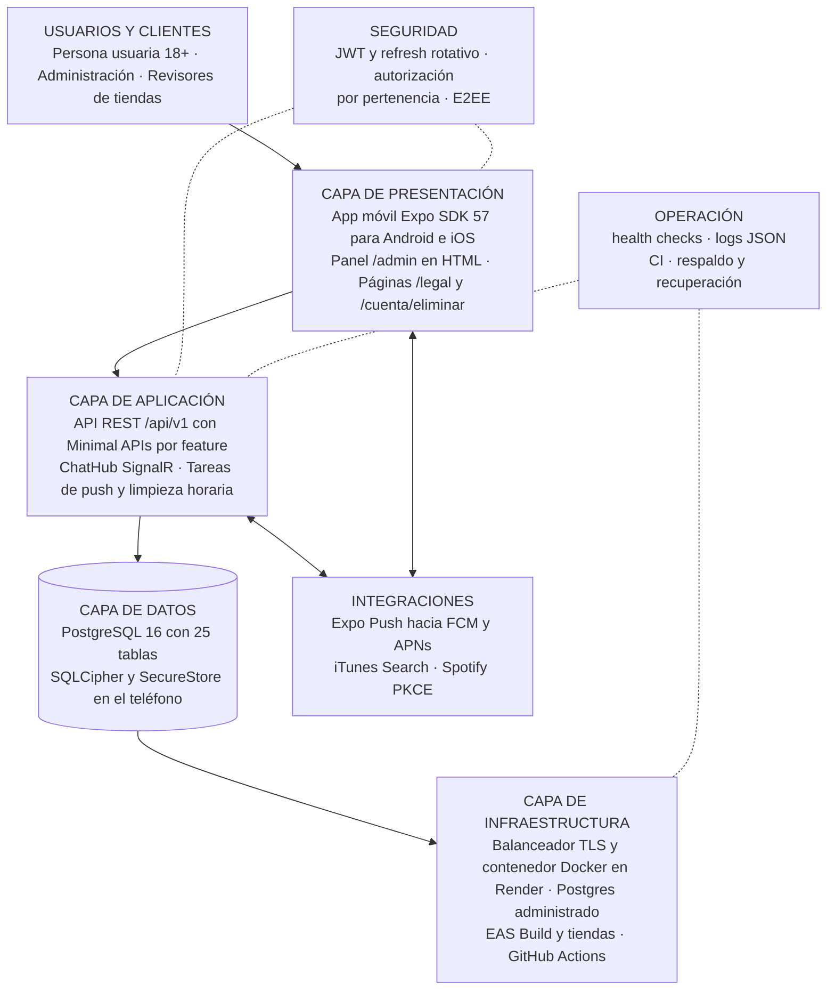

### 4.3 Diagrama de componentes

#### 4.3.1 Componentes de la app

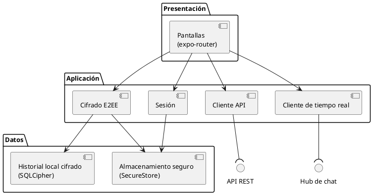

#### 4.3.2 Componentes de la API

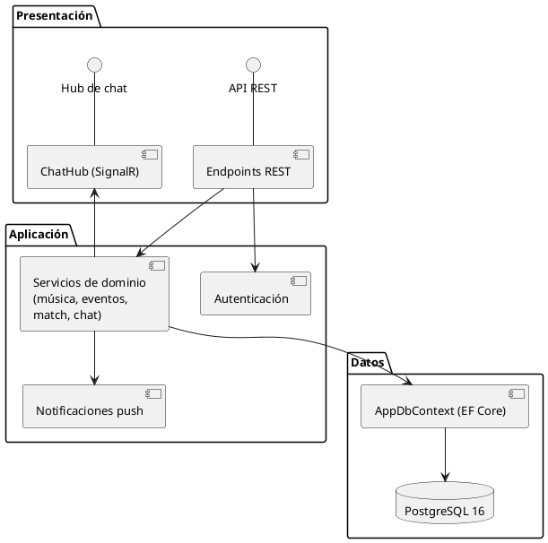

## 5. Instalación, configuración y despliegue

### 5.1 Instalación local de la API y la base de datos

**Prerrequisitos**

- Software de 3.3.1 instalado: mise, Docker con `docker compose` v2.
- Repositorio `encorly_back` clonado y en la rama `dev`.
- Puertos 5000 y 5432 libres (o usar los puertos alternos del final de esta sección).
- Si mise no está activado en la shell (`eval "$(mise activate zsh)"`), anteponer `mise exec --` a cada `dotnet`.

**Pasos**

1. Instalar el SDK definido por el repositorio:

   ```bash
   mise trust     # solo la primera vez en un clon nuevo
   mise install
   ```

2. Crear la configuración local y completar los cuatro valores marcados (los demás ya sirven para local):

   ```bash
   cp .env.example .env
   # DB_PASSWORD         la que se quiera; docker compose crea la BD con ella
   # JWT_SIGNING_KEY     openssl rand -base64 48
   # BANNED_EMAIL_KEY    openssl rand -base64 48   (distinta de la anterior)
   # DEMO_USER_PASSWORD  opcional: contraseña de las 16 cuentas demo
   ```

3. Levantar PostgreSQL y esperar a que esté sano:

   ```bash
   docker compose up -d --wait
   ```

4. Arrancar la API. En `Development` aplica las 11 migraciones y siembra el catálogo al arrancar:

   ```bash
   mise exec -- dotnet run --project src/Encorely.Api
   ```

5. Comprobar el servicio y, si se definió `DEMO_USER_PASSWORD`, iniciar sesión con una cuenta demo:

   ```bash
   curl http://localhost:5000/health/live
   curl http://localhost:5000/health/ready
   curl -s http://localhost:5000/openapi/v1.json | jq -r .info.title
   curl -s -X POST http://localhost:5000/api/v1/auth/login \
     -H 'content-type: application/json' \
     -d '{"email":"valentina.rojas@encorely.demo","password":"<DEMO_USER_PASSWORD>"}' | jq '.user'
   ```

**Criterio de validación**

- El log de arranque muestra `Applying migration '20261014050309_Initial'` hasta `'20261015155802_IndicesPurga'` y las líneas `Seed: 15 géneros`, `Seed: 120 canciones`, `Seed: 24 eventos` (más `Seed: 16 usuarios demo` y `Seed: match demo del revisor` si hay `DEMO_USER_PASSWORD`). En una base que ya tenía datos estas líneas no aparecen.
- `/health/live` y `/health/ready` responden `Healthy`.
- `/openapi/v1.json` devuelve el título `Encorely API`.
- El login responde `accessToken`, `refreshToken`, `expiresIn: 900` y `user`.

**Variantes**

- Puertos alternos: `--urls http://127.0.0.1:5100` al arrancar la API y `DB_PORT=5433` para Postgres.
- Todo en contenedores, sin SDK: `docker compose --profile full up -d --build`.

### 5.2 Instalación local de la app

**Prerrequisitos**

- Software de 3.3.2: Node 24, pnpm 12.11.2, JDK 17 activo, Android SDK 36 con `ANDROID_HOME` apuntando a él y un AVD (referencia: `encorely_api35`).
- `encorely-front` clonado en la rama `Dev`, con `encorly_back` en la carpeta hermana.
- API local corriendo y validada según 5.1.

**Pasos**

1. Instalar dependencias exactamente como dice el lockfile:

   ```bash
   pnpm install --frozen-lockfile
   ```

2. Verificar el código sin emulador:

   ```bash
   pnpm typecheck && pnpm lint && pnpm test
   ```

3. Configurar la URL de la API:

   ```bash
   cp .env.example .env
   # EXPO_PUBLIC_API_URL=http://10.0.2.2:5000        (emulador Android)
   # EXPO_PUBLIC_API_URL=http://<IP-del-PC>:5000     (teléfono en la misma red)
   ```

4. Compilar e instalar el development build y arrancar Metro en otra terminal:

   ```bash
   export ANDROID_HOME="$HOME/Android/Sdk"
   ~/Android/Sdk/emulator/emulator -avd encorely_api35 &
   pnpm android
   pnpm start
   ```

**Criterio de validación**

- `pnpm install --frozen-lockfile` termina sin cambiar `pnpm-lock.yaml`.
- `typecheck`, `lint` y `test` pasan.
- La app abre en la pantalla de bienvenida; no aparece "Falta configurar el servidor".
- Con una cuenta demo se entra y la pestaña Conciertos lista los eventos del seed.

### 5.3 Configuración

#### 5.3.1 Variables de entorno de la API

Cómo se carga: en `Development`, `DotEnv` lee el `.env` más cercano sin pisar variables ya definidas; fuera de `Development` el `.env` se ignora. `EnvironmentMapping` traduce las variables planas a secciones (`DB_HOST` → `Database:Host`) y las opciones se validan al arrancar: si falta un obligatorio, la API no levanta. Ningún secreto tiene valor por defecto en el código.

| Variable | Qué controla | Defecto | Obligatoria |
|---|---|---|---|
| `DB_HOST`, `DB_NAME`, `DB_USER` | Conexión a Postgres | Sin defecto (compose usa `encorely` para nombre y usuario) | Sí |
| `DB_PORT` | Puerto de Postgres | `5432` | No |
| `DB_PASSWORD` | Contraseña de Postgres (secreto) | Sin defecto | Sí |
| `DB_SSL_MODE` | `Disable`, `Allow`, `Prefer`, `Require`, `VerifyCA`, `VerifyFull` | `Prefer` | Fuera de Development debe ser `Require` o superior |
| `DB_MIGRATE_ON_STARTUP` | Aplica migraciones al arrancar | `false` (`true` en Development) | No |
| `JWT_SIGNING_KEY` | Llave HS256 de los access tokens, 32 caracteres o más (secreto) | Sin defecto | Sí |
| `JWT_ISSUER`, `JWT_AUDIENCE` | Emisor y audiencia validados | `encorely-api`, `encorely-app` | No |
| `JWT_ACCESS_TOKEN_MINUTES`, `JWT_REFRESH_TOKEN_DAYS` | Vida de los tokens (5–60 min, 1–90 días) | `15`, `30` | No |
| `BANNED_EMAIL_KEY` | Llave HMAC de los correos vetados, distinta de la del JWT (secreto) | Sin defecto | Sí |
| `SEED_CATALOG` | Siembra géneros, canciones y eventos si faltan | `false` (`true` en Development) | No |
| `DEMO_USER_PASSWORD` | Crea las cuentas demo con esa contraseña (secreto) | Vacío | Fuera de Development solo con `SEED_REVIEWER_ONLY=true` |
| `SEED_REVIEWER_ONLY` | Siembra solo `revisor@encorely.demo` y su par, nunca el admin | `false` | No |
| `RADAR_MIN_SWIPES`, `RADAR_MIN_AFFINITY`, `AFFINITY_MIN_SWIPES` | Reglas del radar y de la afinidad | `15`, `0`, `25` | No |
| `RATE_LIMIT_AUTH_PER_MINUTE`, `AUTH_MAX_FAILED_LOGINS`, `AUTH_LOCKOUT_MINUTES` | Límite de autenticación por IP y bloqueo por (correo, IP) | `10`, `5`, `15` | No |
| `RATE_LIMIT_USER_WRITES_PER_MINUTE`, `RATE_LIMIT_REPORTS_PER_HOUR`, `RATE_LIMIT_TOKENS_PER_MINUTE` | Escrituras por usuario, reportes por usuario, refresh y logout por IP | `120`, `10`, `60` | No |
| `FORWARDED_TRUSTED_NETWORKS` | CIDR de los proxies de confianza | Vacío (se ignora `X-Forwarded-For`) | Sí fuera de Development |
| `CHAT_MESSAGE_RETENTION_DAYS` | Días que se guarda un mensaje sin ack; `0` sin límite | `30` | No |
| `PUSH_ENABLED`, `EXPO_PUSH_ACCESS_TOKEN` | Envío por Expo Push y su token (secreto) | `false`, vacío | No |
| `CORS_ORIGINS` | Orígenes CORS (solo Expo web) | Vacío | No |
| `PUBLIC_BASE_URL` | URL pública para enlaces legales y de borrado | Vacío (se deriva del host) | Sí fuera de Development, y https |
| `PRIVACY_CONTACT_EMAIL` | Correo de consultas de datos personales | Vacío | No |
| `SPOTIFY_CLIENT_ID`, `SPOTIFY_ALLOWED_REDIRECTS` | Client ID público de Spotify y redirects aceptadas | Vacío, `encorely://spotify-callback` | No |

Valores fijos en `appsettings.json`: versión de consentimiento `Legal:ConsentVersion = 2026-10-14` y su fecha. Cambiarlos obliga a todas las personas a aceptar de nuevo (`POST /me/consents`).

#### 5.3.2 Variables de entorno de la app

| Variable | Obligatoria | Dónde se lee | Qué hace | Si falta |
|---|---|---|---|---|
| `EXPO_PUBLIC_API_URL` | Sí | `src/lib/config.ts` | URL base de la API sin `/api/v1`; de ella salen `API_BASE` y `HUB_URL` (`/hubs/chat`) | La app muestra "Falta configurar el servidor" |
| `EXPO_PUBLIC_EAS_PROJECT_ID` | No | `src/features/push/config.ts` | ID del proyecto EAS para pedir el token push, si no está en `app.json` | Push desactivado (`missingProjectId`) |
| `MAESTRO_E2E_*` | Solo E2E | Maestro | Cuenta, contraseña y datos de los flujos E2E | Ver `encorely-front/docs/e2e.md` |

Las variables `EXPO_PUBLIC_*` quedan dentro del bundle: nunca llevan secretos.

#### 5.3.3 Configuración estática de la app

| Archivo | Campo | Valor |
|---|---|---|
| `app.json` | Identificadores: `ios.bundleIdentifier`, `android.package`, `scheme` | `com.encorely.app` y esquema `encorely` |
| `eas.json` | Perfiles de build | `development` (APK dev client, API `http://10.0.2.2:5000`), `preview` (APK interno, API de staging) y `production` (AAB e IPA) |
| `app.json` | `android.allowBackup` | `false`: llaves y base local fuera del backup de Android |

### 5.4 Integración continua

- Back (`.github/workflows/ci.yml`, en cada push a `main`, `dev` y `rebuild/v1` y en todo pull request): formato, paquetes vulnerables, build Release con warnings como errores y pruebas con Postgres real; luego construye la imagen Docker y la prueba en modo `Production`.
- App (`.github/workflows/frontend.yml`, en `main` y `rebuild/v1`): `check:expo`, `typecheck`, `lint`, pruebas y `build:bundles`. No corre en `Dev` (pendiente en 10.6).
- La CI en verde sobre el commit a desplegar es requisito para desplegar (5.5.4); con la rama principal en rojo no se despliega.

### 5.5 Plan de despliegue a producción

#### 5.5.1 Estado actual del despliegue

El sistema no está publicado (ver 2.2). Están listos el `Dockerfile`, el Blueprint `render.yaml`, los perfiles de `eas.json` y el checklist de tiendas; este plan describe cómo pasar a producción cuando se decida.

#### 5.5.2 Cronograma, responsables y ventana

El cronograma es relativo al día de salida (D). Cada actividad tiene una persona responsable; quien ejecuta un paso lo registra en el informe de aceptación.

| Semana o día | Actividad | Responsable | Entregable |
|---|---|---|---|
| D-28 a D-21 | Planificación: fecha de salida, ventana, criterios de aceptación, plan de rollback revisado | Camilo Rincón (Product Owner) | Plan de despliegue aprobado |
| D-21 a D-7 | Prueba cerrada de Google Play (12 testers o más, 14 días seguidos, exigencia de cuentas personales nuevas) con build `preview` o `production` | Emmanuel Dávila (app) | Track de prueba cerrada activo |
| D-21 a D-14 | Preparación del entorno: Render, dominio y TLS, Postgres con respaldo continuo, proyecto EAS, Firebase (FCM v1), APNs, Spotify Dashboard | Samuel Sierra (DevOps) | Entornos creados, secretos cargados |
| D-14 a D-10 | Instalación y configuración en staging: API y app `preview` apuntando a `https://api-staging…` | Samuel Sierra (DevOps) | Staging funcionando |
| D-10 | Migración de datos: aplicar las 11 migraciones sobre la base vacía y sembrar el catálogo | Samuel Sierra (administrador de base de datos) | Esquema y catálogo validados |
| D-10 a D-3 | Pruebas de aceptación: suite completa, flujos Maestro sobre `preview`, smoke manual, revisión de seguridad | Juan Diego Calle (QA) | Informe de aceptación |
| D-3 a D-1 | Capacitación: personas usuarias, administración del panel, guardia y runbooks | Juan Diego Calle (QA y analista) | Material publicado y personas de guardia asignadas |
| D, 05:00 a 07:00 (hora de Colombia, UTC-5) | Go-live: despliegue de la API de producción (Samuel Sierra) y envío de la app a revisión (Emmanuel Dávila) | Camilo Rincón (Product Owner) da la orden de salida | Software en producción |
| D a D+14 | Monitoreo posterior intensivo (revisión diaria de alertas, receipts de push, reportes) | Juan Diego Calle (monitoreo) | Cierre de la puesta en marcha |

Ventana de despliegue propuesta: martes de 05:00 a 07:00 hora de Colombia, la franja de menor uso esperado para una app de conciertos (la actividad se concentra en las noches y los fines de semana). Es un objetivo; no hay tráfico real que lo confirme.

#### 5.5.3 Actividades de la fase de despliegue

| N.º | Actividad | Qué se hace en Encorely | Criterio de validación |
|---|---|---|---|
| 1 | Planificación | Fijar D, ventana, responsables de guardia y criterios de aceptación; revisar el plan de rollback de 5.6 | Plan revisado por todo el equipo |
| 2 | Preparación del entorno | Crear el Blueprint de Render desde `render.yaml`; dominio con TLS; Postgres con respaldo continuo y sin acceso externo (`ipAllowList` vacío, ver 8.5); secretos (`JWT_SIGNING_KEY` y `BANNED_EMAIL_KEY` generados por Render, el resto con `sync: false`); EAS `init` y credenciales; FCM v1 y APNs; redirect de Spotify | Todas las variables obligatorias definidas (la API no arranca si falta alguna); `psql` desde fuera de Render no conecta a `encorely-db` |
| 3 | Instalación y configuración | Desplegar la imagen; completar `FORWARDED_TRUSTED_NETWORKS`, `PUBLIC_BASE_URL` (https), `PRIVACY_CONTACT_EMAIL`, `EXPO_PUSH_ACCESS_TOKEN` y `SPOTIFY_CLIENT_ID` | `/health/live` y `/health/ready` en `Healthy` sobre el dominio público |
| 4 | Migración de datos | No se migran datos del sistema anterior: eran ficticios y su esquema no tenía fuente de verdad. Se aplican las migraciones al arrancar (`DB_MIGRATE_ON_STARTUP=true`, una sola instancia) y se siembra el catálogo (`SEED_CATALOG=true`) | La última fila de `__EFMigrationsHistory` es `20261015155802_IndicesPurga`; `genres` tiene 15 filas y `songs` 120 |
| 5 | Pruebas de aceptación | Smoke de la API, flujos Maestro 01 a 06 sobre un build apuntando a producción o staging, revisión de cabeceras y de páginas legales | Informe de aceptación firmado con cada caso en "pasa" |
| 6 | Capacitación | Personas usuarias finales: el onboarding dentro de la app es su entrenamiento (registro, consentimiento, fecha, ciudad y géneros), la explicación del cifrado está en la pantalla de seguridad de cada chat y en Tú → "Cómo protegemos tus chats", y el manual de usuario (`encorely-front/docs/MANUAL-USUARIO.md`) se publica como material de consulta junto con las fichas de las tiendas. Moderación: recorrido del panel `/admin` sobre staging. Guardia: repaso de runbooks (10.2) | El onboarding completo pasa en el flujo Maestro 01 sobre el build de producción; el manual de usuario está publicado; quien modera resolvió un reporte de prueba en staging; cada persona de guardia ejecutó al menos un runbook en staging |
| 7 | Puesta en marcha (go-live) | Crear el admin de producción (5.5.4, paso 6); enviar la app a revisión con la cuenta `revisor@encorely.demo` (`SEED_REVIEWER_ONLY=true`) | App aprobada por las tiendas; API en producción sin alertas abiertas |
| 8 | Monitoreo posterior | Revisión diaria durante 14 días: alertas, tasa de 5xx, receipts de push, reportes de moderación | Sin incidentes de severidad 1 o 2 abiertos al cierre |

#### 5.5.4 Procedimiento de despliegue de la API

**Prerrequisitos**

- CI en verde sobre el commit a desplegar (jobs `build-test` y `docker`).
- Cuenta de Render con acceso al repositorio y dominio propio con DNS administrable.
- Valores de `FORWARDED_TRUSTED_NETWORKS` (rangos del proxy de Render, según su documentación), `PUBLIC_BASE_URL`, `PRIVACY_CONTACT_EMAIL` y, si aplica, `EXPO_PUSH_ACCESS_TOKEN` y `SPOTIFY_CLIENT_ID`.
- Plan de Postgres con respaldo continuo confirmado (9.5).

**Pasos**

1. Fusionar a `main` el commit aprobado y etiquetarlo (`api-v1.0.0`).
2. En Render, crear el Blueprint desde `render.yaml`. Se crean `encorely-api` (Docker, `starter`) y `encorely-db` (Postgres 16).
3. Completar las variables `sync: false`. No copiar secretos en chats ni documentos; se cargan directamente en el panel del proveedor.
4. Lanzar el primer despliegue. La API migra la base al arrancar y siembra el catálogo.
5. Asociar el dominio y esperar el certificado TLS.
6. Crear el admin de producción: registrar la cuenta desde la app con una contraseña propia y promoverla con una sentencia revisada por dos personas del equipo, ejecutada una sola vez:

   ```sql
   UPDATE users SET role = 'Admin' WHERE email = '<correo-del-admin>';
   ```

7. Ejecutar el smoke:

   ```bash
   curl -fsS https://<dominio>/health/live
   curl -fsS https://<dominio>/health/ready
   curl -sI https://<dominio>/api/v1/events | grep -i '^cache-control: no-store'
   curl -fsS https://<dominio>/api/v1/legal/current | jq .
   ```

**Criterio de validación**

- Los dos health checks responden `Healthy`.
- `/api/v1/events` sin token responde 401 con `Cache-Control: no-store`.
- `/legal/current` devuelve la versión `2026-10-14` y URLs https bajo `PUBLIC_BASE_URL`.
- El admin entra a `https://<dominio>/admin` y ve la cola de reportes.
- El log del servicio muestra líneas JSON con `traceId` y ninguna excepción de arranque.

#### 5.5.5 Procedimiento de build y publicación de la app

**Prerrequisitos**

- Cuentas de Apple Developer, Google Play Console y Expo (`encorely-front/docs/tiendas.md` §1).
- `eas.json` con `EXPO_PUBLIC_API_URL` del perfil `production` apuntando al dominio real (hoy es un marcador).
- API de producción validada (5.5.4).

**Pasos**

1. Configurar EAS una sola vez:

   ```bash
   pnpm dlx eas-cli@24.13.0 login
   pnpm dlx eas-cli@24.13.0 init          # escribe extra.eas.projectId en app.json
   pnpm dlx eas-cli@24.13.0 credentials   # keystore Android, certificados iOS, FCM v1, APNs
   ```

2. Compilar:

   ```bash
   pnpm dlx eas-cli@24.13.0 build -p android --profile production
   pnpm dlx eas-cli@24.13.0 build -p ios --profile production
   ```

3. Enviar a las tiendas con `pnpm dlx eas-cli@24.13.0 submit`, primero a la prueba cerrada de Play y a TestFlight.
4. Completar las fichas: etiquetas de privacidad, URL de política (`/legal/privacidad`), URL de borrado (`/cuenta/eliminar`), cuenta demo del revisor y declaración de cifrado.
5. Publicar en producción con lanzamiento escalonado (Play) y publicación por fases (App Store).

**Criterio de validación**

- El build instalado desde la prueba cerrada se registra, entra, recibe un push real y abre el chat desde la notificación.
- Las tiendas aprueban la revisión.
- En la consola de Play y en App Store Connect no hay fallos nuevos durante las primeras 48 horas del lanzamiento escalonado.

### 5.6 Plan de rollback

El rollback acompaña toda la secuencia: cada paso de 5.5 tiene una forma de deshacerse antes de seguir.

| Qué falla | Cómo se revierte | Criterio para decidir | Validación | Responsable |
|---|---|---|---|---|
| Nueva versión de la API (error de código) | Render: "Rollback" al despliegue anterior desde el historial de deploys del servicio, o redeploy del tag anterior | Alerta de 5xx sostenida, health check en rojo o caso de aceptación fallido | `/health/ready` en `Healthy`, smoke de 5.5.4 en verde con la versión anterior | Samuel Sierra ejecuta; Camilo Rincón decide |
| Variable de entorno mal definida | Restaurar el valor anterior en el panel del proveedor y reiniciar | La API no arranca (la validación lo detiene) o un caso falla | Arranque sin errores de configuración en el log | Samuel Sierra |
| Migración de esquema | Regla preventiva: cada migración es compatible con la versión anterior de la API (agregar antes de quitar), así el rollback de la API no exige tocar el esquema. Si hay que deshacerla: `dotnet ef migrations script <Nueva> <Anterior>` genera el SQL de reversa, se revisa y se aplica en la ventana. Último recurso: restaurar con PITR al minuto anterior al despliegue (se pierden las escrituras posteriores) | Error de datos o de esquema que no se corrige con un hotfix | Última fila de `__EFMigrationsHistory` igual a la esperada; pruebas de humo en verde | Samuel Sierra (base) con Camilo Rincón (migración) |
| Build de la app con error | Detener el lanzamiento escalonado en Play o pausar la publicación por fases en App Store; publicar un hotfix con número de build mayor. Una versión ya instalada no se puede retirar del teléfono | Fallos nuevos en la consola o reportes de usuarios | El hotfix llega al 100 % sin fallos nuevos | Emmanuel Dávila |
| Cambio de contrato que rompe clientes viejos | Política: un cambio marcado **Rompe** en el CHANGELOG solo sale cuando la versión de la app que lo soporta ya está publicada; mientras tanto la API mantiene el comportamiento anterior | Clientes con errores 400 o 404 nuevos | Errores vuelven al nivel previo | Camilo Rincón |

**Procedimiento de rollback de la API**

Prerrequisitos

- Decisión de rollback tomada por Camilo Rincón (escalamiento de incidentes) con la guardia, según la columna "Criterio para decidir", y registrada en el incidente. Ejecuta Samuel Sierra (DevOps).
- Identificado el último despliegue sano (tag `api-v…` o deploy anterior en el historial de Render).
- Confirmado que la versión anterior es compatible con el esquema actual (regla de migraciones compatibles); si no lo es, seguir antes la fila "Migración de esquema".

Pasos

1. Anotar la hora de inicio y avisar al canal del equipo.
2. En Render, abrir el servicio `encorely-api`, ir al historial de deploys y ejecutar "Rollback" sobre el último deploy sano (alternativa: redeploy manual del tag anterior).
3. Si el problema venía de una variable, restaurar su valor anterior en el panel y reiniciar el servicio.
4. Esperar a que el health check de Render marque el servicio como disponible.
5. Ejecutar el smoke de 5.5.4 (paso 7).
6. Registrar en el incidente la versión restaurada, la hora de fin y la causa.

Criterio de validación

- `/health/live` y `/health/ready` responden `Healthy` sobre el dominio público.
- El smoke de 5.5.4 pasa completo y la tasa de 5xx vuelve a su nivel previo durante 30 minutos.
- El historial de Render muestra como activo el deploy elegido.

Antes de cada despliegue se confirma que existe un punto de restauración de la base (respaldo continuo activo) y se anota la hora exacta de inicio, que es el punto de PITR si hiciera falta.

### 5.7 Productos del despliegue

| Producto | Dónde está o estará | Estado |
|---|---|---|
| Plan de despliegue | Este manual, 5.5 | Elaborado |
| Manual de instalación | Este manual, 5.1 a 5.3, y los README de cada repositorio | Elaborado y verificado en local |
| Software en producción | Render y tiendas | No aplica en esta entrega; preparado |
| Documentación de usuario | `encorely-front/docs/MANUAL-USUARIO.md` | Elaborada |
| Informe de aceptación | Plantilla en el Anexo B (10.8); se llena en la actividad 5 de 5.5.3 | Plantilla lista |
| Plan de rollback | Este manual, 5.6 | Elaborado |

### 5.8 Diagramas de despliegue

#### 5.8.1 Despliegue objetivo en producción

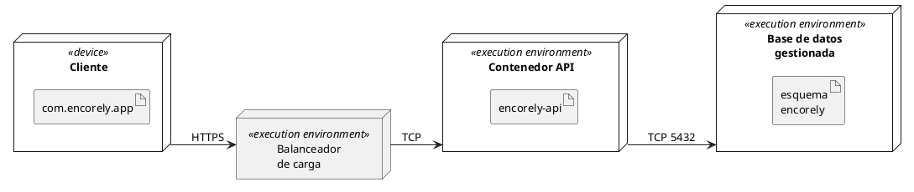

Cliente: teléfono Android o iOS. Balanceador y contenedor: Render. Base de datos gestionada: PostgreSQL 16. Cada nodo aloja exactamente el artefacto que le corresponde. Hay una sola réplica del contenedor; el balanceador no reparte carga entre varias.

#### 5.8.2 Despliegue actual de la demo local

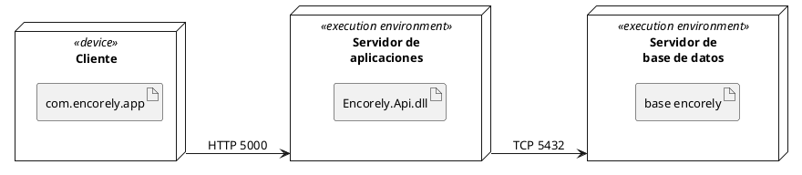

Cliente: emulador o teléfono Android. Servidor de aplicaciones: .NET 10 en el PC de desarrollo. Servidor de base de datos: contenedor Docker con PostgreSQL 16. Cada nodo aloja exactamente el artefacto que le corresponde.

## 6. Base de datos y modelo de información

### 6.1 Motor, conexión y convenciones

| Aspecto | Valor |
|---|---|
| Motor | PostgreSQL 16 (local: imagen `postgres:16-alpine`; producción propuesta: Render PostgreSQL 16) |
| Base de datos | `encorely` (nombre por defecto de compose; en producción el que entregue el proveedor) |
| Acceso | EF Core 10 con Npgsql 10.0.3; Dapper solo para la consulta del radar (`Features/Events/RadarService.cs`) |
| Cadena de conexión | Se arma con `DB_HOST`, `DB_PORT`, `DB_NAME`, `DB_USER`, `DB_PASSWORD` y `DB_SSL_MODE`; nunca se escribe en archivos versionados |
| Nombres | `snake_case` generado por `UseSnakeCaseNamingConvention`; restricciones `pk_`, `fk_`, `ix_`, `ck_` |
| Identificadores | UUID versión 7 generados por la API (`Guid.CreateVersion7()`), salvo `genres.id` y `user_consents.id` (identidad de Postgres) y `chat_messages.id` (lo genera el cliente) |
| Enums | Guardados como texto de hasta 32 caracteres (`varchar(32)`) |
| Fechas | `timestamp with time zone` en UTC; `users.birth_date` es `date` |
| Tablas | 25 de dominio más `__EFMigrationsHistory` de EF Core |
| Dependencias de la base | Ninguna extensión de Postgres |


### 6.2 Diagrama entidad-relación

El modelo se presenta en cinco vistas; `users` y `matches` se repiten como ancla entre vistas. El detalle de cada campo está en las fichas de 6.3.

#### 6.2.1 Vista de cuenta, sesiones y moderación

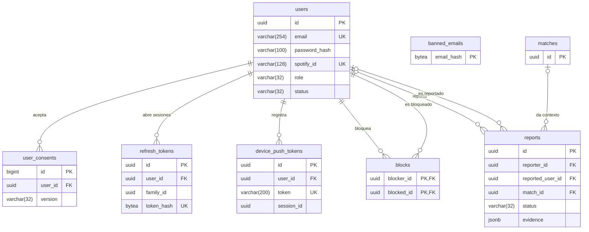

#### 6.2.2 Vista de música y perfil social

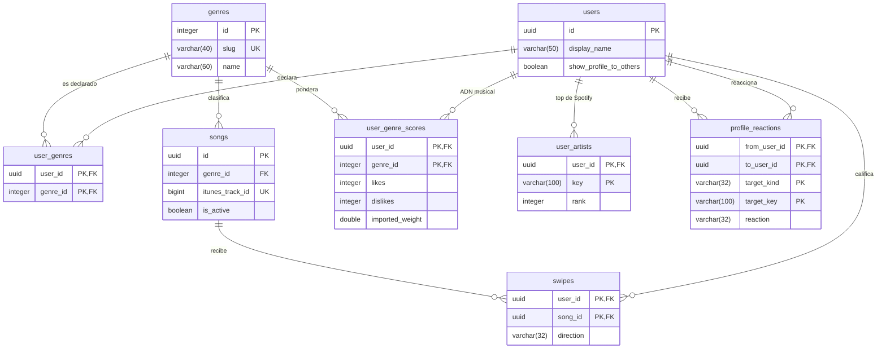

#### 6.2.3 Vista de eventos y match

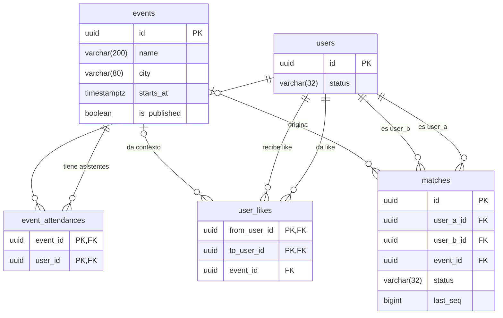

#### 6.2.4 Vista de chat y mensajes

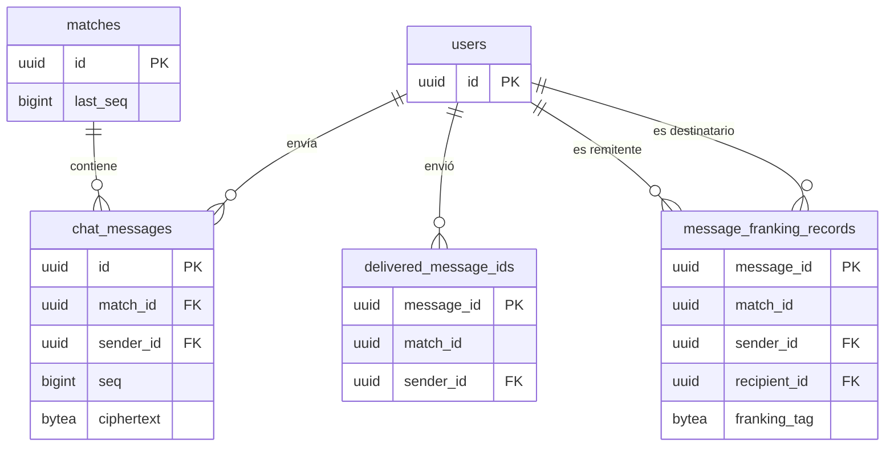

#### 6.2.5 Vista de llaves, respaldo y vinculación

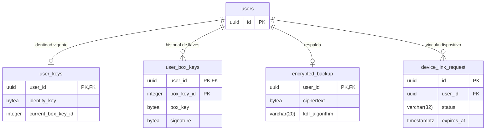

### 6.3 Fichas técnicas de las tablas

#### 6.3.1 Tabla users

Propósito: cuenta y perfil de cada persona. Es la tabla central: 20 tablas la referencian. PK `pk_users (id)`. Índices únicos `ix_users_email (email)` e `ix_users_spotify_id (spotify_id)`. Borrar una fila borra en cascada sus swipes, likes, matches, mensajes, llaves, sesiones y respaldos; los reportes quedan con la referencia en `NULL`. Componentes: `Auth`, `Users`, `Profiles`, `Admin`.

| Campo | Tipo | Nulo | Restricción o defecto | Significado |
|---|---|---|---|---|
| id | uuid | NOT NULL | PK | Identificador de la cuenta |
| email | varchar(254) | NOT NULL | UNIQUE | Correo de acceso, guardado sin espacios y en minúsculas |
| password_hash | varchar(100) | NULL | | Hash BCrypt (factor 12) de la contraseña; `NULL` si la cuenta se creó con Spotify |
| spotify_id | varchar(128) | NULL | UNIQUE | Usuario de Spotify vinculado para entrar con Spotify |
| show_profile_to_others | boolean | NOT NULL | DEFAULT `true` | Si la persona permite que otras vean su perfil |
| display_name | varchar(50) | NOT NULL | | Nombre que ven las demás personas |
| birth_date | date | NULL | | Fecha de nacimiento |
| city | varchar(80) | NULL | | Ciudad que escribe la persona |
| bio | varchar(300) | NULL | | Texto libre del perfil |
| role | varchar(32) | NOT NULL | Valores de 6.4 | Rol: persona usuaria o administración |
| status | varchar(32) | NOT NULL | Valores de 6.4 | Cuenta activa o suspendida |
| created_at | timestamptz | NOT NULL | | Alta de la cuenta |
| updated_at | timestamptz | NOT NULL | | Último cambio del perfil |

#### 6.3.2 Tabla user_consents

Propósito: prueba del consentimiento de términos y política de datos (Ley 1581), una fila por aceptación. PK `pk_user_consents (id)`. FK `fk_user_consents_users_user_id` → `users.id` ON DELETE CASCADE. Índice `ix_user_consents_user_id`. Componentes: `Users`, `Legal`, `Profiles` (consentimiento del perfil público).

| Campo | Tipo | Nulo | Restricción o defecto | Significado |
|---|---|---|---|---|
| id | bigint | NOT NULL | PK, identidad generada por defecto | Número de la aceptación |
| user_id | uuid | NOT NULL | FK → `users.id` | Quién aceptó |
| version | varchar(32) | NOT NULL | | Versión de los documentos aceptados (vigente: `2026-10-14`) |
| accepted_at | timestamptz | NOT NULL | | Cuándo aceptó |

#### 6.3.3 Tabla refresh_tokens

Propósito: sesiones. Cada fila es un refresh token opaco del que solo se guarda el SHA-256; las filas de una misma `family_id` son una sesión. PK `pk_refresh_tokens (id)`. FK `fk_refresh_tokens_users_user_id` → `users.id` CASCADE. Índices: `ix_refresh_tokens_token_hash` (único), `ix_refresh_tokens_family_id`, `ix_refresh_tokens_user_id`, `ix_refresh_tokens_expires_at` (purga horaria). Componentes: `Auth`, `Sessions`, `Infrastructure/Auth`, `MaintenanceService`.

| Campo | Tipo | Nulo | Restricción o defecto | Significado |
|---|---|---|---|---|
| id | uuid | NOT NULL | PK | Identificador del token |
| user_id | uuid | NOT NULL | FK → `users.id` | Dueño de la sesión |
| family_id | uuid | NOT NULL | Índice | Sesión |
| token_hash | bytea | NOT NULL | UNIQUE | SHA-256 del refresh token |
| created_at | timestamptz | NOT NULL | | Emisión |
| expires_at | timestamptz | NOT NULL | Índice | Vencimiento (30 días por defecto) |
| revoked_at | timestamptz | NULL | | Cuándo se revocó (logout, rotación, reuso o suspensión) |
| replaced_by_token_id | uuid | NULL | Sin FK | Token que lo reemplazó al rotar |

#### 6.3.4 Tabla device_push_tokens

Propósito: tokens push de Expo por dispositivo, ligados a la sesión que los registró. PK `pk_device_push_tokens (id)`. FK `fk_device_push_tokens_users_user_id` → `users.id` CASCADE. Índices: `ix_device_push_tokens_token` (único), `ix_device_push_tokens_user_id`, `ix_device_push_tokens_session_id`. Componentes: `Devices`, `Sessions`, `Infrastructure/Push`.

| Campo | Tipo | Nulo | Restricción o defecto | Significado |
|---|---|---|---|---|
| id | uuid | NOT NULL | PK | Identificador del registro |
| user_id | uuid | NOT NULL | FK → `users.id` | Cuenta que recibe los avisos |
| token | varchar(200) | NOT NULL | UNIQUE | Token `ExponentPushToken[…]` o `ExpoPushToken[…]` |
| platform | varchar(32) | NOT NULL | Valores de 6.4 | Sistema operativo del teléfono |
| session_id | uuid | NULL | Índice, sin FK | Sesión (`family_id`) que lo registró |
| created_at | timestamptz | NOT NULL | | Primer registro |
| updated_at | timestamptz | NOT NULL | | Último registro o cambio de dueño |

#### 6.3.5 Tabla banned_emails

Propósito: impedir que una cuenta suspendida se borre y se registre otra vez con el mismo correo. Guarda solo el HMAC-SHA256 del correo normalizado con `BANNED_EMAIL_KEY`. PK `pk_banned_emails (email_hash)`. Sin relaciones. Componentes: `Auth`, `Admin`.

| Campo | Tipo | Nulo | Restricción o defecto | Significado |
|---|---|---|---|---|
| email_hash | bytea | NOT NULL | PK | Huella del correo vetado; no permite recuperar el correo sin la llave |
| created_at | timestamptz | NOT NULL | | Fecha del veto |

#### 6.3.6 Tabla genres

Propósito: catálogo de los 15 géneros musicales. PK `pk_genres (id)`. Índice único `ix_genres_slug`. Referenciada por `songs`, `user_genres` y `user_genre_scores` con ON DELETE RESTRICT (un género en uso no se puede borrar). Componentes: `Music`, `Users`, `Events` (radar).

| Campo | Tipo | Nulo | Restricción o defecto | Significado |
|---|---|---|---|---|
| id | integer | NOT NULL | PK, identidad generada por defecto | Identificador interno |
| slug | varchar(40) | NOT NULL | UNIQUE | Identificador estable que viaja en la API (por ejemplo `vallenato`) |
| name | varchar(60) | NOT NULL | | Nombre visible del género |

#### 6.3.7 Tabla songs

Propósito: catálogo curado de canciones para calificar, con portada y muestra de 30 s de iTunes. PK `pk_songs (id)`. FK `fk_songs_genres_genre_id` → `genres.id` RESTRICT. Índices `ix_songs_genre_id` e `ix_songs_itunes_track_id` (único). Componentes: `Music`, `Admin`, `scripts/curate_songs.py` (seed).

| Campo | Tipo | Nulo | Restricción o defecto | Significado |
|---|---|---|---|---|
| id | uuid | NOT NULL | PK | Identificador de la canción |
| title | varchar(200) | NOT NULL | | Título |
| artist | varchar(200) | NOT NULL | | Artista |
| genre_id | integer | NOT NULL | FK → `genres.id` | Género al que suma la calificación |
| cover_url | varchar(500) | NOT NULL | | URL de la portada |
| preview_url | varchar(500) | NULL | | URL de la muestra de 30 s |
| itunes_track_id | bigint | NULL | UNIQUE | Id de la pista en iTunes, evita duplicados en el catálogo |
| is_active | boolean | NOT NULL | | `false` la saca del feed sin borrarla |
| created_at | timestamptz | NOT NULL | | Alta en el catálogo |

#### 6.3.8 Tabla swipes

Propósito: calificaciones de canciones. PK `pk_swipes (user_id, song_id)`. FK `fk_swipes_users_user_id` → `users.id` CASCADE y `fk_swipes_songs_song_id` → `songs.id` CASCADE. Índice `ix_swipes_song_id`. Componentes: `Music`, `Admin` (conteo de likes por canción).

| Campo | Tipo | Nulo | Restricción o defecto | Significado |
|---|---|---|---|---|
| user_id | uuid | NOT NULL | PK, FK → `users.id` | Quién calificó |
| song_id | uuid | NOT NULL | PK, FK → `songs.id` | Canción calificada |
| direction | varchar(32) | NOT NULL | Valores de 6.4 | Me gusta o paso |
| created_at | timestamptz | NOT NULL | | Momento de la calificación |

#### 6.3.9 Tabla user_genres

Propósito: géneros que la persona declara como favoritos en el onboarding o el perfil. PK `pk_user_genres (user_id, genre_id)`. FK `fk_user_genres_users_user_id` → `users.id` CASCADE y `fk_user_genres_genres_genre_id` → `genres.id` RESTRICT. Índice `ix_user_genres_genre_id`. Componentes: `Users`, `Music` (bono en el ADN), `Profiles`.

| Campo | Tipo | Nulo | Restricción o defecto | Significado |
|---|---|---|---|---|
| user_id | uuid | NOT NULL | PK, FK → `users.id` | Persona |
| genre_id | integer | NOT NULL | PK, FK → `genres.id` | Género declarado |

#### 6.3.10 Tabla user_genre_scores

Propósito: componentes del ADN musical por género. PK `pk_user_genre_scores (user_id, genre_id)`. FK `fk_user_genre_scores_users_user_id` → `users.id` CASCADE y `fk_user_genre_scores_genres_genre_id` → `genres.id` RESTRICT. Índice `ix_user_genre_scores_genre_id`. Componentes: `Music`, `Events` (radar), `Profiles`.

| Campo | Tipo | Nulo | Restricción o defecto | Significado |
|---|---|---|---|---|
| user_id | uuid | NOT NULL | PK, FK → `users.id` | Persona |
| genre_id | integer | NOT NULL | PK, FK → `genres.id` | Género |
| likes | integer | NOT NULL | | Canciones de ese género marcadas "me gusta" |
| dislikes | integer | NOT NULL | | Canciones de ese género marcadas "paso" |
| imported_weight | double precision | NOT NULL | | Aporte de la importación de Spotify; se reemplaza en cada importación |

#### 6.3.11 Tabla user_artists

Propósito: artistas más escuchados importados de Spotify, para el perfil y las reacciones. PK `pk_user_artists (user_id, key)`. FK `fk_user_artists_users_user_id` → `users.id` CASCADE. Componentes: `Music`, `Profiles`.

| Campo | Tipo | Nulo | Restricción o defecto | Significado |
|---|---|---|---|---|
| user_id | uuid | NOT NULL | PK, FK → `users.id` | Persona |
| key | varchar(100) | NOT NULL | PK | Nombre normalizado (sin tildes ni signos, con guiones) para cruzar artistas entre perfiles |
| name | varchar(200) | NOT NULL | | Nombre del artista como lo da Spotify |
| rank | integer | NOT NULL | | Posición en el top (0 es el más escuchado) |
| image_url | varchar(500) | NULL | | Imagen del artista |
| genres | text[] | NOT NULL | | Géneros que Spotify asigna al artista |
| imported_at | timestamptz | NOT NULL | | Fecha de la importación |

#### 6.3.12 Tabla profile_reactions

Propósito: reacciones de una persona a un artista o género del perfil de otra ("Yo también", "Vamos a verlo", "Pásame una"). Una por objetivo y par. PK `pk_profile_reactions (from_user_id, to_user_id, target_kind, target_key)`. FK `fk_profile_reactions_users_from_user_id` y `fk_profile_reactions_users_to_user_id` → `users.id` CASCADE. Índice `ix_profile_reactions_to_user_id_updated_at`. Componente: `Profiles`.

| Campo | Tipo | Nulo | Restricción o defecto | Significado |
|---|---|---|---|---|
| from_user_id | uuid | NOT NULL | PK, FK → `users.id` | Quién reacciona |
| to_user_id | uuid | NOT NULL | PK, FK → `users.id` | Dueño del perfil |
| target_kind | varchar(32) | NOT NULL | PK, valores de 6.4 | Si el objetivo es un artista o un género |
| target_key | varchar(100) | NOT NULL | PK | `slug` del género o `key` del artista |
| target_name | varchar(200) | NOT NULL | DEFAULT `''` | Nombre del objetivo al reaccionar |
| reaction | varchar(32) | NOT NULL | Valores de 6.4 | Tipo de reacción |
| created_at | timestamptz | NOT NULL | | Primera reacción |
| updated_at | timestamptz | NOT NULL | Índice con `to_user_id` | Último cambio; ordena la lista de recibidas |

#### 6.3.13 Tabla events

Propósito: conciertos curados por la administración (seed y panel). PK `pk_events (id)`. Índice `ix_events_city_starts_at (city, starts_at)`. Referenciada por `event_attendances` (CASCADE), `user_likes` y `matches` (SET NULL). Componentes: `Events`, `Admin`, `Matching`.

| Campo | Tipo | Nulo | Restricción o defecto | Significado |
|---|---|---|---|---|
| id | uuid | NOT NULL | PK | Identificador del evento |
| name | varchar(200) | NOT NULL | | Nombre del concierto |
| artist_lineup | text[] | NOT NULL | | Artistas del cartel |
| venue | varchar(200) | NOT NULL | | Lugar |
| city | varchar(80) | NOT NULL | Índice con `starts_at` | Ciudad |
| starts_at | timestamptz | NOT NULL | | Fecha y hora de inicio |
| image_url | varchar(500) | NULL | | Imagen del cartel |
| description | varchar(2000) | NULL | | Descripción |
| is_published | boolean | NOT NULL | | Visible para las personas usuarias |
| created_at | timestamptz | NOT NULL | | Alta del evento |

#### 6.3.14 Tabla event_attendances

Propósito: quién marcó que va a cada evento; habilita el radar y el like entre asistentes. PK `pk_event_attendances (event_id, user_id)`. FK `fk_event_attendances_events_event_id` → `events.id` CASCADE y `fk_event_attendances_users_user_id` → `users.id` CASCADE. Índice `ix_event_attendances_user_id`. Componentes: `Events`, `Matching`, `Profiles`.

| Campo | Tipo | Nulo | Restricción o defecto | Significado |
|---|---|---|---|---|
| event_id | uuid | NOT NULL | PK, FK → `events.id` | Evento |
| user_id | uuid | NOT NULL | PK, FK → `users.id` | Persona que va |
| created_at | timestamptz | NOT NULL | | Cuándo marcó la asistencia |

#### 6.3.15 Tabla user_likes

Propósito: interés de una persona en otra con la que comparte un evento. El match nace solo con el like recíproco. PK `pk_user_likes (from_user_id, to_user_id)`. FK `fk_user_likes_users_from_user_id` y `fk_user_likes_users_to_user_id` → `users.id` CASCADE; `fk_user_likes_events_event_id` → `events.id` SET NULL. Índices `ix_user_likes_to_user_id`, `ix_user_likes_event_id`. CHECK `ck_user_likes_not_self (from_user_id <> to_user_id)`. Componente: `Matching`.

| Campo | Tipo | Nulo | Restricción o defecto | Significado |
|---|---|---|---|---|
| from_user_id | uuid | NOT NULL | PK, FK → `users.id`, CHECK | Quién da el like |
| to_user_id | uuid | NOT NULL | PK, FK → `users.id`, CHECK | Quién lo recibe |
| event_id | uuid | NULL | FK → `events.id` | Evento compartido en que se dio |
| created_at | timestamptz | NOT NULL | | Momento del like |

#### 6.3.16 Tabla matches

Propósito: relación mutua entre dos personas que habilita el chat. El par se guarda ordenado y solo puede haber un match activo por par; los cerrados quedan como historial. PK `pk_matches (id)`. FK `fk_matches_users_user_a_id` y `fk_matches_users_user_b_id` → `users.id` CASCADE; `fk_matches_events_event_id` → `events.id` SET NULL. Índices: `ix_matches_user_a_id_user_b_id` único parcial `WHERE status = 'Active'`, `ix_matches_user_b_id`, `ix_matches_event_id`. CHECK `ck_matches_ordered_pair (user_a_id < user_b_id)`. Componentes: `Matching`, `Chat`, `Moderation`, `Admin`.

| Campo | Tipo | Nulo | Restricción o defecto | Significado |
|---|---|---|---|---|
| id | uuid | NOT NULL | PK | Identificador del match |
| user_a_id | uuid | NOT NULL | FK → `users.id`, CHECK | Persona con el UUID menor del par |
| user_b_id | uuid | NOT NULL | FK → `users.id`, CHECK | Persona con el UUID mayor |
| status | varchar(32) | NOT NULL | Valores de 6.4; parte del índice parcial | Activo o cerrado |
| event_id | uuid | NULL | FK → `events.id` | Evento donde nació el match |
| created_at | timestamptz | NOT NULL | | Fecha del match |
| closed_at | timestamptz | NULL | | Fecha de cierre |
| closed_by_user_id | uuid | NULL | Sin FK | Quién lo cerró |
| close_reason | varchar(32) | NULL | Valores de 6.4 | Por qué se cerró |
| last_seq | bigint | NOT NULL | | Último número de secuencia asignado a un mensaje |
| last_message_at | timestamptz | NULL | | Fecha del último mensaje; ordena la lista de chats |

#### 6.3.17 Tabla user_keys

Propósito: estado vigente de las llaves públicas del chat de cada persona. PK `pk_user_keys (user_id)`. FK `fk_user_keys_users_user_id` → `users.id` CASCADE, relación uno a uno. Componentes: `Chat` (`KeyService`).

| Campo | Tipo | Nulo | Restricción o defecto | Significado |
|---|---|---|---|---|
| user_id | uuid | NOT NULL | PK, FK → `users.id` | Persona |
| identity_key | bytea | NOT NULL | | Llave pública de identidad Ed25519 (32 bytes) |
| current_box_key_id | integer | NOT NULL | | Número de la llave de caja vigente |
| updated_at | timestamptz | NOT NULL | | Última publicación o rotación |

#### 6.3.18 Tabla user_box_keys

Propósito: historial de llaves de caja X25519 públicas, firmadas por la identidad, para descifrar mensajes viejos. PK `pk_user_box_keys (user_id, box_key_id)`. FK `fk_user_box_keys_users_user_id` → `users.id` CASCADE. Componente: `Chat`.

| Campo | Tipo | Nulo | Restricción o defecto | Significado |
|---|---|---|---|---|
| user_id | uuid | NOT NULL | PK, FK → `users.id` | Persona |
| box_key_id | integer | NOT NULL | PK | Número de la llave, estrictamente creciente |
| identity_key | bytea | NOT NULL | | Identidad que firmó esta llave |
| box_key | bytea | NOT NULL | | Llave pública X25519 |
| signature | bytea | NOT NULL | | Firma Ed25519 de `ENCORELY-BOXKEY-v1 ‖ box_key_id ‖ box_key`, verificada por el cliente |
| created_at | timestamptz | NOT NULL | | Publicación |

#### 6.3.19 Tabla chat_messages

Propósito: mensajes cifrados de extremo a extremo pendientes de entrega. PK `pk_chat_messages (id)`. FK `fk_chat_messages_matches_match_id` → `matches.id` CASCADE y `fk_chat_messages_users_sender_id` → `users.id` CASCADE. Índices `ix_chat_messages_match_id_seq` (único), `ix_chat_messages_sender_id`, `ix_chat_messages_created_at` (purga). Componentes: `Chat`, `MaintenanceService`.

| Campo | Tipo | Nulo | Restricción o defecto | Significado |
|---|---|---|---|---|
| id | uuid | NOT NULL | PK, lo genera el cliente | Identificador del mensaje |
| match_id | uuid | NOT NULL | FK → `matches.id`, UNIQUE con `seq` | Conversación |
| sender_id | uuid | NOT NULL | FK → `users.id` | Remitente |
| seq | bigint | NOT NULL | UNIQUE con `match_id` | Orden total del mensaje en la conversación, sin huecos |
| version | smallint | NOT NULL | | Versión del formato del sobre |
| sender_box_key_id | integer | NOT NULL | | Llave de caja del remitente usada |
| recipient_box_key_id | integer | NOT NULL | | Llave de caja del destinatario usada |
| nonce | bytea | NOT NULL | | Nonce aleatorio de 24 bytes de XChaCha20-Poly1305 |
| ciphertext | bytea | NOT NULL | | Mensaje cifrado |
| franking_tag | bytea | NULL | | Compromiso HMAC-SHA256 para reportes verificables |
| created_at | timestamptz | NOT NULL | Índice | Recepción en el servidor |

#### 6.3.20 Tabla delivered_message_ids

Propósito: "lápida" del id de un mensaje sin franking ya confirmado por el receptor. Al borrar el mensaje, impide que el mismo id se reutilice con otro `seq`. PK `pk_delivered_message_ids (message_id)`. FK `fk_delivered_message_ids_users_sender_id` → `users.id` CASCADE. Índices `ix_delivered_message_ids_sender_id` e `ix_delivered_message_ids_delivered_at` (purga a los 180 días). Componentes: `Chat`, `MaintenanceService`.

| Campo | Tipo | Nulo | Restricción o defecto | Significado |
|---|---|---|---|---|
| message_id | uuid | NOT NULL | PK | Id del mensaje entregado |
| match_id | uuid | NOT NULL | Sin FK | Conversación |
| sender_id | uuid | NOT NULL | FK → `users.id` | Remitente |
| delivered_at | timestamptz | NOT NULL | Índice | Momento del ack |

#### 6.3.21 Tabla message_franking_records

Propósito: copia del compromiso de franking de cada mensaje con tag, con vida propia: el ack borra el mensaje pero un reporte posterior debe poder verificarse. PK `pk_message_franking_records (message_id)`. FK `fk_message_franking_records_users_sender_id` y `fk_message_franking_records_users_recipient_id` → `users.id` CASCADE. Índices por `match_id`, `sender_id`, `recipient_id` y `created_at`. Componentes: `Chat`, `Moderation`, `MaintenanceService`.

| Campo | Tipo | Nulo | Restricción o defecto | Significado |
|---|---|---|---|---|
| message_id | uuid | NOT NULL | PK | Mensaje al que pertenece el compromiso |
| match_id | uuid | NOT NULL | Índice, sin FK | Conversación |
| sender_id | uuid | NOT NULL | FK → `users.id` | Remitente (el reportable) |
| recipient_id | uuid | NOT NULL | FK → `users.id` | Destinatario (quien puede reportar) |
| franking_tag | bytea | NOT NULL | | HMAC-SHA256 del mensaje con la llave de franking |
| created_at | timestamptz | NOT NULL | Índice | Fecha del mensaje |

#### 6.3.22 Tabla blocks

Propósito: bloqueos entre personas. PK `pk_blocks (blocker_id, blocked_id)`. FK `fk_blocks_users_blocker_id` y `fk_blocks_users_blocked_id` → `users.id` CASCADE. Índice `ix_blocks_blocked_id`. CHECK `ck_blocks_not_self (blocker_id <> blocked_id)`. Componentes: `Moderation`, `Events`, `Profiles`, `Matching`.

| Campo | Tipo | Nulo | Restricción o defecto | Significado |
|---|---|---|---|---|
| blocker_id | uuid | NOT NULL | PK, FK → `users.id`, CHECK | Quién bloquea |
| blocked_id | uuid | NOT NULL | PK, FK → `users.id`, CHECK | Quién queda bloqueado |
| created_at | timestamptz | NOT NULL | | Fecha del bloqueo |

#### 6.3.23 Tabla reports

Propósito: reportes de moderación con evidencia verificable. Sobreviven al borrado de las cuentas (las referencias pasan a `NULL`). Solo puede haber un reporte abierto por par (quien reporta, reportado). PK `pk_reports (id)`. FK `fk_reports_users_reporter_id` y `fk_reports_users_reported_user_id` → `users.id` SET NULL; `fk_reports_matches_match_id` → `matches.id` SET NULL. Índices: `ix_reports_reporter_id_reported_user_id` único parcial `WHERE status = 'Open'`, `ix_reports_status_created_at`, `ix_reports_resolved_at` parcial `WHERE evidence_purged_at IS NULL`, `ix_reports_reporter_id`, `ix_reports_reported_user_id`, `ix_reports_match_id`. Componentes: `Moderation`, `Admin`, `MaintenanceService`.

| Campo | Tipo | Nulo | Restricción o defecto | Significado |
|---|---|---|---|---|
| id | uuid | NOT NULL | PK | Identificador del reporte |
| reporter_id | uuid | NULL | FK → `users.id` | Quién reporta; `NULL` si borró su cuenta |
| reported_user_id | uuid | NULL | FK → `users.id` | Persona reportada |
| match_id | uuid | NULL | FK → `matches.id` | Conversación en la que ocurrió, si aplica |
| reason | varchar(32) | NOT NULL | Valores de 6.4 | Motivo |
| detail | varchar(1000) | NULL | | Explicación libre |
| evidence | jsonb | NULL | | Lista de `{MessageId, Plaintext, Verified}`: mensajes revelados y si su franking coincide |
| status | varchar(32) | NOT NULL | Valores de 6.4 | Estado en la cola de moderación |
| resolution_note | varchar(1000) | NULL | | Nota de quien modera |
| resolved_by_user_id | uuid | NULL | Sin FK | Admin que resolvió |
| resolved_at | timestamptz | NULL | Índice parcial | Fecha de resolución |
| evidence_purged_at | timestamptz | NULL | | Cuándo se borraron `detail` y el texto de la evidencia (quedan `MessageId` y `Verified`) |
| created_at | timestamptz | NOT NULL | Índice con `status` | Fecha del reporte |

#### 6.3.24 Tabla encrypted_backup

Propósito: respaldo opcional del historial y las llaves, cifrado en el teléfono. Un blob por persona. PK `pk_encrypted_backup (user_id)`. FK `fk_encrypted_backup_users_user_id` → `users.id` CASCADE, uno a uno. Componente: `Sync`.

| Campo | Tipo | Nulo | Restricción o defecto | Significado |
|---|---|---|---|---|
| user_id | uuid | NOT NULL | PK, FK → `users.id` | Dueño del respaldo |
| version | integer | NOT NULL | | Versión del formato del respaldo |
| ciphertext | bytea | NOT NULL | | Contenido cifrado |
| nonce | bytea | NOT NULL | | Nonce del cifrado |
| salt | bytea | NOT NULL | | Sal de la derivación de la llave |
| kdf_algorithm | varchar(20) | NOT NULL | | Algoritmo de derivación aceptado (`argon2id`, `scrypt` o `pbkdf2-sha256`) |
| kdf_ops_limit | bigint | NOT NULL | | Parámetro de costo de la derivación |
| kdf_mem_limit | bigint | NOT NULL | | Parámetro de memoria de la derivación |
| updated_at | timestamptz | NOT NULL | | Última subida |

#### 6.3.25 Tabla device_link_request

Propósito: buzón de un solo uso (10 minutos) para traspasar las llaves a un teléfono nuevo. PK `pk_device_link_request (id)`. FK `fk_device_link_request_users_user_id` → `users.id` CASCADE. Índice `ix_device_link_request_user_id_expires_at`. Componentes: `Sync`, `MaintenanceService` (borra los vencidos).

| Campo | Tipo | Nulo | Restricción o defecto | Significado |
|---|---|---|---|---|
| id | uuid | NOT NULL | PK | Identificador del buzón (va en el QR) |
| user_id | uuid | NOT NULL | FK → `users.id` | Cuenta que vincula |
| new_device_ephemeral_key | bytea | NOT NULL | | Llave efímera X25519 pública del teléfono nuevo |
| status | varchar(32) | NOT NULL | Valores de 6.4 | Pendiente o listo para recoger |
| sender_ephemeral_key | bytea | NULL | | Llave efímera del teléfono viejo |
| nonce | bytea | NULL | | Nonce del material cifrado |
| ciphertext | bytea | NULL | | Llaves cifradas hacia el teléfono nuevo |
| created_at | timestamptz | NOT NULL | | Apertura del buzón |
| expires_at | timestamptz | NOT NULL | Índice con `user_id` | Vencimiento |

### 6.4 Diccionario de datos

Valores permitidos de los campos enumerados:

| Tabla.campo | Valores | Significado de negocio |
|---|---|---|
| `users.role` | `User`, `Admin` | Persona usuaria; administración con acceso a `/admin` |
| `users.status` | `Active`, `Banned` | Cuenta en uso; cuenta suspendida por moderación (no entra y su correo queda vetado) |
| `swipes.direction` | `Like`, `Dislike` | "Me gusta" suma 1 al género; "Paso" resta 0,5 |
| `device_push_tokens.platform` | `Android`, `Ios` | Sistema operativo del teléfono |
| `matches.status` | `Active`, `Closed` | Conversación habilitada; conversación cerrada (se puede leer el historial, no escribir) |
| `matches.close_reason` | `Unmatched`, `Blocked`, `AccountDeleted`, `Banned` | Una persona deshizo el match; hubo bloqueo; se borró una cuenta; se suspendió una cuenta |
| `reports.reason` | `Spam`, `Harassment`, `Inappropriate`, `FakeProfile`, `Underage`, `Other` | Spam; acoso; contenido inapropiado; perfil falso; menor de edad; otro |
| `reports.status` | `Open`, `Resolved`, `Dismissed` | En cola; resuelto con acción; descartado |
| `profile_reactions.target_kind` | `Artist`, `Genre` | La reacción es a un artista o a un género del perfil |
| `profile_reactions.reaction` | `MeToo`, `LetsGo`, `SendOne` | "Yo también", "Vamos a verlo", "Pásame una" |
| `device_link_request.status` | `Pending`, `Ready` | Esperando al teléfono viejo; material listo para recoger |

Términos de negocio que aparecen en varias tablas:

| Término | Significado |
|---|---|
| ADN musical | Vector de pesos por género de una persona, calculado desde `user_genre_scores` y `user_genres` |
| Afinidad | Coseno entre dos ADN, de 0 a 100; `null` si alguna persona no tiene señal suficiente (menos de `AFFINITY_MIN_SWIPES` calificaciones y sin Spotify) |
| Radar | Lista de asistentes de un evento ordenada por afinidad; se desbloquea con `RADAR_MIN_SWIPES` calificaciones |
| Match | Relación mutua entre dos personas que se dieron like en un evento compartido |
| Ack | Confirmación del receptor de que guardó los mensajes hasta un `seq`; el servidor los borra |
| Franking | Compromiso criptográfico que permite verificar un mensaje reportado sin leer el resto del chat |
| Llave de caja | Llave X25519 con la que se cifran los mensajes hacia una persona; rota cada 7 días en la app |
| Sesión | Familia de refresh tokens (`refresh_tokens.family_id`), visible en Tú → Sesiones |

### 6.5 Almacenamiento en el dispositivo

La app tiene además una base SQLite por persona, `encorely_chat_<userId>.db`, abierta con SQLCipher. La llave de la base son 32 bytes aleatorios en SecureStore (`e2ee_v1_<userId>_dbkey`). Si el llavero no se puede leer, la base no se abre y no se crea otra llave. Código: `encorely-front/src/features/chat/local/sqliteStore.ts`.

#### 6.5.1 Tabla local messages

Propósito: historial descifrado del chat en el teléfono. PK `id`. Índices `messages_match_seq (match_id, seq)` y `messages_undecryptable (match_id) WHERE status = 'undecryptable'`.

| Campo | Tipo | Nulo | Restricción | Significado |
|---|---|---|---|---|
| id | TEXT | NOT NULL | PK | Id del mensaje (el mismo del servidor) |
| match_id | TEXT | NOT NULL | Índice | Conversación |
| seq | INTEGER | NOT NULL | Índice con `match_id` | Orden en la conversación |
| sender_id | TEXT | NOT NULL | | Remitente |
| sent_at | INTEGER | NOT NULL | | Hora del servidor en milisegundos desde 1970 |
| kind | TEXT | NOT NULL | `text` o `system` | Tipo de mensaje |
| body | TEXT | NULL | | Texto descifrado |
| p | TEXT | NULL | | Texto interno exacto, evidencia para un reporte |
| fk | TEXT | NULL | | Llave de franking en base64 |
| status | TEXT | NOT NULL | `sent` o `undecryptable` | Si se pudo descifrar |
| envelope | TEXT | NULL | | Sobre cifrado de lo que no se pudo abrir, para reintentar |

#### 6.5.2 Tabla local sync_state

Propósito: hasta dónde se sincronizó y confirmó cada conversación. PK `match_id`.

| Campo | Tipo | Nulo | Restricción | Significado |
|---|---|---|---|---|
| match_id | TEXT | NOT NULL | PK | Conversación |
| synced_seq | INTEGER | NOT NULL | Solo sube | Hasta qué `seq` se leyó el servidor sin huecos |
| acked_seq | INTEGER | NOT NULL | Solo sube | Hasta qué `seq` el servidor ya borró lo recibido |
| completed_at | INTEGER | NULL | | Última sincronización completa |

En SecureStore (`WHEN_UNLOCKED_THIS_DEVICE_ONLY`) viven los tokens de sesión y las llaves con espacio de nombres por persona: `e2ee_v1_<userId>_identity`, `_meta`, `_chain`, `_box_<n>`, `_install_id`, los pines de contactos (`e2ee_v1_<userId>_peer_…`) y el token push (`encorely_push_token_v1`).

### 6.6 Migraciones

El esquema solo cambia con migraciones de EF Core en `encorly_back/src/Encorely.Api/Data/Migrations`. En `Development` se aplican al arrancar; las pruebas aplican todas sobre un Postgres real.

| Migración | Cambio |
|---|---|
| `20261014050309_Initial` | Esquema base: cuentas, música, eventos, match, chat, bloqueos y reportes |
| `20261014053201_BackupAndDeviceLinking` | `encrypted_backup` y `device_link_request` |
| `20261014061136_SecurityHardening` | `device_push_tokens.session_id`, `banned_emails`, `message_franking_records`; copia vetos y compromisos previos con SQL |
| `20261014174742_SpotifyLogin` | `users.password_hash` pasa a admitir `NULL`; `users.spotify_id` único |
| `20261014194322_LoginThrottlePerIp` | Quita `failed_login_attempts` y `lockout_ends_at` de `users`: el bloqueo pasa a memoria por (correo, IP) |
| `20261014202024_ProfileSocial` | `profile_reactions` y `user_artists` |
| `20261014232924_PublicProfileConsent` | `users.show_profile_to_others`, `profile_reactions.target_name` e índice por `(to_user_id, updated_at)` |
| `20261015003212_ReporteAbiertoUnicoPorPar` | Descarta reportes abiertos duplicados y crea el índice único parcial |
| `20261015003902_RetencionEvidenciaReportes` | `reports.evidence_purged_at` e índice parcial de purga |
| `20261015134656_LapidaMensajesEntregados` | `delivered_message_ids` |
| `20261015155802_IndicesPurga` | Índices `ix_refresh_tokens_expires_at` e `ix_chat_messages_created_at` |

El procedimiento para crear una migración está en 10.5.

Con más de una instancia en producción, las migraciones dejan de correr al arrancar y pasan a un paso previo del despliegue con `efbundle` (`DB_MIGRATE_ON_STARTUP=false`).

### 6.7 Datos semilla

`Data/Seeder.cs` inserta lo que falta desde JSON embebidos en `Data/Seed/` y es idempotente. Con `SEED_CATALOG=true` siembra 15 géneros, 120 canciones con muestra de iTunes y 24 eventos; con `DEMO_USER_PASSWORD` agrega 16 cuentas demo (fuera de `Development`, solo el revisor de tiendas con `SEED_REVIEWER_ONLY=true`). Esos conteos son el criterio de validación de la actividad 4 de 5.5.3.

### 6.8 Relación entre componentes y estructuras de datos

Qué componente lee y escribe cada tabla, y con qué tipo de acceso (EF Core, Dapper o `expo-sqlite`), está en *Análisis del software*, sección 4.6.

### 6.9 Política de respaldo de la base de datos

La política (RTO, RPO, tipo, frecuencia y retención) y los procedimientos de respaldo y restauración están en 9.5.

### 6.10 Mantenimiento de este capítulo

Este capítulo se actualiza con cada cambio de esquema, en el mismo PR de la migración: fichas (6.3), diccionario (6.4), ERD (6.2) y tabla de migraciones (6.6); si cambia qué componente usa una tabla, también *Análisis del software*, sección 4.6. La fuente que manda es `AppDbContextModelSnapshot.cs`; antes de aprobar el PR se compara campo por campo con las fichas.

## 7. Integraciones, APIs y servicios externos

### 7.1 API REST v1

| Aspecto | Regla |
|---|---|
| Base | `/api/v1` (en las tablas de este capítulo se omite) |
| Contrato | `encorly_back/contracts/openapi.v1.json`, 68 operaciones; las versiones `v1.0.0-draft.N` se registran en `contracts/CHANGELOG.md` |
| Autenticación | `Authorization: Bearer <accessToken>` en todo lo que no está marcado como público |
| Formato | JSON en `camelCase`, enums como string `camelCase`, fechas ISO-8601 en UTC, binarios en base64 estándar |

Fuera del contrato, la API sirve `/health/live` y `/health/ready` (públicas, sin detalle), el hub `/hubs/chat` (JWT), el panel `/admin` y las páginas `/legal/terminos`, `/legal/privacidad` y `/cuenta/eliminar`.

### 7.2 Operaciones por módulo

### 7.3 Tiempo real con SignalR

El hub `/hubs/chat` (`Infrastructure/Realtime/ChatHub.cs`) exige JWT, se cierra cuando vence el token y no tiene métodos invocables: solo avisa, y la app consulta el REST, que es la fuente de verdad. Los eventos son `MessageAvailable` (`{matchId, id, seq}`), `PeerKeyChanged` (`{matchId, userId}`), `MatchClosed` (`{matchId}`) y `MatchCreated` (`{matchId}`). El token viaja en `?access_token=` solo en `/hubs/*` y el log de acceso nunca registra query strings.

### 7.4 Servicios externos

| Servicio | Para qué | Dirección y protocolo | Credencial | Dato que recibe | Si falla |
|---|---|---|---|---|---|
| Expo Push → FCM y APNs | Avisar de mensajes y matches nuevos con la app cerrada (`PUSH_ENABLED=true`) | API → `exp.host` por HTTPS; Expo → FCM (Android) y APNs (iOS) | `EXPO_PUSH_ACCESS_TOKEN` (opcional); credenciales FCM v1 y APNs en EAS | Token push y aviso sin contenido (`"Tienes mensajes nuevos"`, `"Tienes un match nuevo"`) | Sin avisos fuera de la app; el hub avisa con la app abierta y la app consulta al volver a primer plano |
| iTunes Search | Portadas y muestras de 30 s del catálogo | Panel admin (`GET /admin/itunes/search`) y `scripts/curate_songs.py` → Apple por HTTPS; la app reproduce las muestras desde el CDN de Apple | Ninguna | Términos de búsqueda | Sin altas nuevas en el catálogo; el catálogo existente sigue funcionando |
| Spotify Accounts y Web API | Entrar con Spotify, vincular la cuenta e importar los artistas más escuchados | App y API → Spotify por HTTPS (OAuth PKCE) | `SPOTIFY_CLIENT_ID` (público) | Code PKCE (la API lo canjea); el token del usuario solo vive en el teléfono | Sin login ni importación con Spotify; correo y contraseña siguen funcionando. Sin `SPOTIFY_CLIENT_ID` la API responde 502 `spotify_unavailable` |
| Render (propuesto) | Hosting de la API y de la base | HTTPS; TCP 5432 con TLS | Cuenta del equipo | Todo el estado del servidor | Caída total del servicio (capítulos 9 y 10) |
| EAS Build | Compilación y firma de la app | HTTPS | Cuenta de Expo y credenciales de firma | Código de la app | No se pueden publicar versiones nuevas; la app instalada sigue funcionando |

Spotify se usa con PKCE S256, sin client secret en ningún lado y con una sola redirect, `encorely://spotify-callback`. En modo desarrollo Spotify solo admite las cuentas registradas a mano como usuarios de prueba (máximo 5); a las demás responde 403 y la app lo explica con un mensaje propio.

## 8. Seguridad, perfiles y permisos

### 8.1 Perfiles de usuario y permisos

| Perfil | Cómo se obtiene | Qué puede hacer | Qué no puede hacer |
|---|---|---|---|
| Visitante anónimo | Sin token | Registrarse, entrar, renovar sesión, ver géneros, términos, política y borrar su cuenta desde la web | Cualquier otra operación (401) |
| Persona usuaria con onboarding pendiente | Cuenta `User` sin fecha, ciudad o géneros | Completar el onboarding, aceptar consentimiento, gestionar su cuenta | La app no la deja pasar a las tabs hasta completar el onboarding |
| Persona usuaria | `role = User`, `status = Active` | Todo lo de 7.2 salvo `/admin/*`, solo sobre sus propios recursos | Ver o modificar recursos ajenos (404), entrar a `/admin` (403) |
| Administración | `role = Admin`, confirmado en la base en cada petición | Todo lo anterior más `/admin/*` y el panel `/admin` | Suspender a otra cuenta admin (403 `cannot_change_admin_status`) |
| Cuenta suspendida | `status = Banned` por moderación | Borrar su cuenta (derecho de supresión) | Entrar: recibe 403 `account_banned` solo con la contraseña correcta; todos sus tokens dejan de servir al instante |
| Revisor de tiendas | Cuenta `revisor@encorely.demo` sembrada con `SEED_REVIEWER_ONLY=true` | Lo mismo que una persona usuaria, con un match ya creado para probar el chat | Lo mismo que una persona usuaria |

Matriz de permisos por módulo:

| Módulo | Anónimo | Persona usuaria | Administración |
|---|---|---|---|
| Registro, login, refresh, logout | Sí | Sí | Sí |
| Perfil propio, consentimientos, exportación, borrado | Solo borrado web | Sí, solo el propio | Sí, solo el propio |
| Perfil ajeno y reacciones | No | Sí, si la otra persona lo permite y no hay bloqueo | Igual que una persona usuaria |
| Catálogo, swipes, ADN | Solo géneros | Sí | Sí |
| Eventos y radar | No | Sí; radar solo si asiste y desbloqueó | Igual; además ve eventos no publicados en `/admin/events` |
| Likes, matches y chat | No | Sí, solo sus matches | Igual que una persona usuaria (no lee chats ajenos: son ciphertext) |
| Bloqueos y reportes | No | Sí | Sí, y resuelve reportes |
| Eventos y canciones (gestión) | No | No | Sí |
| Suspender y reactivar cuentas | No | No | Sí, salvo otras cuentas admin |

Perfiles técnicos de operación (propuestos, con mínimo privilegio): acceso al panel de Render y a la base de producción solo para quien esté de guardia; acceso de lectura a la base para consultas de diagnóstico; cuentas de Expo, Apple y Google con dos factores.

### 8.2 Autenticación y sesiones

- Contraseñas con BCrypt factor 12, de 12 a 72 bytes; una contraseña más larga se rechaza en vez de truncarse.
- Access token JWT HS256 de 15 minutos con `issuer` y `audience` validados y tolerancia de reloj de 30 s; lleva `sub` (persona) y `sid` (sesión).
- Refresh token opaco de 256 bits, guardado como SHA-256, válido 30 días, rotado en cada uso. Presentar uno ya usado revoca la familia completa (detección de robo).
- Cada petición autenticada comprueba en la base que la cuenta existe, no está suspendida y que la sesión sigue abierta: logout, cierre de sesión remoto, reuso de refresh o suspensión cortan el acceso al instante, también en el hub.
- Contra la enumeración de cuentas, un correo inexistente se verifica contra un hash ficticio (mismo tiempo y mismo 401).
- Límite de frecuencia por IP: 10 por minuto en registro, login y borrado web, y 60 por minuto en refresh y logout. Al pasarse, la API responde 429 con `Retry-After`.
- Bloqueo por intentos: 5 fallos seguidos bloquean 15 minutos el par (correo, IP), en memoria.
- En la app, una sola sesión (`SessionContext`) con tokens en SecureStore.

### 8.3 Autorización

- La identidad sale solo del JWT (`ClaimsPrincipal.UserId()`); ningún contrato acepta un `userId` para decidir quién llama.
- Política de respaldo: todo endpoint exige autenticación salvo los marcados `AllowAnonymous()`.
- Autorización por pertenencia en cada servicio; un recurso ajeno responde 404.
- `/admin/*` exige rol admin confirmado en la base en cada petición (`AdminRoleFilter`).

### 8.4 Cifrado de extremo a extremo del chat

| Pieza | Especificación |
|---|---|
| Identidad y llave de caja | Ed25519 por persona y llave de caja X25519 firmada por la identidad, generadas en el teléfono; las privadas solo en SecureStore. La llave de caja rota cada 7 días |
| Llave del par | `HKDF-SHA256(X25519(mi_privada, pública_del_otro), salt = matchId, info = "ENCORELY-CHAT-v1")` |
| Cifrado | XChaCha20-Poly1305 con nonce aleatorio de 24 bytes y AAD con versión, id, matchId, remitente y los dos ids de llave: el servidor no puede mover un mensaje a otro chat ni cambiar su remitente sin que falle el descifrado |
| Franking | `HMAC-SHA256(fk, "ENCORELY-FRANK-v1" ‖ id ‖ texto)`; al reportar se revelan texto y `fk`, y el servidor verifica sin leer el resto del chat |
| Código de seguridad | 60 dígitos derivados de SHA-256 de las dos identidades, también como QR para comparar en persona |
| Respaldo y traspaso | Respaldo con scrypt y XChaCha20-Poly1305 (la frase nunca sale del teléfono); traspaso por un buzón de 10 minutos con QR y código de 6 dígitos |

Librerías: `@noble/curves`, `@noble/ciphers` y `@noble/hashes`. En el teléfono, SecureStore usa `WHEN_UNLOCKED_THIS_DEVICE_ONLY` (llaves y tokens fuera de iCloud y del backup de Android) y el historial vive en SQLCipher con una llave propia por persona (6.5). No hay forward secrecy por mensaje: la protección de mensajes anteriores depende de la rotación semanal, y así se declara en la app.

### 8.5 Segmentación

- Red: en producción solo el balanceador TLS de Render recibe tráfico de internet (HTTPS y WSS en el puerto 443). El contenedor escucha HTTP 8080 dentro de la red privada de Render y llega a la base por su nombre interno (`DB_HOST` sale de `fromDatabase` en `render.yaml`) con TLS obligatorio (`DB_SSL_MODE=Require`). `render.yaml` no define `ipAllowList` para `encorely-db`, y sin ese campo el proveedor acepta conexiones externas con credenciales válidas; por eso la actividad 2 de 5.5.3 lo deja vacío y solo se abre de forma temporal a la IP de quien hace un volcado manual (9.5.2).
- Ambientes: `Development`, `Testing` y `Production` no comparten base ni secretos. Fuera de `Development` el `.env` se ignora, `/openapi/v1.json` y `/swagger` no existen y la API no arranca con TLS débil hacia la base.
- Datos: cada persona solo ve sus recursos (8.3) y la administración es un rol aparte. En el teléfono, la base SQLCipher y las llaves llevan el id de la persona en el nombre (`encorely_chat_<userId>.db`, `e2ee_v1_<userId>_…`), de modo que dos cuentas en el mismo teléfono no comparten historial ni llaves.

### 8.6 Auditoría

Lo que queda registrado hoy:

| Acción | Dónde queda | Qué guarda |
|---|---|---|
| Resolución de un reporte | `reports` | `status`, `resolved_by_user_id` (admin) y `resolved_at` |
| Suspensión o reactivación de una cuenta | Log de la API | Línea "Cuenta … pasó a … por el admin …" con los dos ids |
| Cierre de un match | `matches` | `close_reason`, `closed_by_user_id` y `closed_at` |
| Aceptación de términos y política | `user_consents` | Versión aceptada y `accepted_at` |
| Toda petición HTTP, incluidas las de `/admin/*` | Log de acceso | Método, ruta sin query, status, duración y `traceId` (sin identidad del usuario) |

Lo que no queda: quién creó, editó o borró un evento o una canción desde el panel. No hay una tabla de auditoría ni un almacén de logs con retención; los logs viven en la salida del contenedor. Objetivo para producción: una tabla `admin_audit_log` (admin, acción, recurso y fecha) que se escriba en la misma transacción de cada escritura de `/admin/*`, y el envío de los logs al almacén con retención de 9.3.

### 8.7 Gestión de secretos

Los secretos (`DB_PASSWORD`, `JWT_SIGNING_KEY`, `BANNED_EMAIL_KEY`, `DEMO_USER_PASSWORD`, `EXPO_PUSH_ACCESS_TOKEN`) viven en el `.env` local, ignorado por git, y en producción en el panel del proveedor; las credenciales de firma, FCM v1 y APNs viven en EAS. Render genera `JWT_SIGNING_KEY` y `BANNED_EMAIL_KEY` (`generateValue`) y el proveedor de la base entrega `DB_PASSWORD`. Rotar `BANNED_EMAIL_KEY` anula los vetos de correos guardados, así que solo se rota ante un compromiso confirmado; la rotación de `JWT_SIGNING_KEY` está en el runbook RB-07 (10.2).

### 8.8 Datos personales y Ley 1581

La app pide consentimiento previo y versionado (`user_consents`), permite exportar los datos (`GET /me/export`) y borrar la cuenta desde la app o la web, exige mayoría de edad y aplica las purgas de 9.4. La IP no se guarda, los push no llevan contenido y el token de Spotify no llega al servidor. El inventario completo de datos y las respuestas para las tiendas están en `encorly_back/docs/privacidad-y-tiendas.md` y `encorely-front/docs/tiendas.md`.

## 9. Operación, monitoreo, respaldo y recuperación

### 9.1 Estado operativo real y objetivos propuestos

Encorely no está en producción. Este capítulo separa dos cosas:

- **Lo que existe y está verificado hoy**: health checks, logs estructurados, tareas de limpieza, validación de configuración al arrancar, pruebas automatizadas y CI.
- **Lo propuesto para producción**: horario, SLA, tiempos de respuesta, umbrales, alertas, tableros, RTO y RPO. Son objetivos de diseño para cuando el sistema se despliegue. Ninguno es una medición.

| Capacidad operativa | Existe hoy | Propuesto para producción |
|---|---|---|
| Health checks | Sí: `/health/live` (proceso) y `/health/ready` (proceso y base) | Render reinicia el contenedor con `/health/live`; monitor externo sobre `/health/ready` cada minuto |
| Logs estructurados y log de acceso | Sí: JSON por línea con timestamp UTC y `traceId`; el log de acceso registra método, ruta sin query, status y duración | Envío a un almacén de logs con búsqueda y retención; fuente de las métricas de latencia y de 5xx |
| Métricas de CPU, memoria y conexiones | No en el código | Panel de métricas del proveedor; exportador OpenTelemetry como mejora |
| Alertas automáticas | No | 9.3 |
| Respaldo de la base | Solo manual en local | Respaldo continuo del proveedor y volcado diario |
| Fallos de la app en los teléfonos | No hay SDK de reporte de fallos | Android vitals de Play Console y reportes de fallos de App Store Connect |

### 9.2 Disponibilidad y rendimiento

Objetivos propuestos para producción. No son mediciones.

| Aspecto | Objetivo propuesto | Justificación |
|---|---|---|
| Horario de operación | 24×7; mayor uso esperado de 18:00 a 02:00 y fines de semana, hora de Colombia | Los conciertos y la conversación previa ocurren en las noches |
| Ventana de mantenimiento | Martes de 05:00 a 07:00 (UTC-5), anunciada con 48 horas de anticipación | Franja de menor uso esperado |
| Disponibilidad (SLA interno) | 99,5 % mensual de `/health/ready` (unas 3,6 horas de caída al mes como máximo) | Una sola instancia y una sola base en una región no sostienen 99,9 % |
| Tiempo de respuesta de lecturas REST | p95 menor a 500 ms medido en el log de acceso | Consultas indexadas sobre tablas pequeñas |
| Tiempo de respuesta de escrituras | p95 menor a 1 s | Incluye transacción y, en el chat, asignación de `seq` |
| Radar de un evento | p95 menor a 1,5 s con hasta 200 asistentes | Única consulta pesada (CTE con coseno) |
| Aviso de mensaje en tiempo real | Menos de 2 s entre el `POST` y el evento `MessageAvailable` con la app abierta | El hub solo avisa |
| Timeout del cliente | 15 s (valor real en `client.ts`) | Pasado ese tiempo la app muestra error y permite reintentar |
| Capacidad inicial | 1 instancia `starter` y Postgres `basic-256mb` | Suficiente para piloto; revisar con los umbrales siguientes |

Alta disponibilidad: hoy no existe. La demo corre en un solo PC y la propuesta de producción es de una instancia de la API y una base en una región, sin réplica; si cae cualquiera de las dos, el servicio queda fuera hasta que el proveedor la reinicie o se restaure (9.5). Por eso el SLA propuesto es 99,5 % y no 99,9 %. El objetivo para cuando el uso lo justifique es tener dos instancias de la API detrás del balanceador de Render y una base con réplica en espera; antes hay que cumplir las condiciones de la última fila de la tabla siguiente.

Umbrales de degradación y plan de escalamiento:

| Señal | Umbral propuesto | Acción |
|---|---|---|
| CPU de la instancia | Mayor a 80 % durante 10 min | Subir de plan la instancia (escalamiento vertical) |
| Memoria de la instancia | Mayor a 85 % durante 10 min | Subir de plan; revisar la cola de push (máximo 1000 elementos) |
| p95 de lecturas | Mayor a 1 s durante 15 min | Revisar consultas lentas en Postgres; subir de plan la base |
| Conexiones a Postgres | Mayor al 80 % del máximo del plan | Subir de plan la base |
| Tasa de 5xx | Mayor a 1 % de las peticiones en 5 min | Abrir incidente (10.1) |
| Instancias necesarias | Más de una | Antes de escalar horizontalmente: backplane de SignalR, contador de intentos compartido y migraciones con `efbundle` (ver *Análisis del software*, sección 6.4) |

### 9.3 Monitoreo y observabilidad

| Componente monitoreado | Qué se mide | Herramienta propuesta | Alerta y umbral propuestos |
|---|---|---|---|
| API (vida) | `/health/live` | Health check de Render | Render reinicia el contenedor; aviso al canal del equipo si hay más de 3 reinicios en 1 hora |
| API y base (preparación) | `/health/ready` desde fuera | Monitor de disponibilidad HTTP externo (por ejemplo UptimeRobot o Better Stack) cada 1 min | 2 fallos seguidos → alerta de severidad 1 |
| Errores de la API | Respuestas 5xx y excepciones en el log JSON | Log streams de Render hacia un almacén de logs (por ejemplo Better Stack o Grafana Loki) | Más de 1 % de 5xx en 5 min → severidad 2 |
| Latencia | Duración del log de acceso, p95 por ruta | Mismo almacén de logs, consulta agregada | p95 de lecturas mayor a 1 s por 15 min → severidad 3 |
| Base de datos | CPU, memoria, almacenamiento, conexiones | Métricas del Postgres administrado | Almacenamiento mayor a 80 % → severidad 3 |
| Push | Errores de envío y receipts `DeviceNotRegistered` en el log | Almacén de logs | Más de 20 % de errores de envío en 1 hora → severidad 3 |
| Seguridad | 429 por IP, fallos de login, `invalid_refresh_token` por reuso | Almacén de logs | Pico de 429 o de reusos de refresh → severidad 2 y revisión |
| App | Fallos y ANR | Android vitals (Play Console) y App Store Connect | Tasa de fallos mayor a la del release anterior → severidad 2 |
| CI | Estado de los workflows | GitHub Actions | Rama principal en rojo → no se despliega |

Trazas: el `traceId` de cada error permite seguir una petición en el log. La mejora propuesta es agregar el exportador de OpenTelemetry para .NET (trazas y métricas de ASP.NET Core y Npgsql) hacia un backend compatible como Grafana Cloud; no está implementado.

Tablero propuesto ("Encorely · Producción"):

| Panel | Fuente |
|---|---|
| Disponibilidad de `/health/ready` en 24 h y 30 días | Monitor externo |
| Peticiones por minuto y tasa de 4xx y 5xx | Log de acceso |
| p50 y p95 de latencia por grupo de rutas (`/auth`, `/events`, `/matches`, `/admin`) | Log de acceso |
| CPU, memoria y reinicios de la instancia | Métricas de Render |
| Conexiones, CPU y almacenamiento de Postgres | Métricas del Postgres administrado |
| Envíos de push y errores de receipts | Log de la API |
| Cola de moderación: reportes abiertos | Consulta de solo lectura a `reports` |

### 9.4 Tareas programadas del sistema

| Tarea | Frecuencia | Qué hace | Cómo se verifica |
|---|---|---|---|
| `MaintenanceService` | Cada hora | Purga de datos vencidos según la tabla siguiente | Conteos en el log de la tarea; filas vencidas en 0 |
| `PushReceiptChecker` | Cada 15 min | Lee receipts de Expo y borra tokens no registrados | Log sin errores de lectura |
| `PushDispatcher` | Continuo | Envía la cola de push | Log de envíos |
| Volcado lógico de la base (propuesto) | Diario, 03:00 UTC-5 | `pg_dump -Fc` hacia almacenamiento externo | Procedimiento de 9.5.2 |
| Prueba de restauración (propuesta) | Mensual | Restaura el último volcado en una base temporal | Procedimiento de 9.5.3 |
| Revisión de dependencias | Semanal | Dependabot del back y `pnpm audit` de la app | PR de actualización con CI en verde |

Reglas de retención que aplica `MaintenanceService`:

| Dato | Regla |
|---|---|
| `device_link_request` | Se borra al vencer (10 minutos) |
| `refresh_tokens` | Se borran 30 días después de vencer |
| `chat_messages` | Se borran con el ack o, sin ack, a los `CHAT_MESSAGE_RETENTION_DAYS` días (30 por defecto) |
| `message_franking_records`, `delivered_message_ids` | Se borran a los 180 días |
| `reports.detail` y texto de `reports.evidence` | Se borran 180 días después de resolver, o en cuanto la cuenta reportada ya no existe; queda `evidence_purged_at` |

### 9.5 Respaldo y recuperación

#### 9.5.1 Política de respaldo

| Aspecto | Propuesta para producción |
|---|---|
| RTO (tiempo máximo para restaurar el servicio) | 2 horas |
| RPO (pérdida máxima de datos tolerable) | 15 minutos |
| Tipo de respaldo 1 | Continuo (WAL) con recuperación a un punto en el tiempo, provisto por el Postgres administrado. El plan elegido debe incluirlo; verificar su retención antes del go-live |
| Tipo de respaldo 2 | Completo lógico diario con `pg_dump -Fc`, cifrado y guardado fuera del proveedor |
| Frecuencia | Continua (tipo 1) y diaria (tipo 2) |
| Retención | 7 días de PITR como mínimo; 30 volcados diarios |
| Prueba de restauración | Mensual, en una base temporal |
| Qué no se respalda en el servidor | Los mensajes ya confirmados (solo existen cifrados en los teléfonos) y la base SQLCipher de cada teléfono; la persona los protege con el respaldo cifrado de la app |
| Secretos | `JWT_SIGNING_KEY` y `BANNED_EMAIL_KEY` en el gestor de secretos del equipo, aparte de la base |
| Local y demo | Volcado manual antes de cualquier operación destructiva |

Riesgo conocido: restaurar a un punto anterior puede devolver cuentas que pidieron su borrado después de ese punto. Mientras no exista un registro de borrados (pendiente en 10.6), tras una restauración el equipo revisa las solicitudes recibidas por `PRIVACY_CONTACT_EMAIL` y repite los borrados.

#### 9.5.2 Procedimiento de respaldo manual

**Prerrequisitos**

- Cliente `pg_dump` versión 16 instalado (o el contenedor `encorely-postgres` en local).
- En producción: host, puerto, base y usuario del Postgres administrado, con la IP de quien hace el volcado agregada de forma temporal a `ipAllowList` (8.5) y retirada al terminar; la contraseña se lee de `~/.pgpass` (permisos 600) o se escribe cuando el cliente la pide, nunca en el comando.
- Destino de almacenamiento con espacio suficiente y cifrado.

**Pasos (producción)**

1. Ejecutar el volcado en formato personalizado:

   ```bash
   pg_dump "host=<host> port=5432 dbname=<base> user=<usuario> sslmode=require" \
     -Fc --no-owner -f encorely-$(date +%Y%m%d-%H%M).dump
   ```

2. Calcular la suma de verificación: `sha256sum encorely-*.dump > encorely-$(date +%Y%m%d).sha256`.
3. Copiar el volcado y su suma al almacenamiento externo cifrado.

**Pasos (local)**

```bash
docker exec encorely-postgres pg_dump -U encorely -Fc encorely > encorely-local-$(date +%Y%m%d).dump
```

**Criterio de validación**

- `pg_restore --list <archivo>.dump | grep -c 'TABLE DATA'` devuelve 26 (25 tablas de dominio más `__EFMigrationsHistory`).
- El archivo pesa más de 0 bytes y su `sha256sum -c` da `OK` en el destino.

#### 9.5.3 Procedimiento de restauración

**Prerrequisitos**

- Volcado validado según 9.5.2, o un punto de PITR elegido (hora exacta anterior a la falla).
- Una base vacía nueva de PostgreSQL 16. Nunca se restaura encima de la base de producción en uso.
- API detenida o en mantenimiento, para que no escriba durante la restauración.

**Pasos**

1. Si se usa PITR: en el panel del proveedor, crear una base nueva restaurada a la hora elegida y continuar en el paso 4.
2. Si se usa un volcado: crear la base vacía y restaurar:

   ```bash
   pg_restore --no-owner --dbname "host=<host> port=5432 dbname=<base-nueva> user=<usuario> sslmode=require" <archivo>.dump
   ```

3. Comparar conteos con los del volcado (`users`, `matches`, `reports`).
4. Apuntar la API a la base restaurada (`DB_HOST`, `DB_NAME`, `DB_USER` y `DB_PASSWORD` en el panel del proveedor) y reiniciar.
5. Repetir los borrados de cuenta pendientes (riesgo de 9.5.1).
6. Registrar la restauración en el informe del incidente.

**Criterio de validación**

- `/health/ready` responde `Healthy`.
- La consulta `SELECT "MigrationId" FROM "__EFMigrationsHistory" ORDER BY 1 DESC LIMIT 1;` devuelve `20261015155802_IndicesPurga` (o la última migración vigente).
- Los conteos coinciden con los del volcado o con lo esperado para la hora de PITR.
- Una cuenta de prueba entra, lista eventos y abre su lista de matches.
- El tiempo total desde la declaración del incidente quedó dentro del RTO de 2 horas; si no, se anota como lección aprendida.

### 9.6 Ficha de operatividad

| Aspecto | Descripción | Objetivo / métrica | Herramienta | Dueño |
|---|---|---|---|---|
| Disponibilidad | API REST, hub de chat y base de datos activos 24×7 | 99,5 % mensual de `/health/ready` (objetivo propuesto) | Health check de Render + monitor HTTP externo | Samuel Sierra |
| Rendimiento | Respuesta de la API a la app | p95 de lecturas menor a 500 ms y de escrituras menor a 1 s (objetivo); timeout del cliente 15 s (real) | Log de acceso con duración + almacén de logs | Camilo Rincón |
| Monitoreo | Supervisión de API, base, push y fallos de la app | Alerta en menos de 2 min tras 2 fallos seguidos de `/health/ready` (objetivo) | Monitor externo, log streams, métricas del proveedor, Play Console y App Store Connect | Juan Diego Calle |
| Respaldo | Copia de la base `encorely` | RPO 15 min / RTO 2 h (objetivo) | PITR del Postgres administrado + `pg_dump -Fc` diario | Samuel Sierra |
| Limpieza de datos | Purga de tokens, buzones, mensajes y evidencia vencidos | Ejecución cada hora (real) | `MaintenanceService` | Samuel Sierra |
| Mantenimiento del back | Actualización de paquetes NuGet, parches y migraciones | Ventana semanal de martes 05:00 a 07:00 (objetivo); CI en verde antes de cada cambio | CI de GitHub Actions + Dependabot + `contracts/CHANGELOG.md` | Camilo Rincón |
| Mantenimiento de la app | Parches del SDK de Expo y dependencias de la app | Revisión semanal de `pnpm audit` y de los parches del SDK (objetivo) | `pnpm audit`, `pnpm check:expo`, EAS Build | Emmanuel Dávila |
| Seguridad | Abuso de autenticación y sesiones robadas | 429 por IP y bloqueo de 15 min tras 5 fallos (real); revocación de familia ante reuso (real) | Rate limiter de ASP.NET Core + `LoginThrottle` + logs | Camilo Rincón |
| Incidentes | Caída de la API, de la base o de Expo Push | Respuesta a severidad 1 en menos de 15 min (objetivo) | Runbooks de 10.2 + guardia | Camilo Rincón (escalamiento, 10.1) |

### 9.7 Flujo operativo ante una falla

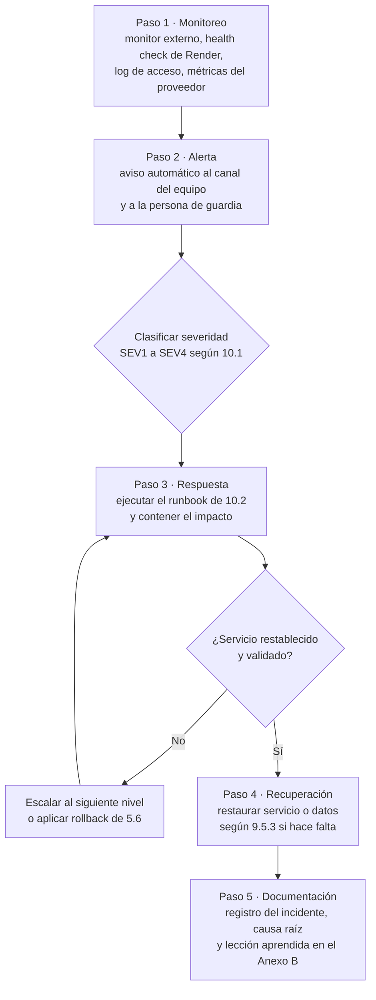

Ejemplo aplicado: el monitor externo detecta dos fallos seguidos de `/health/ready` (paso 1); avisa a la guardia (paso 2); se clasifica SEV1 porque nadie puede entrar; la guardia ejecuta el runbook RB-02, encuentra la base sin conexiones disponibles y reinicia la API para liberar el pool (paso 3); si no se recupera en 30 minutos escala al nivel 2 y evalúa restaurar (paso 4); al cerrar, registra el incidente y la lección (paso 5).

## 10. Solución de incidentes, mantenimiento y anexos

### 10.1 Gestión de incidentes

Clasificación por severidad e impacto:

| Severidad | Impacto | Respuesta objetivo | Resolución o mitigación objetivo |
|---|---|---|---|
| SEV1 · Crítica | Servicio caído o datos expuestos | 15 min | 2 h (RTO) |
| SEV2 · Alta | Función principal degradada para muchas personas | 30 min | 8 h |
| SEV3 · Media | Función secundaria afectada | 4 h hábiles | 3 días hábiles |
| SEV4 · Baja | Cosmético o con alternativa | Siguiente revisión semanal | Siguiente release |

Escalamiento y responsables por nivel (los tiempos son objetivos propuestos):

| Nivel | Quién | Qué hace | Escala cuando |
|---|---|---|---|
| N1 · Guardia | Juan Diego Calle (dueño de monitoreo y observabilidad) | Recibe la alerta, clasifica, ejecuta el runbook, comunica | El runbook no resuelve en 30 min (SEV1) o 2 h (SEV2) |
| N2 · Responsable del componente | API y lógica de la base: Camilo Rincón. App: Emmanuel Dávila. Infraestructura, disponibilidad y respaldo: Samuel Sierra | Diagnóstico de código o datos, hotfix, rollback | Requiere decisión de producto, restauración de datos o soporte del proveedor |
| N3 · Escalamiento | Camilo Rincón (Product Owner y dueño del escalamiento), con el equipo completo y el soporte de Render, Expo, Apple o Google | Decide restauración con PITR, rotación de secretos y comunicación pública | No aplica |

Comunicación: mantenimiento programado anunciado con 48 horas de anticipación por los canales del proyecto.

Lecciones aprendidas: cada incidente SEV1 o SEV2 cierra con un registro (plantilla del Anexo B) que incluye línea de tiempo, causa raíz, qué funcionó, qué no y acciones con responsable. Las lecciones que cambian un procedimiento se llevan a este manual en la siguiente versión.

### 10.2 Runbooks de incidentes

| ID | Síntoma | Diagnóstico | Acción | Validación |
|---|---|---|---|---|
| RB-01 | `/health/live` no responde | Log del servicio en Render: excepción de arranque o falta de memoria | Si es configuración, corregir la variable (el log nombra la que falta); si es código, rollback (5.6); si es memoria, reiniciar y subir de plan | `/health/live` en `Healthy` |
| RB-02 | `/health/live` bien y `/health/ready` mal | La base no responde: estado del Postgres en el proveedor, conexiones y almacenamiento | Esperar o reiniciar la base según el proveedor; si se agotó el pool, reiniciar la API; si hay corrupción o pérdida, 9.5.3 | `/health/ready` en `Healthy` y login de prueba |
| RB-03 | Tasa de 5xx mayor a 1 % | Buscar en el log las excepciones por `traceId` y la ruta afectada | Hotfix o rollback de la última versión | Tasa de 5xx de vuelta a su nivel normal durante 30 min |
| RB-04 | Los mensajes llegan solo al reabrir el chat | Conexiones al hub en el log; ¿el token vence y el hub se cierra? | Verificar que la app renueva el token; reiniciar la API si el hub no acepta conexiones | `MessageAvailable` llega con la app abierta |
| RB-05 | No llegan notificaciones push | `PUSH_ENABLED`, errores de envío a `exp.host`, receipts; estado de Expo, FCM y APNs | Corregir `EXPO_PUSH_ACCESS_TOKEN` o credenciales FCM/APNs en EAS; si el proveedor está caído, esperar (la app sigue funcionando) | Push de prueba recibido en un teléfono real |
| RB-06 | Pico de 429 o de fallos de login | Log de acceso por IP; ¿ataque o falta de `FORWARDED_TRUSTED_NETWORKS`? | Si todas las IP son la del proxy, corregir la variable; si es ataque, bloquear la IP en el proveedor | 429 solo para la IP atacante |
| RB-07 | Sospecha de compromiso de `JWT_SIGNING_KEY` | Origen de la sospecha | Generar una nueva (`openssl rand -base64 48`), cargarla en el proveedor y reiniciar; los access tokens vigentes dejan de servir. Si también se comprometieron refresh tokens, revocar las sesiones afectadas | Los tokens anteriores reciben 401; los clientes renuevan y siguen |
| RB-08 | `POST /auth/spotify` responde 502 `spotify_unavailable` o 403 | `SPOTIFY_CLIENT_ID` vacío; cuenta fuera de la lista de prueba de Spotify; redirect distinta | Definir la variable; agregar la cuenta en el Dashboard (máximo 5 en modo desarrollo); registrar exactamente `encorely://spotify-callback` | Login con Spotify de una cuenta de prueba |
| RB-09 | Reporte de contenido abusivo | Cola en `/admin`; evidencia con `Verified = true` | Resolver con descarte o suspensión; la suspensión cierra matches, revoca sesiones y veta el correo | Reporte en `Resolved` y cuenta en `Banned` si correspondía |
| RB-10 | La app muestra "Falta configurar el servidor" | `EXPO_PUBLIC_API_URL` ausente en el perfil del build | Corregir `eas.json` o `.env` y recompilar; en local, reiniciar Metro | La app llega a la pantalla de bienvenida |

### 10.3 Solución de problemas en desarrollo

Errores vistos en el proyecto, con el mensaje real.

#### 10.3.1 Problemas frecuentes del back

| Síntoma | Causa | Solución |
|---|---|---|
| `A compatible .NET SDK was not found. Requested SDK version: 10.0.402` | `dotnet` es el del sistema porque mise no está activado en esa shell | `mise exec -- dotnet …` o activar mise en `~/.zshrc` |
| La API arranca en 5000 aunque se defina `ASPNETCORE_URLS` | `appsettings.Development.json` fija `Urls` | `--urls http://127.0.0.1:<puerto>` |
| `docker compose` falla con `Define DB_PASSWORD en .env` | Falta `.env` o `DB_PASSWORD` | `cp .env.example .env` y completar |
| `dotnet-ef not found` | Herramientas locales sin restaurar | `mise exec -- dotnet tool restore` o `dnx --yes dotnet-ef@10.0.13 …` |
| `OpenApiContractTests` falla en la CI | Cambiaron endpoints o DTOs sin regenerar el contrato | `scripts/update-contract.sh` y entrada en el CHANGELOG |

#### 10.3.2 Problemas frecuentes de la app

| Síntoma | Causa | Solución |
|---|---|---|
| `node_modules` vacío o incompleto | Otro gestor (npm o yarn) sobre la instalación de pnpm | Usar solo pnpm, que es el gestor del lockfile; para solo arrancar, `npx expo start --dev-client` |
| El bundle no resuelve `@react-navigation/…` | Expo Router 56+ trae React Navigation adentro | Importar desde `expo-router/react-navigation`; no agregar el paquete |
| Metro se cae al instalar un paquete | `pnpm add` reescribe `node_modules` mientras Metro lo vigila | Parar Metro, instalar, volver a arrancar |
| `pnpm check:expo` falla con "Found outdated dependencies" | Expo publicó parches del SDK 57 después del lockfile | `pnpm exec expo install --fix` con Metro parado y verificar (10.4) |
| `pnpm gen:api` no encuentra el contrato | El back no está en `../encorly_back` | Clonar el back en la carpeta hermana |

### 10.4 Mantenimiento preventivo

| Actividad | Procedimiento | Validación |
|---|---|---|
| Actualizar paquetes NuGet | Revisar el PR de Dependabot; `dotnet build` y `dotnet test` en local | CI en verde, incluido el paso de paquetes vulnerables |
| Actualizar el SDK de Expo o sus parches | Leer las notas de la versión; parar Metro; `pnpm exec expo install --fix`; `pnpm install --frozen-lockfile` en limpio; `pnpm check:expo`, `pnpm verify`, `pnpm build:bundles`; nuevo dev build si cambió algo nativo; revisar los `overrides` de `pnpm-workspace.yaml` | Los tres comandos en verde y recorrido manual en el emulador |
| Revisar el espacio y los índices de la base | Consultas de solo lectura sobre `pg_stat_user_tables` y tamaño por tabla | Ninguna tabla crece fuera de lo esperado; purgas en 0 pendientes |
| Probar la restauración | 9.5.3 sobre una base temporal | Criterios de 9.5.3 |
| Revisar este manual | Comparar fichas con `AppDbContextModelSnapshot.cs` y la tabla de operaciones de 7.2 con el contrato | Sin diferencias |

### 10.5 Mantenimiento correctivo

Cada falla se corrige con un hotfix que empieza por una prueba que la reproduce. El cambio entra por PR y solo se despliega con la CI en verde (5.4). Un SEV1 se despliega de inmediato; el resto, en la ventana de mantenimiento de 9.2. Si la corrección toca el esquema o el contrato, se siguen los dos procedimientos siguientes. El incidente se cierra con el registro del Anexo B.

**Procedimiento para crear una migración**

Prerrequisitos: entidades o `AppDbContext` modificados; SDK de 3.3.1.

1. Restaurar las herramientas locales: `mise exec -- dotnet tool restore`.
2. Generar la migración:

   ```bash
   mise exec -- dotnet ef migrations add <Nombre> -p src/Encorely.Api -o Data/Migrations
   # si dotnet-ef no está disponible:
   mise exec -- dnx --yes dotnet-ef@10.0.13 migrations add <Nombre> -p src/Encorely.Api -o Data/Migrations
   ```

3. Revisar el diff de la migración y del `AppDbContextModelSnapshot.cs`. La fábrica de diseño usa una cadena ficticia, así que `migrations add` no necesita base ni secretos.
4. Arrancar la API en local para aplicarla y correr la suite.
5. Actualizar en el mismo PR las fichas, el diccionario, el ERD y la tabla de migraciones del capítulo 6.

Criterio de validación: el log de arranque muestra `Applying migration '<timestamp>_<Nombre>'`, `mise exec -- dotnet test tests/Encorely.Tests` pasa completo y `\d <tabla>` en `psql` coincide con la ficha actualizada.

**Procedimiento para integrar un nuevo draft del contrato**

Prerrequisitos: back en la carpeta hermana en la rama que tiene el draft; app con dependencias instaladas.

1. Leer en `../encorly_back/contracts/CHANGELOG.md` las entradas posteriores al draft integrado (hoy draft.17).
2. Regenerar los tipos de `src/lib/api/schema.d.ts`: `pnpm gen:api`.
3. `pnpm typecheck` y corregir lo que señale, empezando por `src/lib/api/types.ts`, luego `src/lib/api/endpoints.ts` y los hooks de cada feature.
4. Si el draft solo cambia comportamiento (códigos de error nuevos), buscar los `code` afectados en `src/` y en `src/lib/api/errors.ts`.
5. `pnpm verify` y recorrido manual de las pantallas afectadas.
6. Commit con el draft en el mensaje: `Integra el contrato draft.N: …`.

Criterio de validación: `pnpm gen:api` no deja diferencias sin commitear en `schema.d.ts` y `pnpm verify` pasa.

### 10.6 Pendientes técnicos conocidos

Diferencias y deudas detectadas al 2026-10-20, priorizadas. Ninguna impide la demo.

| Prioridad | Pendiente | Repositorio |
|---|---|---|
| Importante | La CI de la app no corre en `Dev` (solo `main` y `rebuild/v1`), y al activarla fallaría en `pnpm check:expo` por 8 parches pendientes del SDK 57 | `encorely-front` |
| Importante | `/swagger` responde 401 en `Development`: `UseSwaggerUI` se registra después de la autorización. `/openapi/v1.json` sí funciona | `encorly_back` |
| Importante | No hay registro de borrados de cuenta para repetirlos tras una restauración (9.5.1) | `encorly_back` |
| Importante | No hay mecanismo de avisos dentro de la app para mantenimientos o incidentes | `encorely-front` |

### 10.7 Anexo A. Glosario

| Término | Definición |
|---|---|
| AAD | Datos autenticados adicionales: se verifican al descifrar pero no se cifran |
| Ack | Confirmación de entrega del receptor; el servidor borra lo confirmado |
| Advisory lock | Bloqueo de PostgreSQL por clave numérica, usado para serializar operaciones sin fila natural |
| CI | Integración continua (GitHub Actions) |
| Draft del contrato | Versión `v1.0.0-draft.N` del OpenAPI, registrada en el CHANGELOG |
| E2EE | Cifrado de extremo a extremo: solo los teléfonos de la conversación pueden leer los mensajes |
| EAS | Expo Application Services: compilación y envío de la app a las tiendas |
| Franking | Compromiso criptográfico que permite verificar un mensaje reportado |
| JWT | Token firmado que identifica a la persona en cada petición |
| PITR | Recuperación de la base a un punto en el tiempo |
| PKCE | Variante de OAuth sin secreto de cliente, para apps móviles |
| RPO | Pérdida máxima de datos tolerable, medida en tiempo |
| RTO | Tiempo máximo aceptable para restaurar el servicio |
| SecureStore | Almacén cifrado del sistema operativo (Keychain o Keystore) expuesto por Expo |
| SignalR | Librería de tiempo real de ASP.NET Core sobre WebSocket |
| SLA | Acuerdo de nivel de servicio; aquí, objetivo interno de disponibilidad |
| SQLCipher | SQLite cifrado, usado para el historial del chat en el teléfono |

### 10.8 Anexo B. Plantillas de aceptación e incidentes

**Informe de aceptación del despliegue**

| Campo | Valor |
|---|---|
| Versión desplegada | API `api-v<x.y.z>` (commit `<sha>`) · App `<versión>` (build `<n>`) |
| Ambiente | Staging / Producción |
| Fecha y ventana | `<AAAA-MM-DD hh:mm>` a `<hh:mm>` (UTC-5) |
| Ejecutado por | `<nombres>`; responsable de las pruebas de aceptación: Juan Diego Calle (QA) |

| Caso | Resultado esperado | Resultado (pasa / falla) | Evidencia |
|---|---|---|---|
| Health checks | `/health/live` y `/health/ready` en `Healthy` | | |
| Registro y onboarding (Maestro 01) | La cuenta nueva llega a Descubrir | | |
| Calificar canciones (Maestro 02) | El ADN cambia | | |
| Asistencia y radar (Maestro 03) | Radar visible o estado vacío correcto | | |
| Chat cifrado (Maestro 04) | El mensaje llega y se descifra | | |
| Bloquear (Maestro 05) | La persona aparece en bloqueadas | | |
| Borrar cuenta (Maestro 06) | La cuenta deja de existir | | |
| Push en teléfono real | Llega el aviso sin contenido | | |
| Cabeceras de seguridad | `Cache-Control: no-store` en `/api` | | |
| Páginas legales | `/legal/privacidad` y `/cuenta/eliminar` en https | | |

Decisión: Aceptado / Rechazado (motivo). Firman Juan Diego Calle (QA) y Camilo Rincón (Product Owner) · Fecha: `<AAAA-MM-DD>`.

**Registro de incidente y lección aprendida**

| Campo | Contenido |
|---|---|
| ID y severidad | `INC-<AAAA>-<nnn>` · SEV1 a SEV4 |
| Detección | Cómo y cuándo se detectó (alerta, reporte de usuario) |
| Línea de tiempo | Detección, alerta, respuesta, mitigación, cierre (hora UTC-5) |
| Impacto | Personas y funciones afectadas, duración |
| Causa raíz | Qué falló y por qué |
| Runbook usado | RB-xx o "ninguno" |
| Qué funcionó y qué no | |
| Acciones | Acción, responsable (nombre), fecha límite |
| Cambio en el manual | Sección afectada y versión del documento |
